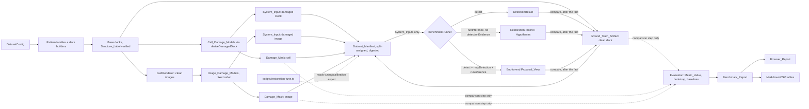

# Design Document

## Overview

This document designs the Benchmark_Suite: a deterministic, headless, network-free evaluation library in `src/benchmark`, with command-line entry points in `scripts/`, implementing `benchmark-and-evaluation/requirements.md` (requirements 1-28). It is the fourth of five specs. It generates synthetic datasets with known ground truth, runs the detection and restoration components under test, compares their output with truth, and writes versioned, canonical, browser-consumable reports that the fifth (UI) spec reads.

Design principles, carried from the three approved sibling designs and from steering:

1. **Every number traces to a recorded run.** A `Metric_Value` is either `{defined, value, ...}` or `{undefined, reason}`. Nothing is silently `0`, `1` or `NaN`. Every report carries dataset version, seed, split, sample size and component versions.
2. **Ground truth never reaches the system under test.** `System_Input` types cannot structurally carry a truth value. Truth and damage masks live in physically separate files, read only after the system has produced its output.
3. **Deterministic by construction.** No `Math.random`, `Date`, network access or environment-dependent value in any dataset- or report-producing function. Every seed is derived from the dataset root seed and documented identifying keys through one pure function.
4. **Splits are by design family, not by item.** A Deck_Family (one base design) belongs to exactly one Split_Role. A sealed `test` role is read only once the Threshold_Register is frozen.
5. **No threshold is invented.** Every acceptance threshold starts `not set` in the Threshold_Register and is set only from a recorded Preliminary_Experiment that read `tuning`, `calibration` or `held-out` data.
6. **Reuse, never redefine, upstream contracts.** The Benchmark_Suite imports `MachineProfile`, `Deck`, `deriveDamagedDeck`, `compareCells` and the canonical-JSON conventions from the domain; `detect`, `DetectionResult`, `mapDetection`, the detection metric functions from vision; `runInference`, the masking contract, `PriorMeasurement`, `CalibrationRecord` from restoration. It never duplicates one of their types.
7. **Synthetic results describe the generator.** Every report carries the fixed statement that synthetic accuracy does not predict accuracy on historical cards, and that a family's Structure_Label is a property of the generator, not evidence of historical prevalence.

Research summary (no external research needed; sources are the four spec documents already approved or in draft, and the project steering files):
- Domain contract: `card-domain-and-loom-engine/design.md` -- `Deck`, `Card`, `Cell`, `MachineProfile`, `RandomFn`, `DamageFn`, `deriveDamagedDeck`, `compareCells`, `deckEquals`, `readIndexToGrid`, `gridToReadIndex`, `bitmapToDeck`, the canonical-JSON writer convention (`io/canonicalJson.ts`), `fnv1a64`/`DIGEST_ALGORITHM`, `Result`, `LIMITS.maxCardsPerDeck = 10000`.
- Detection contract: `card-detection/design.md` and its `requirements.md` -- `detect`, `DetectionResult`, `DetectionParameters` (`unknownCoverFrac` default), `mapDetection`, `CardDetectionRecord`, `compareDetectionToTruth`, `evaluation/metrics.ts` (presence accuracy, coverage, Brier, ECE, alignment success rate, corner error), the `src/vision/__tests__/synthetic` renderer and `loadDamageLevels`/`DamageLevelDefinition` placeholder interface, intake limits.
- Restoration contract: `restoration-engine/design.md` and its `requirements.md` -- `RestorationInput`, `RestorationConfig`, `DetectionEvidenceInput` (structural, no vision import), `maskCell`/`isMasked`, `Hypothesis`, `Abstention`, `ABSTENTION_REASONS`, `PriorMeasurement`, `CalibrationRecord` (histogram-binning, 10 bins), `scripts/restoration-tune.ts`'s minimal JSON dataset format, `shortRegionBound` config field, whole-card recovery stretch feature.
- Steering: `tech.md` (TypeScript strict, Vitest/fast-check, no Node-only API in browser-read code, Python only under `/research`), `structure.md` (dependency direction `ui -> restore, vision, benchmark -> domain`; new top-level folders need `structure.md` updated first), `testing-standards.md` (explicit seeds, bounded `numRuns`, stated preconditions, goldens in version control, synthetic/real separation, no tuning on held-out data), `restoration-principles.md` (confidence calibration must be stated, not assumed), `product.md` (resurrection framing, honesty rules, non-goals).

### Decisions carried from the approved requirements.md

| ID | Decision | Source |
|----|----------|--------|
| Baselines | Exactly three Baselines (B1 deck-majority, B2 column-majority, B3 nearest-neighbour). `B0 abstain-all` is a test fixture only, never a reported baseline. | Req 16 |
| Occlusion_Cover_Fraction | A per-Cell_Window coverage fraction, initial value 0.9, bounds `(0.5, 1]`, at least `unknownCoverFrac`, marked `initial-unconfirmed` until Preliminary_Experiment E-2 confirms or revises it. Distinct from `occlusionCoverage` (Occlusion_Extent), a per-level cap on the *fraction of a card's cells* the occlusion model may damage, strictly below 1, non-decreasing, zero at `none`. | Req 7 |
| Split roles | Four roles: `tuning`, `calibration`, `held-out`, `test` (sealed). | Req 10, Q1 resolved to four roles |
| Renderer ownership | `src/benchmark` owns the full benchmark renderer; `src/vision/__tests__/synthetic` keeps its own smaller generator for detection's own unit/property tests; both read the same `Damage_Level_File` as data. | Req 4, Q2 |
| User comparison | Protocol defined; default report status `not-conducted` with no time-saving number unless a valid study result file is imported. | Req 19, Q6 |

### Out of scope

The React UI (consumes this spec's output but is not built here), the detector and restoration algorithms themselves (only invoked), physical loom control, training of learned models, any server or network service, any claim about historical card prevalence, Python tooling (this spec's scripts are TypeScript because they call `src/domain`/`src/vision`/`src/restore`, which `/research` must not depend on; see [CONFIRM] Q2 below, inherited from the sibling specs' own open question).

## Architecture

### Module layout

```
src/benchmark/
  index.ts                      single public export surface, BENCHMARK_INTERFACE_VERSION
  result.ts                     BenchmarkResult, BenchmarkError, BENCHMARK_ERROR_CODES/MESSAGES
  limits.ts                     BENCHMARK_LIMITS, ExecutionProfile bounds (quick, full)
  canonicalJson.ts               re-export of a benchmark-local canonical writer matching the domain's
                                 convention (stable key order, two-space indent, \n, no timestamps)
  seed.ts                       deriveSeed (root seed + keys -> child seed), PRNG (mulberry32)
  families/
    patternFamilies.ts          Pattern_Family registry, Structure_Label rules, family key derivation
    deckBuilders.ts             periodic, periodic-perturbed, card-mirror, within-card-mirror,
                                 periodic-and-mirror, random, sparse-or-constant, bitmap-derived
    labelCheck.ts                independent Structure_Label verifier (not the restoration Evidence_Test)
    withinCardPartner.ts         benchmark's own partner-mapping definition + conformance check against
                                 restoration's symmetry.ts mapping (Req 2.4)
  render/
    cardRenderer.ts              renderCleanCardImage (seeded, deterministic, PNG/JPEG/WebP)
    rendererTypes.ts             RenderedCardImage, RenderParameters
  damage/
    damageLevelFile.ts            DamageLevelFile schema, loadDamageLevelFile, validateDamageLevelFile
    cellDamageModels.ts           random-cells, consecutive-run, strip, missing-cards (as DamageFn factories)
    imageDamageModels.ts          illumination-gradient, shadow, stain, cord, patch, tear, blur, noise,
                                   rotation, perspective, occlusion (fixed order, Req 6.2)
    damageMask.ts                 Damage_Mask type, recording helpers
  dataset/
    manifest.ts                   Dataset_Manifest type, build + verify + reproduce
    familyBuilder.ts               Deck_Family construction, Family_Key, seed derivation per item
    splitAssignment.ts             Split_Role assignment by stratified deterministic rule
    datasetBuilder.ts              DatasetBuilder.build(config) orchestration
    leakageGuard.ts                 static + runtime leakage checks (Req 8)
  evaluation/
    evaluationGroup.ts              Evaluation_Group definitions and cell-set builders
    metricValue.ts                  Metric_Value type, defined/undefined helpers
    detectionMetrics.ts              precision, recall(answered/all), accuracy(answered/all), coverage;
                                     delegates shared definitions to vision's evaluation/metrics.ts
    restorationMetrics.ts            accuracy(all/damaged), per-provenance, abstention rate, top-1/top-3,
                                     whole-card recovery rate
    calibrationMetrics.ts            Brier, ECE (binning), Reliability_Data
    bootstrap.ts                     Cluster_Bootstrap (resample Deck_Families), paired difference
    baselines.ts                     B1 deck-majority, B2 column-majority, B3 nearest-neighbour,
                                     B0 abstain-all (test fixture only, not exported from index)
    evaluationPolicy.ts               Proposal_View construction (Req 17.1)
  tracks/
    detectionTrack.ts
    restorationTrack.ts
    endToEndTrack.ts
    realPhotographTrack.ts
  runner/
    benchmarkRunner.ts              BenchmarkRunner.run(profile, config): orchestrates tracks, budget,
                                     Component_Stamp, writes Benchmark_Report
    executionProfile.ts              ExecutionProfile ("quick" | "full"), bound tables
  threshold/
    thresholdRegister.ts             ThresholdRegister type, draft/frozen state, status evaluation
    preliminaryExperiment.ts          PreliminaryExperiment record type (E-1..E-7)
  report/
    benchmarkReport.ts                BenchmarkReport schema, export/import, invariant checks
    browserReport.ts                  BrowserReport (size-limited), reportReader (browser-safe)
    tables.ts                         Markdown/CSV table generation (pure functions of a report)
    failureExamples.ts                 deterministic failure-example selection
  userStudy/
    protocol.ts                       UserComparisonProtocol constants/doc anchors
    studyResult.ts                     StudyResultFile schema, validating importer
  adapters/
    restorationTuneExport.ts           writes restoration's minimal tune-dataset JSON format
    calibrationExport.ts               writes/validates restoration CalibrationRecord + PriorMeasurement
    damageLevelForDetection.ts          re-exports the Damage_Level_File as the exact shape
                                       detection's loadDamageLevels(json) validates
  __tests__/
    generators.ts, golden/, *.test.ts
scripts/
  benchmark-build-dataset.ts        CLI: build a dataset from a config for a given profile
  benchmark-run.ts                  CLI: run tracks over a dataset, write reports and tables
  benchmark-export-tuning.ts        CLI: write restoration tune-dataset + calibration/prior artifacts
  benchmark-freeze-thresholds.ts    CLI: flip the Threshold_Register from draft to frozen
  benchmark-browser-report.ts       CLI: produce/update the committed quick-profile Browser_Report
docs/
  benchmark-metrics.md              metric definitions, groups, undefined conditions (Req 12.1)
  benchmark-errors.md               error registry (Req 25.4)
  benchmark-data-handling.md        data kinds, storage, commit policy (Req 26.6)
  benchmark-user-comparison.md      User_Comparison_Protocol (Req 19.1)
data/
  benchmark/
    experiments/                   committed Preliminary_Experiment reports (E-1..E-7), canonical JSON
    threshold-register.json        committed Threshold_Register
    fixtures/                      small committed quick-profile manifests/reports for golden tests
  synthetic/
    damage-levels.json              the Damage_Level_File (supersedes the placeholder; Req 7.7)
  generated/                        gitignored: full datasets, images (Req 22.7)
```

No new top-level folder is introduced. `scripts` is a pre-existing proposal from the sibling specs (card-detection design Q6, restoration-engine design Q7); this design reuses it rather than inventing a second mechanism. `data/benchmark` and `data/generated` are sub-folders of the existing `data` folder and need no `structure.md` change beyond the `scripts` entry the sibling specs already flagged. See [CONFIRM] Q2.

### Dependency rule and import-boundary test

- `src/benchmark` imports `src/domain`, `src/vision` and `src/restore` only through their public `index.ts`. It never imports `src/vision/__tests__` (that is detection's own test-only generator) or any non-index module of another source folder.
- `src/domain`, `src/vision`, `src/restore` and `src/workers` never import `src/benchmark`.
- `src/ui` may import `src/benchmark` (not built in this spec).
- `scripts/` may import any of the above.
- A file in the Report_Reader path (`report/browserReport.ts` and everything it statically imports) uses no Node-only API, so `src/ui` can load it in the browser.

`src/benchmark/__tests__/boundary.test.ts`, using the TypeScript compiler API exactly as the domain, vision and restoration boundary tests do, fails on:
- an import specifier in `src/benchmark` resolving to `src/ui`, `src/vision/__tests__`, or a non-index module of `src/domain`/`src/vision`/`src/restore`;
- any file in `src/domain`, `src/vision`, `src/restore` or `src/workers` importing from `src/benchmark` (checked by scanning those trees from the benchmark side, mirroring the reverse-edge checks the domain and vision boundary tests already perform);
- a file in the Report_Reader path importing a Node-only module (`fs`, `path`, `crypto` with Node-specific APIs, etc. -- an explicit disallowed-module list, checked by import specifier);
- the forbidden identifiers `document`, `window`, `fetch`, `Date`, `Math.random`, `performance.now`, `setTimeout`, `setInterval` in any file that contributes to building a dataset or a report, excepting the one runtime-measurement module (`runner/runtimeFile.ts`, introduced in the Runner section) that writes only the excluded-from-digest runtime file (Req 27.4).
- a System_Input directory containing a file named or typed as ground truth, and a module in the evaluation-input construction path importing a module that reads a Ground_Truth_Artifact (Req 8.7, detailed under "Leakage guard").

A negative self-test feeds the scanner an in-memory violating source and expects failure, matching the sibling boundary tests' own convention.

### Data flow



## Components and Interfaces

All code below is a type or signature contract, or short pseudocode, not an implementation.

### Result and errors

```ts
export type BenchmarkResult<T, E extends BenchmarkError = BenchmarkError> =
  | { readonly ok: true; readonly value: T }
  | { readonly ok: false; readonly error: E };

export interface BenchmarkError {
  readonly code: BenchmarkErrorCode;         // member of BENCHMARK_ERROR_CODES (closed tuple)
  readonly message: string;                   // stable text from BENCHMARK_ERROR_MESSAGES[code]
  readonly path?: string;
  readonly domainCode?: string;               // present when code === "DOMAIN_RULE_REJECTED"-style wraps
}

export const BENCHMARK_ERROR_CODES = [
  "INVALID_DATASET_CONFIG", "INVALID_DAMAGE_PARAMETERS", "INVALID_DAMAGE_LEVELS", "DAMAGE_TOO_SEVERE",
  "PATTERN_LABEL_MISMATCH", "RENDER_OUT_OF_LIMITS", "SPLIT_STRATUM_TOO_SMALL", "SPLIT_ROLE_FORBIDDEN",
  "LEAKAGE_DETECTED", "DATASET_DIGEST_MISMATCH", "DATASET_NOT_REPRODUCIBLE", "BASELINE_SPLIT_MISMATCH",
  "REAL_DATA_NOT_LICENSED", "INVALID_STUDY_RESULT", "LIMIT_EXCEEDED", "BUDGET_EXCEEDED",
  "OUTPUT_DIRECTORY_INVALID", "REPORT_TOO_LARGE", "COMPONENT_VERSION_UNSUPPORTED", "INVALID_REPORT",
  "INPUT_TOO_LARGE", "INVALID_JSON", "INVALID_FORMAT", "UNSUPPORTED_SCHEMA_VERSION", "UNKNOWN_FIELD",
  "INVALID_THRESHOLD_REGISTER", "REGISTER_NOT_FROZEN",
] as const;
export type BenchmarkErrorCode = typeof BENCHMARK_ERROR_CODES[number];
```

This mirrors the `VisionResult`/`RestorationResult` pattern: a closed union with the same field names as the domain `Result`, never extending the domain `ErrorCode` union (Req 25.2). The registry exactly matches requirement 25.1's minimum list; no code is added or removed beyond what the requirement names.

### Seeding and determinism

```ts
export type RandomFn = () => number;   // matches the domain's own RandomFn shape, [0,1)

/** mulberry32: a small, fast, deterministic PRNG. Chosen because it needs no library dependency,
 *  produces reproducible output across Node and browser from a 32-bit integer seed, and is already
 *  the precedent used by card-detection's synthetic renderer (`__tests__/synthetic/renderer.ts`). */
export function makeRng(seed: number): RandomFn;

/** Derives a child seed from the dataset root seed and an ordered list of identifying keys, by
 *  FNV-1a-64 hashing their canonical-JSON-joined string form and truncating to a 32-bit unsigned
 *  integer. Adding a new Family or Item never changes the seed of an existing one, because each
 *  seed depends only on its own keys, never on enumeration order or sibling count (Req 9.3). */
export function deriveSeed(rootSeed: number, keys: readonly (string | number)[]): number;
```

No function that builds a dataset or a report calls `Math.random`, `Date.now`, `Date`, `fetch` or any clock. Every seed consumed anywhere (deck builder, renderer, cell/image damage model, bootstrap resampler) is either the dataset root seed or a value returned by `deriveSeed`.

### Pattern families and Structure_Label (requirement 2)

```ts
export type PatternFamilyKind =
  | "periodic" | "periodic-perturbed" | "card-mirror" | "within-card-mirror" | "periodic-and-mirror"
  | "random" | "sparse-or-constant" | "bitmap-derived";

export type StructuralPriorKind = "repeat" | "symmetry";              // reused by name from restoration
export type StructureLabel = "helpful" | "non-helpful" | "partially-helpful";

export interface PatternFamilyParameters {
  readonly kind: PatternFamilyKind;
  // kind-specific fields, each with a documented range:
  readonly period?: number;                        // periodic, periodic-perturbed, periodic-and-mirror
  readonly perturbationFraction?: number;           // periodic-perturbed: [0,1)
  readonly axisKind?: "card-sequence" | "within-card";   // card-mirror, within-card-mirror, periodic-and-mirror
  readonly axisPosition?: number;                  // card-mirror, periodic-and-mirror: integer or half-integer
  readonly bitmapName?: "stripes" | "checkerboard" | "diamonds" | "seeded-noise";   // bitmap-derived
  readonly density?: number;                       // sparse-or-constant: within degenerateDensityMargin of 0 or 1
}

export interface FamilyKey {
  readonly patternFamily: PatternFamilyKind;
  readonly parametersId: string;                   // canonical-JSON digest of PatternFamilyParameters
  readonly baseDeckSeed: number;
  readonly profileId: string;
}
export function familyKeyString(key: FamilyKey): string;   // stable string form used as a map key and in reports

export interface StructureLabels { readonly repeat: StructureLabel; readonly symmetry: StructureLabel }

export const FAMILY_STRUCTURE_LABELS: Readonly<Record<PatternFamilyKind, (p: PatternFamilyParameters) => StructureLabels>>;
// periodic -> { repeat: "helpful", symmetry: "non-helpful" }
// periodic-perturbed -> { repeat: "partially-helpful" (perturbationFraction recorded), symmetry: "non-helpful" }
// card-mirror -> { repeat: "non-helpful", symmetry: "helpful" }  (axisKind "card-sequence")
// within-card-mirror -> { repeat: "non-helpful", symmetry: "helpful" }  (axisKind "within-card")
// periodic-and-mirror -> { repeat: "helpful", symmetry: "helpful" }
// random -> { repeat: "non-helpful", symmetry: "non-helpful" }
// sparse-or-constant -> { repeat: "non-helpful", symmetry: "non-helpful" }
// bitmap-derived -> { repeat: "non-helpful", symmetry: "non-helpful" }   // named bitmaps carry no induced period/symmetry

export function buildBaseDeck(profile: MachineProfile, params: PatternFamilyParameters, cardCount: number, seed: number): BenchmarkResult<Deck>;
export function verifyStructureLabel(deck: Deck, expected: StructureLabels, config: LabelCheckConfig): BenchmarkResult<void>;
// runs an INDEPENDENT statistical check (plain agreement-rate counting, NOT restoration's Evidence_Test):
// for "helpful"/"partially-helpful" repeat: at the declared period, agreement rate across trusted-equivalent
//   (i.e. all, since base decks have no masking yet) cells exceeds a documented margin over the Chance_Baseline;
// for "non-helpful": no period in [1, maxPeriodChecked] exceeds that margin.
// A mismatch returns PATTERN_LABEL_MISMATCH naming the family and the measured value (Req 2.3).
```

`buildBaseDeck` dispatches to `families/deckBuilders.ts`, one pure function per `PatternFamilyKind`, each taking only `(profile, params, cardCount, seed)` and using only `makeRng(seed)` internally -- never `Math.random` (Req 9.2). `periodic` picks one random row pattern per residue class modulo `period` and copies it to every card of that residue (Req 2.1). `card-mirror` builds card `i` and card `c - i` as identical rows for an axis position `c`. `within-card-mirror` builds each card so every `readIndex` equals the value at `withinCardPartner(profile, readIndex)` (see below). `bitmap-derived` calls the domain's own `bitmapToDeck` on a named bitmap generator (`stripes`, `checkerboard`, `diamonds`, or `seeded-noise` built from `makeRng(seed)`), never duplicating `bitmapToDeck`'s logic (Req 2.1).

**Within-card partner mapping and conformance** (Req 2.4):

```ts
export function withinCardPartner(profile: MachineProfile, readIndex: number): number;
// Benchmark's OWN definition, documented in docs/benchmark-metrics.md, used only to BUILD within-card-mirror
// base decks. It is intentionally the same placeholder reflection-about-read-order-midpoint that
// restoration-engine/design.md's symmetry.ts documents for Garin, because both must agree for the
// "helpful" label to be honest -- NOT because benchmark imports or calls restoration's function.

export function checkWithinCardPartnerConformance(
  profile: MachineProfile,
  restorationPartnerFn: (profile: MachineProfile, readIndex: number) => number
): BenchmarkResult<void>;
// a TEST-ONLY function (never called by dataset building) that a conformance test imports restoration's
// symmetry.ts partner function into and compares pointwise against withinCardPartner for every readIndex.
// A difference is a TEST FAILURE, never a silent adjustment (Req 2.4's literal requirement).
```

The conformance test lives in `src/benchmark/__tests__/withinCardPartnerConformance.test.ts` and is the one place in the whole codebase where a benchmark test file is permitted to import a restoration *internal* module (not through the public index) for comparison purposes only; this is a documented, narrow exception recorded in the boundary test's own allow-list, not a production dependency. See [CONFIRM] Q1.

### Machine profiles (requirement 3)

```ts
export function datasetProfiles(): { readonly garin: MachineProfile; readonly generated: (seed: number) => MachineProfile };
// garin: GARIN_PROFILE re-exported by reference, imported through the domain index, never redefined.
// generated(seed): a profile with gridRows in [3,12], gridColumns in [2,8], chosen deterministically
// from `seed` via makeRng, passed through the domain's own validateProfile before use.
```

Every Benchmark_Report groups metrics by `profileId` (Req 3.2) and copies `profile.verification` into the Dataset_Manifest and every report (Req 3.3, 3.4). A profile that fails `validateProfile` returns `INVALID_DATASET_CONFIG` wrapping the domain error code and path (Req 3.5), before any generation starts.

### Clean image rendering (requirement 4)

```ts
export interface RenderParameters {
  readonly rendererVersion: string;
  readonly imageFormat: "png" | "jpeg" | "webp";
  readonly imageWidthPx: number; readonly imageHeightPx: number;
  readonly cardFillColour: string; readonly backgroundColour: string;
  readonly holePolarity: "holes-brighter" | "holes-darker";
  readonly appliedOrientation: 0 | 90 | 180 | 270;
}
export interface RenderedCardImage {
  readonly bytes: Uint8Array;
  readonly trueCardQuadrilateral: readonly [ImagePointLike, ImagePointLike, ImagePointLike, ImagePointLike];
  readonly renderParameters: RenderParameters;
  readonly digest: { readonly algorithm: "sha-256"; readonly hex: string };
}
export interface ImagePointLike { readonly imageX: number; readonly imageY: number }  // structural match to vision's ImagePoint

export function renderCleanCardImage(deck: Deck, cardId: string, profile: MachineProfile, params: Omit<RenderParameters, "rendererVersion">, seed: number): BenchmarkResult<RenderedCardImage>;
```

`renderCleanCardImage` is the Benchmark_Suite's own renderer, structurally independent of `src/vision/__tests__/synthetic/renderer.ts` (no import either way; Req 4.2, 4.3) but consistent with it through three shared mechanisms (Req 4.4): (a) both read the same `Damage_Level_File` as data; (b) both use the same documented parameter names and units (recorded once in `docs/benchmark-metrics.md` and referenced by detection's `docs/vision-methods.md`); (c) a conformance test in `src/benchmark/__tests__/rendererConformance.test.ts` renders clean cards at documented sizes, calls the public `detect` function (through the vision index, never `__tests__`), and asserts `alignment.status === "aligned"` and that `compareDetectionToTruth` recovers every cell's bit with the tolerance that Preliminary_Experiment E-1 records (initially `0` mismatched cells on a clean image; E-1 confirms or revises).

Images render no larger than detection's `Intake_Limits` defaults and in a format `detect` accepts (Req 4.6); an image outside those limits returns `RENDER_OUT_OF_LIMITS` naming the limit, and no artifact is written for that Item (Req 4.7). Rendering is seeded and deterministic: equal inputs and an equal `rendererVersion` give byte-identical bytes (Req 4.8).

### Damage levels and the Damage_Level_File (requirement 7)

```ts
export interface CellDamageLevelParameters {
  readonly maskFraction: number;                    // [0,1)
  readonly runLengthRange: readonly [number, number];
  readonly stripWidthRange: readonly [number, number];
  readonly stripCardRange: readonly [number, number];
  readonly missingCardFraction: number;             // [0,1)
}
export interface ImageDamageLevelParameters {
  readonly blurSigmaPx: number; readonly noiseSigma: number; readonly illuminationGradient: number;
  readonly perspectiveDeg: number; readonly rotationDeg: number;
  readonly stainCoverage: number; readonly cordCoverage: number; readonly tearCoverage: number;
  readonly occlusionCoverage: number;               // the Occlusion_Extent: cap on fraction of a card's
                                                      // readable Cell_Windows the occlusion model may damage
}
export type DamageLevelName = "none" | "light" | "moderate" | "heavy";
export interface DamageLevelDefinition {
  readonly level: DamageLevelName;
  readonly cell: CellDamageLevelParameters;
  readonly image: ImageDamageLevelParameters;
  readonly confirmedBy: string | "initial-unconfirmed";   // experiment id, e.g. "E-2", or the literal marker
}
export interface DamageLevelFile {
  readonly format: "loom-lazarus-damage-levels";
  readonly schemaVersion: 1;
  readonly damageLevelVersion: string;
  readonly source: "benchmark-and-evaluation requirements.md requirement 7";
  readonly occlusionCoverFraction: number;           // the single file-level, per-Cell_Window fraction;
                                                      // initial 0.9; bounds (0.5, 1]; see note below
  readonly occlusionCoverFractionConfirmedBy: string | "initial-unconfirmed";
  readonly levels: readonly [DamageLevelDefinition, DamageLevelDefinition, DamageLevelDefinition, DamageLevelDefinition];  // none, light, moderate, heavy, in that order
}

export function validateDamageLevelFile(json: unknown, unknownCoverFrac: number): BenchmarkResult<DamageLevelFile>;
export function loadDamageLevelFile(path: string): BenchmarkResult<DamageLevelFile>;   // Node-only; scripts use this
```

`occlusionCoverFraction` and `occlusionCoverage` (per level, the Occlusion_Extent) are deliberately two different fields with two different meanings, exactly as the glossary of requirements.md distinguishes them: the first is "how much of ONE cell's window must be covered before detection must call it unknown", the second is "what fraction of a card's cells the occlusion model is allowed to damage at this level". `validateDamageLevelFile` checks, in order (first failure returns `INVALID_DAMAGE_LEVELS` naming the path, Req 7.9):
1. `format`, `schemaVersion`, no unknown field;
2. `occlusionCoverFraction` in `(0.5, 1]` and `>= unknownCoverFrac` (the caller passes detection's current default so the file cannot silently drift below it);
3. for every numeric field across the four levels (both `cell` and `image` groups), non-decreasing from `none` to `heavy`;
4. every field of `none` equals `0` (an exception is carved for `occlusionCoverFraction` itself, which is file-level, not per-level, and is never `0`);
5. no two levels have an identical full parameter set;
6. every `occlusionCoverage` (per level) is in `[0, 1)`, non-decreasing, and equals `0` at `none`.

The file replaces `data/synthetic/damage-levels.placeholder.json` (Req 7.7); `adapters/damageLevelForDetection.ts` re-exports exactly the shape detection's `loadDamageLevels(json)` validates, so detection's loader needs no change beyond reading a different (non-placeholder) file at the same path (`data/synthetic/damage-levels.json`), consistent with the amendment list below. The `Cell_Damage_Models` are exposed as `DamageFn` factories (`cellDamageModelFactory(kind, level, seed): DamageFn`) so any caller, including a sibling spec's own test, can reproduce a benchmark-damaged deck without importing the `BenchmarkRunner` (Req 7.10).

### Cell-level damage models (requirement 5)

```ts
export type CellDamageModelKind = "random-cells" | "consecutive-run" | "strip" | "missing-cards";

export function cellDamageModelFactory(
  kind: CellDamageModelKind, params: CellDamageLevelParameters, shortRegionBound: number, seed: number
): BenchmarkResult<DamageFn>;    // DamageFn imported by name from the domain index

export interface DamageMaskEntry { readonly cardId: string; readonly readIndex: number; readonly modelKind: CellDamageModelKind | ImageDamageModelKind; readonly parameters: Readonly<Record<string, number>> }
export interface CellDamageMask { readonly entries: readonly DamageMaskEntry[] }   // one entry per masked cell
```

Each factory returns a `DamageFn` (the domain's own type: `(rng: RandomFn, ctx: { cardId, readIndex, raw }) => RawObservation`) built so that masking a cell means returning `{}` (no `value`, no `holeLikelihood`) -- exactly the restoration masking contract (Req 5.3). Callers pass the factory's `DamageFn` and a `makeRng(deriveSeed(...))` directly to the domain's `deriveDamagedDeck`; the benchmark never bypasses it to touch a Deck directly (Req 5.2, 5.8). `consecutive-run` and `strip` draw run lengths from `runLengthRange`/`stripWidthRange`, which `familyBuilder.ts` constructs so that, across the four damage levels, at least one configured value falls at or below `shortRegionBound` (restoration's config value, passed in, never hard-coded) and at least one falls above it, so both the Hypothesis path and the `REGION_TOO_LARGE` abstention path are exercised across the damage-level sweep (Req 5.4). `missing-cards` selects whole cards; `random-cells` selects a uniform-random subset of size `maskFraction * readableCount`. All four compose in the fixed order random-cells, then consecutive-run, then strip, then missing-cards when more than one is configured for one Item (Req 5.5); each applied model and its resolved parameters are appended to the `CellDamageMask`. `DAMAGE_TOO_SEVERE` is returned, naming the configured minimum Trusted-cell count, before any damage is applied, if the combined parameters would leave fewer Trusted cells than that minimum (Req 5.6). `INVALID_DAMAGE_PARAMETERS` is returned, naming the parameter and its range, for any out-of-range value, before any damage is applied (Req 5.9). The Clean_Ground_Truth deck passed to `deriveDamagedDeck` is left deeply equal to its value before the call, because the domain function already guarantees this (Req 5.8 is inherited, not re-implemented).

### Image-level damage models (requirement 6)

```ts
export type ImageDamageModelKind =
  | "illumination-gradient" | "shadow" | "stain" | "cord" | "patch" | "tear"
  | "occlusion" | "rotation" | "perspective" | "blur" | "noise";

export const IMAGE_DAMAGE_ORDER: readonly ImageDamageModelKind[] =
  ["illumination-gradient", "shadow", "stain", "cord", "patch", "tear", "occlusion", "rotation", "perspective", "blur", "noise"];

export interface ImageDamageMaskEntry {
  readonly modelKind: ImageDamageModelKind;
  readonly polygonImageCoords: readonly ImagePointLike[];
  readonly overlappingReadIndexes: readonly number[];      // Cell_Window overlap >= documented overlap fraction
  readonly parameters: Readonly<Record<string, number>>;
}
export function applyImageDamage(
  clean: RenderedCardImage, levels: ImageDamageLevelParameters, profile: MachineProfile, seed: number
): BenchmarkResult<{ readonly damaged: RenderedCardImage; readonly mask: readonly ImageDamageMaskEntry[] }>;
```

`applyImageDamage` applies every configured model strictly in `IMAGE_DAMAGE_ORDER` (Req 6.2), never mutates the input `RenderedCardImage` (Req 6.6), and is deterministic for identical seeds, images and parameters (Req 6.5). The `occlusion` model paints a solid-colour cover over chosen cell windows chosen so that the fraction of a card's readable Cell_Windows covered does not exceed `levels.occlusionCoverage` for that Item (checked by a dedicated property, see Property 13 below); the `Occlusion_Cover_Fraction` from the `DamageLevelFile` (not `levels`) is the per-window threshold a *human reader of the benchmark report* (and detection's own `unknownCoverFrac` semantics) use to judge whether a given occluded cell "should" become `unknown` -- the image model itself only needs to know, and only records, the actual per-window covered fraction it achieved, in `ImageDamageMaskEntry.parameters.coveredFraction`. Each damaging element records its polygon in image coordinates and the overlapping `readIndex` set at the documented overlap fraction (Req 6.3); the suite documents, for each model, its meaning, unit and known simplifications, and that these are approximations, not measurements of historical damage (Req 6.8). `INVALID_DAMAGE_PARAMETERS` is returned for any out-of-range field before any pixel work (Req 6.7); every output image stays at or above detection's minimum size and inside bounds after rotation/perspective (Req 6.4).

### Separation of System_Inputs and Ground_Truth_Artifacts (requirement 8)

```ts
export interface Item {
  readonly itemId: string;                           // neutral: encodes no truth, damage level, family or split
  readonly familyKey: FamilyKey;                      // GROUND TRUTH SIDE ONLY -- never embedded in a SystemInput
  readonly splitRole: SplitRole;                      // GROUND TRUTH SIDE ONLY
  readonly track: "detection" | "restoration" | "end-to-end";
  readonly damageLevel: DamageLevelName;
}

export interface SystemInputRef {                     // what the runner is allowed to touch before comparison
  readonly itemId: string;
  readonly damagedDeckPath?: string;                   // restoration / end-to-end cell-damage path
  readonly damagedImagePaths?: ReadonlyMap<string, string>;  // cardId -> path, detection / end-to-end
  readonly profile: MachineProfile;
  readonly detectionParameters?: unknown;              // DetectionParameters, passed through opaquely
  readonly restorationConfig?: unknown;                // RestorationConfig, passed through opaquely
}
export interface GroundTruthRef {                      // never passed to detect() or runInference()
  readonly itemId: string;
  readonly cleanDeckPath: string;
  readonly cellDamageMaskPath?: string;
  readonly imageDamageMaskPaths?: ReadonlyMap<string, string>;
  readonly familyKey: FamilyKey;
  readonly splitRole: SplitRole;
}
```

`SystemInputRef` and `GroundTruthRef` are deliberately disjoint types with no field in common beyond `itemId` (a neutral identifier, Req 8.3); every function that constructs a `detect()` call, a `RestorationInput`, or a `mapDetection()` call takes only a `SystemInputRef` (plus the raw bytes/Deck it already names) as its parameter type, so it cannot structurally receive a `GroundTruthRef` (Req 8.4). `GroundTruthRef`s are loaded only inside `evaluation/*`, after a track has returned its output (Req 8.5). Files are written to physically separate directories (`data/generated/<dataset>/system-inputs/` and `data/generated/<dataset>/ground-truth/`), so no file contains both kinds of data (Req 8.1, 8.2).

**Leakage guard (Req 8.6, 8.7, 8.9):**

```ts
export function runLeakageTest(datasetBuilder: (seedOverride: Partial<Record<string, Bit>>) => Deck): BenchmarkResult<void>;
// Builds two clean decks differing only in the values of the cells a documented masking function will later
// mask, runs the masking function and runInference (through restoration's own masking contract) on both,
// and asserts deeply-equal outputs (reusing restoration's own leakage property as the oracle shape).

export function checkSystemInputFilesForLeakage(dir: string): BenchmarkResult<void>;
// Reads every file under a System_Input directory and fails LEAKAGE_DETECTED (naming the artifact) if it
// contains a FamilyKey string, a PatternFamilyKind name, a DamageLevelName, or a true bit value for any
// cell outside the damaged deck's own (masked) bit array.
```

The static boundary test additionally fails if a module on the "evaluation-input construction path" (every module `SystemInputRef`-consuming code statically imports, computed once by the TypeScript compiler API and compared against an explicit list of `evaluation/*` modules that are permitted to import `GroundTruthRef`-reading code) imports a `GroundTruthRef`-reading module (Req 8.7's third clause).

### Determinism, versioning and digests (requirement 9)

```ts
export interface DatasetManifest {
  readonly format: "loom-lazarus-benchmark-dataset";
  readonly schemaVersion: 1;
  readonly datasetVersion: string;
  readonly damageLevelFileVersion: string;
  readonly generatorVersion: string;
  readonly rootSeed: number;
  readonly profileId: string;
  readonly families: readonly FamilyManifestEntry[];
  readonly items: readonly ItemManifestEntry[];
  readonly manifestDigest: { readonly algorithm: "fnv1a-64-v1"; readonly hex: string };   // over canonical text w/o this field
}
export interface FamilyManifestEntry {
  readonly familyKey: FamilyKey;
  readonly structureLabels: StructureLabels;
  readonly measuredDensity: number;
  readonly splitRole: SplitRole;
  readonly cleanGroundTruthDigest: { readonly algorithm: "sha-256"; readonly hex: string };
}
export interface ItemManifestEntry {
  readonly itemId: string; readonly familyKey: FamilyKey; readonly splitRole: SplitRole;
  readonly damageLevel: DamageLevelName; readonly track: "detection" | "restoration" | "end-to-end";
  readonly derivedSeed: number;
  readonly artifacts: readonly { readonly relativePath: string; readonly byteLength: number; readonly digest: { readonly algorithm: string; readonly hex: string } }[];
}

export function buildDatasetManifest(config: DatasetConfig): BenchmarkResult<DatasetManifest>;   // byte-identical for identical config+seeds+versions
export function verifyManifestArtifacts(manifest: DatasetManifest, rootDir: string): BenchmarkResult<void>;   // DATASET_DIGEST_MISMATCH naming first mismatch
export function reproduceAndCompare(manifest: DatasetManifest, rootDir: string): BenchmarkResult<void>;       // DATASET_NOT_REPRODUCIBLE naming first differing artifact
```

The manifest and every `BenchmarkReport` are written through the shared canonical writer (stable key order, two-space indent, `\n`, finite numbers only, no timestamps, `format` + integer `schemaVersion`; Req 9.5). The digest is computed over the canonical text with the digest field itself omitted, using the algorithm name `fnv1a-64-v1` -- the same family the domain's `stateDigest` already uses -- recorded beside the digest (Req 9.6). `verifyManifestArtifacts` runs before any evaluation and is the gate behind `DATASET_DIGEST_MISMATCH` (Req 9.7); `reproduceAndCompare` is the gate behind `DATASET_NOT_REPRODUCIBLE` (Req 9.8), used by `scripts/benchmark-build-dataset.ts --verify` and by a CI check. Wall-clock durations, hardware descriptions and tool versions are written only to a separate `runtime.json` excluded from every digest and determinism comparison (Req 9.9); every report states that byte-identical reproduction is guaranteed only within one runtime environment, and that cross-environment agreement is checked only by detection's own cross-environment comparison (Req 9.10).

### Splits by design family (requirement 10)

```ts
export type SplitRole = "tuning" | "calibration" | "held-out" | "test";

export interface SplitAssignmentConfig {
  readonly rootSeed: number;
  readonly roleFractions: Readonly<Record<SplitRole, number>>;    // sum to 1, documented defaults per profile
  readonly minFamiliesPerStratumPerRole: number;                   // default 2, documented range
}
export interface Stratum { readonly patternFamily: PatternFamilyKind; readonly profileId: string }

export function assignSplitRoles(families: readonly FamilyManifestEntry[], config: SplitAssignmentConfig): BenchmarkResult<ReadonlyMap<string, SplitRole>>;
// keyed by familyKeyString(familyKey). Deterministic: within each Stratum (patternFamily x profileId),
// families are ordered by familyKeyString ascending (never by generation order or object identity), then
// partitioned into the four roles by a fixed round-robin keyed off deriveSeed(rootSeed, [stratum, "split"])
// so that adding a Family to one stratum never reassigns another stratum's families.
// Returns SPLIT_STRATUM_TOO_SMALL naming the stratum when a role would receive fewer than
// minFamiliesPerStratumPerRole Families after partitioning.

export function assertNoCrossSplitFamily(manifest: DatasetManifest): BenchmarkResult<void>;
// FOR ALL pairs of Items, no FamilyKey (by familyKeyString) and no cleanGroundTruthDigest appears under
// two different SplitRole values in the same manifest (Req 10.6).

export function readRole(role: SplitRole, caller: "tuning-script" | "calibration-script" | "benchmark-runner-preliminary" | "benchmark-runner-final", registerState: "draft" | "frozen", explicitTestOptIn: boolean): BenchmarkResult<void>;
// SPLIT_ROLE_FORBIDDEN naming the caller and role, before any read, per the rules of Req 10.7-10.11:
//   tuning-script / calibration-script: forbidden from "held-out" and "test" unconditionally
//   benchmark-runner-preliminary (default CLI / quick profile / npm test): forbidden from "test" always
//   benchmark-runner-final: "test" allowed only when explicitTestOptIn is true AND registerState === "frozen"
```

Every `Item` derived from one base design -- every damaged copy, every damage-level variant, every rendering -- is assigned the `SplitRole` of its `FamilyKey` (Req 10.2); items are never split across roles and are never assigned at random, only through `assignSplitRoles`'s deterministic partition (Req 10.3). Two base designs are one `Deck_Family` exactly when they share `(patternFamily, parametersId, baseDeckSeed, profileId)` -- different damage seeds of one design share one `FamilyKey` because the damage seed is never part of the key (Req 10.5). `tuning` is used for parameter/threshold selection, `calibration` only for fitting a calibration mapping and measuring prior frequency/reliability, `held-out` for preliminary evaluation and frozen-configuration checks, `test` only for final reported results (Req 10.7); no npm test script and no default `ExecutionProfile` reads `test` (Req 10.9); `scripts/restoration-tune.ts`'s own allow-list (restoration's existing mechanism) is configured, by the amendment listed at the end of this document, to recognise and refuse `held-out` and `test` by these same role names (Req 10.10). Every `BenchmarkReport` metric lists the `SplitRole`, the Family count and the Item count behind it (Req 10.12).

### Real-photograph track (requirement 11)

```ts
export interface PhotographFolderManifest {
  readonly folderPath: string;
  readonly readmePresent: boolean;
  readonly licenceCheckStatus: "checked" | "unchecked";
  readonly redistributable: boolean;
  readonly referenceLabels: readonly { readonly cardId: string; readonly readIndex: number; readonly bit: 0 | 1 }[] | "absent";
  readonly labellerRole: string;                        // a role, e.g. "project-maintainer", never a personal name
  readonly labellingProcedure: string;
}
export const MIN_LABELLED_CELLS_FOR_RATE = 200;         // initial value; documented, not an acceptance threshold

export function evaluateRealPhotographFolder(folder: PhotographFolderManifest, runner: DetectAndCompareFn): BenchmarkResult<RealPhotographTrackResult>;
export type RealPhotographTrackResult =
  | { readonly status: "not-evaluated"; readonly reason: "no licensed reference data" }
  | { readonly status: "evaluated"; readonly sampleSize: number; readonly countsOnly: true }    // below MIN_LABELLED_CELLS_FOR_RATE
  | { readonly status: "evaluated"; readonly sampleSize: number; readonly metrics: readonly MetricValue[]; readonly confusion: ConfusionCounts };
```

A folder with no README, an unchecked licence, or no reference labels returns `REAL_DATA_NOT_LICENSED` for that folder and is not evaluated (Req 11.2). A photograph whose licence forbids redistribution is treated as local-only: it is never committed, and its results are written only to an uncommitted local output path outside `data/benchmark` (Req 11.3). Below `MIN_LABELLED_CELLS_FOR_RATE` labelled cells, only counts are reported with the statement that the sample is too small for a rate (Req 11.5). The track's report section always states that the sample is small and qualitative, states the sample size, makes no accuracy claim beyond it, lists observed failures, and shares no table or summary line with any synthetic track (Req 11.6, 1.4). Absent any licensed folder, the `BenchmarkReport` carries this track with `status: "not-evaluated"`, reason `"no licensed reference data"`, no number (Req 11.7). Garin5 content (A10) is never included in any committed dataset, manifest, report or fixture until its licence is checked (Req 11.8); no user photograph is ever committed (Req 11.9).

### Metric framework (requirement 12)

```ts
export type MetricValue =
  | { readonly status: "defined"; readonly value: number; readonly numerator: number; readonly denominator: number;
      readonly cellCount: number; readonly itemCount: number; readonly familyCount: number;
      readonly interval?: BootstrapInterval }
  | { readonly status: "undefined"; readonly reason: string;
      readonly cellCount: number; readonly itemCount: number; readonly familyCount: number };

export interface BootstrapInterval {
  readonly status: "estimated"; readonly lower: number; readonly point: number; readonly upper: number;
  readonly confidenceLevel: 0.95; readonly resamples: number; readonly seed: number;
}
export interface BootstrapNotEstimated { readonly status: "not-estimated"; readonly reason: "INSUFFICIENT_FAMILIES"; readonly familyCount: number; readonly minimumRequired: number }

export type EvaluationGroupName =
  | "all-cells" | "damage-masked-cells" | "undamaged-cells" | string;   // string allows per-provenance/per-label/per-split composites, always documented when added

export interface EvaluationGroup {
  readonly name: EvaluationGroupName;
  readonly cellRefs: readonly { readonly itemId: string; readonly cardId: string; readonly readIndex: number }[];
  readonly familyKeys: readonly FamilyKey[];               // distinct families represented, for the bootstrap and family counts
}

export function definedRate(numerator: number, denominator: number, counts: { cellCount: number; itemCount: number; familyCount: number }, reason?: string): MetricValue;
// returns {status:"undefined", reason: reason ?? "EMPTY_DENOMINATOR", ...counts} when denominator === 0;
// else {status:"defined", value: numerator/denominator, ...}; NEVER returns 0, 1 or NaN for the undefined case.
```

Every metric function documented in `docs/benchmark-metrics.md` is a pure function from an `EvaluationGroup` (plus whatever per-cell predictions it needs) to a `MetricValue`, with its formula, group, abstention handling and undefined conditions stated there (Req 12.1). `status: "undefined"` is returned, never `0`/`1`/`NaN`, whenever the denominator is zero, the group is empty, an input is invalid, or a required quantity is missing (Req 12.2). Every defined rate, precision, recall, accuracy, coverage and calibration value is restricted to `[0, 1]` by construction (the division is always of a count by a count or a probability sum, both non-negative and the numerator never exceeding the denominator by construction of the counting loop); the same holds for Brier score (Req 12.3). Every `MetricValue` carries its numerator, denominator, cell/item/family counts (Req 12.4). A cell the system leaves unresolved (an Abstention, `ambiguous`, or `unknown`) counts as not correct in every "over all" metric, and the matching "over answered" metric is reported separately with its own coverage (Req 12.9). Every `EvaluationGroup` is named explicitly; groups spanning different damage levels, profiles, tracks or split roles are never merged into one `MetricValue` unless it is marked `pooled` with its constituents listed (a `PooledMetricValue` wrapper type, used only by the explicit pooling functions in `tables.ts`, never by the per-group computation above) (Req 12.10).

**Cluster bootstrap** (Req 12.5-12.8):

```ts
export interface BootstrapConfig { readonly seed: number; readonly resamples: number /* default 1000, range [200,10000] */; readonly minFamilies: number /* default 5 */ }
export function clusterBootstrap(group: EvaluationGroup, statistic: (g: EvaluationGroup) => number, config: BootstrapConfig): BootstrapInterval | BootstrapNotEstimated;
export function pairedClusterBootstrapDifference(groupA: EvaluationGroup, groupB: EvaluationGroup, statisticA: (g: EvaluationGroup) => number, statisticB: (g: EvaluationGroup) => number, config: BootstrapConfig): (BootstrapInterval & { readonly distinguishable: boolean }) | BootstrapNotEstimated;
```

`clusterBootstrap` resamples whole `FamilyKey`s with replacement (never individual cells or Items, because cells within a Family are correlated) using `makeRng(config.seed)`, recomputes `statistic` over the cells belonging to the resampled multiset of families, and reports the 95th-percentile interval from `config.resamples` resamples (default 1,000, documented range 200-10,000, Req 12.5). Below `config.minFamilies` (default 5) distinct families in the group, the function returns `BootstrapNotEstimated` with reason `INSUFFICIENT_FAMILIES`, never a point estimate presented as an interval (Req 12.6). `docs/benchmark-metrics.md` states explicitly that the interval describes variation across generated designs, not variation across historical cards (Req 12.7). `pairedClusterBootstrapDifference` computes the paired statistic difference on the identical resampled family multiset for both systems and marks `distinguishable: false` when the interval contains zero (Req 12.8).

### Detection metrics (requirement 13)

```ts
export function detectionPrecision(group: EvaluationGroup, predicted: ReadonlyMap<string, DetectionCellOutcome>, truth: ReadonlyMap<string, 0 | 1>): MetricValue;
export function detectionRecallAnswered(group: EvaluationGroup, predicted: ReadonlyMap<string, DetectionCellOutcome>, truth: ReadonlyMap<string, 0 | 1>): MetricValue;
export function detectionRecallAll(group: EvaluationGroup, predicted: ReadonlyMap<string, DetectionCellOutcome>, truth: ReadonlyMap<string, 0 | 1>): MetricValue;
export function detectionAccuracyAnswered(group: EvaluationGroup, predicted: ReadonlyMap<string, DetectionCellOutcome>, truth: ReadonlyMap<string, 0 | 1>): MetricValue;
export function detectionAccuracyAll(group: EvaluationGroup, predicted: ReadonlyMap<string, DetectionCellOutcome>, truth: ReadonlyMap<string, 0 | 1>): MetricValue;
export interface DetectionCellOutcome { readonly condition: "observed" | "ambiguous" | "unknown"; readonly proposedValue?: 0 | 1 }
```

The positive class is "hole present", derived from the Clean_Ground_Truth bit through the polarity recorded in the `DetectionResult` (Req 13.1). Precision is `TP / (TP + FP)` over cells with `condition === "observed"` and `proposedValue === 1` (Req 13.2). Recall-over-answered divides by truth-positive cells with `condition === "observed"`; recall-over-all divides by all truth-positive cells, so `ambiguous`/`unknown` count as misses (Req 13.3). Accuracy-over-answered divides correct `observed` values by `observed` count; accuracy-over-all divides by all readable cells (Req 13.4). Every detection metric is reported per `DamageLevelName`, per `profileId`, per `SplitRole`, and for the groups `all-cells`, `damage-masked-cells`, `undamaged-cells` (Req 13.5). Alignment success rate, corner error (mean and max, pixels) and per-stage failure rate reuse vision's own exported functions directly -- `import { alignmentSuccessRate, cornerError } from "<vision index>"` style re-use, never a re-implementation (Req 13.6). A test asserts, for every metric defined by both specs (accuracy-answered, accuracy-all, coverage, Brier, ECE, alignment success rate, corner error), that this module's value equals vision's own function's value on the same input (Req 13.7). Hole-probability Brier/ECE is reported with the bin count stated and labelled an uncalibrated algorithmic score unless a detection calibration run is cited (Req 13.8). An Item whose `DetectionResult.alignment.status` is not `aligned`/`aligned-with-warnings` counts every readable cell as unresolved in "over all" metrics and is excluded from "over answered" metrics, with the failure counted in the alignment success rate (Req 13.9).

### Restoration metrics (requirement 14)

```ts
export function restorationAccuracyAll(group: EvaluationGroup, proposal: ReadonlyMap<string, 0 | 1 | undefined>, truth: ReadonlyMap<string, 0 | 1>): MetricValue;
export function restorationAccuracyDamaged(group: EvaluationGroup, proposal: ReadonlyMap<string, 0 | 1 | undefined>, truth: ReadonlyMap<string, 0 | 1>, damageMask: CellDamageMask): { readonly overAll: MetricValue; readonly overAnswered: MetricValue; readonly coverage: MetricValue };
export function perProvenanceAccuracy(group: EvaluationGroup, provenance: ReadonlyMap<string, "repeat-inferred" | "symmetry-inferred">, proposal: ReadonlyMap<string, 0 | 1 | undefined>, truth: ReadonlyMap<string, 0 | 1>): ReadonlyMap<"repeat-inferred" | "symmetry-inferred", MetricValue & { readonly cellsInCategory: number }>;
export function abstentionRate(group: EvaluationGroup, hypothesesPresent: ReadonlySet<string>, damageMask: CellDamageMask): MetricValue;
export function abstentionReasonCounts(abstentions: readonly { readonly reason: string }[]): ReadonlyMap<string, number>;   // keyed by restoration's ABSTENTION_REASONS values, reused by name
export function topKAccuracy(k: 1 | 3, group: EvaluationGroup, rankedProposals: ReadonlyMap<string, readonly (0 | 1)[]>, truth: ReadonlyMap<string, 0 | 1>): MetricValue;
export function wholeCardRecoveryRate(fullyMaskedCards: readonly { readonly cardId: string; readonly rank1Values: ReadonlyMap<number, 0 | 1> | undefined; readonly truth: ReadonlyMap<number, 0 | 1>; readonly cellsCovered: number; readonly readableCount: number }[]): { readonly rate: MetricValue; readonly shareCellsCovered: MetricValue } | { readonly status: "not-evaluated"; readonly reason: string };
```

`restorationAccuracyAll` divides exact `Proposal_View` matches (a cell with no value counts as not correct) by evaluated cells (Req 14.2). `restorationAccuracyDamaged` additionally reports coverage as answered-damaged-cells divided by damaged-cells (Req 14.3). `perProvenanceAccuracy` reports `repeat-inferred` and `symmetry-inferred` recovery accuracy with per-category cell counts (Req 14.4). `abstentionRate` divides damaged cells without a Hypothesis by damaged cells, and `abstentionReasonCounts` tallies each of restoration's `ABSTENTION_REASONS` values by name, never redefining the registry (Req 14.5). `topKAccuracy(3, ...)` counts a cell correct when any ranked alternative equals truth and the function's own documentation states this does not describe a single proposal (Req 14.6). `wholeCardRecoveryRate` returns `not-evaluated` whenever whole-card recovery was disabled or no fully-masked card exists, else the rate (every readable cell's rank-1 value equal to truth, divided by fully-masked-card count) and the mean share of cells covered (Req 14.7). Every restoration metric is additionally reportable per `PatternFamilyKind`, per `StructureLabel`, per `DamageLevelName`, per `profileId`, per `SplitRole` (Req 14.8) and the count of Hypotheses produced on a `non-helpful` family together with their accuracy is reported separately as a "false structure" metric (Req 14.9). The end-to-end track reuses these same functions and additionally reports them split by the detection `condition` (`unknown`/`ambiguous`/`observed`) of each cell before restoration ran (Req 14.10). An Item whose restoration run returned an error has every cell counted not-correct in "over all" metrics, is excluded from "over answered" metrics, and the error code and group are recorded (Req 14.11).

### Confidence calibration and reliability data (requirement 15)

```ts
export interface ReliabilityBin { readonly lowerBound: number; readonly upperBound: number; readonly predictionCount: number; readonly meanConfidence: number | "empty"; readonly observedAccuracy: number | "empty" }
export interface ReliabilityData { readonly binCount: number; readonly bins: readonly ReliabilityBin[] }

export function brierScore(predictions: readonly { readonly confidence: number; readonly outcome: 0 | 1 }[]): MetricValue;
export function expectedCalibrationError(predictions: readonly { readonly confidence: number; readonly outcome: 0 | 1 }[], binCount: number /* default 10, range [2,50] */): MetricValue & { readonly binCount: number };
export function buildReliabilityData(predictions: readonly { readonly confidence: number; readonly outcome: 0 | 1 }[], binCount: number): ReliabilityData;

export function writeRestorationCalibrationArtifact(
  calibrationSplitPredictions: readonly { readonly confidence: number; readonly outcome: 0 | 1 }[],
  params: { readonly calibrationSplit: string; readonly tuningSplit: string; readonly seed: number; readonly benchmarkVersion: string; readonly validPriorKinds: readonly StructuralPriorKind[]; readonly validSupportRange: { readonly min: number; readonly max: number } }
): BenchmarkResult<unknown>;   // return type is restoration's own CalibrationRecord, validated via its validateCalibrationRecord before saving
```

A prediction for calibration purposes is a cell with a rank-1 Hypothesis, confidence the Hypothesis_Confidence, outcome `1` iff the proposal equals truth (Req 15.1). Brier score is the mean squared difference over predictions; ECE sums, over equal-width bins (default 10, documented range 2-50, stated in every report), the bin weight times `|meanConfidence - observedAccuracy|` (Req 15.2). Both are reported for raw and for calibrated confidence, with calibrated values `not-applicable` absent a valid `CalibrationRecord` (Req 15.3). `ReliabilityData` marks a zero-prediction bin `"empty"`, never `0` accuracy (Req 15.4). A calibration mapping is fit only on `calibration`-role data; calibration error is reported only on `held-out` (or, once frozen, `test`) data -- never on the fitting data itself (Req 15.5). `writeRestorationCalibrationArtifact` builds the exact shape restoration's `CalibrationRecord` requires (`method: "histogram-binning"`, 10 bins, split identifiers, per-bin sample size, seed, benchmark version, ECE with bin count, valid prior kinds and support range) and validates it with restoration's own `validateCalibrationRecord` before any save, rejecting with the wrapped error on failure (Req 15.6). A Hypothesis carrying restoration's `syntheticPriorWarning` is reported as `uncalibrated` with the warning flag kept in the Evaluation_Group labels (Req 15.7). Perfect predictions (confidence 1, outcome 1) give Brier 0 and ECE 0 by construction (Req 15.8, verified by Property 6 below). Every calibration section states that calibration measured on synthetic data does not establish calibration on historical cards (Req 15.9).

### Baselines and paired comparison (requirement 16)

```ts
export interface BaselineResult { readonly proposal: ReadonlyMap<string, 0 | 1 | undefined> }   // keyed "cardId#readIndex"

/** B1: every target cell receives the majority bit among ALL Trusted cells of the deck. Ties and missing
 *  support resolved by the fixed rule: a tie returns no value (unresolved); zero Trusted cells in the
 *  deck returns no value for every target. No seed is used. */
export function baselineDeckMajority(damagedDeck: Deck): BaselineResult;

/** B2: every target cell at readIndex r receives the majority bit among Trusted cells at readIndex r
 *  across the OTHER cards of the deck. Same tie/no-support rule as B1, applied per readIndex. Uses
 *  cross-card information but no repeat-period or symmetry structure -- isolates the value of B1 is
 *  purely a global-density baseline; the comparison against the proposed system's `repeat` prior isolates
 *  the value of structure beyond a simple cross-card positional count. */
export function baselineColumnMajority(damagedDeck: Deck): BaselineResult;

/** B3: every target cell receives the value of the nearest Trusted cell by readIndex distance within the
 *  SAME card. A tie (two Trusted cells equidistant) resolved by the fixed rule: prefer the lower readIndex.
 *  No Trusted cell in the card returns no value for every target of that card. */
export function baselineNearestNeighbour(damagedDeck: Deck): BaselineResult;

/** B0: test fixture only. Never exported from src/benchmark/index.ts, never included in a Baseline list,
 *  never used in a paired comparison. Used solely to verify that an all-abstaining prediction group
 *  yields MetricValue {status:"undefined"} with coverage 0 (Req 16.9). */
export function abstainAllFixture(damagedDeck: Deck): BaselineResult;

export const BASELINES: ReadonlyArray<{ readonly id: "B1" | "B2" | "B3"; readonly name: string; readonly fn: (d: Deck) => BaselineResult }> = [
  { id: "B1", name: "deck-majority", fn: baselineDeckMajority },
  { id: "B2", name: "column-majority", fn: baselineColumnMajority },
  { id: "B3", name: "nearest-neighbour", fn: baselineNearestNeighbour },
];
```

Each Baseline is a pure function that receives only the damaged `Deck` (a `SystemInputRef`-derived value, never a `GroundTruthRef`) and uses no Ground_Truth_Artifact and no seed (Req 16.2, 16.5). `docs/benchmark-metrics.md` documents B1 as a global density prior, B2 as a cross-card positional prior without repeat-period or symmetry structure, and B3 as a local spatial-copy baseline testing whether local copying suffices for isolated cells and short runs (Req 16.3). The `BenchmarkRunner` evaluates all three Baselines and the proposed system on the identical Items, identical `SystemInputRef`s and identical `SplitRole`s, returning `BASELINE_SPLIT_MISMATCH` if the Item sets ever differ (Req 16.4). The same restoration metric functions (requirement 14) are applied to each Baseline's `BaselineResult`, and the paired difference in damaged-cell accuracy between the system and each of B1/B2/B3 is reported with its `pairedClusterBootstrapDifference` interval, at both the system's own coverage and at full coverage, with the coverage distinction stated explicitly (Req 16.6, 16.7). The comparison is additionally reported per `StructureLabel` so a gain on `helpful` families and a loss (or no gain) on `non-helpful` families are both visible (Req 16.8). `abstainAllFixture`/`B0` is used by exactly one test (Property 10 below) and never appears in `BASELINES`, in any paired comparison, or in any report's baseline list (Req 16.9).

### Evaluation policy and system configuration (requirement 17)

```ts
export function buildProposalView(deck: Deck, hypothesesByCell: ReadonlyMap<string, { readonly rank1Value: 0 | 1 }>): BaselineResult;
// Every observed cell's effective value, plus the rank-1 Hypothesis value of every covered target cell.
// Performs NO accept-hypothesis, select-alternative, edit-cell or approval action -- it reads Hypotheses
// and effective values only, never calling restoration's review/service.ts (Req 17.1).

export interface RestorationRunContext {
  readonly deckOrigin: "synthetic"; readonly syntheticEvaluationContext: true;             // Req 17.2, fixed for every benchmark run
  readonly enabledPriorsCondition: "none" | "repeat-only" | "symmetry-only" | "both";       // Req 17.4
  readonly priorMeasurementRefs: ReadonlyMap<StructuralPriorKind, { readonly benchmarkVersion: string; readonly scope: "synthetic" }>;  // Req 17.3
  readonly restorationConfigUsed: unknown;                                                   // restoration's RestorationConfig, recorded verbatim
  readonly detectionParametersUsed: unknown;                                                  // vision's DetectionParameters, recorded verbatim
  readonly tunedConstantsFileRefs: readonly { readonly path: string; readonly version: string }[];  // Req 17.5
  readonly seed: number;                                                                      // Req 17.6, documented as not used to choose among Hypotheses
}
```

The Benchmark_Runner runs restoration on benchmark decks with `deckOrigin: "synthetic"` and `syntheticEvaluationContext: true` always, recording both (Req 17.2); it enables a `StructuralPriorKind` only with a `PriorMeasurement` produced from the `tuning` or `calibration` role of the same `datasetVersion`, recording the measurement reference and scope `synthetic` (Req 17.3). It evaluates all four labelled conditions -- priors disabled, repeat-only, symmetry-only, both -- as separate rows (Req 17.4), recording the complete `RestorationConfig`/`DetectionParameters` used and marking every tuned-constants-file-derived value with that file's identifier and version (Req 17.5). It passes the restoration `seed` from configuration and documents (in `docs/benchmark-metrics.md`) that the algorithm never uses it to choose among Hypotheses (Req 17.6). A condition whose `PriorMeasurement`/`CalibrationRecord` is absent is recorded `not-evaluated` with the reason, never substituted (Req 17.7).

### Preliminary experiments and the Threshold_Register (requirement 18)

```ts
export type PreliminaryExperimentId = "E-1" | "E-2" | "E-3" | "E-4" | "E-5" | "E-6" | "E-7";

export interface PreliminaryExperimentRecord {
  readonly format: "loom-lazarus-preliminary-experiment";
  readonly schemaVersion: 1;
  readonly experimentId: PreliminaryExperimentId;
  readonly purpose: string;
  readonly datasetVersion: string;
  readonly seeds: readonly number[];
  readonly splitRolesRead: readonly SplitRole[];     // never includes "test"
  readonly configuration: Readonly<Record<string, unknown>>;
  readonly results: Readonly<Record<string, unknown>>;
  readonly reportDigest: { readonly algorithm: "fnv1a-64-v1"; readonly hex: string };
}
export function recordPreliminaryExperiment(e: Omit<PreliminaryExperimentRecord, "reportDigest">): BenchmarkResult<PreliminaryExperimentRecord>;
// rejects splitRolesRead containing "test" with SPLIT_ROLE_FORBIDDEN before computing anything (Req 18.5)

export interface ThresholdEntry {
  readonly metricId: string; readonly evaluationGroup: EvaluationGroupName;
  readonly comparisonOperator: ">=" | "<=" | ">" | "<";
  readonly value: number | "not set";
  readonly settingExperiment: PreliminaryExperimentId | `to be set from experiment ${PreliminaryExperimentId}`;
  readonly splitRoleUsed: SplitRole | null;           // null while "not set"; never "test"
  readonly sampleSize: number | null;
  readonly datasetVersion: string | null;
  readonly ciGating: boolean;                          // default false; may be set true only after registerState is frozen
}
export interface ThresholdRegister {
  readonly format: "loom-lazarus-threshold-register"; readonly schemaVersion: 1;
  readonly registerVersion: string; readonly registerState: "draft" | "frozen";
  readonly thresholds: readonly ThresholdEntry[];
}
export function setThreshold(register: ThresholdRegister, entry: ThresholdEntry): BenchmarkResult<ThresholdRegister>;
// INVALID_THRESHOLD_REGISTER if registerState === "frozen" (use freezeRegister only in the other direction),
// or if entry.splitRoleUsed === "test", or if entry.settingExperiment does not read a tuning/calibration/held-out role.
export function freezeRegister(register: ThresholdRegister): BenchmarkResult<ThresholdRegister>;   // one-way draft -> frozen
export function evaluateThresholdStatus(entry: ThresholdEntry, metric: MetricValue): "met" | "not-met" | "not-set" | "not-evaluated";
// "not-set" when entry.value === "not set"; "not-evaluated" when metric.status === "undefined";
// else "met" iff metric.interval's LOWER bound (not the point value) satisfies comparisonOperator against
// value, unless the entry documents a different rule (none does, in this design) -- per Req 18.7.
```

The seven Preliminary_Experiments are fixed by requirement 18.1: **E-1** renderer conformance / clean-image detection check (feeds the tolerance in the Req 4.4 conformance test); **E-2** damage-level confirmation -- monotone degradation, distinct levels, the per-Cell_Window `occlusionCoverFraction` and the per-level `occlusionCoverage` extent (Req 7.11, 7.12); **E-3** detection threshold tuning on `tuning`; **E-4** `PriorMeasurement` production on `tuning`/`calibration`; **E-5** calibration fit and held-out calibration check; **E-6** baseline comparison variance and sample-size sufficiency; **E-7** runtime/size measurement per `ExecutionProfile`. Each is recorded as a `PreliminaryExperimentRecord` under `data/benchmark/experiments/E-n.json`, canonical JSON, committed (Req 18.2). The `ThresholdRegister` starts with every entry `value: "not set"` (Req 18.4); no accuracy, coverage, calibration or improvement percentage is fixed in this document, any other spec document, or a test before a `PreliminaryExperimentRecord` sets it (Req 18.4, this design's own numeric fields above are all marked "initial value" rather than a threshold). A threshold is set only from an experiment that read `tuning`, `calibration` or `held-out` (Req 18.5); the register has an explicit `draft`/`frozen` state, mutable only in `draft` (Req 18.6); a threshold status never gates CI except the determinism/validity/boundary tests of requirement 28 and any entry explicitly marked `ciGating: true` after freezing (Req 18.8); every report names the register version and state and states `"not set"` for every unset threshold (Req 18.9).

**E-2 design detail** (Req 7.11, 7.12, satisfying this spec's own requirement without introducing a new acceptance threshold): render a documented sweep of occluded synthetic cards at each `occlusionCoverFraction` candidate near 0.9 and at each level's `occlusionCoverage`; run `detect`; for every cell whose actual Cell_Window coverage is at or above the candidate fraction, assert `condition !== "observed" || proposedValue` is never `"hole-absent"` and report the rate at which such cells become `unknown` versus `ambiguous`; separately report, for cells below the candidate fraction, the rate forced to `unknown` (so a later reader can judge whether the fraction is too conservative or too lax); record both rates in the `PreliminaryExperimentRecord.results`, with no pass/fail threshold introduced by this design (Req 7.11's own text).

### Manual versus assisted restoration comparison (requirement 19)

```ts
export interface UserComparisonProtocol {
  readonly taskSet: { readonly cardsPerTask: number; readonly damagedCellsPerTask: number; readonly timeLimitMs: number; readonly sourceRole: SplitRole /* "test", read only when frozen */ | "study-role" };
  readonly conditions: readonly ["manual-only", "assisted"];
  readonly conditionOrderSeed: number;                  // counterbalancing assignment, seeded
  readonly practiceTaskRequired: true;
  readonly primaryMeasures: readonly ["elapsedInteractionTimeMs", "finalDeckAccuracy"];
  readonly minParticipants: number; readonly minTasks: number; readonly stoppingRule: string; readonly analysisMethod: string;
  readonly consentRequirements: readonly string[];
}
export interface StudyResultFile {
  readonly format: "loom-lazarus-user-study-result"; readonly schemaVersion: 1;
  readonly participants: readonly {
    readonly pseudonymousId: string;
    readonly tasks: readonly { readonly taskId: string; readonly condition: "manual-only" | "assisted"; readonly elapsedInteractionTimeMs: number; readonly finalDeckAccuracy: number; readonly order: number }[];
  }[];
}
export function importStudyResultFile(text: string): BenchmarkResult<StudyResultFile>;   // INVALID_STUDY_RESULT naming the path of the first violation; no partial import
export type UserComparisonSection =
  | { readonly status: "not-conducted" }
  | { readonly status: "insufficient-sample"; readonly participants: number; readonly minimumRequired: number }
  | { readonly status: "conducted"; readonly pairedTimeDifference: BootstrapInterval | BootstrapNotEstimated; readonly pairedAccuracyDifference: BootstrapInterval | BootstrapNotEstimated };
```

`docs/benchmark-user-comparison.md` is the `UserComparisonProtocol`'s canonical text (task set, conditions, measures, sample, consent/privacy, analysis method); the type above mirrors its structured fields (Req 19.1). Tasks are bounded, seeded synthetic decks with known truth and a fixed time limit, drawn from `test` only after the register is frozen, or from a separate documented `study-role` (Req 19.2). The two conditions are counterbalanced by a seeded assignment with a required practice task (Req 19.3); the two primary measures are always reported together (Req 19.4); the minimum sample, stopping rule and analysis method are fixed in the protocol document before any data collection, and the section reports `not-conducted` or `insufficient-sample` when the minimum is not met (Req 19.5). The protocol requires informed consent, voluntary participation, pseudonymous ids, no photographs/recordings, no personal data in any report, and a documented review of whether ethics approval applies (Req 19.6). `StudyResultFile` stores durations as integer milliseconds with no wall-clock timestamp (Req 19.7); `importStudyResultFile` returns `INVALID_STUDY_RESULT` naming the first violation with no partial import (Req 19.9). The `BenchmarkReport`'s user-comparison section is `{status:"not-conducted"}` with no time-saving number unless a valid, sample-sufficient `StudyResultFile` is imported (Req 19.8); the `conducted` section states results describe only the tested participants and tasks, and reports the paired-difference interval (Req 19.10).

### Report format and validation (requirement 20)

```ts
export interface ComponentStamp {
  readonly domainInterfaceVersion: string; readonly visionInterfaceVersion: string; readonly visionImplementationStamp: unknown;
  readonly restorationInterfaceVersion: string; readonly benchmarkInterfaceVersion: string;
}
export interface BenchmarkReport {
  readonly format: "loom-lazarus-benchmark-report"; readonly schemaVersion: 1;
  readonly datasetVersion: string; readonly rootSeed: number; readonly manifestDigest: { readonly algorithm: string; readonly hex: string };
  readonly componentStamp: ComponentStamp;
  readonly executionProfile: "quick" | "full";
  readonly splitRolesRead: readonly SplitRole[];
  readonly testRoleOptIn: boolean; readonly thresholdRegisterStateAtRun: "draft" | "frozen";
  readonly tracks: Readonly<Record<"detection" | "restoration" | "end-to-end" | "real-photograph", TrackSection>>;
  readonly userComparison: UserComparisonSection;
  readonly thresholds: readonly (ThresholdEntry & { readonly status: "met" | "not-met" | "not-set" | "not-evaluated"; readonly metric: MetricValue })[];
  readonly failureExamples: readonly FailureExample[];
  readonly reportDigest: { readonly algorithm: "fnv1a-64-v1"; readonly hex: string };
}
export type TrackSection =
  | { readonly status: "evaluated"; readonly metrics: readonly { readonly definitionId: string; readonly group: EvaluationGroupName; readonly value: MetricValue }[] }
  | { readonly status: "not-evaluated"; readonly reason: string };

export function exportBenchmarkReport(report: BenchmarkReport): BenchmarkResult<string>;
export function importBenchmarkReport(text: string): BenchmarkResult<BenchmarkReport>;
```

`importBenchmarkReport` checks, in this fixed order, returning the first failure (Req 20.3): size above the configured maximum (`INPUT_TOO_LARGE`, default 16 MiB), syntax (`INVALID_JSON`), `format` (`INVALID_FORMAT`), `schemaVersion` (`UNSUPPORTED_SCHEMA_VERSION`), unknown field (`UNKNOWN_FIELD` with path), invariants (`INVALID_REPORT` with path), then the recomputed report digest (`INVALID_REPORT` at `reportDigest`). The invariants checked (Req 20.4): every defined rate in `[0,1]`; numerator never exceeds denominator for rate metrics; every undefined value has a non-empty reason; every `Metric_Value` of a `not-evaluated` track is itself undefined; every count is a non-negative integer; `lower <= point <= upper` for every defined interval; no `test`-role `MetricValue` without `testRoleOptIn === true` and `thresholdRegisterStateAtRun === "frozen"`. Export-import-export is byte-identical for every valid report (Req 20.5); truncated text or single-byte corruption returns an error or a value deeply equal to the original, never a partial/altered report (Req 20.6). `report/browserReport.ts` and its entire static-import closure use no Node-only API (Req 20.7). No report contains timestamps, absolute file paths, personal data or pixel data (Req 20.8).

### Tables, calibration artifacts, failure examples (requirement 21)

```ts
export function renderMarkdownTable(report: BenchmarkReport, section: "detection" | "restoration" | "end-to-end"): string;   // pure, byte-identical for an identical report
export function renderCsv(report: BenchmarkReport, section: "detection" | "restoration" | "end-to-end"): string;
export function writeRestorationTuningExport(manifest: DatasetManifest, rootDir: string, roles: readonly ("tuning" | "calibration")[]): BenchmarkResult<void>;
// writes restoration's minimal JSON dataset format (a domain Deck JSON + a list of masked cells with known
// values), ONE FILE SET PER SplitRole, reading only "tuning" and "calibration" (Req 21.3) -- never "held-out"/"test".

export interface FailureExample {
  readonly itemId: string; readonly seed: number; readonly damageLevel: DamageLevelName;
  readonly category: "wrong-rank1" | "high-confidence-wrong" | "false-structure-non-helpful" | "detection-failure" | "alignment-failure";
  readonly artifactPath: string; readonly artifactDigest: { readonly algorithm: string; readonly hex: string };
}
export function selectFailureExamples(candidates: readonly (FailureExample & { readonly confidenceOutcomeGap: number })[], perCategoryLimit: number /* default 20 */): readonly FailureExample[];
// deterministic rule: within each category, sort by confidenceOutcomeGap descending, then itemId ascending;
// take the first perCategoryLimit per category (Req 21.5).
```

Tables carry the dataset version, seed, split, sample size and `ComponentStamp` in their header, and are byte-identical for an identical report (Req 21.1); synthetic and real-photograph results are written to separate files, and every undefined `MetricValue` in a table renders as the literal word `undefined` followed by its reason code, never an empty cell or a number (Req 21.2). The tuning export covers only `tuning` and `calibration` (Req 21.3); calibration/prior-measurement artifacts are validated with restoration's own validators before saving (Req 21.4). Failure examples are selected by the documented deterministic rule across the five named categories, with a default of 20 per category (Req 21.5); each is referenced by Item id, seed, damage level, artifact path and digest, with no pixels and no truth artifact embedded, so the case can be regenerated (Req 21.6). `test`-role failure examples are written only once frozen, and that fact is recorded (Req 21.7).

### Browser-consumable reports (requirement 22)

```ts
export interface BrowserReport {
  readonly format: "loom-lazarus-benchmark-browser-report"; readonly schemaVersion: 1;
  readonly datasetVersion: string; readonly executionProfile: "quick" | "full"; readonly reportDigest: { readonly algorithm: string; readonly hex: string };
  readonly componentStamp: ComponentStamp;
  readonly tracks: Readonly<Record<"detection" | "restoration" | "end-to-end" | "real-photograph", TrackSection>>;
  readonly reliabilityData: ReadonlyMap<string, ReliabilityData>;             // keyed by EvaluationGroupName
  readonly failureExamples: readonly FailureExample[];                       // first N only, documented count
  readonly honestyStatements: readonly string[];                             // fixed texts of Req 1.5, 15.9, 11.6
  readonly unverifiedMarkers: Readonly<Record<string, unknown>>;             // copied profile.verification
  readonly userComparison: UserComparisonSection;
}
export const BROWSER_REPORT_MAX_BYTES = 2 * 1024 * 1024;   // initial value; permitted range 64 KiB to 8 MiB
export function buildBrowserReport(report: BenchmarkReport, firstNFailureExamples: number): BenchmarkResult<BrowserReport>;   // REPORT_TOO_LARGE naming size and limit instead of writing
export interface BrowserReportIndexEntry { readonly datasetVersion: string; readonly executionProfile: "quick" | "full"; readonly reportDigest: { readonly algorithm: string; readonly hex: string }; readonly trackStatuses: Readonly<Record<string, "evaluated" | "not-evaluated">> }
export function buildBrowserReportIndex(entries: readonly BrowserReportIndexEntry[]): string;   // canonical JSON
```

A `BrowserReport` omits per-cell detail but keeps every `MetricValue` with its interval and counts, `ReliabilityData`, the first N failure examples (a documented count), and references image artifacts only by path and digest (Req 22.1). It must not exceed `BROWSER_REPORT_MAX_BYTES` (initial 2 MiB, permitted 64 KiB-8 MiB); exceeding it returns `REPORT_TOO_LARGE` naming the size and limit instead of writing a larger file (Req 22.2). The index file lists available reports with dataset identity, profile, digest and track statuses (Req 22.3). A `BrowserReport` loads with a plain static request, no server computation, no network service, no account (Req 22.4); it carries the fixed honesty statements and `unverified` markers directly, so the UI need not recompute them (Req 22.5). A committed quick-profile `BrowserReport` is regenerated only by `scripts/benchmark-browser-report.ts` (Req 22.6). Generated datasets and images stay out of the repository by default; only manifests, the `ThresholdRegister`, the `DamageLevelFile`, small fixtures and `BrowserReport`s are committed (Req 22.7).

### Execution profiles, bounds, headless operation (requirement 23)

```ts
export interface ExecutionProfileBounds {
  readonly maxFamilies: number; readonly maxItems: number; readonly maxCardsPerDeck: number;
  readonly maxImageLongSidePx: number; readonly maxBootstrapResamples: number;
  readonly maxGeneratedArtifactBytes?: number;        // "full" only
  readonly wallClockBudgetMs: number;
  readonly boundsConfirmedBy: string | "initial-unconfirmed";   // E-7
}
export const EXECUTION_PROFILE_BOUNDS: Readonly<Record<"quick" | "full", ExecutionProfileBounds>> = {
  quick: { maxFamilies: 12, maxItems: 24, maxCardsPerDeck: 8, maxImageLongSidePx: 1024, maxBootstrapResamples: 200, wallClockBudgetMs: 120_000, boundsConfirmedBy: "initial-unconfirmed" },
  full:  { maxFamilies: 400, maxItems: 4000, maxCardsPerDeck: 100, maxImageLongSidePx: 2048, maxBootstrapResamples: 10_000, maxGeneratedArtifactBytes: 500 * 1024 * 1024, wallClockBudgetMs: 60 * 60_000, boundsConfirmedBy: "initial-unconfirmed" },
};
export function enforceBudget<T>(profile: "quick" | "full", startedAtMs: number, nowMs: number, onBudgetExceeded: () => BenchmarkError): BenchmarkResult<void>;
// nowMs/startedAtMs are supplied by the ONE excluded runtime-measurement caller (runner/runtimeFile.ts),
// never read internally via Date.now(); BUDGET_EXCEEDED naming the budget, no partial BenchmarkReport written.
```

Every profile and every step (dataset generation, evaluation, table export, calibration export, report validation) is exposed through headless, offline, no-interactive-input npm scripts (Req 23.6); the `quick` profile runs inside the project test scripts with no network, no browser, and no `test`-role read (Req 23.7). Exceeding a profile bound returns `LIMIT_EXCEEDED` naming the limit, supplied and permitted values, before any data generation (Req 23.8). The runner writes nothing outside its configured output directories, returning `OUTPUT_DIRECTORY_INVALID` for an escaping path (Req 23.9). Reference hardware and its specification are documented beside every measured runtime; no budget is claimed met without a recorded measurement (Req 23.10). Bounds above are initial values pending E-7 confirmation (Req 23.4).

### Version stamping (requirement 24)

```ts
export const BENCHMARK_INTERFACE_VERSION = "1.0.0";
export const SUPPORTED_COMPONENT_MAJOR_VERSIONS = { domain: 1, vision: 1, restoration: 1 } as const;
export function checkComponentVersions(domainVersion: string, visionVersion: string, restorationVersion: string): BenchmarkResult<void>;
// COMPONENT_VERSION_UNSUPPORTED naming the component and both versions when a major version differs from
// SUPPORTED_COMPONENT_MAJOR_VERSIONS; checked once, before any run starts (Req 24.3).
```

Every `BenchmarkReport` carries the domain `INTERFACE_VERSION`, vision's `VISION_INTERFACE_VERSION` and `ImplementationStamp`, restoration's `RESTORATION_INTERFACE_VERSION`, and `BENCHMARK_INTERFACE_VERSION` (Req 24.1), plus `datasetVersion`, `damageLevelFileVersion`, renderer/generator versions, the `ThresholdRegister` version/state, and every tuned-constants-file/`CalibrationRecord` identifier used (Req 24.2). The git commit identifier, when available, is recorded only in the runtime file, never in a digest or determinism comparison (Req 24.4). `docs/benchmark-data-handling.md` states that a result applies only to its recorded `ComponentStamp`, and that reports with different stamps are never compared as one system without an explicit comparison label (Req 24.5).

### The Benchmark_Runner and tracks

```ts
export interface DetectAndCompareFn { (image: Uint8Array, profile: MachineProfile, parameters: unknown): Promise<unknown> }  // wraps vision's detect

export interface BenchmarkRunConfig {
  readonly executionProfile: "quick" | "full";
  readonly manifest: DatasetManifest;
  readonly rootDir: string;
  readonly detectionParameters: unknown;            // vision DetectionParameters, passed through opaquely
  readonly restorationConfigsByCondition: Readonly<Record<"none" | "repeat-only" | "symmetry-only" | "both", unknown>>;
  readonly priorMeasurements: ReadonlyMap<StructuralPriorKind, unknown>;
  readonly calibrationRecord?: unknown;
  readonly testRoleOptIn: boolean;
  readonly thresholdRegister: ThresholdRegister;
}
export function runBenchmark(config: BenchmarkRunConfig): Promise<BenchmarkResult<BenchmarkReport>>;
```

`runBenchmark` orchestrates, in order: (1) `checkComponentVersions`; (2) `verifyManifestArtifacts`; (3) for each requested track, resolve the `Item`s of the readable `SplitRole`s (via `readRole`, refusing `test` unless `config.testRoleOptIn && thresholdRegister.registerState === "frozen"`); (4) call `detectionTrack.run` / `restorationTrack.run` / `endToEndTrack.run` / `evaluateRealPhotographFolder` per requested track, each strictly through `SystemInputRef`s; (5) load `GroundTruthRef`s only inside each track's comparison step; (6) compute every `EvaluationGroup`'s `MetricValue`s, bootstrap intervals, baseline comparisons; (7) evaluate every `ThresholdEntry`'s status; (8) select failure examples; (9) assemble and digest the `BenchmarkReport`. A track whose required input is absent is recorded `not-evaluated` with a reason and is never omitted from the report (Req 1.8); each track runs independently -- selecting one never requires another's data or output (Req 1.6); the suite never presents a `Proposal_View` as a human-approved deck (Req 1.7); every report states the fixed synthetic-results disclaimer (Req 1.5).

```ts
// tracks/detectionTrack.ts
export function runDetectionTrack(items: readonly SystemInputRef[], parameters: unknown): Promise<BenchmarkResult<readonly { readonly itemId: string; readonly detectionResult: unknown }[]>>;
// For each item, decode its rendered image bytes and call vision's detect(imageBytes, item.profile, parameters)
// through the vision public index. No GroundTruthRef is constructed or passed (Req 1.1).

// tracks/restorationTrack.ts
export function runRestorationTrack(items: readonly SystemInputRef[], configsByCondition: Readonly<Record<string, unknown>>, priorMeasurements: ReadonlyMap<StructuralPriorKind, unknown>, calibrationRecord: unknown | undefined): Promise<BenchmarkResult<readonly { readonly itemId: string; readonly condition: string; readonly record: unknown }[]>>;
// For each item and each of the four conditions, builds a RestorationInput with baseDeck = the damaged
// Deck named by item.damagedDeckPath, detectionEvidence = undefined (Req 1.2's own "no image evidence"),
// config = configsByCondition[condition], and calls restoration's runInference through its public index.

// tracks/endToEndTrack.ts
export function runEndToEndTrack(items: readonly SystemInputRef[], detectionParameters: unknown, restorationConfig: unknown): Promise<BenchmarkResult<readonly { readonly itemId: string; readonly record: unknown }[]>>;
// For each card image of an item: detect() -> mapDetection() (vision's own function, through its index) ->
// assemble the mapped cards into one Deck via the DOMAIN's createDeck (never hand-built) -> runInference()
// with detectionEvidence built from each card's CardDetectionRecord, satisfying DetectionEvidenceInput
// structurally with no cast and no src/vision import inside src/restore (Req 1.3).
```

`DetectAndCompareFn`-shaped wrappers exist only so the tracks' unit tests can inject a stub detector/restorer without invoking the real (slow) pipeline; production code always calls the real `detect`/`mapDetection`/`runInference` through the public indexes.

### Dataset builder orchestration

```ts
export interface DatasetConfig {
  readonly rootSeed: number; readonly datasetVersion: string;
  readonly profiles: readonly MachineProfile[];
  readonly families: readonly { readonly params: PatternFamilyParameters; readonly cardCount: number }[];
  readonly damageLevelFile: DamageLevelFile;
  readonly splitAssignment: SplitAssignmentConfig;
  readonly tracksToBuildFor: readonly ("detection" | "restoration" | "end-to-end")[];
  readonly executionProfile: "quick" | "full";
}
export function buildDataset(config: DatasetConfig, rootDir: string): BenchmarkResult<DatasetManifest>;
```

`buildDataset` checks `config` against `EXECUTION_PROFILE_BOUNDS[config.executionProfile]` first (`LIMIT_EXCEEDED` before any generation, Req 23.8), then for each `(profile, family params)` pair: builds the base deck (`buildBaseDeck`), verifies its `StructureLabel` (`verifyStructureLabel`, `PATTERN_LABEL_MISMATCH` on failure), derives its `FamilyKey` and per-item seeds (`deriveSeed(config.rootSeed, [...key fields..., itemIndex, track, damageLevel])`), applies cell damage for the `restoration`/`end-to-end` tracks (via `cellDamageModelFactory` + the domain's `deriveDamagedDeck`), renders clean images and applies image damage for the `detection`/`end-to-end` tracks, writes `SystemInputRef`-named files under `system-inputs/` and `GroundTruthRef`-named files under `ground-truth/`, and accumulates `FamilyManifestEntry`/`ItemManifestEntry` records. After every family is built, `assignSplitRoles` partitions them and `assertNoCrossSplitFamily` checks the result before the manifest is finalised and digested. Any `INVALID_DATASET_CONFIG`, `INVALID_DAMAGE_PARAMETERS`, `DAMAGE_TOO_SEVERE`, `RENDER_OUT_OF_LIMITS`, `PATTERN_LABEL_MISMATCH` or `SPLIT_STRATUM_TOO_SMALL` aborts with no partial dataset written (the builder writes to a staging directory and renames atomically into place only on full success).

### CLI / npm scripts and the detection delegation (Q7 resolution)

```
npm run bench:dataset:quick    -> scripts/benchmark-build-dataset.ts --profile quick
npm run bench:dataset:full     -> scripts/benchmark-build-dataset.ts --profile full
npm run bench:run:quick        -> scripts/benchmark-run.ts --profile quick
npm run bench:run:full         -> scripts/benchmark-run.ts --profile full
npm run bench:tuning:export    -> scripts/benchmark-export-tuning.ts
npm run bench:threshold:freeze -> scripts/benchmark-freeze-thresholds.ts
npm run bench:browser-report   -> scripts/benchmark-browser-report.ts
```

Every script is headless, offline and non-interactive, and `bench:run:quick`/`bench:dataset:quick` are the scripts the project's default `npm test` invokes (so the suite runs in CI with no network, no browser, and no `test`-role read, per Req 23.6, 23.7). Per the resolution of requirements.md's own Q7, `card-detection`'s `scripts/vision-eval-synthetic.ts` and `vision-eval-real.ts` become thin wrappers that call `runBenchmark`/`runDetectionTrack` with `executionProfile: "quick"` and write their existing output paths for backward compatibility, rather than duplicating evaluation logic; this is listed under "Amendments to earlier specs" below, since it is a change to a sibling spec's tasks, not something this design document edits directly.

## Data Models

### Garin and generated profiles used in datasets

No new profile data is introduced. `datasetProfiles().garin` is the domain's own `GARIN_PROFILE` re-exported by reference; `datasetProfiles().generated(seed)` builds a small profile (3-12 rows, 2-8 columns) through the domain's own `MachineProfile` shape and `validateProfile`, exactly as the sibling specs' own test generators already do, so no Garin-specific or generated-profile value is redefined here.

### Damage_Level_File initial values

| Level | maskFraction | runLengthRange | stripWidthRange | stripCardRange | missingCardFraction | blurSigmaPx | noiseSigma | illuminationGradient | perspectiveDeg | rotationDeg | stainCoverage | cordCoverage | tearCoverage | occlusionCoverage |
|-------|---|---|---|---|---|---|---|---|---|---|---|---|---|---|
| none | 0 | [0,0] | [0,0] | [0,0] | 0 | 0 | 0 | 0 | 0 | 0 | 0 | 0 | 0 | 0 |
| light | 0.05 | [1,4] | [1,3] | [1,2] | 0.02 | 0.5 | 0.02 | 0.1 | 1 | 2 | 0.05 | 0.02 | 0.02 | 0.1 |
| moderate | 0.15 | [3,8] | [2,6] | [2,4] | 0.08 | 1.2 | 0.05 | 0.25 | 3 | 5 | 0.15 | 0.08 | 0.08 | 0.3 |
| heavy | 0.30 | [6,14] | [4,10] | [3,6] | 0.18 | 2.5 | 0.10 | 0.45 | 6 | 10 | 0.30 | 0.18 | 0.15 | 0.55 |

All values above are **initial values set in design**, non-decreasing by construction across the four levels, zero at `none`, distinct per level, and `occlusionCoverage` strictly below 1 at every level, confirmed or revised only by Preliminary_Experiment E-2 (Req 7.4, 7.6, 7.12). `occlusionCoverFraction` (file-level) is `0.9`, `initial-unconfirmed`. `runLengthRange`/`stripWidthRange` spans are chosen so that, read against a representative `shortRegionBound` default of 6 (restoration's own documented default), `light` stays entirely at or below it and `heavy` extends above it -- the exact boundary is re-derived per run from the actual `shortRegionBound` the restoration configuration in use specifies, never hard-coded (Req 5.4).

### Execution profile bounds

See `EXECUTION_PROFILE_BOUNDS` above; all values are initial, confirmed by E-7.

### Threshold register initial content

`data/benchmark/threshold-register.json` starts with `registerState: "draft"` and one `ThresholdEntry` per metric this project intends to report against eventually (detection accuracy-over-all, restoration accuracy-over-damaged, calibration ECE, whole-card recovery rate, baseline paired-difference significance, manual-vs-assisted time saving), every `value: "not set"`, every `settingExperiment: "to be set from experiment E-n"` naming the relevant experiment, every `splitRoleUsed: null`. No numeric value is committed in this document or in that file before an experiment runs.

## Correctness Properties

*A property is a characteristic or behavior that should hold true across all valid executions of a system -- essentially, a formal statement about what the system should do. Properties serve as the bridge between human-readable specifications and machine-verifiable correctness guarantees.*

Reflection on redundancy. Requirement 28 largely re-enumerates the properties already implied by requirements 1-24; rather than doubling the list, each Property below is stated once and its "Validates" line cites every requirement 1-24 criterion it covers together with the matching requirement-28 item. Four requirement-28 items are not properties at all and are handled elsewhere: 28.2 (stating a precondition comment) and 28.3 (no `Math.random`/network) are process rules enforced by the testing-strategy conventions below, not "for all input" statements; 28.15 (golden tests) is a fixture, listed under Testing Strategy; 28.17 (every shrunk counterexample becomes a permanent example) is a process rule, also listed under Testing Strategy. Requirements classified as example, edge-case or policy-only in the prework (real-photograph licensing (11), the error registry (25), ethics/licensing documentation (26), and the static import-boundary/forbidden-identifier checks (27)) are covered by unit and structural tests in the Testing Strategy, not by a property, because none of them contains a meaningful "for all input X" statement: they describe fixed configuration, fixed text, or a one-shot structural scan.

### Property 1: Dataset and report generation is deterministic

For any dataset configuration within the `quick` profile bounds and any fixed root seed, two independent builds produce byte-identical Dataset_Manifests, damaged decks, rendered images and Benchmark_Reports; adding one new Family or Item to the configuration never changes the derived seed of any Family or Item that already existed.

**Validates: Requirements 4.8, 5.7, 6.5, 9.1, 9.2, 9.3, 28.1, 28.4**

### Property 2: Cell damage models preserve everything outside the mask

For any seed, any valid clean Deck and any valid Cell_Damage_Model parameters (random-cells, consecutive-run, strip, missing-cards, singly or composed in the fixed order), the damaged Deck returned through `deriveDamagedDeck` equals the clean Deck at every cell outside the recorded Damage_Mask; every masked cell has no `raw.value` and no `raw.holeLikelihood`; the Clean_Ground_Truth Deck passed in is deeply equal to its value before the call; and parameters outside the documented range are rejected with `INVALID_DAMAGE_PARAMETERS` naming the parameter and its range before any damage is applied, leaving the Deck unmodified.

**Validates: Requirements 5.2, 5.3, 5.5, 5.8, 5.9, 28.11**

### Property 3: Severely damaged decks are refused, never silently truncated

For any seed, clean Deck and Damage_Parameter set whose combined effect would leave fewer Trusted cells than the documented minimum, `DAMAGE_TOO_SEVERE` naming the limit is returned before any damage is applied, and the Deck is left unmodified.

**Validates: Requirements 5.6**

### Property 4: Image damage models stay within bounds and never mutate the clean image

For any seed, clean rendered image and valid Image_Damage_Model parameters, the damaged image stays at or above the detection minimum size and inside the card bounds after rotation and perspective; the original clean image bytes are deeply equal to their value before the call; two calls with identical seed, image and parameters produce byte-identical damaged images; and an out-of-range parameter is rejected with `INVALID_DAMAGE_PARAMETERS` naming the parameter and its range before any pixel work.

**Validates: Requirements 6.4, 6.5, 6.6, 6.7, 28.11**

### Property 5: Occlusion damage never exceeds its configured extent

For any seed, card and Damage_Level, the fraction of a card's readable Cell_Windows that the `occlusion` model actually covers, as recorded in the Damage_Mask, never exceeds that level's `occlusionCoverage` value.

**Validates: Requirements 7.13**

### Property 6: The Damage_Level_File's numeric structure is well formed

For any candidate `DamageLevelFile` value, `validateDamageLevelFile` accepts it if and only if: every numeric field is non-decreasing from `none` through `heavy`; every field of `none` equals zero (except the file-level `occlusionCoverFraction`, which is never zero); no two levels share an identical parameter set; `occlusionCoverFraction` lies in `(0.5, 1]` and is at least the supplied `unknownCoverFrac`; and every level's `occlusionCoverage` lies in `[0, 1)` and is non-decreasing. For any seeded violation of one of these rules, or a missing/unknown field or unsupported `schemaVersion`, the function returns `INVALID_DAMAGE_LEVELS` naming the path of the first violation.

**Validates: Requirements 7.4, 7.5, 7.9, 7.12, 28.12**

### Property 7: Structure labels match an independent measurement

For any Pattern_Family and any parameter set within its documented range, the base Deck that `buildBaseDeck` constructs, when checked by `verifyStructureLabel` (an independent agreement-rate measurement, never the restoration Evidence_Test), either confirms the family's declared Structure_Label for both prior kinds, or the deck is rejected with `PATTERN_LABEL_MISMATCH` naming the family and the measured value. For any Pattern_Family parameter outside its documented range, `INVALID_DATASET_CONFIG` naming the parameter and its range is returned and no partial dataset is generated.

**Validates: Requirements 2.2, 2.3, 2.8**

### Property 8: Invalid profiles and over-limit renders are refused before generation

For any profile that fails domain validation, dataset building returns `INVALID_DATASET_CONFIG` carrying the domain error code and path, and generates nothing. For any render whose output would exceed detection's intake limits, `RENDER_OUT_OF_LIMITS` naming the limit is returned and no artifact is written for that Item.

**Validates: Requirements 3.5, 4.7**

### Property 9: No leakage from masked ground truth

For any pair of clean Decks that differ only in the true values of the cells one documented masking function will mask, masking both with the same mask and running `runInference` (through restoration's own masking contract, with no detection evidence) on the two resulting Decks yields deeply equal outputs. For any generated set of System_Input files, none contains a Family_Key, a Pattern_Family name, a Damage_Level name, or a true bit value for any cell outside the damaged Deck's own masked bit array.

**Validates: Requirements 8.6, 8.8, 8.9, 28.10**

### Property 10: No Deck_Family or base-deck digest crosses two Split_Roles

For any generated dataset, no Family_Key and no base-deck content digest appears under two different Split_Roles; every Item carries the Split_Role of its Family; and each stratum (Pattern_Family x Profile) receives at least the documented minimum number of Families per role, or dataset building returns `SPLIT_STRATUM_TOO_SMALL` naming the stratum.

**Validates: Requirements 10.3, 10.4, 10.6, 28.8**

### Property 11: Metric values are bounded and never silently absent

For any Evaluation_Group of generated predictions with probabilities in `[0,1]`, every defined rate, precision, recall, accuracy, coverage, Brier score and expected calibration error lies in `[0,1]` and every numerator does not exceed its denominator; and for any empty group, any group with a zero denominator, or any group with invalid input, the returned Metric_Value is `{status:"undefined"}` with a non-empty reason and is never `0`, `1` or `NaN`.

**Validates: Requirements 12.2, 12.3, 12.9, 28.5, 28.7**

### Property 12: Perfect predictions yield perfect metrics

For any non-empty Evaluation_Group in which every prediction equals the truth with confidence 1, accuracy, precision, recall and coverage equal 1 where defined, and Brier score and expected calibration error equal 0; and for any set of predictions, a Reliability_Data bin with zero predictions is marked empty, never reported as zero accuracy.

**Validates: Requirements 15.4, 15.8, 28.6**

### Property 13: The Cluster_Bootstrap is reproducible and respects the family-count floor

For any fixed seed and any Evaluation_Group with at least the documented minimum number of Families, the bootstrap interval is reproducible across repeated calls, its lower bound does not exceed the point value, and its upper bound is not below the point value; for any group with fewer Families than the minimum, the result is `{status:"not-estimated", reason:"INSUFFICIENT_FAMILIES"}`; and a paired difference whose interval contains zero is marked `distinguishable: false`.

**Validates: Requirements 12.5, 12.6, 12.8, 28.14**

### Property 14: Shared detection metrics agree with vision's own definitions

For any generated Detection_Result-shaped input, every metric this module computes that vision also defines (accuracy over answered cells, accuracy over all cells, coverage, Brier score, expected calibration error, alignment success rate, corner error) equals the value vision's own exported function computes on the same input.

**Validates: Requirements 13.7**

### Property 15: Detection alignment failure is never silently excluded

For any Item whose Detection_Result has an Alignment_Status other than `aligned` or `aligned-with-warnings`, every readable cell of that Item counts as unresolved in every "over all" metric, the Item is excluded from every "over answered" metric, and the failure is counted in the alignment success rate.

**Validates: Requirements 13.9**

### Property 16: Baselines are pure functions of the damaged deck and are evaluated fairly

For any damaged Deck, each Baseline's output is unchanged when the deck's own Clean_Ground_Truth is replaced by an arbitrary other Deck with the same shape and mask, so long as the damaged Deck itself is unchanged; for any two runs with the identical damaged Deck, each Baseline produces deeply equal output with no seed; and for any evaluated set of Items, the proposed system and every Baseline receive deeply equal System_Inputs over the identical Item set, or `BASELINE_SPLIT_MISMATCH` is returned.

**Validates: Requirements 16.2, 16.4, 16.5, 28.9**

### Property 17: The abstain-all fixture is never a reported baseline

For any Evaluation_Group built from the abstain-all fixture's output, every metric is `{status:"undefined"}` with a non-empty reason and coverage `0`; and the fixture's function never appears in the exported `BASELINES` list.

**Validates: Requirements 16.9**

### Property 18: The evaluation policy performs no review action and never substitutes a configuration

For any set of Hypotheses and effective values, `buildProposalView` reads only effective values and rank-1 Hypothesis values and makes no call to any review, accept, select, edit or approval function; and for any restoration condition whose required `PriorMeasurement` or `CalibrationRecord` is absent, that condition is recorded `not-evaluated` with the reason, and no other configuration is substituted for it.

**Validates: Requirements 17.1, 17.7**

### Property 19: The Threshold_Register can only be mutated correctly

For any sequence of `setThreshold`/`freezeRegister` calls, a threshold value or `ciGating` flag changes only while `registerState === "draft"`; a threshold is set only from an entry whose `settingExperiment` names an experiment that read `tuning`, `calibration` or `held-out` data, never `test`; and once `registerState === "frozen"`, every further `setThreshold` call is rejected with `INVALID_THRESHOLD_REGISTER` and the register is left unchanged.

**Validates: Requirements 18.4, 18.5, 18.6**

### Property 20: Threshold status is derived consistently from the metric interval

For any `ThresholdEntry` and any `MetricValue`, `evaluateThresholdStatus` returns `"not-set"` iff the entry's value is `"not set"`, `"not-evaluated"` iff the metric is undefined, and otherwise `"met"` iff the metric's interval lower bound satisfies the entry's comparison operator against the threshold value, and `"not-met"` otherwise.

**Validates: Requirements 18.7**

### Property 21: Report, manifest and study-result import never yields a partial value

For any valid Dataset_Manifest, Benchmark_Report or Study_Result_File text and any cut point strictly before its last closing brace, the importer returns `INVALID_JSON`. For any such text with one seeded corruption (an added unknown field, an unsupported or non-integer `schemaVersion`, a wrong `format`, a violated invariant, or a single corrupted byte), the importer returns the matching error code naming the first offender, or a value deeply equal to the original, and never a partial or altered value. For any valid value of these three types, export, import and export again yields byte-identical text.

**Validates: Requirements 19.9, 20.5, 20.6, 28.13**

### Property 22: Tables and failure-example selection are deterministic

For any Benchmark_Report, rendering its Markdown table or CSV twice yields byte-identical text; and for any set of failure-example candidates, `selectFailureExamples` is reproducible, respects the per-category limit, and never selects more than one candidate set deterministically ordered by the documented rule (confidence-outcome gap descending, then Item id ascending).

**Validates: Requirements 21.1, 21.5**

### Property 23: Browser reports never exceed their size limit

For any Benchmark_Report whose built Browser_Report would exceed `BROWSER_REPORT_MAX_BYTES`, `buildBrowserReport` returns `REPORT_TOO_LARGE` naming the size and the limit, and writes no file; for any report within the limit, the built Browser_Report is produced and its byte length does not exceed the limit.

**Validates: Requirements 22.2**

### Property 24: Execution-profile bounds and budgets are enforced before and during a run

For any dataset configuration exceeding one bound of its declared Execution_Profile, `buildDataset` returns `LIMIT_EXCEEDED` naming the limit, the supplied value and the permitted value, before any data is generated. For any run whose elapsed time (as supplied only through the excluded runtime-measurement path) exceeds its profile's wall-clock budget, `runBenchmark` returns `BUDGET_EXCEEDED` naming the budget and writes no partial Benchmark_Report. For any configured output path that resolves outside the configured output directories, the runner returns `OUTPUT_DIRECTORY_INVALID` and writes nothing.

**Validates: Requirements 23.5, 23.8, 23.9**

### Property 25: Component version mismatches are rejected before any run

For any combination of domain, vision and restoration interface version strings in which one major version differs from the version this suite supports, `checkComponentVersions` returns `COMPONENT_VERSION_UNSUPPORTED` naming the component and both versions, and no run starts.

**Validates: Requirements 24.3**

### Seed and generator register

Each property is a single `fc.assert(fc.property(...), { seed, numRuns })`. Seeds are distinct constants `20260700 + n`, continuing the numbering convention of the domain (`20260100+`), vision (`20260200+`) and restoration (`20260500+`) specs. `numRuns` is at most 200 for image-based properties and at most 500 for data-only properties, per requirement 28.1. Generators live in `src/benchmark/__tests__/generators.ts`.

| Property | Seed | numRuns | Generator precondition (stated in a comment beside the test) |
|----------|------|---------|-----------------------------------------------------------|
| P1 | 20260701 | 40 | `arbQuickDatasetConfig`: families and items within the `quick` profile bounds, fixed root seed, plus one extra family appended |
| P2 | 20260702 | 300 | `arbDeck` 1-6 cards, `arbCellDamageModelKind` and in-range parameters, composed 1-4 at a time |
| P3 | 20260703 | 150 | `arbDeck` and `arbSevereDamageParameters` (parameters chosen to breach the Trusted-cell minimum) |
| P4 | 20260704 | 40 | `arbRenderedCardImage` (small, 256px), `arbImageDamageModelKind` and in-range parameters |
| P5 | 20260705 | 40 | `arbSmallProfile`, `arbDamageLevel`, seeded occlusion placement |
| P6 | 20260706 | 300 | `arbDamageLevelFileCandidate` valid, plus `arbDamageLevelFileViolation` (one seeded violation per sample) |
| P7 | 20260707 | 100 | `arbPatternFamilyParameters` across all eight `PatternFamilyKind`s, card counts 2-20 |
| P8 | 20260708 | 150 | `arbInvalidProfile`, `arbOverLimitRenderSpec` |
| P9 | 20260709 | 100 | `arbTruthDeckPair` (identical mask, different masked values), `arbSystemInputFileSet` |
| P10 | 20260710 | 100 | `arbDatasetFamilies` with seeded stratum sizes near the configured minimum |
| P11 | 20260711 | 500 | `arbEvaluationGroup` with probabilities in [0,1], including empty and zero-denominator groups |
| P12 | 20260712 | 200 | `arbPerfectPredictionGroup`, `arbReliabilityBinsWithEmpty` |
| P13 | 20260713 | 200 | `arbEvaluationGroup` with family counts at, above and below the documented minimum |
| P14 | 20260714 | 100 | `arbDetectionResultShaped` (data-only, matches vision's input shape) |
| P15 | 20260715 | 100 | `arbDetectionResultShaped` with Alignment_Status drawn from the non-aligned values |
| P16 | 20260716 | 150 | `arbDamagedDeck`, `arbAlternateTruthDeck`, two independent calls per Baseline |
| P17 | 20260717 | 100 | `arbDamagedDeck` fully masked and partially masked |
| P18 | 20260718 | 150 | `arbHypothesisSet`, `arbConditionWithMissingMeasurement` |
| P19 | 20260719 | 150 | `arbRegisterMutationSequence` 0-20 operations from `setThreshold`/`freezeRegister` |
| P20 | 20260720 | 300 | `arbThresholdEntry`, `arbMetricValue` (defined and undefined) |
| P21 | 20260721 | 300 | valid `DatasetManifest`/`BenchmarkReport`/`StudyResultFile` texts, cut points, `arbTextCorruption` |
| P22 | 20260722 | 100 | `arbBenchmarkReport`, `arbFailureExampleCandidateSet` |
| P23 | 20260723 | 100 | `arbBenchmarkReport` sized near `BROWSER_REPORT_MAX_BYTES` |
| P24 | 20260724 | 100 | `arbDatasetConfig` with one bound breached, `arbElapsedTime` near and over the budget, `arbEscapingPath` |
| P25 | 20260725 | 200 | `arbVersionTriple` with one seeded major-version mismatch |

## Error Handling

- **No throws for expected failures.** Every public function returns `BenchmarkResult` or a plain value when failure is impossible (`familyKeyString`, `deriveSeed`, `evaluateThresholdStatus`). An unexpected exception is not caught and silently converted; exhaustive input validation (`validateDamageLevelFile`, dataset-config bound checks, `validateConfig`-style parameter checks) runs before any expensive work, matching the sibling specs' own "no partial results" rule.
- **Fixed check order per function.** `buildDataset`, `importBenchmarkReport`, `readRole`, `evaluatePriorGate`-style gates all have a stated, fixed check order above, so the same bad input always yields the same first error.
- **No partial results.** On any error, every input is left unchanged; `buildDataset` writes to a staging directory and renames atomically into place only on full success, so a failed build leaves no partial dataset on disk; a failed `runBenchmark` writes no `BenchmarkReport`.
- **Resource limits checked first.** `Execution_Profile` bounds are checked before any generation; `Benchmark_Report`/`Dataset_Manifest`/`Study_Result_File` text size is checked before parsing.
- **Stable messages.** `BENCHMARK_ERROR_MESSAGES[code]` holds fixed text per code, documented in `docs/benchmark-errors.md`.
- **Leakage is a hard error, not a warning.** `LEAKAGE_DETECTED` and `BASELINE_SPLIT_MISMATCH` stop the run; they are never downgraded to a report-level diagnostic.
- **Unverified status is data, not an error.** Profile verification markers are copied and displayed; they never block a run.

## Testing Strategy

PBT applies: the dataset builder, damage models, metric functions, bootstrap, baselines, report serialisers and the threshold register are pure functions over plain data with large input spaces. Library: **fast-check** with **Vitest**, matching `tech.md` and the three sibling specs.

### Property tests

- One property test per Correctness Property (P1-P25), each a single `fc.assert(fc.property(...), { seed, numRuns })` using the seed and generator register above. No test uses `Math.random`, `Date.now` or the network (Req 28.3).
- Each carries a tag comment, for example `// Feature: benchmark-and-evaluation, Property 9: No leakage from masked ground truth`, with an adjacent generator-precondition and seed comment, for example `// Precondition: arbTruthDeckPair with an identical mask; seed 20260709` (Req 28.2).
- On failure, fast-check prints the seed and the shrunk counterexample (`verbose: 1`). Every shrunk counterexample found becomes a permanent example test in `src/benchmark/__tests__/regressions.test.ts` (Req 28.17).

### Generators (`src/benchmark/__tests__/generators.ts`)

- `arbSmallProfile`: reused by import from the domain's own generator pattern (not duplicated), 3-12 rows, 2-8 columns, always passes `validateProfile`.
- `arbPatternFamilyParameters`: one generator per `PatternFamilyKind` with in-range fields; `arbInvalidPatternFamilyParameters` seeds one out-of-range field per sample, tagged with the expected violation.
- `arbDeck`, `arbDamagedDeck`, `arbTruthDeckPair`: built through the domain's own `createDeck`/`bitmapToDeck`, never by hand; `arbTruthDeckPair` differs only at the cells a documented test-owned masking function will mask.
- `arbCellDamageModelKind`, `arbImageDamageModelKind`, `arbSevereDamageParameters`, `arbOverLimitRenderSpec`: enumerated-kind generators with in-range and seeded out-of-range parameter variants, each variant tagged with its expected error code.
- `arbDamageLevelFileCandidate`, `arbDamageLevelFileViolation`: a valid four-level file and an enumerated list of single-rule violations (non-monotone field, non-zero `none` field, duplicate level, out-of-range `occlusionCoverFraction`, out-of-range per-level `occlusionCoverage`), each tagged with the expected code.
- `arbEvaluationGroup`, `arbPerfectPredictionGroup`, `arbReliabilityBinsWithEmpty`: data generators satisfying the `EvaluationGroup`/prediction shape, built independently of a real pipeline run, as the domain's `arbDetectionResult`-style generators do.
- `arbDatasetFamilies`, `arbDatasetConfig`, `arbQuickDatasetConfig`: built within `quick`-profile bounds unless a test states otherwise.
- `arbDetectionResultShaped`: a data-only generator matching vision's `DetectionResult` shape structurally, used only to test this module's shared-metric functions against vision's own, never to fabricate a real detection run.
- `arbRegisterMutationSequence`, `arbThresholdEntry`, `arbMetricValue`, `arbVersionTriple`, `arbTextCorruption`, `arbEscapingPath`, `arbElapsedTime`: enumerated and bounded generators for the register, threshold-status, version-check and corruption/robustness properties.
- Damage and masking in tests are produced by a test-owned seeded function applied to a valid Deck, per `testing-standards.md`, so ground truth is always known to the test and never reachable by the code under test.

### Unit and example tests

- One example test per `BenchmarkErrorCode` (Req 25.5) and per abstention-reason tally pass-through.
- Each track's wiring: `runDetectionTrack` calls `detect` through the vision index with no `GroundTruthRef` constructed; `runRestorationTrack` passes `detectionEvidence: undefined`; `runEndToEndTrack` assembles the mapped cards into a Deck through the domain's own `createDeck` and builds `DetectionEvidenceInput` with no `src/vision` import inside the restoration call path (Req 1.1-1.3).
- Real-photograph examples: `not-evaluated` with no licensed folder; `countsOnly` below `MIN_LABELLED_CELLS_FOR_RATE`; a local-only (non-redistributable) folder's results never appear in a committed file; no pooling of real and synthetic numbers in one table.
- User-comparison examples: `not-conducted` with no `StudyResultFile`; `insufficient-sample` below the configured minimum; a malformed `StudyResultFile` returns `INVALID_STUDY_RESULT` naming the first violation with no partial import.
- Ethics/licensing examples: a `data` folder with third-party material and no README is refused; no personal data field exists in any report type (checked by a schema key-table scan, mirroring the domain's own canonical-writer key-table approach).
- Within-card partner conformance (Req 2.4): `checkWithinCardPartnerConformance` against restoration's `symmetry.ts` function for the Garin profile and one generated profile; a difference fails the test.
- Renderer/detection conformance (Req 4.4): render a documented set of clean cards, call `detect`, assert `aligned` status and zero cell mismatches against the Preliminary_Experiment E-1 tolerance.
- E-2 experiment example: the designed sweep (see requirement 18 section) run once at the committed `quick`-profile scale, with its two reported rates recorded in `data/benchmark/experiments/E-2.json`.
- Threshold register example: a fresh register has every entry `"not set"`; `freezeRegister` is one-way (a `setThreshold` after freezing is rejected).
- Compile-time test: `// @ts-expect-error` shows a `GroundTruthRef` value is not assignable where a `SystemInputRef` parameter is expected.
- Import-boundary test (`src/benchmark/__tests__/boundary.test.ts`), forbidden-identifier scan, exported-surface snapshot against a committed `surface.snapshot.json`, error-registry-versus-`docs/benchmark-errors.md` sync test, `BENCHMARK_INTERFACE_VERSION` present -- one test each, mirroring the three sibling boundary/surface tests exactly.

### Golden tests (Req 28.15)

Fixture: a fixed `quick`-profile dataset (`golden-bench-1`) with two Pattern_Families (`periodic` at period 3, `random`), the Garin-sized generated profile (not full Garin, to keep the fixture small), one card deliberately occluded above `occlusionCoverFraction` and one below it, one damage level `light` and one `moderate`. Goldens live in `src/benchmark/__tests__/golden/` and are committed:
- `dataset-manifest.golden.json`
- `benchmark-report.golden.json`
- `summary-table.golden.md` and `summary.golden.csv`
- `calibration-record.golden.json` (validated through restoration's own `validateCalibrationRecord` before being committed)

Any change to a golden requires a stated reason in the commit message, per `testing-standards.md`.

### Integration points

The UI spec tests against this spec's `Report_Reader`/`BrowserReport` output and does not re-implement evaluation logic. `src/benchmark` tests never import `src/ui`. `card-detection` and `restoration-engine` read only the data files this spec produces (`Damage_Level_File`, tuning/calibration exports, `Threshold_Register`) and never import `src/benchmark`.

## Assumptions requiring verification

Carried forward unchanged from `requirements.md`'s own table; the Benchmark_Suite copies profile verification markers into every report and never treats an unverified assumption as a blocker.

| ID | Item | Benchmark dependence and handling |
|----|------|-----------------------------------|
| A1-A9 | Garin format items (reserved positions, end holes, axes, read order, threads-per-hook, mirror, symmetry, card-to-pass, dimensions) | The Garin dataset renders and reads cells under an unverified profile; results describe the generator and the pipeline, not historical cards. |
| A10 | Licence and terms of the Garin5 dataset | Unchecked. No Garin5 content is used, bundled or committed until checked (Req 11.8). |
| B1 | Synthetic damage models resemble real damage | Unverified; the models approximate damage. The real-photograph track, where available, is the only check, and it is small and qualitative. |
| B2 | Prevalence of repetition and symmetry in historical decks (R1, R2 in restoration) | Unknown; `helpful`-family results establish that the mechanism works, not how common the structure is historically. |
| B3 | The within-card partner mapping (R4 in restoration) | The generator and the engine each define the mapping; the conformance test (Req 2.4) compares them. Agreement shows consistency, not historical correctness. |
| B4 | Hole polarity and photographic hole contrast (D7, P1 in detection) | Taken from the detection configuration; a wrong polarity inverts all values consistently, which does not change any relative comparison this spec reports. |
| B5 | Bootstrap intervals describe variation across generated designs | They do not describe variation across historical cards (Req 12.7). |
| B6 | Numeric levels in the Damage_Level_File, the Execution_Profile bounds and the stratum minima | Initial values; confirmed by E-2 and E-7. |

## Open questions requiring confirmation

- **[CONFIRM] Q1 Within-card partner conformance test's cross-spec import.** The conformance test in `withinCardPartnerConformance.test.ts` is the one place a benchmark test file imports a restoration *internal* module (`symmetry.ts`, not through the public index) to compare it pointwise against the benchmark's own `withinCardPartner`. Options: (a) accept this narrow, explicitly documented exception, recorded in the boundary test's own allow-list, because the alternative is duplicating the mapping with no automatic way to detect drift; (b) have restoration export `withinCardPartner` from its public index so the comparison needs no internal import, which is a restoration spec change; (c) drop the automated conformance check and rely on a documentation cross-reference only, which risks silent drift exactly as Req 2.4 warns against. Recommended: (a) now, because it needs no change to an already-approved sibling spec, and revisit (b) only if restoration's internal module layout changes in a way that breaks the import.
- **[CONFIRM] Q2 Location of `scripts/` and the `structure.md` update.** This design reuses the `scripts` top-level folder that `card-detection/design.md` (its own Q6) and `restoration-engine/design.md` (its own Q7) already proposed and flagged as needing one shared `structure.md` update before any script in any of the three specs is created. Options: (a) the first spec whose tasks phase actually creates a script performs the one shared `structure.md` update, and this spec's own tasks phase (not created yet, per the user's explicit instruction) checks whether that update already landed and only adds to it if not; (b) this design proposes its own separate update now, duplicating the sibling specs' proposals. Recommended: (a), to avoid three specs independently editing the same steering file in slightly different ways.
- **[CONFIRM] Q3 Detection's evaluation scripts becoming thin wrappers.** Per requirements.md's own resolution of its Q7, this design states that `scripts/vision-eval-synthetic.ts` and `vision-eval-real.ts` should delegate to `runBenchmark`. Options: (a) land this as a follow-up amendment to `card-detection/tasks.md` once this spec's own tasks exist, so detection's task 27 is edited rather than duplicated; (b) leave detection's scripts as freestanding duplicates and accept two sources of evaluation logic. Recommended: (a); listed under "Amendments to earlier specs" below as a change this document does not itself apply.
- **[CONFIRM] Q4 Reference hardware for the `quick`/`full` wall-clock budgets.** Mirrors card-detection's own open Q7: the developer machine plus the CI Chromium/Node runner (recommended), or additionally a named low-spec machine if judges are likely to use one. Recommended: the first, with its specification recorded beside every measured number in `docs/benchmark-data-handling.md` (per Req 23.10).

## Requirements traceability

| Requirement | Design elements |
|-------------|-----------------|
| 1.1-1.8 | "The Benchmark_Runner and tracks", `tracks/*`, `TrackSection` not-evaluated handling |
| 2.1-2.9 | "Pattern families and Structure_Label", `families/*`; P7, P8 |
| 3.1-3.5 | "Machine profiles", `datasetProfiles`; P8 |
| 4.1-4.8 | "Clean image rendering", `render/*`; P1, P4, P8, renderer conformance example |
| 5.1-5.9 | "Cell-level damage models", `damage/cellDamageModels.ts`; P2, P3 |
| 6.1-6.8 | "Image-level damage models", `damage/imageDamageModels.ts`; P1, P4 |
| 7.1-7.13 | "Damage levels and the Damage_Level_File", `damage/damageLevelFile.ts`; P5, P6, E-2 design |
| 8.1-8.9 | "Separation of System_Inputs and Ground_Truth_Artifacts", `Item`/`SystemInputRef`/`GroundTruthRef`, `leakageGuard.ts`; P9 |
| 9.1-9.10 | "Determinism, versioning and digests", `seed.ts`, `dataset/manifest.ts`; P1 |
| 10.1-10.12 | "Splits by design family", `dataset/splitAssignment.ts`; P10 |
| 11.1-11.9 | "Real-photograph track", `tracks/realPhotographTrack.ts` |
| 12.1-12.10 | "Metric framework", `evaluation/metricValue.ts`, `evaluation/bootstrap.ts`; P11, P12, P13 |
| 13.1-13.9 | "Detection metrics", `evaluation/detectionMetrics.ts`; P14, P15 |
| 14.1-14.11 | "Restoration metrics", `evaluation/restorationMetrics.ts` |
| 15.1-15.9 | "Confidence calibration and reliability data", `evaluation/calibrationMetrics.ts`; P12 |
| 16.1-16.9 | "Baselines and paired comparison", `evaluation/baselines.ts`; P16, P17 |
| 17.1-17.7 | "Evaluation policy and system configuration", `evaluation/evaluationPolicy.ts`, `RestorationRunContext`; P18 |
| 18.1-18.9 | "Preliminary experiments and the Threshold_Register", `threshold/*`; P19, P20 |
| 19.1-19.10 | "Manual versus assisted restoration comparison", `userStudy/*`; P21 |
| 20.1-20.8 | "Report format and validation", `report/benchmarkReport.ts`; P21 |
| 21.1-21.7 | "Tables, calibration artifacts, failure examples", `report/tables.ts`, `report/failureExamples.ts`; P22 |
| 22.1-22.7 | "Browser-consumable reports", `report/browserReport.ts`; P23 |
| 23.1-23.10 | "Execution profiles, bounds, headless operation", `runner/executionProfile.ts`; P24 |
| 24.1-24.5 | "Version stamping", `checkComponentVersions`; P25 |
| 25.1-25.5 | "Result and errors", `BENCHMARK_ERROR_CODES`, `docs/benchmark-errors.md` sync test |
| 26.1-26.8 | `docs/benchmark-data-handling.md`, licensing/README examples, no-personal-data scan |
| 27.1-27.6 | "Dependency rule and import-boundary test", `index.ts` |
| 28.1-28.17 | Correctness Properties P1-P25 (direct mapping, see each property's "Validates" line); 28.2/28.3 are testing-strategy conventions; 28.15 is the golden-tests subsection; 28.17 is the regression-conversion rule in "Property tests" above |

## Amendments to earlier specs

These changes are required by this spec. They are listed here and are **not** applied by this document. Each needs an explicit edit of the named spec, after approval, in that spec's own workflow.

1. **Detection requirements 21.3, 21.4, 21.8, 22.1, 22.7, and design "Damage levels (placeholder interface only)", and tasks 27.** Damage levels, the Occlusion_Cover_Fraction and the `occlusionCoverage` extent are now defined by this spec's requirement 7. Detection's `data/synthetic/damage-levels.placeholder.json` and its placeholder marker are superseded by this spec's `data/synthetic/damage-levels.json` (the Damage_Level_File); the file path is unchanged so detection's `loadDamageLevels` needs no path change, but its validated field list must match this spec's requirement 7.3 schema. Detection's seed-block convention (tuning `1..N`, held-out `100000..`) is superseded, for official reports, by this spec's Deck_Family splits (requirement 10); `scripts/vision-eval-synthetic.ts` and `vision-eval-real.ts` should become thin wrappers delegating to this spec's `runBenchmark`/`runDetectionTrack` (per requirements.md's own Q7 resolution, see [CONFIRM] Q3 above), and `scripts/vision-tune.ts` should read the `tuning` role from a Dataset_Manifest rather than its own seed-block convention.
2. **Restoration `scripts/restoration-tune.ts` and its dataset format, and `docs/restoration-priors.md`.** The script's split allow-list must name this spec's `tuning` and `calibration` roles explicitly and refuse `held-out` and `test` by those names (requirement 10.10). If restoration's minimal JSON dataset format cannot carry a Family_Key or Split_Role, this spec writes one file set per role (already designed above under "Tables, calibration artifacts, failure examples"), so no format change is strictly required; a change is needed only if restoration's importer rejects an unrecognised extra field.
3. **`structure.md`.** The `scripts` top-level folder entry is already proposed by `card-detection/design.md` and `restoration-engine/design.md`; this spec reuses it and introduces no new top-level folder of its own. See [CONFIRM] Q2 for which spec's tasks phase performs the shared edit.
4. **Earlier specs' "dependencies for later specs" sections.** `card-domain-and-loom-engine`, `card-detection` and `restoration-engine` each describe their consumers assuming a four-spec sequence ending in the UI. Each should note that this spec (benchmark-and-evaluation) is the fourth and the UI is the fifth, and that the UI consumes this spec's `BrowserReport`s rather than calling detection/restoration metric functions directly for benchmark purposes.
5. **Detection and restoration test suites' optional `withinCardPartner`/symmetry-mapping export.** Only if [CONFIRM] Q1 above is resolved toward option (b): restoration's `symmetry.ts` would need to export its partner-mapping function from the public index so this spec's conformance test imports it through the index rather than internally.

## Interfaces the UI spec depends on

| Export | Contract |
|--------|----------|
| `report/browserReport.ts`: `BrowserReport`, `BrowserReportIndexEntry`, the browser-safe importer | Loads a committed static `BrowserReport` with no server computation; the UI does not re-run the benchmark (Req 22.4). |
| `MetricValue`, `BootstrapInterval`, `BootstrapNotEstimated` | The UI shows every `undefined` value with its reason, and every interval or its `not-estimated` reason, as written, never substituting a number. |
| `ReliabilityData` | Drives the UI's reliability diagram; a zero-prediction bin renders as empty, never as zero accuracy. |
| `UserComparisonSection`, `RealPhotographTrackResult` | The UI shows `not-conducted`, `insufficient-sample`, `not-evaluated` and `countsOnly` statuses exactly as received. |
| `ThresholdEntry` with its derived status | The UI shows `"met"`, `"not-met"`, `"not-set"` and `"not-evaluated"` as written; `"not set"` thresholds are shown as such, never omitted. |
| Fixed honesty-statement constants (Req 1.5, 15.9, 11.6) and `ComponentStamp` | The UI displays these verbatim rather than composing its own wording. |
| `profile.verification`-derived `unverifiedMarkers` | The UI shows the `unverified` status of every dependent field. |

`BENCHMARK_INTERFACE_VERSION = "1.0.0"` is exported from `src/benchmark/index.ts`; a change to any exported signature after this design's approval requires a spec update, matching the convention of the three sibling specs.
