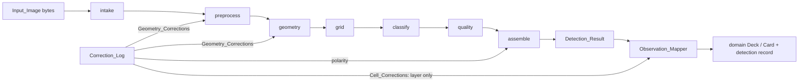
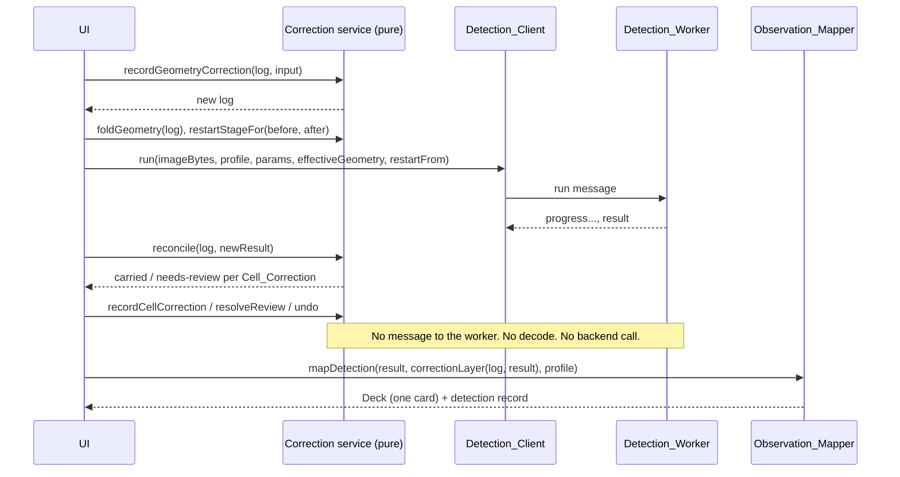

# Design Document

## Overview

This document designs the Card_Detector: a deterministic, browser-side pipeline in `src/vision`, with a thin worker adapter in `src/workers`, that turns one photograph of a punched card into explainable per-position observations. For every readable position it reports a hole probability in [0, 1], a condition (`observed`, `ambiguous`, `unknown`) and diagnostics. It also reports card geometry, quality findings and unknown regions. It does not infer missing instructions. Photos never leave the browser.

The design builds on the approved `card-domain-and-loom-engine` contract and reuses its types by name: `MachineProfile`, `VerificationStatus`, `Deck`, `Card`, `Cell`, `CellSeed`, `CellInitial`, `RawObservation`, `Evidence`, `EvidenceRef`, `Provenance`, `Bit`, `GridPosition`, `ReadIndex`, `ActionId`, `SequenceNumber`, `UserEditInput`, `InferenceInput`, `createCard`, `createDeck`, `userEdit`, `setInferred`, `gridToReadIndex`, `readIndexToGrid`, `validateDeck`. `src/vision` imports `src/domain` only through its index. `src/domain` never imports `src/vision`.

Design principles:

1. **Profile as input data.** Grid size, reserved positions, read order, end holes and verification markers come from the supplied `MachineProfile`. No Garín value is hard-coded. Every unverified field the run depended on is copied into the result.
2. **Pure pipeline, thin worker.** Every stage is an `async` function of explicit inputs. The worker only adapts messages, progress, cancellation and transfer. The pipeline is unit-testable without a worker.
3. **Explainable by construction.** Each cell decision records the features, thresholds and deciding step. The probability is a documented monotone function of those features. No trained model is in the primary path.
4. **Unknown is not absent.** Missing, occluded or unreadable evidence yields `unknown`, never "no hole".
5. **Evidence is never overwritten.** The Original_Image is never mutated. A Detection_Result is immutable. Corrections live in a separate append-only log. A re-run produces a new result.
6. **Two correction classes, two behaviours.** A geometry correction changes interpretation and restarts the pipeline from a defined stage. A cell correction never touches the pipeline. It is a layer over an unchanged result. The mapper applies value corrections through the domain `userEdit`, and surfaces condition corrections only as human-authored records in the detection record (they are never written into the domain Card).
7. **Numbers are measured, not asserted.** Every threshold and budget below is an *initial value* to be tuned or validated empirically on a documented tuning split. The requirements fix none of them. Accuracy numbers are quoted only from recorded runs.
8. **Determinism with an honest scope.** Identical inputs give identical results within one runtime. Cross-environment identity is measured, not promised.

Research summary (no external research was needed; sources are the steering files and the approved requirements):
- Format facts and their unverified status: `jacquard-card-format.md`, citing Rodas Lorente et al. (2025), https://doi.org/10.1007/s11042-025-20917-9. None is verified against the paper's figures.
- Principles for provenance, confidence and raw-evidence preservation: `restoration-principles.md`.
- Stack and layering: `tech.md` (OpenCV.js size trade-off is explicitly open until a spike on real photos).
- Test rules: `testing-standards.md` (seeded properties, goldens, separate synthetic and real evaluation, no tuning on held-out data).
- Detection-relevant algorithm families used below are standard and need no citation: Otsu thresholding, connected components, Douglas-Peucker polygon simplification, direct linear transform for homographies, Huber-weighted iteratively reweighted least squares, variance-of-Laplacian blur measure, CIELAB colour difference.

### Design decisions

| ID | Decision | Rationale | Requirements |
|----|----------|-----------|--------------|
| V1 | Image primitives sit behind `ImageBackend`. The first implementation is a hand-written typed-array backend. OpenCV.js is a second implementation, added only if the spike shows a gain. | The pipeline needs thresholding, morphology, connected components, blur, homography and warping. These are small to write, run in Node tests without wasm, and avoid a large asset. `tech.md` leaves the choice to a spike. See Q1. | 17 |
| V2 | The pipeline restarts from a named stage per geometry-correction kind, and reuses cached outputs only of stages *before* that stage. | Matches Req 12.14 literally and keeps results equal to a full run. | 12.13, 12.14 |
| V3 | `set-cell-value` corrections are applied by `userEdit` on a one-card Deck (provenance `user-edited`, edit note, per-cell action ids `"<actionId>#<readIndex>"`). `set-cell-condition` corrections are kept only in the vision correction layer as human-authored records and exposed in `CardDetectionRecord.userConditionOverrides`. They are not written into the domain Card, and the mapped cell keeps the provenance the detector produced. | `userEdit` takes a `Bit` and `setInferred` rejects `user-edited`. Using `setInferred` with `ambiguous` would misrepresent a human edit as an algorithmic one. The domain has no human "mark unknown" operation. See "Condition corrections and the domain contract" for the limitation. | 10.13, 12.3 |
| V4 | Every detected cell is mapped with `initial.restorationConfidence: null` (not evaluated). | The approved domain contract types Restoration_Confidence as `number | null`, where `null` means no algorithm has estimated correctness and `0` means an evaluated zero. Detection observes holes and does not evaluate restoration correctness. | 10.7 |
| V5 | Vision errors use a separate registry with the domain `Result` *shape* (`VisionResult`, `VisionError`). | The domain `ErrorCode` union is closed and the domain registry must not be extended. | 16 |
| V6 | Orientation is resolved automatically only when the profile declares an asymmetry. Otherwise the result is `orientation-unresolved` until the caller supplies one. | Card orientation is unverified (D3). Aspect ratio alone only narrows the choice to a 180° pair. See Q5. | 4.5 to 4.7 |
| V7 | All numeric budgets and tolerances are defined here as initial values with a validation method. | Delegated by Req 13.6, 13.14, 15.4, 17.6. | 13, 15, 17 |
| V8 | `Hole_Probability` is a logistic mapping of a weighted sum of bounded sub-scores. | Monotone, documented, deterministic, no model. | 7.6 |

### Out of scope

Strip segmentation, restoration of missing instructions, colour inference, physical loom control, server processing, trained custom networks, damage-model definitions (benchmark spec).

## Architecture

### Module layout

```
src/vision/
  index.ts                  single public surface, VISION_INTERFACE_VERSION
  result.ts                 VisionResult, VisionError, VISION_ERROR_CODES, VISION_ERROR_MESSAGES
  coords.ts                 ImagePoint, RectPoint, quads, homography math (pure)
  hash.ts                   fnv1a64 (sync), sha256Hex (async via crypto.subtle)
  canonical.ts              schema-ordered JSON writer, schema key tables, rounding constants
  params/                   defaults.ts, validate.ts, overrideAllowList.ts
  intake/                   sniff.ts, exif.ts, limits.ts, decoder.ts (ImageDecoder interface + browser decoder)
  backend/                  imageBackend.ts, raster.ts, typedArrayBackend.ts, opencvBackend.ts (optional, lazy)
  preprocess/               resize.ts, illumination.ts, denoise.ts, perspective.ts
  geometry/                 cardQuad.ts, endHoles.ts, orientation.ts
  grid/                     latticeFit.ts, cellWindows.ts
  classify/                 features.ts, probability.ts, condition.ts
  quality/                  blur.ts, lowContrast.ts, glare.ts, shadow.ts, stain.ts, cord.ts,
                            patch.ts, tear.ts, perspective.ts, unknownRegions.ts, methodDocs.ts
  pipeline/                 detect.ts, stages.ts, stageCache.ts, context.ts, assemble.ts
  corrections/              log.ts, validate.ts, fold.ts, reconcile.ts, layer.ts, restartStage.ts, serialize.ts
  mapping/                  observationMapper.ts, detectionRecord.ts
  assistant/                interface.ts, validate.ts
  evaluation/               metrics.ts, compare.ts
  protocol/                 messages.ts, validate.ts
  client/                   detectionClient.ts
  __tests__/                generators.ts, synthetic/ (renderer, degradations), goldens/, *.test.ts
src/workers/
  detection.worker.ts       thin adapter, imports the src/vision index (the only file of src/workers this feature owns; restoration.worker.ts belongs to the Workbench spec)
scripts/
  vision-spike.ts, vision-measure.ts, vision-eval-synthetic.ts, vision-eval-real.ts, vision-tune.ts,
  vision-make-sample.ts     single producer of the bundled synthetic sample
data/
  samples/card-synthetic-sample.png, sample.meta.json, README.md   (written by vision-make-sample.ts)
docs/
  vision-errors.md, vision-parameters.md, vision-methods.md, vision-measurements.md,
  vision-eval-synthetic.md, vision-eval-real.md
data/
  synthetic/damage-levels.json   (benchmark-owned Damage_Level_File, read as data; not created by this feature)
```

No new top-level folder is needed. `scripts` is already listed in `structure.md` (its rules there apply: thin entry points, no `src` folder imports `scripts`, generated data only under `data/generated`, committed manifests and reports under `data/benchmark`). `docs` is an existing folder. The three evaluation scripts are thin: see "Evaluation, synthetic generator and reporting".

### Dependency rule and import-boundary test

- `src/vision` imports `src/domain` (index only) and TypeScript built-ins. It never imports `src/ui`, `src/restore`, `src/benchmark`.
- `src/workers` may import the public indexes of `src/vision`, `src/restore` and `src/domain` (as `structure.md` allows). It never imports `src/ui`, `src/benchmark`, or any module other than those three indexes. This feature owns only `src/workers/detection.worker.ts`, which imports the `src/vision` index. `src/workers/restoration.worker.ts` belongs to the Workbench spec and may import the `src/restore` index.
- `src/domain` never imports `src/vision` or `src/workers`.
- `src/vision/client` uses a caller-supplied `WorkerFactory`. It does not call `new Worker` itself, so `src/vision` has no DOM dependency except in the browser decoder.
- Files under `src/vision` that produce a Detection_Result (everything except `intake/decoder.ts`, `client/`, `protocol/` adapters and `__tests__/`) must not use `document`, `window`, `fetch`, `XMLHttpRequest`, `Date`, `Math.random`, `performance.now`, `setTimeout`, `setInterval`. The one yield point the pipeline needs is injected (`PipelineHooks.yieldToEventLoop`).
- The test `src/vision/__tests__/boundary.test.ts` scans all `.ts` files with the TypeScript compiler API (same technique as the domain test) and checks these rules, plus that `src/domain` contains no import of `src/vision`. It also asserts that every import in `src/workers` resolves to the index of `src/vision`, `src/restore` or `src/domain`, and fails on an import of `src/ui`, `src/benchmark` or a deep (non-index) module path. A negative self-test feeds it a worker file with each forbidden import and expects a failure.

### Pipeline



| Stage | Responsibility | Produces |
|-------|----------------|----------|
| `intake` | Size, format sniff, multi-frame check, decode, EXIF rotation, alpha flatten, digest | `DecodedImage`, `IntakeReport` |
| `preprocess` | Resize, illumination correction, denoise | `Raster` working images, `PreprocessingReport` |
| `geometry` | Card quadrilateral, multiple-card check, perspective rectification, end holes, orientation | `GeometryReport`, rectified rasters |
| `grid` | Lattice fit from the profile, one cell window per grid position | `GridReport`, `CellWindow[]` |
| `classify` | Per-cell features, hole probability, provisional condition | `ProvisionalCell[]` |
| `quality` | Findings and unknown regions | `QualityReport` |
| `assemble` | Demote cells covered by blocking regions, attach findings, polarity, assistant, artifacts, `resultId` | `DetectionResult` |

Stage order and names are the progress stage names of Req 13.5.

### Staged recompute and cache

Each stage has a content key: `fnv1a64(canonical JSON of { stage, stageParameters, upstreamKeys, profileFields, correctionFields, implementation })`. The `StageCache` stores stage outputs for **one** `imageDigest` at a time and is bounded (initial value 160 MiB, evicting the oldest stage output first). A new image digest clears it.

```ts
export type StageName = "intake" | "preprocess" | "geometry" | "grid" | "classify" | "quality" | "assemble";
export interface StageCache {
  get(key: string): StageOutput | undefined;
  put(key: string, out: StageOutput, approxBytes: number): void;
  clear(): void;
}
```

Restart stage per geometry-correction kind (V2, Req 12.14). `restartStageFor` is a pure function over the effective geometry before and after.

| Correction kind | Restart stage |
|-----------------|---------------|
| `set-parameter-override` of a preprocess parameter | `preprocess` |
| `set-corners`, `set-reference-holes`, `set-orientation`, `select-profile`, `set-parameter-override` of a geometry, grid, classify or quality parameter | `geometry` |
| `set-polarity` | `assemble` |

Rule: when a run restarts at stage `S`, stages before `S` may be served from the cache if their content keys match. Stage `S` and every later stage are always recomputed. If several kinds changed, the earliest restart stage wins. If the previous effective geometry is unknown (first run, new image), the run starts at `intake`. The result of a restarted run equals the result of a full run on the same inputs (Property 12).

```
run(input, restartFrom?):
  keys = computeKeys(input)                       // cheap, no pixel work
  for stage in STAGES:
    if restartFrom is set and index(stage) >= index(restartFrom): recompute
    elif cache.has(keys[stage]): reuse
    else: recompute
    checkpoint(); emit progress
```

### Data flow for corrections



## Components and Interfaces

All code below is a type or signature contract, not an implementation.

### Result and errors (V5)

```ts
export type VisionResult<T> =
  | { readonly ok: true; readonly value: T }
  | { readonly ok: false; readonly error: VisionError };

/** Same field names as the domain DomainError. `code` is from VISION_ERROR_CODES, not the domain ErrorCode union. */
export interface VisionError {
  readonly code: VisionErrorCode;
  readonly message: string;            // stable text from VISION_ERROR_MESSAGES[code]; may append names or numbers after a fixed prefix
  readonly path?: string;              // e.g. "parameters.classify.holeThreshold"
  readonly stage?: PipelineStage | "mapping" | "corrections" | "protocol";
  readonly domainCode?: string;        // underlying domain ErrorCode when code is DOMAIN_RULE_REJECTED
  readonly details?: JsonObject;       // structured, cloneable, code-specific (for example candidate polygons)
}
export type JsonObject = { readonly [k: string]: JsonValue };
export type JsonValue = string | number | boolean | null | readonly JsonValue[] | JsonObject;
```

The domain `Result<T, E extends DomainError>` cannot carry a vision code, because `DomainError.code` is the closed domain `ErrorCode` union. `VisionResult` mirrors its discriminant (`ok`, `value`, `error`) and the field names of `DomainError`. A domain failure is wrapped: `code: "DOMAIN_RULE_REJECTED"`, `domainCode` holds the domain code, `path` and `message` are copied. The full registry is under "Error Handling".

### Coordinate systems

Five systems are kept distinct. The four domain systems are unchanged. Image and rectified coordinates are added. Distinct property names make them non-assignable in TypeScript.

```ts
export interface ImagePoint { readonly imageX: number; readonly imageY: number }   // Original_Image pixels, origin top-left, y down
export interface RectPoint  { readonly rectX: number;  readonly rectY: number }    // Rectified canonical frame pixels
export interface ImageQuad  { readonly corners: readonly [ImagePoint, ImagePoint, ImagePoint, ImagePoint] } // clockwise as displayed, starting at the corner with the smallest imageX + imageY
export interface RectBox    { readonly rectX0: number; readonly rectY0: number; readonly rectX1: number; readonly rectY1: number }
export type Orientation = 0 | 90 | 180 | 270;    // degrees clockwise applied to the displayed card to align it with the profile grid axes
```

Rules:
- All coordinates stored in a Detection_Result are in **Original_Image coordinates** or **canonical rectified coordinates**, never working-image coordinates. The pipeline works at a working resolution (scale factor `s`, recorded). Points are divided by `s` on output and multiplied by `s` on input (user-supplied corners and reference holes).
- The **canonical rectified frame** has `gridRow` increasing downward and `gridColumn` increasing rightward. The profile's `readOrder` is applied only through `gridToReadIndex`. Which physical card edge is "row 0" is unverified (A3, D3). The frame is a convention, not a claim about the card.
- Grid positions are the domain `GridPosition`. Read indices come only from `gridToReadIndex` (Req 5.4). The pipeline never computes a read index itself.

Pure homography helpers (`coords.ts`): `homographyFromQuad(src, dstW, dstH): Matrix3`, `applyHomography`, `invert3`, `rotateRaster90(raster, orientation)` (lossless).

### Image backend and OpenCV.js loading (V1)

```ts
export interface Raster {                                   // plain typed-array image, structured-cloneable
  readonly width: number; readonly height: number;
  readonly channels: 1 | 3 | 4;
  readonly kind: "u8" | "f32";
  readonly data: Uint8ClampedArray | Float32Array;
}
export interface ImageBackend {
  readonly name: "typed-array" | "opencv-js";
  readonly version: string;                                 // pinned; opencv build id included
  toGray(src: Raster): Raster;                              // f32 in [0,1]
  resizeArea(src: Raster, w: number, h: number): Raster;    // area average, deterministic
  gaussianBlur(src: Raster, sigma: number): Raster;
  medianBlur(src: Raster, kernel: 3 | 5): Raster;
  normalizedBlur(src: Raster, weight: Raster, sigma: number): Raster;     // blur(src*w)/blur(w)
  threshold(src: Raster, t: number, invert: boolean): Raster;             // u8 mask
  otsu(src: Raster, mask?: Raster): number;
  morph(mask: Raster, op: "open" | "close" | "erode" | "dilate", kernel: KernelSpec): Raster;
  components(mask: Raster, connectivity: 4 | 8): ComponentSet;            // labels + stats (area, bbox, centroid, second moments)
  convexHull(points: readonly ImagePoint[]): readonly ImagePoint[];
  warpPerspective(src: Raster, h: Matrix3, outW: number, outH: number): Raster;   // bilinear, inverse mapping
  laplacianVariance(src: Raster, box: RectBox): number;
  rgbToLab(src: Raster): Raster;
  liveAllocations(): number;                                // typed-array: pooled buffers in use; opencv: live Mats
  dispose(): void;                                          // releases every allocation made since the last scope began
}
export interface ImageDecoder {
  decode(bytes: Uint8Array, format: "png" | "jpeg" | "webp"): Promise<VisionResult<Raster /* u8, 4 channels, no EXIF applied, straight alpha */>>;
}
```

- **Primary implementation: typed-array backend.** Plain TypeScript over `Float32Array` / `Uint8ClampedArray`, a buffer pool to avoid GC churn, no wasm, runs in Node and in the worker. Operations are written to be deterministic: fixed iteration order, no parallel reductions, no `Math.random`.
- **Optional implementation: OpenCV.js.** If the spike (below) shows a clear accuracy or speed benefit, `opencvBackend.ts` implements the same interface. Loading: the worker calls `loadBackend()` on the **first `run`**, never on page load or on the main thread. The asset is a same-origin static file (`/vendor/opencv-<pinned-version>.js`, pinned in a constant and recorded in the Implementation_Stamp). A failed load returns `BACKEND_LOAD_FAILED` naming the backend and leaves the worker able to accept a later run. Every `Mat` is created through a `BackendScope` that records it. `dispose()` runs in a `finally` block after every run. Test: `liveAllocations()` after 20 consecutive runs equals the count before them (Req 17.8).
- **Browser decoder** (`intake/decoder.ts`): `createImageBitmap(blob, { imageOrientation: "none", premultiplyAlpha: "none", colorSpaceConversion: "none" })` drawn onto an `OffscreenCanvas`, then `getImageData`. EXIF is read by our own parser and applied once after decode (below), so the rotation is recorded and deterministic. Colour management differences between browsers are part of the cross-environment tolerance. This file is the only place in the decode path that uses a DOM-adjacent API.
- **Node decoder for tests and benchmark scripts**: lives in `src/vision/__tests__/support/nodeDecoder.ts` and wraps a PNG/JPEG/WebP library chosen in the tasks phase as a dev-only dependency. It implements `ImageDecoder`. See Q6.

**Spike (decides Q1).** `scripts/vision-spike.ts` runs the typed-array backend and, if available, an OpenCV.js build on the same set of synthetic images and any licensed real photos. It records asset size, load time, run time, peak memory, and the Detection_Result differences. Output goes to `docs/vision-measurements.md`. No size or time is claimed before it runs.

### Intake and validation (stage `intake`)

```ts
export type ImageFormat = "png" | "jpeg" | "webp";
export interface IntakeLimits {
  readonly maxFileBytes: number;      // default 20_971_520 (20 MiB)
  readonly maxSide: number;           // default 8_192
  readonly maxPixels: number;         // default 33_554_432
  readonly minLongSide: number;       // default 800
  readonly minShortSide: number;      // default 200
}
export function sniffFormat(bytes: Uint8Array): ImageFormat | "unknown";               // magic bytes, never the file name
export function isMultiFrame(bytes: Uint8Array, format: ImageFormat): boolean;        // PNG acTL chunk; WebP VP8X animation flag, ANIM or ANMF chunk
export function readExifOrientation(bytes: Uint8Array, format: ImageFormat): number | null;  // JPEG APP1, WebP EXIF chunk, PNG eXIf chunk; values 1..8
export function checkIntakeLimits(meta: { byteLength: number; width?: number; height?: number }, limits: IntakeLimits): VisionResult<void>;
```

Check order (first failure returned, nothing partial, Req 1.3 to 1.7):
1. `byteLength > maxFileBytes` gives `IMAGE_TOO_LARGE_BYTES` before decoding. A file of exactly `maxFileBytes` is accepted.
2. `sniffFormat` is `unknown` gives `UNSUPPORTED_IMAGE_FORMAT` naming the detected format or `unknown`.
3. `isMultiFrame` gives `MULTI_FRAME_IMAGE` (checked on bytes, before decode).
4. Decode failure, including truncated or corrupt data, gives `IMAGE_DECODE_FAILED`. No partial raster is returned.
5. Apply the EXIF rotation once (orientation values 1 to 8, including mirrored values, mapped to a rotation and optional flip applied to the raster). Record the tag and the applied transform in `IntakeReport`. Dimensions are those after rotation.
6. `max(width, height) > maxSide` or `width * height > maxPixels` gives `IMAGE_TOO_LARGE_PIXELS`. Exactly at the limit is accepted.
7. `max(width, height) < minLongSide` or `min(width, height) < minShortSide` gives `IMAGE_TOO_SMALL`. Exactly at the minimum is accepted. The message states the supplied and permitted values.
8. Alpha: flatten onto white, `c' = c*a + 255*(1-a)`, record `alphaFlattened: true` when any `a < 255`.
9. `imageDigest = sha-256` of the **input bytes** (`crypto.subtle.digest`, async). The algorithm name is stored with the value.

The ordering of 6 after decode is required because dimensions are known only then. A cheap pre-decode dimension read from the header is allowed as an early exit, but the post-decode check is authoritative. The intake limits are `Detection_Parameters` (documented bounds in "Parameters").

```ts
export interface IntakeReport {
  readonly format: ImageFormat;
  readonly byteLength: number;
  readonly width: number; readonly height: number;          // after EXIF rotation
  readonly exifOrientationTag: number | null;
  readonly appliedTransform: "none" | "rot90" | "rot180" | "rot270" | "flipH" | "flipV" | "transpose" | "transverse";
  readonly alphaFlattened: boolean;
  readonly limits: IntakeLimits;                            // limits that applied
  readonly digest: { readonly algorithm: "sha-256"; readonly hex: string };
}
```

### Preprocessing (stage `preprocess`)

Order is fixed by Req 3.1: resize, illumination correction, denoise. Perspective correction runs inside the `geometry` stage after the quadrilateral is known.

| Step | Method (initial parameters, tunable) | Recorded |
|------|--------------------------------------|----------|
| Resize | Area-average downscale so the longer side equals `workingLongSide` (2,048). Never upscale. | scale factor `s`, sizes |
| Border background mask | Median intensity of the one-pixel image border `b`. Foreground `F = |gray - b| > otsu(|gray - b|)`. Border pixels are assumed to be background (a card cut by the border is a diagnosed failure). | `b`, threshold |
| Illumination correction | `bg = normalizedBlur(gray, F, sigma)` with `sigma = illuminationSigmaFrac * shortSide` (0.08). `corrected = gray / max(bg, eps) * mean(bg over F)`, clamped to [0, 1]. Outside `F` the value is left as gray. Weighting by `F` stops the background and the card edge from bleeding into the estimate. | method name, sigma, `mean(bg)` |
| Denoise | 3x3 median blur. Preserves hole edges better than a Gaussian. | method, kernel |

Each step has a boolean that disables it (`illuminationEnabled`, `denoiseEnabled`, `resizeEnabled`). The `PreprocessingReport` lists each step with name, parameters, input size, output size, and mean and standard deviation of the output intensity (Req 3.7). Colour is kept in a parallel RGB working raster (resized only), used by the quality stage. All outputs are `Derived_Artifact`s. The Original_Image is not touched. Failure mode: strong cast shadows across the card are partly flattened and partly kept. The quality stage reports shadows separately.

Parameter validation (`INVALID_PARAMETERS`, Req 3.10) runs before any pixel work.

### Geometry (stage `geometry`)

**Card quadrilateral.** On the denoised, illumination-corrected working image:

```
for polarity in { card-brighter-than-background, card-darker-than-background }:
  mask = threshold(gray, otsu(gray), invert = polarity)
  mask = close(mask, ellipse(k)) then open(mask, ellipse(k))     // k = 1% of the shorter working side
  comps = components(mask, 8); keep area >= 5% of the image
  for each comp: hull = convexHull(boundary); quad = simplifyToFour(hull)
candidates = all comps from both polarities, scored
score = fillRatio(compArea / quadArea) * (1 - borderTouchFraction) * sizeScore
best = argmax score;   ties broken by larger area, then smaller y, then smaller x
```

`simplifyToFour(hull)`: Douglas-Peucker with `epsilon = polygonEpsilonFrac * perimeter` (0.02); if the result has more than 4 vertices, repeatedly remove the vertex whose removal changes the polygon area least (deterministic tie-break by vertex order); if fewer than 4, the candidate is rejected. Corners are ordered clockwise, starting at the corner with the smallest `imageX + imageY`.

- **Multiple cards.** If a second candidate has area at least `secondCardAreaRatio` (25%) of the best and does not overlap it (IoU below 0.5), return `MULTIPLE_CARDS_SUSPECTED` with the candidate polygons in `details`. No per-cell observations. Strip segmentation is not attempted (Req 2.4).
- **Strip or crop heuristic.** If the best quadrilateral's aspect ratio differs from the expected grid aspect (`max(rows, cols) / min(rows, cols)`, assuming equal pitches, unverified D5) by more than `aspectTolerance` (initial 0.4, relative) and its long-side ends touch the image border (within `borderTouchTolerancePx`), emit a `Quality_Finding` kind `other` ("may be a strip or a crop") and set `alignment.status = failed` unless a user `set-corners` correction exists.
- **Corner confidence** per corner: for each of the two edges adjacent to the corner, the fraction of sample points along the edge whose gradient magnitude exceeds the 75th percentile of the card-border band. The corner confidence is the smaller of the two fractions, in [0, 1].
- **Unreliable geometry.** If the quad area is below `minCardAreaFrac` (20%) of the image, or any corner confidence is below `cornerConfidenceMin` (0.3), the run ends with `alignment.status = failed`, failure stage `geometry`, code `ALIGNMENT_UNRELIABLE` (Req 11.4). With a `set-corners` correction the confidence check is skipped and the corners are marked `user-supplied`.
- If no quadrilateral is found: `failed`, stage `geometry`, with annotated candidate artifacts (Req 4.9).

**Rectification.** `H = homographyFromQuad(quad_working, W, H)` with `W = round(mean(top, bottom edge length))` and `H = round(mean(left, right edge length))`. `warpPerspective` produces `rectified-displayed` (gray and RGB). The report stores the matrix (9 values), the source quad (working coordinates), output size and `s`. A `perspective-distortion` finding is computed from the quad (see Quality).

**End holes** (only when the profile declares `endHoles`). Search two bands of depth `endHoleBandFrac` (0.12) of the long side at the two short ends of `rectified-displayed`:

```
nominalPitchShort = shortSide / min(rows, cols)
binarise band with hole polarity (see Hole polarity detection)
components -> keep roundness >= endHoleMinRoundness (0.7) and
   radiusEq in [r_lo, r_hi] * nominalPitchShort   (initial r_lo = 0.3, r_hi = 1.2)
pick the component with the best score = roundness * sizeFit   (sizeFit = 1 - |radiusEq - r_mid| / r_mid, clamped)
```

Each end hole is reported as `found` (centre, radius in image pixels, score in [0, 1], feature values) or `not-found` (reason). A `not-found` end hole is never invented. It adds a `Quality_Finding` of kind `other` naming it. When `requireEndHoles` is true (default false, because the end holes are unverified A2) a missing end hole sets `failed`, stage `end-holes`. These size and position relations are Detection_Parameters marked `unverified` (D2) unless the profile's `endHoles` declares geometry, in which case the profile wins.

**Orientation (V6).** From `rectified-displayed`:
1. **Aspect gate.** The profile has `gridRows != gridColumns`. The rectified long side must lie along the larger grid dimension in the canonical frame. This leaves two candidate rotations (a 180° pair). If `gridRows == gridColumns` all four remain.
2. **Evidence.** A candidate's score comes from asymmetry the profile *declares*: differing `endHoles` specs (different `diameterMm` or `xMm`, `yMm`), matched to the found end holes. If the profile declares no asymmetry, both candidates score equal.
3. **Decision.** If a caller supplied an Orientation (parameter `orientation`, or an effective `set-orientation` correction), use it and record `source: "user-supplied"`. Else, if the top score exceeds the runner-up by at least `orientationMargin` (0.1) **and** the profile field `readOrder` and `gridSize` verification statuses allow automatic use, use the top candidate. Else, return `alignment.status = orientation-unresolved` with the candidate rotations, their scores, and one `orientation-preview` artifact per candidate. No cell observations are returned (Req 4.6).
4. The chosen rotation is applied to the rectified rasters as an exact 90° rotation (`rotateRaster90`, no resampling) to produce the canonical `rectified` rasters. Every rotation applied is recorded (Req 4.8). Nothing is mirrored.

With the Garín profile, steps 2 and 3 mean: unresolved until the caller selects one of the two candidates, because `endHoles` carry no geometry (A2) and the grid fields are `unverified`. The bundled sample ships with a recorded, user-supplied orientation in its parameters. See Q5.

**Hole polarity detection** (`classify.holeContrastPolarity = "auto"`). Whether holes appear brighter or darker than the card paper depends on what lies behind the card. The default heuristic assumes the surface visible through a hole is the same surface that surrounds the card: if the border median `b` is brighter than the card median, holes are brighter. The value is recorded and may be overridden by parameter (`brighter` or `darker`). This is an assumption about photography, not about the format. It is distinct from the Hole_Polarity_Assumption (hole = lifted or down), which is about the weaving meaning (D7).

### Grid fit (stage `grid`)

Inputs are the profile's `gridRows`, `gridColumns`, `reservedPositions` and `readOrder`, and the canonical `rectified` raster of size `W x H`.

```
initial lattice (uniform):  rowPitch0 = H / rows,  colPitch0 = W / cols
                            node(i,j) = ((j + 0.5 + insetX) * colPitch0, (i + 0.5 + insetY) * rowPitch0)
                            (insets default 0; unverified D5)
hole candidates: binarise `rectified` with hole polarity and Otsu; components with
   area in [0.4, 2.2] * expectedHoleArea  and roundness >= 0.5
assign each candidate to the nearest node within assignRadiusFrac (0.35) * min(pitch)
if assigned >= minRefineHoles (12):
   solve  x = offX + colPitch * (j + 0.5),  y = offY + rowPitch * (i + 0.5)   by Huber IRLS
          (delta = huberDeltaFrac (0.1) * min(pitch), 5 iterations, deterministic start = initial lattice)
   residual = RMS distance of inliers to their fitted node (rect pixels)
   score = inlierFraction * (1 - min(1, residual / (0.25 * minPitch))) * supportFraction
   supportFraction = fraction of lattice rows AND columns with >= 1 assigned hole (min of the two)
else:
   use the initial lattice, refinedWithHoles = 0, score = 0.3 * supportFraction     // below any sane failure threshold
effective reference holes (user): the same solver with the user points as high-weight inliers
```

- `expectedHoleArea = pi * (holeRadiusFrac * min(pitch))^2` with `holeRadiusFrac = 0.25` (initial, unverified D5). The detector never derives millimetres.
- Failure thresholds (initial): `gridFitFailBelow = 0.35`, `gridFitWarnBelow = 0.65`. Score below the first gives `alignment.status = failed`, stage `grid-fit`, `ALIGNMENT_UNRELIABLE`, no cell observations and no best-guess grid (Req 5.5, 11.7). Between the two gives `aligned-with-warnings`, and the score is attached to every `CellDiagnostics`. At or above the second gives `aligned`.
- **Reserved positions** come from the profile. Reserved nodes are excluded from the support counts when `reservedAsAlignmentFeature` is false (default, Req 6.5).
- **Cell windows.** One per grid position, an axis-aligned `RectBox` of `colPitch x rowPitch` centred on the node, plus the polygon of its four corners mapped to Original_Image coordinates through the inverse of the rectification (and rotation). Windows tile the lattice and never overlap.
- **Read index.** `readIndex = gridToReadIndex(profile, position)` (domain). Reserved positions return `RESERVED_POSITION` from the domain and are routed to `ReservedRecord`, not `CellEvidence`.

```ts
export interface CellWindow {
  readonly rect: RectBox;                                             // canonical rectified coordinates
  readonly imagePolygon: readonly [ImagePoint, ImagePoint, ImagePoint, ImagePoint]; // Original_Image coordinates
}
```

Profile replacement needs no code change: a different grid size or reserved list produces a different lattice and window set (Req 5.7, 6.7).

### Hole classification (stage `classify`)

**Features per cell** (computed on the canonical `rectified` gray raster, normalised so that the card-paper median is 1 and the hole-level high quantile is 0, with polarity applied so that "more hole-like" is always larger):

| Feature | Definition |
|---------|-----------|
| `meanInner`, `stdInner` | Mean and standard deviation of normalised intensity inside the inner disc, radius `innerRadiusFactor * r_h` (0.7) |
| `meanRing`, `stdRing` | Same in the ring from `ringInnerFactor * r_h` (1.3) to `ringOuterFactor * r_h` (1.8) |
| `contrast` | `meanInner - meanRing` after polarity (positive means hole-like) |
| `holeFraction` | Fraction of window-disc pixels (radius `1.3 * r_h`) above the card-level hole threshold `T_h` |
| `componentAreaRatio` | Area of the largest 8-connected component that overlaps the inner disc, divided by the expected hole area |
| `roundness` | `sqrt(lambdaMin / lambdaMax)` of that component's second-moment matrix (1 is a disc) |
| `centroidOffset` | Distance of that component's centroid from the window centre, divided by `min(pitch)` |

`r_h = holeRadiusFrac * min(rowPitch, colPitch)`. `T_h` is a per-card Otsu threshold over pooled inner-disc and ring pixels of all cells (fallback 0.5 when the pooled histogram is degenerate, recorded). A cell with no component has `componentAreaRatio = 0`, `roundness = 0`, `centroidOffset = 0`, and `hasComponent = false`.

**Probability** (V8). Bounded sub-scores in [0, 1], then a logistic:

```
contrastScore = clamp((contrast - c0) / (c1 - c0))                  c0 = 0.15, c1 = 0.50
areaScore     = tent(componentAreaRatio; zero<=0.2, full in [0.6,1.4], zero>=2.0)
fractionScore = clamp(holeFraction / 0.6)
shapeScore    = roundness * (1 - clamp(centroidOffset / 0.3))
S = 0.40*contrastScore + 0.30*areaScore + 0.20*fractionScore + 0.10*shapeScore
holeProbability = 1 / (1 + exp(-beta * (S - S0)))                   beta = 10, S0 = 0.5
```

`holeProbability` is monotone non-decreasing in `contrast`, `holeFraction`, and (within the tent's rising part) `componentAreaRatio`, with the other features fixed (Property 20). All constants above are **initial values**, tuned empirically on the tuning split and recorded with the benchmark version. The mapping is an uncalibrated score, and the result says so (`holeProbabilityNote`, `calibration: "uncalibrated"`) until a calibration run is recorded (Req 7.6, 7.7). If any intermediate value is non-finite, the cell becomes `unknown` with reason `non-finite-score` and no number is emitted (Req 7.11).

**Readability score** `q` in [0, 1] per cell: `q = min(inImageFraction, 1 - saturatedFraction, 1 - darkFraction, sharpnessFactor, rangeFactor)`, where `sharpnessFactor` is the tile's Laplacian-variance ratio to the card median (clamped), and `rangeFactor` is the local p95-p5 spread over the card-level spread (clamped).

**Condition assignment** (pseudocode, Req 8.2 to 8.6):

```
if window outside image > outsideImageFrac (0.2)  -> unknown, reason outside-image
elif q < readabilityThreshold (0.5)               -> unknown, reason low-readability
elif p not finite                                 -> unknown, reason non-finite-score
elif p >= holeThreshold (0.75)                    -> observed, proposedValue hole-present
elif p <= noHoleThreshold (0.25)                  -> observed, proposedValue hole-absent
else                                              -> ambiguous, keep p, no proposedValue
```

Validated at parameter time: `0 <= noHoleThreshold < holeThreshold <= 1`. Defaults `0.25` and `0.75` are initial, tuned on the tuning split only, never on the held-out split.

The classifier cannot set `observed`-absent from missing evidence: a window that is missing, occluded or unreadable reaches `unknown` first. A final guard asserts that every `hole-absent` cell has `q >= readabilityThreshold` and in-image fraction at least `1 - outsideImageFrac`.

The loop checkpoints every `checkpointEveryRows` grid rows (default 10, bounded to at most 50, Req 13.6) and reports progress.

### Quality diagnostics (stage `quality`)

Findings are computed on the canonical `rectified` Lab raster, plus the full working image for kinds that concern the border. None repairs, inpaints or hides anything (Req 9.6). Findings are heuristic and say so.

| Kind | Method (initial parameters) | Score | Unknown region it can create | Known failure modes |
|------|-----------------------------|-------|------------------------------|---------------------|
| `perspective-distortion` | From the source quad: `edgeRatioDev = max(|1 - top/bottom|, |1 - left/right|)`, `angleDev = max |angle - 90°|`. Homography matrix is recorded. | `clamp(max(edgeRatioDev / 0.25, angleDev / 30°))` | none | Warped or bent cards read as distortion. |
| `blur` | Variance of the Laplacian per 64 px tile of `rectified`, relative to the card median. Tiles with ratio below 0.35 are blurred. | `1 - ratio` aggregated over the blurred area | `blurred` when tile score above 0.8 | Smooth, blank card areas look blurred. |
| `low-contrast` | `spread = p95 - p5` of normalised card intensity. | `clamp(1 - spread / 0.35)` | none | A card with few holes has a narrow spread by nature. |
| `glare` | Components of pixels with value above 0.98 and low chroma, area above `minAreaFrac` | covered fraction mapped by `scoreScale` | `saturated` | Bright paper and white cards. |
| `shadow` | Low-frequency component of the corrected gray: regions at least 0.12 below the card median with little chroma change | depth / 0.3 | `too-dark` when mean below 0.05 | Dark ink or stains of similar chroma. |
| `stain` | Mask of CIELAB `deltaE` from the median card colour above 12, soft edges (low gradient on the boundary), not elongated, not a hole-sized disc | coverage * mean deltaE / 40, clamped | none | Faded areas, foxing, hole shadows. |
| `cord` | Same `deltaE` mask, opened with oriented line kernels (0, 45, 90, 135 degrees). Thin elongated components crossing at least 2 cells. | length / card span | `occluded-by-cord` (polygon dilated by half a hole radius) | Edge of a card or a crease that looks like a thread. |
| `patch` | Large `deltaE` components with sharp, straight edges, area / minimum-area-rectangle above 0.8 | coverage-based | `covered-by-patch` | Rectangular stains, labels. |
| `tear` | Pixels inside the quad that look like background (border-polarity) touching the card edge, area above `minAreaFrac`, not hole-shaped | missing fraction | `torn-away` | Dark card corners, severe lighting falloff. |
| `other` | Strip or crop heuristic, missing end hole | n/a | none | n/a |

Hole-sized discs (area at most 1.5 times the expected hole area, roundness at least 0.6) are removed from the `deltaE` mask before the stain, cord and patch steps, so holes are not reported as damage.

Each `QualityFinding` has a deterministic id (`q-<kind>-<n>`, ordered by kind, then `imageY`, then `imageX` of the polygon centroid), kind, score in [0, 1], `severity` (low below 0.33, medium below 0.66, high otherwise; thresholds are parameters), polygon in Image_Coordinates, affected `readIndex` list (cells overlapping the polygon by at least `overlapMinFrac`, 0.1), method name, feature values, thresholds, and the text "Heuristic detector. It may be wrong." A kind that cannot be evaluated is reported as `not-evaluated` with a reason, never as absent (Req 9.10). `docs/vision-methods.md` repeats the table. Only `perspective-distortion`, `blur` and `low-contrast` are computed measurements. The rest are heuristics whose recall and precision are measured only in the evaluations.

**Unknown regions.** Each region has a polygon, a reason from the fixed list (`outside-image`, `occluded-by-cord`, `torn-away`, `saturated`, `too-dark`, `blurred`, `covered-by-patch`, `other`) and the affected `readIndex` values (cells covered by at least `unknownCoverFrac`, initial 0.3).

### Assemble

```
assemble(classifyOut, qualityOut, ...):
  for each provisional cell c:
    if c is covered >= unknownCoverFrac by a blocking Unknown_Region R:
        c.condition = unknown; c.reason = R.reason; drop holeProbability and proposedValue
        (features are kept as raw evidence; the probability is not kept)
    attach findingIds of every finding overlapping c's window
    if alignment == aligned-with-warnings: c.diagnostics.gridFitScore = grid score
  compute conditionSummary, reserved records, artifact descriptors
  attach polarity assumption, assistant section, user-supplied markers, verification markers
  round all numbers per ROUNDING; sort keys per schema; resultId = fnv1a64(canonical text without resultId)
```

Demotion only turns a cell into `unknown`. It never creates `observed` or `hole-absent`.

### Pipeline execution, progress, cancellation

```ts
export interface PipelineHooks {
  progress(stage: PipelineStage, phase: "start" | "end", fraction: number): void;
  checkpoint(): void | Promise<void>;       // throws or rejects with Cancelled when cancellation was requested
  yieldToEventLoop(): Promise<void>;        // worker supplies a macrotask yield, tests supply a no-op
}
export interface DetectEnvironment {
  readonly decoder: ImageDecoder;
  readonly backend: ImageBackend;
  readonly stageCache?: StageCache;
  readonly hooks?: PipelineHooks;
}
export interface DetectInput {
  readonly imageBytes: Uint8Array;
  readonly profile: MachineProfile;
  readonly parameters: DetectionParameters;
  readonly geometry?: EffectiveGeometry;      // folded Geometry_Corrections, or undefined
  readonly restartFrom?: StageName;
  readonly assistant?: DetectionAssistant;
}
export function detect(imageBytes: Uint8Array, profile: MachineProfile, parameters: DetectionParameters,
  geometryCorrections?: EffectiveGeometry, env?: DetectEnvironment): Promise<VisionResult<DetectionResult>>;
export function createDetector(env: DetectEnvironment): { run(input: DetectInput): Promise<VisionResult<DetectionResult>> };
```

`detect` is the function Req 20.4 requires: usable without a worker, takes no Cell_Corrections. When `env` is omitted it uses the typed-array backend and the browser decoder if `createImageBitmap` exists. Otherwise it returns `BACKEND_LOAD_FAILED` naming the decoder. Node scripts and tests pass an `env` with the Node decoder.

- **Progress.** Weights: `intake` 0 to 0.05, `preprocess` to 0.25, `geometry` to 0.45, `grid` to 0.60, `classify` to 0.85, `quality` to 0.95, `assemble` to 1. Each stage emits `start` and `end`, and `classify` also emits per checkpoint. Fractions never decrease within a run.
- **Cancellation checkpoints.** Between stages, every `checkpointEveryRows` grid rows in `classify`, and inside the heavy backend loops at tile boundaries (each tile row of 64 px is a checkpoint). The worker adapter implements `checkpoint` by awaiting `yieldToEventLoop` and then reading a cancel flag, so a `cancel` message can be delivered between checkpoints.
- **No partial result.** Any error returns `VisionResult` failure. `alignment.status = failed` is *not* an error: it is a successful result with `cells: []` and diagnostics.

### Corrections: log, folding, reconciliation (Req 12)

```ts
export type CorrectionEntryClass = "geometry-correction" | "cell-correction" | "review-resolution" | "correction-undo";

interface EntryBase {
  readonly actionId: ActionId;             // caller supplied, unique in the log, never generated
  readonly sequence: SequenceNumber;       // assigned by the service, contiguous from 1, one sequence for all entries
  readonly entryClass: CorrectionEntryClass;
}

export type GeometryCorrectionKind =
  | { readonly kind: "set-corners"; readonly corners: readonly [ImagePoint, ImagePoint, ImagePoint, ImagePoint] }
  | { readonly kind: "set-reference-holes"; readonly holes: readonly ReferenceHole[] }
  | { readonly kind: "set-orientation"; readonly orientation: Orientation }
  | { readonly kind: "set-polarity"; readonly polarity: HolePolarityAssumption }
  | { readonly kind: "set-parameter-override"; readonly path: OverridablePath; readonly value: number | boolean | string }
  | { readonly kind: "select-profile"; readonly profile: MachineProfile };
export interface ReferenceHole { readonly id: { readonly endHole: string } | { readonly gridPosition: GridPosition }; readonly point: ImagePoint }
export type GeometryCorrectionEntry = EntryBase & { readonly entryClass: "geometry-correction" } & GeometryCorrectionKind;

export type CellCorrectionKind =
  | { readonly kind: "set-cell-value"; readonly value: "hole-present" | "hole-absent" }
  | { readonly kind: "set-cell-condition"; readonly condition: "ambiguous" | "unknown" };
export interface CellCorrectionEntry extends EntryBase {
  readonly entryClass: "cell-correction";
  readonly author: "user";                                    // human-authored, for both kinds
  readonly correction: CellCorrectionKind;
  readonly readIndexes: readonly number[];                    // non-empty, distinct, ascending
  readonly note: string;                                      // 1..1000 chars; becomes the domain Edit_Note for set-cell-value, the override note for set-cell-condition
  readonly madeAgainst: string;                               // resultId of the Detection_Result it was made against
  readonly fingerprint: GeometryFingerprint;
  readonly snapshots: readonly EvidenceSnapshot[];            // one per readIndex, same order
}
export interface ReviewResolutionEntry extends EntryBase {
  readonly entryClass: "review-resolution";
  readonly resolution: "confirm-cell-correction" | "discard-cell-correction";
  readonly references: ActionId;                              // the Cell_Correction
  readonly resultId: string;                                  // the Detection_Result current when resolved
}
export interface CorrectionUndoEntry extends EntryBase {
  readonly entryClass: "correction-undo";
  readonly reverses: ActionId;                                // a geometry, cell or review entry
}
export type CorrectionLogEntry = GeometryCorrectionEntry | CellCorrectionEntry | ReviewResolutionEntry | CorrectionUndoEntry;

export interface CorrectionLog {
  readonly format: "loom-lazarus-corrections";
  readonly schemaVersion: 1;
  readonly entryCount: number;
  readonly entries: readonly CorrectionLogEntry[];            // append-only, at most 1,000
}

export interface GeometryFingerprint {
  readonly orientation: Orientation; readonly polarity: HolePolarityAssumption;
  readonly profileId: string; readonly gridRows: number; readonly gridColumns: number; readonly readableCount: number;
  readonly rowPitch: number; readonly colPitch: number; readonly offsetX: number; readonly offsetY: number;  // rectified pixels
}
export interface EvidenceSnapshot {
  readonly readIndex: number; readonly condition: Condition; readonly holeProbability?: number;
  readonly proposedValue?: "hole-present" | "hole-absent"; readonly patch: PatchReference;
  readonly features: CellFeatures | null; readonly windowCentre: ImagePoint;
}
export interface EffectiveGeometry {                          // folded view of the geometry entries
  readonly corners?: readonly [ImagePoint, ImagePoint, ImagePoint, ImagePoint];
  readonly referenceHoles?: readonly ReferenceHole[];
  readonly orientation?: Orientation;
  readonly polarity?: HolePolarityAssumption;
  readonly parameterOverrides: { readonly [path: string]: number | boolean | string };
  readonly profile?: MachineProfile;
  readonly sources: readonly ActionId[];                      // action ids that contribute, ascending sequence
}
```

**Folding.** `foldGeometry(log)` takes geometry entries in sequence order, drops those reversed by a `correction-undo` that is itself not reversed, and keeps: the last `set-corners`, the last `set-reference-holes` (replace, not merge), the last `set-orientation`, the last `set-polarity`, the last `select-profile`, and the last value per overridden path. The result is an `EffectiveGeometry`. It is a pure function of the log.

**Undo semantics.** `correction-undo` references an entry by `actionId`. Reversal is itself reversible: an undo of an undo entry restores the original entry. "Reversed" means "the latest undo-chain over this entry has odd length". `NOTHING_TO_UNDO` is returned if the target does not exist as an entry that is currently un-reversed (unknown id gives `UNKNOWN_ACTION_ID`). An undo of a geometry correction triggers re-detection and reconciliation. An undo of a cell correction or a review resolution does not invoke the detector.

**Recording rules** (all return a new log or an error, never mutate):

| Operation | Validation (first failure returned) | Side effects |
|-----------|-------------------------------------|--------------|
| `recordGeometryCorrection` | log size (`CORRECTION_LOG_TOO_LARGE`), duplicate id (`DUPLICATE_ACTION_ID`), then per-kind rules | none on the detector. The caller re-runs. |
| `recordCellCorrection` | log size, duplicate id, `current` has status `aligned` or `aligned-with-warnings`, `madeAgainst` equals `current.resultId` (`DETECTION_RESULT_MISMATCH`), indices (`INVALID_CELL_CORRECTION`), note length | Builds snapshots and fingerprint from `current`. No detector, backend or decode. |
| `resolveReview` | log size, duplicate id, referenced entry exists (`UNKNOWN_ACTION_ID`), it is a cell correction currently `needs-review` for `current` (`REVIEW_NOT_PENDING`) | none |
| `undo` | log size, duplicate id, target exists (`UNKNOWN_ACTION_ID`), target un-reversed (`NOTHING_TO_UNDO`) | none |

Per-kind geometry rules (Req 12.6 to 12.9):
- `set-corners`: four finite points inside the Original_Image, clockwise as displayed (signed shoelace area positive in image coordinates), strictly convex, no three collinear (normalised cross product below `collinearTolerance`, 0.02), area at least `userCornerMinAreaFrac` (5%) of the image area. A failed rule gives `INVALID_CORNERS` naming the rule (`out-of-bounds`, `non-finite`, `not-clockwise`, `not-convex`, `collinear`, `too-small`).
- `set-reference-holes`: each point inside the image, each id either a declared end-hole id or an in-grid, non-reserved grid position (a reserved one gives `RESERVED_POSITION`), no repeated id, at least 2 points. Fewer than 2, an unknown id or an out-of-bounds point gives `INVALID_REFERENCE_HOLES`. **Solver use:** grid-position references feed the lattice fit as high-weight inliers and, with at least two distinct rows and two distinct columns, fix both pitches. With fewer, the missing axis keeps the automatic pitch. End-hole references replace the detected end holes and are marked `user-supplied`. They do not move the lattice.
- `set-polarity`, `set-orientation`, `set-parameter-override`, `select-profile`: values must be in the documented set, the path must be in `OVERRIDE_ALLOW_LIST`, the value inside its documented range, the profile must pass the domain `validateProfile`. A failure gives `INVALID_PARAMETERS` naming the field.

**Reconciliation (Req 12.16 to 12.18).** `reconcile(log, current, tolerances)` is a pure function of the log and the current result. It returns one `ReconciliationItem` per **active** Cell_Correction (not reversed, not discarded for the current result).

```ts
export interface ReconciliationTolerances {                   // initial values, defined here (Req 12.17), tuned in the tuning split
  readonly gridShift: number;          // 0.15   max displacement of a targeted window centre, in units of min(window side) in Image_Coordinates
  readonly evidenceDistance: number;   // 0.25   max feature distance between snapshot and new evidence
}
export type ReviewReasonCode =
  | "ORIENTATION_CHANGED" | "POLARITY_CHANGED" | "PROFILE_CHANGED" | "INDEX_OUT_OF_RANGE"
  | "NOT_ALIGNED" | "GRID_SHIFTED" | "EVIDENCE_CHANGED";
export interface ReviewReason { readonly code: ReviewReasonCode; readonly text: string; readonly readIndexes: readonly number[]; readonly values?: JsonObject }
export type CorrectionReviewState = "carried" | "needs-review";
export interface ReconciliationItem {
  readonly actionId: ActionId;
  readonly state: CorrectionReviewState;
  readonly reasons: readonly ReviewReason[];                   // non-empty when needs-review
  readonly resolution?: "confirmed" | "discarded";             // from a Review_Resolution made against current.resultId
  readonly snapshots: readonly EvidenceSnapshot[];
  readonly newEvidence: readonly (EvidenceSnapshot | null)[];  // same readIndex in `current`, null if out of range
}
export interface ReconciliationReport { readonly resultId: string; readonly items: readonly ReconciliationItem[] }
```

A Cell_Correction is `needs-review` when any of these holds (Req 12.17):
1. `fingerprint.orientation` differs from `current` (`ORIENTATION_CHANGED`).
2. `fingerprint.polarity` differs (`POLARITY_CHANGED`).
3. `profileId`, `gridRows`, `gridColumns` or `readableCount` differs, or a targeted index is `>= current.readableCount` (`PROFILE_CHANGED`, `INDEX_OUT_OF_RANGE`).
4. `current.alignment.status` is not `aligned` or `aligned-with-warnings` (`NOT_ALIGNED`).
5. For a targeted index, `|centreNew - centreOld| / min(window side)` in Image_Coordinates exceeds `gridShift` (`GRID_SHIFTED`). Window centres are compared in Image_Coordinates because the rectified frame changes when corners change.
6. For a targeted index, `evidenceDistance(snapshot, new) > evidenceDistance tolerance` (`EVIDENCE_CHANGED`), where `evidenceDistance = max(|dP|, |dContrast|, |dHoleFraction|, |dAreaRatio'|)` with `areaRatio' = min(areaRatio, 2) / 2`, and a pair where one side has no probability counts as distance 1.

Otherwise `carried`. An unchanged geometry and unchanged evidence always give `carried` (Property 13). A `needs-review` item is never applied, never dropped, never silently reapplied.

**Review resolutions.** A resolution is bound to `resultId`. `confirm-cell-correction` makes the correction applied for that result. `discard-cell-correction` keeps it in the log and does not apply it. If the current result later changes (`resultId` differs), the resolution is ignored and the state is recomputed. Undoing a resolution restores the computed state. No resolution invokes the detector.

**Correction layer.** `correctionLayer(log, current)` returns the applied corrections:

```ts
export interface CorrectionLayer {
  readonly resultId: string;
  readonly applied: readonly AppliedCellCorrection[];          // in sequence order, after supersession
  readonly notApplied: readonly NotAppliedCorrection[];
}
export interface AppliedCellCorrection {
  readonly actionId: ActionId; readonly sequence: SequenceNumber; readonly readIndex: number;
  readonly correction: CellCorrectionKind; readonly note: string;
  readonly author: "user";                                     // human-authored; never algorithmic
  readonly reviewState: "carried" | "confirmed";               // carried by reconciliation, or confirmed by a Review_Resolution
}
export interface NotAppliedCorrection {
  readonly actionId: ActionId; readonly sequence: SequenceNumber; readonly readIndexes: readonly number[];
  readonly correctionKind: CellCorrectionKind["kind"]; readonly note: string; readonly author: "user";
  readonly state: "needs-review" | "discarded" | "superseded";
  readonly reasons: readonly ReviewReason[];
}
```

An item is *applied* when it is active, and (`carried`, or `needs-review` with a confirm resolution for `current.resultId`), and not discarded. **Supersession:** if several applied corrections of either kind target one `readIndex`, the one with the highest sequence wins. The others are listed as `superseded`. This keeps one human decision per cell in the mapped output.

**Manual-correction interface contract for the UI** (all pure, exported from `src/vision/corrections`):

```ts
export interface GeometryValidationContext { readonly imageWidth: number; readonly imageHeight: number; readonly profile: MachineProfile }
export function emptyCorrectionLog(): CorrectionLog;
export function recordGeometryCorrection(log: CorrectionLog, input: GeometryCorrectionKind & { actionId: ActionId }, ctx: GeometryValidationContext): VisionResult<CorrectionLog>;
export function recordCellCorrection(log: CorrectionLog, input: { actionId: ActionId; correction: CellCorrectionKind; readIndexes: readonly number[]; note: string }, current: DetectionResult): VisionResult<CorrectionLog>;
export function resolveReview(log: CorrectionLog, input: { actionId: ActionId; resolution: "confirm-cell-correction" | "discard-cell-correction"; references: ActionId }, current: DetectionResult, tolerances?: ReconciliationTolerances): VisionResult<CorrectionLog>;
export function undoCorrection(log: CorrectionLog, input: { actionId: ActionId; reverses: ActionId }): VisionResult<CorrectionLog>;
export function foldGeometry(log: CorrectionLog): EffectiveGeometry;
export function restartStageFor(before: EffectiveGeometry, after: EffectiveGeometry): StageName | null;   // null: nothing to recompute
export function reconcile(log: CorrectionLog, current: DetectionResult, tolerances?: ReconciliationTolerances): ReconciliationReport;
export function correctionLayer(log: CorrectionLog, current: DetectionResult, tolerances?: ReconciliationTolerances): CorrectionLayer;
export function exportCorrectionLog(log: CorrectionLog): VisionResult<string>;
export function importCorrectionLog(text: string): VisionResult<CorrectionLog>;
export const DEFAULT_RECONCILIATION_TOLERANCES: ReconciliationTolerances;
```

UI obligations (stated here so the UI spec can rely on them): after a geometry correction, run detection with `foldGeometry(log)` and `restartStageFor(before, after)`, retain the previous result, call `reconcile`, show `needs-review` items with `snapshots` and `newEvidence` side by side, and offer confirm or discard. The UI never calls the worker for cell corrections.

### Observation mapper (Req 10)

```ts
// No confidence constant exists. Every mapped cell has `initial.restorationConfidence: null` (not evaluated), see V4.

export interface MapOptions { readonly cardId?: string; readonly initActionId?: ActionId }   // defaults: "card-" + digest.slice(0,12), "vision:init"
export interface MappedDetection {
  readonly deck: Deck;                                // one-card Deck under the supplied profile, unapproved
  readonly card: Card;                                // deck.cards[0], includes history of applied corrections
  readonly record: CardDetectionRecord;               // stored beside the Card; the domain Card type is not extended
}
export function mapDetection(result: DetectionResult, layer: CorrectionLayer, profile: MachineProfile, options?: MapOptions): VisionResult<MappedDetection>;
```

**Preconditions (first failure returned):** `result.alignment.status` is `aligned` or `aligned-with-warnings` (else `RESULT_NOT_MAPPABLE` naming the status), `profile.profileId` equals `result.profileRef.profileId` and `schemaVersion` matches (`PROFILE_MISMATCH`), `layer.resultId === result.resultId` (`DETECTION_RESULT_MISMATCH`).

**Cell mapping** (a `CellSeed` per readable position, ordered by `readIndex`, then `createCard(profile, cardId, seeds)`). `bit(v)` is `v = hole-present` mapped through the polarity in `result.polarity.value`: `hole-is-lifted` gives present = `1`, absent = `0`; `hole-is-down` gives the complement.

| Condition | `raw` | `initial` |
|-----------|-------|-----------|
| `observed` | `{ value: bit(proposedValue), holeLikelihood: p }` | `{ effectiveValue: bit(proposedValue), provenance: "observed", restorationConfidence: null, evidence }` |
| `ambiguous` | `{ holeLikelihood: p }` | `{ provenance: "ambiguous", restorationConfidence: null, evidence }` |
| `unknown` | `{}` | `{ provenance: "ambiguous", restorationConfidence: null, evidence }` |

The mapper passes `initial` explicitly in each `CellSeed`, so `restorationConfidence` is always present as `null` and is never left to a default.

`evidence.text` is a deterministic template, at most 1,000 characters, truncated with an ellipsis: deciding step, key feature values, thresholds, hole probability or the unknown reason, grid-fit score when `aligned-with-warnings`, and bracketed identifiers `[patch: <patchId>] [findings: q-stain-1, q-cord-2]`. `evidence.refs = [{ kind: "cell", cardId, readIndex }]`.

*Limitation (Q4).* The domain `EvidenceRef` has no field that can hold a patch or finding id. The structured link is therefore kept in `CardDetectionRecord.perCell`, and the evidence text carries the ids for a human reader. The domain is not extended.

**Confidence is null (not evaluated).** The domain types Restoration_Confidence as `number | null`. `validateDeck` accepts `null` for every provenance, and `createCard` from vision-style seeds also yields `null`. The mapper sets `null` on every cell for every Condition and never derives any number from `holeProbability`, the classification margin or the quality score. `null` is never coerced to `0`. `CardDetectionRecord.restorationConfidenceNote` states that detection does not evaluate restoration correctness, that `null` means not evaluated, and that only restoration (through `setInferred`) assigns a number (Req 10.7, 10.8). Consumers display `null` as "not evaluated", never as 0%.

**Applying corrections (Req 10.13) and the exact domain call.** The domain `userEdit` is `userEdit(deck: Deck, i: UserEditInput): Result<Deck>` with `UserEditInput = { cardId: string; readIndex: number; value: Bit; editNote: string; actionId: ActionId }`. It works on a Deck, not a Card, and the new value is a `Bit`. Therefore the mapper first wraps the card: `createDeck(profile, [card], initActionId)`. Then for each applied `set-cell-value` correction, in sequence order, per target `readIndex`:

```
set-cell-value   -> userEdit(deck, { cardId, readIndex,
                       value: bit(correction.value),                 // through result.polarity
                       editNote: note,                               // 1..1000 chars, validated at record time
                       actionId: `${actionId}#${readIndex}` })       // unique per cell, as the domain does for policy entries
set-cell-condition -> no domain call. Recorded in CardDetectionRecord.userConditionOverrides only.
```

Facts confirmed against the domain design:
- `userEdit` sets provenance `user-edited` and the new value, leaves `raw`, `restorationConfidence` (including `null`) and `evidence` unchanged, and appends a `user-edit` entry holding the previous value and provenance. It does not touch approval on an unapproved Deck. Checks: `UNKNOWN_CARD`, `READ_INDEX_OUT_OF_RANGE`, `DUPLICATE_ACTION_ID`, `EDIT_NOTE_REQUIRED`, `EVIDENCE_TOO_LONG`.
- `setInferred` rejects provenance `user-edited` and rejects a `null` confidence, and it records an algorithmic inference. The mapper never calls it, so no human decision is stored as an inference.
- The domain has no operation by which a human marks a cell ambiguous or unknown (see "Condition corrections and the domain contract").
- Rejected domain calls return `DOMAIN_RULE_REJECTED` with `domainCode` and no partial deck (Req 10.9, 10.16). The mapper never calls the detector.

Mapping from an unchanged Detection_Result with an empty layer reproduces the uncorrected card exactly. Raw observations are identical with or without corrections (Property 21).

**Card-level detection record** (never added to `Card`):

```ts
export interface CardDetectionRecord {
  readonly format: "loom-lazarus-detection-record"; readonly schemaVersion: 1;
  readonly profileId: string; readonly profileVerification: Readonly<Record<string, VerificationStatus>>;
  readonly implementation: ImplementationStamp; readonly imageDigest: { algorithm: "sha-256"; hex: string };
  readonly imageDigestText: string;                                    // same digest as "sha-256:<lowercase hex>", the canonical text form across spec boundaries
  readonly resultId: string; readonly alignment: AlignmentStatus; readonly polarity: PolarityAssumption;
  readonly restorationConfidenceNote: string;                          // states that every cell has restorationConfidence null = not evaluated; only restoration assigns a number
  readonly holeProbabilityCalibration: "uncalibrated" | { readonly benchmarkRef: string };
  readonly perCell: readonly { readIndex: number; condition: Condition; holeProbability?: number;
                               unknownReason?: CellUnknownReason; patchId: string; findingIds: readonly string[] }[];
  readonly appliedCorrections: readonly { actionId: ActionId; readIndexes: readonly number[]; effect: "user-edit" }[];   // value corrections written to the domain Card
  readonly userConditionOverrides: readonly UserConditionOverride[];   // condition corrections; never written to the domain Card
  readonly notApplied: CorrectionLayer["notApplied"];
  readonly assistantEvidence: readonly AssistantEvidence[];            // Req 19.5: only here
  readonly qualityFindingIds: readonly string[]; readonly unknownRegionCount: number;
}
```

The detection record keeps the `unknown` vs `ambiguous` distinction that the domain provenance cannot express (both are `ambiguous` with no value). A reader reconstructs the Condition from `perCell` (Req 10.11).

```ts
export interface UserConditionOverride {
  readonly author: "user";                                             // human-authored record, not an algorithmic result
  readonly readIndex: number;
  readonly condition: "ambiguous" | "unknown";                         // the user's declaration; the detector's Condition stays in perCell
  readonly actionId: ActionId;                                         // the log entry's id (one entry may cover a region, one override per readIndex)
  readonly sequence: SequenceNumber;
  readonly note: string;                                               // 1..1000 chars, as entered by the user
  readonly reviewState: "carried" | "confirmed" | "needs-review" | "discarded" | "superseded";
  readonly applied: boolean;                                           // true for carried or confirmed; false otherwise
  readonly reasons: readonly ReviewReason[];                           // non-empty when needs-review
}
```

`userConditionOverrides` lists one entry per targeted `readIndex` of every active `set-cell-condition` correction, ordered by `readIndex` then `sequence`. It is derived from the Correction_Layer only (applied entries plus `notApplied` entries of kind `set-cell-condition`), so mapping with an empty layer gives an empty list.

### Condition corrections and the domain contract

A `set-cell-condition` correction states that a person judges a cell ambiguous or unknown (for example "unreadable under the cord") and supplies no value. The domain contract cannot hold that fact in a Card:
- `userEdit` takes a `Bit`, so it can only set a value. It cannot produce a value-less user decision.
- `setInferred` rejects provenance `user-edited` and records an algorithmic inference with a numeric confidence. Using it for a human decision would misrepresent a human edit as an inference.
- There is no domain operation by which a human marks a cell unknown.

Therefore:
1. A condition correction is stored in the Correction_Log with `author: "user"`, action id, sequence number and note, and goes through the same carried / needs-review reconciliation as a value correction (unchanged).
2. The mapper does not change the mapped domain cell. It keeps the provenance the detector produced: `observed` with its value if the detector observed it, or `ambiguous` with no value if the detector could not read it.
3. The override is exposed in `CardDetectionRecord.userConditionOverrides` so the UI and restoration honour it.

**Documented limitation.** A condition correction cannot turn an observed cell into a value-less cell in the domain Card, because the domain has no human unknown operation. After a user declares an observed cell `unknown`, the domain Card still carries the detector's value for it. Any consumer that reads only the domain Card sees the detector's value, not the user's declaration. Consumers must read `userConditionOverrides` as well. If the cell is later exported through the domain alone, the override is absent from that export.

**How restoration must treat an override.** For every override with `applied: true`, restoration must:
- not use the detector's observed value as trusted evidence for that cell, and not treat the cell as a human-confirmed value;
- not infer over the cell silently. Any inference for that cell must carry evidence text that names the override (action id, condition and note), and the UI must surface it for review;
- never set provenance `user-edited` on its behalf, and never delete or alter the override.

For overrides with `applied: false` and state `needs-review`, restoration treats the cell as having a pending human decision and surfaces it. Overrides in state `discarded` or `superseded` are ignored for decisions and kept for audit.

An optional future domain amendment could add a human "mark unresolved" operation (a value-less user edit with its own history entry). It is not part of this spec, and nothing here depends on it. [CONFIRM] only if you want it proposed as a domain change.

### Web Worker protocol

```ts
export const PROTOCOL_VERSION = 1;
export const RUN_ID_NONE = "";                              // runId of a `ready` message

interface MessageBase { readonly protocolVersion: number; readonly runId: string }

export interface RunMessage extends MessageBase {
  readonly type: "run";
  readonly imageBytes: ArrayBuffer;                          // posted by structured clone (a copy); the caller's buffer stays attached
  readonly profile: MachineProfile;
  readonly parameters: DetectionParameters;
  readonly geometry?: EffectiveGeometry;                     // no Cell_Corrections are ever sent
  readonly restartFrom?: StageName;
  readonly cache?: "use" | "bypass";                         // default "use"
  readonly assistantId?: string;                             // must name an assistant registered in the worker
}
export interface CancelMessage extends MessageBase { readonly type: "cancel" }
export type ClientMessage = RunMessage | CancelMessage;

export interface ReadyMessage extends MessageBase { readonly type: "ready"; readonly implementation: ImplementationStamp | null }
export interface ProgressMessage extends MessageBase {
  readonly type: "progress"; readonly stage: PipelineStage; readonly phase: "start" | "end"; readonly fraction: number;
}
export interface TransferredArtifact {
  readonly artifactId: string; readonly width: number; readonly height: number;
  readonly channels: 1 | 3 | 4; readonly kind: "u8" | "f32"; readonly data: ArrayBuffer;
}
export interface ResultMessage extends MessageBase {
  readonly type: "result"; readonly result: DetectionResult; readonly artifacts: readonly TransferredArtifact[];  // buffers are in the transfer list
}
export interface ErrorMessage extends MessageBase {
  readonly type: "error"; readonly error: VisionError;      // code, message, stage, path, details
}
export type WorkerMessage = ReadyMessage | ProgressMessage | ResultMessage | ErrorMessage;
```

Rules:
- **Validation.** `validateClientMessage(unknown): VisionResult<ClientMessage>` is a pure structural validator. Unknown `type` or a malformed field gives `INVALID_MESSAGE` with the path of the first invalid field. `protocolVersion !== PROTOCOL_VERSION` gives `UNSUPPORTED_PROTOCOL_VERSION` naming supplied and supported versions (checked before type). The worker continues after either error.
- **Run state.** The adapter holds `activeRunId | null`. A `run` while a run is active returns `RUN_IN_PROGRESS` for the new `runId` and leaves the active run alone.
- **Cancel.** A `cancel` for the active `runId` sets the flag. The pipeline stops at the next checkpoint, the worker sends `error` `CANCELLED`, and no `result` for that run. A `cancel` for an unknown or finished `runId` is ignored with no reply (a cancel racing with completion is normal).
- **Errors.** An expected pipeline error becomes an `error` message carrying the `VisionError` (code, stage). An unexpected exception becomes `INTERNAL_ERROR` with the exception message, and the worker accepts the next run.
- **Ready.** The worker posts `ready` after startup. The backend is not loaded until the first run.
- **Copy semantics (Req 13.4, 14.7).** The client posts `imageBytes` without a transfer list, so structured clone copies it and the caller's buffer is not detached. The worker never transfers the original copy back. Derived artifact pixels are returned only when requested through `output.includeArtifactPixels`, as transferable buffers in the `result` message.
- **No time or network** in the result-producing code paths (Req 13.12).

```ts
export interface WorkerFactory { create(): WorkerLike }
export interface DetectionClient {
  run(input: Omit<RunMessage, "protocolVersion" | "type" | "runId" | "imageBytes"> & { imageBytes: Uint8Array },
      opts: { runId: string; onProgress?: (p: ProgressMessage) => void }): Promise<VisionResult<{ result: DetectionResult; artifacts: readonly TransferredArtifact[] }>>;
  cancel(runId: string): void;
  dispose(): void;
}
export function createDetectionClient(factory: WorkerFactory): DetectionClient;
```

The client contains no image processing. A worker crash (`onerror`) rejects the active run with `INTERNAL_ERROR` and the client recreates the worker on the next run.

### Performance budgets, latency, blocking and tolerance (V7)

The requirements delegate these to design. They are **initial values**, defined here, validated by measurement, and reported in `docs/vision-measurements.md` with the hardware, browser versions and commit. No budget is claimed as met before measurement. If a budget fails, the remedy is listed.

| Budget | Initial value | Validation method | Remedy if it fails |
|--------|---------------|-------------------|--------------------|
| Cancellation latency (Req 13.6) | p95 at most 250 ms from the `cancel` message being posted to the `error CANCELLED` message arriving. Checkpoint spacing target: at most 50 ms of work. | Playwright test posts `cancel` at 20 seeded delays during a run of the bundled sample. Reports min, median, p95, max. | Smaller tiles, smaller `checkpointEveryRows`. |
| Main-thread blocking (Req 13.14) | No main-thread task of 100 ms or more during a run, including message handling and structured-clone of the result. | Playwright test with a `PerformanceObserver` for `longtask` entries plus a `requestAnimationFrame` gap sampler during a run. Reports the longest task and the count of tasks of 50 ms or more. | Smaller result payload (descriptors, not pixels), chunked result messages. |
| Backend asset size and load time (Req 17.6) | Typed-array backend: at most 150 KiB gzip added to the worker bundle. OpenCV.js build, if used: at most 3 MiB transfer size compressed, load at most 1.5 s p95 on the reference machine. | `vision-spike.ts` and `vision-measure.ts`. | Trimmed OpenCV.js build, or stay on the typed-array backend. |
| Run time (reported, not a requirement) | Bundled sample at working size 2,048: at most 5 s p95 on the reference machine. | `vision-measure.ts`, 20 runs. | Lower working size, tile-level optimisations. |
| Allocations (Req 17.8) | `liveAllocations()` after 20 runs equals the value before. | Unit test over 20 runs. | Fix leak. |
| Cross-environment tolerance (Req 15.4) | Between two environments (for example Chromium on Windows against Firefox on Linux): max `|dHoleProbability|` at most 0.01, `Condition` changes at most 0.25% of cells, identical `alignment.status`, max corner difference at most 1 px. | `vision-measure.ts --env <label>` writes a result bundle. `vision-compare-envs` compares two bundles over the evaluation set and reports the maxima. | Round earlier, avoid transcendental functions in feature code, document the difference. |

Reference hardware is the developer machine plus the CI Playwright Chromium runner. Their specifications are recorded with the numbers. Which lowest-spec device to target is Q7.

### Optional vision assistance (Req 19)

```ts
export interface DetectionAssistant {
  readonly id: string;                 // model identifier
  readonly version: string;
  readonly usesNetwork: boolean;
  propose(input: AssistantInput, signal: { readonly cancelled: boolean }): Promise<readonly AssistantProposal[]>;
}
export interface AssistantInput { readonly rectified: Raster; readonly windows: readonly { readIndex: number; rect: RectBox }[]; readonly unknownRegions: readonly UnknownRegion[]; readonly findings: readonly QualityFinding[] }
export type AssistantTarget = { readonly kind: "cell"; readonly readIndex: number } | { readonly kind: "region"; readonly polygon: readonly ImagePoint[] } | { readonly kind: "finding"; readonly findingId: string };
export interface AssistantProposal { readonly target: AssistantTarget; readonly proposal: { readonly holePresent?: boolean; readonly note?: string }; readonly confidence: number; readonly explanation: string }
export interface AssistantEvidence extends AssistantProposal {
  readonly modelId: string; readonly modelVersion: string;
  readonly label: "model-generated proposal; not an observation";
}
```

Rules:
- Off by default. `parameters.assistant.enabled = false`. The core demo needs no assistant and no network.
- The assistant runs after `quality`, inside `assemble`. Its validated output is stored in `DetectionResult.assistant.evidence`, separate from `cells`. It never sets `condition`, `proposedValue` or `holeProbability`. The mapper never turns it into a `RawObservation`. It reaches restoration only through `CardDetectionRecord.assistantEvidence`.
- Validation: confidence finite in [0, 1], non-empty `modelId`, non-empty `explanation`, target in range. A proposal that fails is discarded and a diagnostic `ASSISTANT_OUTPUT_INVALID` is recorded. If the assistant throws or is missing, `ASSISTANT_UNAVAILABLE` is recorded and the run completes.
- `usesNetwork: true` requires `parameters.assistant.networkOptIn = true`. Otherwise the assistant is skipped with `ASSISTANT_UNAVAILABLE`. The UI spec owns the label and the explicit opt-in before any image data leaves the browser. No assistant ships in this feature.
- The recorded `assistant: { id, version } | null` makes a run with and without an assistant distinguishable, and it is included in `resultId`.

### Privacy and original-image preservation

- Everything runs in the browser. There is no upload code. The Detection_Result contains no pixels of the Original_Image: it holds `imageDigest`, dimensions and byte length only.
- The Original_Image bytes are held by the caller. The client sends a copy. The pipeline never mutates its input (`Uint8Array` is not written to). `imageDigest` is recomputed on the caller's buffer after the run in tests and compared (Property 17).
- The Input_Image is not persisted to browser storage unless the caller asks. This feature has no storage code.
- No user photo is committed. The bundled sample comes from `data/samples/` with a README stating source and licence. If no licensed real photo is available, the sample is synthetic and says so. The Garín5 licence is checked before any redistribution (A10, D10).

**Bundled sample producer.** `scripts/vision-make-sample.ts` is the single producer of the bundled synthetic card image `data/samples/card-synthetic-sample.png`. It is a thin script over `renderSyntheticCard` (test-support code, used only by scripts). The Workbench Demo_Bundle builder copies the committed file and never renders its own image. The script writes `data/samples/sample.meta.json` beside the image:

```ts
export interface SampleMeta {
  readonly format: "loom-lazarus-sample-meta";
  readonly schemaVersion: 1;
  readonly generator: string;                 // for example "loom-lazarus-synthetic-card-renderer"
  readonly generatorVersion: string;
  readonly sourceId: string;                  // stable id of the sample, for example "garin-profile-synthetic-001"
  readonly seed: number;
  readonly parametersDigest: string;          // "sha-256:<lowercase hex>" over the canonical JSON of the SyntheticSpec (profile id, damage parameters, size, polarity)
  readonly imageDigest: string;               // "sha-256:<lowercase hex>", computed with the same sha256Hex function as Image_Digest, over the PNG bytes
  readonly orientation: Orientation;          // recorded, user-supplied orientation for the unverified Garín profile (see Q5)
  readonly profileId: string;
  readonly synthetic: true;
}
```

These fields are the inputs a restoration Synthetic_Image_Attestation needs (`generator`, `generatorVersion`, `sourceId`, `seed`, `parametersDigest`, `imageDigest`), usable without translation. The string form `<algorithm>:<lowercase hex>` (for example `sha-256:ab12...`) is the canonical text form of an Image_Digest wherever it crosses a spec boundary. Both digests in `SampleMeta` use sha-256 so they share this one documented format. The Detection_Result stores Image_Digest as an object (`{ algorithm, hex }`), so `CardDetectionRecord` also exposes the same string form (`imageDigestText`), and restoration compares strings: the attestation `imageDigest` must equal `imageDigestText` of the evidence. `sample.meta.json` is a declaration by the generator, not proof. Detection never reads it to decide anything. The Workbench consumes it only for this committed asset, after checking that `imageDigest` equals the digest of the file it loads, and never for an uploaded image. A test recomputes the image digest through the detection digest function and compares it with the metadata, and a second run of the script gives byte-identical image and metadata.
- A Playwright test blocks every non-same-origin request, runs a detection on the bundled sample and asserts completion and that no request carried image data (Req 18.3).

### Evaluation, synthetic generator and reporting (Req 21)

**Metrics** (`evaluation/metrics.ts`, pure, exported to the benchmark spec). Let `O` be the positions with Condition `observed`, `P` the positions with a probability, `N = readableCount`, truth hole presence derived from the truth Deck through the polarity.

| Metric | Definition |
|--------|-----------|
| Presence accuracy | correct `proposedValue` over `O` |
| Coverage | `|observed|/N`, `|ambiguous|/N`, `|unknown|/N` |
| Accuracy over all | correct `observed` positions divided by `N`, so `ambiguous` and `unknown` count as not correct |
| Brier score | mean over `P` of `(holeProbability - truthPresent)^2` |
| ECE | expected calibration error over `P` with 10 equal-width bins, bin count stated |
| Alignment success rate | fraction of images with `aligned` or `aligned-with-warnings` |
| Corner error | mean Euclidean distance in pixels between detected and true corners (synthetic only, true corners known) |

Each report states the benchmark version, seed, split, sample size and Implementation_Stamp. `compareDetectionToTruth(result, truth: Deck): VisionResult<CellDetectionComparison>` requires equal profile id and returns per-position truth/predicted/condition/probability plus the aggregates above.

**Synthetic generator** (`src/vision/__tests__/synthetic/`, never imported by production code, Req 21.10):

```ts
export interface SyntheticSpec {
  readonly seed: number; readonly profile: MachineProfile; readonly truth: Deck;       // one card
  readonly longSidePx: number;                                                        // for example 1024 (property tests) or 2048
  readonly polarity: "holes-brighter" | "holes-darker";
  readonly damage: DamageParameters;                                                  // explicit values, from a level or hand-set
}
export interface DamageParameters {
  readonly blurSigmaPx: number; readonly noiseSigma: number; readonly illuminationGradient: number;
  readonly perspectiveDeg: number; readonly rotationDeg: number;
  readonly stainCoverage: number; readonly cordCoverage: number; readonly tearCoverage: number;
  readonly occludeReadIndexes?: readonly number[];                                     // solid-colour occlusion of chosen windows
}
export interface SyntheticImage { readonly raster: Raster; readonly pngBytes?: Uint8Array; readonly trueCorners: ImageQuad; readonly truth: Deck; readonly appliedOrientation: Orientation }
export function renderSyntheticCard(spec: SyntheticSpec): SyntheticImage;
```

The renderer draws a paper-coloured card on a background, with discs at truth hole positions (via `readIndexToGrid`), then applies the damage in a fixed order (illumination gradient, stain, cord, tear, occlusion, rotation and perspective, blur, noise) using a seeded PRNG (mulberry32 from `seed`). No `Math.random`. Ground truth is known by construction (`testing-standards.md`).

**Damage levels (reader of the benchmark-owned Damage_Level_File).** Damage levels, the Occlusion_Cover_Fraction and the per-level `occlusionCoverage` extent are defined by `benchmark-and-evaluation` requirement 7 and stored in `data/synthetic/damage-levels.json`. Detection only reads that file as data. It imports nothing from `src/benchmark`. The placeholder file `data/synthetic/damage-levels.placeholder.json` and its marker `PLACEHOLDER, not benchmark-defined` are superseded and no longer read or written. The reader lives in `src/vision/__tests__/synthetic/` (test support, never imported by production code).

```ts
export type DamageLevelName = "none" | "light" | "moderate" | "heavy";
/** Detection's own copy of the field list that benchmark requirement 7.3 defines. No import from src/benchmark. */
export interface DamageLevelDefinition {
  readonly level: DamageLevelName;
  readonly cell: { readonly maskFraction: number; readonly runLengthRange: readonly [number, number];
                   readonly stripWidthRange: readonly [number, number]; readonly stripCardRange: readonly [number, number];
                   readonly missingCardFraction: number };       // read and validated; the image generator ignores them
  readonly image: Omit<DamageParameters, "occludeReadIndexes"> & {
    readonly occlusionCoverage: number;                          // Occlusion_Extent: cap on the share of a card's readable Cell_Windows the occlusion may cover
  };
  readonly confirmedBy: string;                                  // experiment id, or the literal "initial-unconfirmed"
}
export interface DamageLevelData {
  readonly damageLevelVersion: string;
  readonly occlusionCoverFraction: number;                       // per-Cell_Window fraction, initial 0.9, in (0.5, 1]
  readonly occlusionCoverFractionConfirmedBy: string;            // "initial-unconfirmed" until benchmark experiment E-2
  readonly levels: readonly DamageLevelDefinition[];             // none, light, moderate, heavy, in that order
}
/** Validates exactly the benchmark 7.3 field list: format "loom-lazarus-damage-levels", integer schemaVersion, no unknown field.
 *  Also checks occlusionCoverFraction in (0.5, 1] and at least the current DetectionParameters classify.unknownCoverFrac. */
export function loadDamageLevels(json: unknown, unknownCoverFrac: number): VisionResult<DamageLevelData>;
```

Rules:
- The Occlusion_Cover_Fraction is a per-Cell_Window coverage fraction: the minimum share of ONE window that a solid occluder must cover before detection must not report that cell as observed-absent. It is not the share of cells of a card that are occluded, and "about 90% of all cells occluded" is not a starting condition. Its initial value is 0.9 and it stays `initial-unconfirmed` until benchmark experiment E-2 confirms or revises it. `occlusionCoverage` (per level) is a separate, strictly-below-1 cap on how many windows the occlusion model may damage in one card.
- The generator's occluder placement uses `occlusionCoverage` of the chosen level for how many windows to cover, and the file-level `occlusionCoverFraction` as the per-window cover it must reach for a window to count as "covered" in Property 4.
- A missing, malformed or unsupported file returns `INVALID_PARAMETERS` naming the path of the first violation (no new code is added to the registry), and the dependent tests fail with that message rather than falling back to defaults.
- No accuracy target and no damage-level definition is fixed in this document. Reports state the `damageLevelVersion` and the `confirmedBy` markers they used.

**Reporting.** Official detection numbers come from the benchmark runner. `scripts/vision-eval-synthetic.ts` and `scripts/vision-eval-real.ts` are thin wrappers:

```ts
// scripts/vision-eval-synthetic.ts: parse CLI args, call runBenchmark (detection track only, quick or full profile) from the src/benchmark index,
//   write docs/vision-eval-synthetic.md from the returned report. Computes no metric itself.
// scripts/vision-eval-real.ts: parse CLI args, call runDetectionTrack on the Real_Photograph_Track inputs from the src/benchmark index,
//   write docs/vision-eval-real.md. Computes no metric itself.
// scripts/vision-tune.ts: parse CLI args, read a Dataset_Manifest, request role "tuning" only; refuse "held-out" and "test"
//   (SPLIT_ROLE_FORBIDDEN from the benchmark role gate), tune on that data, write the tuned-constants JSON.
```

- The two reports are separate documents. They share no table, no pooled average and no common summary line. Each metric row states the benchmark version, seed, split role, sample size and Implementation_Stamp. The synthetic report is per damage level and states that synthetic accuracy does not predict real-photo performance. The real report states the sample size, says it is small and qualitative, lists the failures observed and makes no claim beyond the measured sample.
- **Splits.** The earlier seed-block convention (tuning `1..N`, held-out `100000..`) is superseded for official reports by the Deck_Family splits and the Dataset_Manifest Split_Roles of `benchmark-and-evaluation` requirement 10, so damaged copies of one base design never cross roles. Detection tuning reads only the `tuning` role. The `held-out` and `test` roles are never read by a tuning script. The numeric seed block `20260200+` remains only the seed register of property tests (Req 22.1) and defines no dataset split.
- **Single source for shared metrics.** `detect`, `compareDetectionToTruth` and the metric definitions in `evaluation/metrics.ts` stay in `src/vision` as the one source for the shared detection metrics (presence accuracy, coverage, accuracy over all, Brier score, ECE, alignment success rate, corner error). The benchmark runner calls them and must match them (benchmark requirement 13.7). The scripts above and the benchmark add no second definition.
- Tuned defaults are exported as versioned JSON with a description of the data used (`tech.md`), and the code default is replaced only by loading that JSON.

### Interfaces for later specs

| Spec | Consumes from `src/vision` | Contract |
|------|---------------------------|----------|
| Restoration | `mapDetection`, `CardDetectionRecord`, `CorrectionLayer`, `reconcile`, `UserConditionOverride`, `AssistantEvidence` (inside the record) | Reads `Deck` and the record. Conditions and probabilities per cell. Pending `needs-review` items. Every detected cell has `restorationConfidence: null` (not evaluated); restoration alone assigns a number, through `setInferred`. `unknown` and `ambiguous` are distinguished only in the record. User condition overrides are read from `userConditionOverrides` and are never inferred over silently (see "Condition corrections and the domain contract"). |
| UI | `createDetectionClient`, all `corrections` functions, `restartStageFor`, `ArtifactDescriptor`, `QualityFinding`, `UnknownRegion`, `AlignmentOutcome`, `FailureDiagnostics`, `VISION_ERROR_MESSAGES`, `exportDetectionResult`, `importDetectionResult`, `exportCorrectionLog`, `importCorrectionLog`, verification markers, the `uncalibrated` marker | UI owns timers, canvases, overlays, the review screen and the explicit assistant opt-in. It retains previous results. |
| Benchmark (the fourth spec) | `detect`, `DEFAULT_PARAMETERS`, `compareDetectionToTruth`, `evaluation/metrics` | Benchmark supplies the Damage_Level_File (damage levels, Occlusion_Cover_Fraction, `occlusionCoverage`), the Deck_Family splits and Dataset_Manifest roles, and the accuracy thresholds. Vision supplies `detect`, the per-cell comparison and the metric definitions, which stay the single source for shared metrics. Vision never imports `src/benchmark`, and `loadDamageLevels` is a vision-side reader of benchmark data. |
| UI (the fifth spec), additionally | none from detection for benchmark numbers | The UI consumes the benchmark's `BrowserReport` files for benchmark results and does not call detection metric functions for benchmark purposes. |

`VISION_INTERFACE_VERSION = "1.0.0"` is exported. A change to an exported signature after approval needs a spec update (Req 20.5).

## Data Models

### Parameters

```ts
export type HolePolarityAssumption = "hole-is-lifted" | "hole-is-down";   // weaving meaning (D7), not photographic contrast

export interface DetectionParameters {
  readonly schemaVersion: 1;
  readonly intake: IntakeLimits;
  readonly preprocess: {
    readonly resizeEnabled: boolean; readonly workingLongSide: number;
    readonly illuminationEnabled: boolean; readonly illuminationSigmaFrac: number;
    readonly denoiseEnabled: boolean; readonly denoiseKernel: 3 | 5;
  };
  readonly geometry: {
    readonly aspectTolerance: number; readonly secondCardAreaRatio: number; readonly minCardAreaFrac: number;
    readonly cornerConfidenceMin: number; readonly polygonEpsilonFrac: number; readonly borderTouchTolerancePx: number;
    readonly userCornerMinAreaFrac: number; readonly collinearTolerance: number;
    readonly requireEndHoles: boolean; readonly endHoleBandFrac: number;
    readonly endHoleRadiusRange: readonly [number, number]; readonly endHoleMinRoundness: number;
    readonly orientationMargin: number;
  };
  readonly grid: {
    readonly holeRadiusFrac: number; readonly insetFracX: number; readonly insetFracY: number;
    readonly assignRadiusFrac: number; readonly minRefineHoles: number; readonly huberDeltaFrac: number;
    readonly gridFitFailBelow: number; readonly gridFitWarnBelow: number;
    readonly reservedAsAlignmentFeature: boolean;
  };
  readonly classify: {
    readonly holeContrastPolarity: "auto" | "brighter" | "darker";
    readonly innerRadiusFactor: number; readonly ringInnerFactor: number; readonly ringOuterFactor: number;
    readonly contrastRamp: readonly [number, number];
    readonly weights: { readonly contrast: number; readonly area: number; readonly fraction: number; readonly shape: number };
    readonly logisticBeta: number; readonly logisticMidpoint: number;
    readonly noHoleThreshold: number; readonly holeThreshold: number; readonly readabilityThreshold: number;
    readonly outsideImageFrac: number; readonly unknownCoverFrac: number; readonly centroidOffsetZero: number;
  };
  readonly quality: {
    readonly severityMedium: number; readonly severityHigh: number; readonly tileSize: number; readonly overlapMinFrac: number;
    readonly kinds: { readonly [K in QualityKind]?: { readonly enabled: boolean; readonly minAreaFrac: number; readonly scoreScale: number } };
  };
  readonly polarity: HolePolarityAssumption;                               // default "hole-is-lifted", unverified
  readonly orientation: Orientation | "auto";
  readonly seed: number;                                                    // reserved for randomised backends; the pipeline uses none
  readonly execution: { readonly checkpointEveryRows: number };
  readonly assistant: { readonly enabled: boolean; readonly networkOptIn: boolean };
  readonly output: { readonly includeArtifactPixels: readonly ArtifactKind[]; readonly reportReservedMeasurements: boolean };
}
export const DEFAULT_PARAMETERS: DetectionParameters;
export function validateParameters(p: unknown, profile: MachineProfile): VisionResult<DetectionParameters>;
```

Defaults and ranges. Every default is an **initial value**. Rows marked U depend on an unverified assumption and are listed in `unverifiedParameterPaths` of every result.

| Path | Default | Documented range | Note |
|------|---------|------------------|------|
| `intake.maxFileBytes` | 20,971,520 | 1,024 to 104,857,600 | starting constraint |
| `intake.maxSide` | 8,192 | 256 to 16,384 | |
| `intake.maxPixels` | 33,554,432 | 65,536 to 268,435,456 | |
| `intake.minLongSide` | 800 | 64 to 8,192 | must be at least `minShortSide` |
| `intake.minShortSide` | 200 | 16 to 4,096 | |
| `preprocess.workingLongSide` | 2,048 | 512 to 4,096 | |
| `preprocess.illuminationSigmaFrac` | 0.08 | 0.01 to 0.3 | |
| `preprocess.denoiseKernel` | 3 | 3 or 5 | |
| `geometry.aspectTolerance` | 0.4 | 0.05 to 2 | U (D5, D6) |
| `geometry.secondCardAreaRatio` | 0.25 | 0.05 to 1 | |
| `geometry.minCardAreaFrac` | 0.2 | 0.05 to 0.9 | |
| `geometry.cornerConfidenceMin` | 0.3 | 0 to 1 | |
| `geometry.polygonEpsilonFrac` | 0.02 | 0.005 to 0.1 | |
| `geometry.userCornerMinAreaFrac` | 0.05 | 0.01 to 0.5 | |
| `geometry.requireEndHoles` | false | boolean | U (D2) |
| `geometry.endHoleBandFrac` | 0.12 | 0.03 to 0.3 | U (D2) |
| `geometry.endHoleRadiusRange` | [0.3, 1.2] | 0.05 to 4, low < high | U (D2, D5) |
| `geometry.orientationMargin` | 0.1 | 0 to 1 | |
| `grid.holeRadiusFrac` | 0.25 | 0.05 to 0.45 | U (D5) |
| `grid.insetFracX`, `insetFracY` | 0 | 0 to 0.3 | U (D5) |
| `grid.gridFitFailBelow` | 0.35 | 0 to 1 | below `gridFitWarnBelow` |
| `grid.gridFitWarnBelow` | 0.65 | 0 to 1 | |
| `grid.reservedAsAlignmentFeature` | false | boolean | U (D1) |
| `classify.holeContrastPolarity` | `auto` | `auto`, `brighter`, `darker` | U (photographic assumption) |
| `classify.ringOuterFactor * grid.holeRadiusFrac` | at most 0.5 | cross-field rule | ring must stay inside the window |
| `classify.noHoleThreshold` | 0.25 | 0 to 1 | `< holeThreshold` |
| `classify.holeThreshold` | 0.75 | 0 to 1 | |
| `classify.readabilityThreshold` | 0.5 | 0 to 1 | |
| `classify.logisticBeta` | 10 | 0.1 to 100 | |
| `classify.weights` | 0.4, 0.3, 0.2, 0.1 | each in [0, 1], sum equal to 1 | |
| `polarity` | `hole-is-lifted` | two values | U (D7) |
| `orientation` | `auto` | `auto`, 0, 90, 180, 270 | U (D3) |
| `execution.checkpointEveryRows` | 10 | 1 to 50 | Req 13.6 |

`validateParameters` checks ranges, cross-field rules and the threshold relation, and returns `INVALID_PARAMETERS` naming the first offending path, before any pixel work (Req 3.10, 8.7). `docs/vision-parameters.md` lists the same table. A test fails when the document and `DEFAULT_PARAMETERS` differ.

`OVERRIDE_ALLOW_LIST` for `set-parameter-override` contains: `preprocess.*` (except `workingLongSide` below 512), `geometry.aspectTolerance`, `geometry.cornerConfidenceMin`, `geometry.endHole*`, `grid.holeRadiusFrac`, `grid.insetFrac*`, `grid.gridFit*`, `classify.*` (except thresholds relation violations), `quality.*`. Intake limits and `execution.*` are not overridable through corrections (they are caller configuration).

### Stamp, references and reports

```ts
export interface ImplementationStamp {
  readonly detectorVersion: string;                                   // "1.0.0"
  readonly backend: { readonly name: "typed-array" | "opencv-js"; readonly version: string; readonly build?: string };
  readonly resultSchemaVersion: 1;
  readonly decoder: string;                                           // for example "browser-createImageBitmap" or the Node decoder name and version
}
export interface ImageRef { readonly digest: { readonly algorithm: "sha-256"; readonly hex: string }; readonly byteLength: number; readonly width: number; readonly height: number }
export interface ProfileRef {
  readonly profileId: string; readonly schemaVersion: 1;
  readonly verification: Readonly<Partial<Record<ProfileFieldKey, VerificationStatus>>>;  // gridSize, reservedPositions, endHoles, readOrder, physicalDimensions, copied with status, basis, note
}
export interface PolarityAssumption { readonly value: HolePolarityAssumption; readonly status: "unverified"; readonly source: "default" | "parameter" | "user-correction"; readonly note: string }
export interface PreprocessingStepReport {
  readonly step: "resize" | "illumination" | "denoise" | "perspective";
  readonly enabled: boolean; readonly method: string; readonly parameters: JsonObject;
  readonly inputSize: { width: number; height: number }; readonly outputSize: { width: number; height: number };
  readonly outputMean: number; readonly outputStd: number;
}
export interface PreprocessingReport { readonly scaleFactor: number; readonly steps: readonly PreprocessingStepReport[] }
```

### Detection_Result

```ts
export type AlignmentStatus = "aligned" | "aligned-with-warnings" | "failed" | "orientation-unresolved";
export type PipelineStage = StageName;
export type FailureStage = "intake" | "geometry" | "end-holes" | "orientation" | "grid-fit";
export type Condition = "observed" | "ambiguous" | "unknown";
export type RegionReason = "outside-image" | "occluded-by-cord" | "torn-away" | "saturated" | "too-dark" | "blurred" | "covered-by-patch" | "other";
export type CellUnknownReason = RegionReason | "low-readability" | "non-finite-score";
export type SuggestedAction =
  | "retake-with-card-fully-in-frame" | "reduce-glare-and-shadows" | "photograph-flat-and-square-on" | "use-higher-resolution"
  | "set-card-corners-manually" | "mark-reference-holes-manually" | "choose-card-orientation" | "check-machine-profile"
  | "photograph-one-card-at-a-time" | "adjust-parameters";

export interface DetectionResult {
  readonly format: "loom-lazarus-detection";
  readonly schemaVersion: 1;
  readonly resultId: string;                           // fnv1a-64 of the canonical text without this field
  readonly implementation: ImplementationStamp;
  readonly parameters: DetectionParameters;            // effective parameters after overrides
  readonly unverifiedParameterPaths: readonly string[];
  readonly profile: ProfileRef;
  readonly image: ImageRef;
  readonly intake: IntakeReport;
  readonly preprocessing: PreprocessingReport;
  readonly geometry: GeometryReport | null;            // null when intake or geometry failed before it existed
  readonly grid: GridReport | null;
  readonly alignment: AlignmentOutcome;
  readonly polarity: PolarityAssumption;
  readonly cells: readonly CellEvidence[];             // [] unless status is aligned or aligned-with-warnings; then exactly readableCount, by readIndex
  readonly reserved: readonly ReservedRecord[];        // [] when no grid; else exactly one per profile reserved entry
  readonly conditionSummary: ConditionSummary;
  readonly quality: QualityReport;
  readonly artifacts: readonly ArtifactDescriptor[];
  readonly effectiveGeometry: EffectiveGeometry;
  readonly userSupplied: readonly string[];            // output paths that depend on user-supplied geometry, for example "geometry.corners", "geometry.orientation"
  readonly assistant: { readonly id: string; readonly version: string; readonly evidence: readonly AssistantEvidence[]; readonly diagnostics: readonly VisionError[] } | null;
  readonly calibration: "uncalibrated" | { readonly benchmarkRef: string; readonly seed: number; readonly split: string; readonly sampleSize: number };
  readonly holeProbabilityNote: string;                // "Algorithmic, uncalibrated score of hole presence in the image. Not a restoration confidence."
}

export interface AlignmentOutcome {
  readonly status: AlignmentStatus;
  readonly warnings: readonly { readonly code: string; readonly text: string }[];
  readonly failure?: FailureDiagnostics;               // present for failed and orientation-unresolved
}
export interface FailureDiagnostics {
  readonly stage: FailureStage;
  readonly code: VisionErrorCode;                      // ALIGNMENT_UNRELIABLE, ORIENTATION_UNRESOLVED, ...
  readonly values: { readonly [name: string]: number | string | boolean };
  readonly thresholds: { readonly [name: string]: number | string | boolean };
  readonly suggestedActions: readonly SuggestedAction[];
  readonly artifactIds: readonly string[];             // annotated candidates, orientation previews
  readonly orientationCandidates?: readonly { readonly orientation: Orientation; readonly score: number; readonly evidence: string }[];
}

export interface GeometryReport {
  readonly quad: { readonly corners: ImageQuad["corners"]; readonly cornerConfidence: readonly [number, number, number, number]; readonly areaPx: number; readonly areaFrac: number; readonly source: "detected" | "user-supplied" };
  readonly candidateCount: number;
  readonly homography: { readonly matrix: readonly number[] /* 9 */; readonly sourceQuadWorking: ImageQuad["corners"]; readonly outputWidth: number; readonly outputHeight: number; readonly scale: number };
  readonly endHoles: readonly EndHoleFinding[];
  readonly orientation: { readonly applied: Orientation | null; readonly source: "user-supplied" | "evidence" | "none"; readonly candidates: readonly { orientation: Orientation; score: number; evidence: string }[]; readonly margin: number };
  readonly holeContrast: { readonly value: "brighter" | "darker"; readonly source: "auto" | "parameter"; readonly borderMedian: number; readonly cardMedian: number };
}
export type EndHoleFinding =
  | { readonly id: string; readonly status: "found"; readonly centre: ImagePoint; readonly radius: number; readonly score: number; readonly features: JsonObject; readonly source: "detected" | "user-supplied" }
  | { readonly id: string; readonly status: "not-found"; readonly reason: string };

export interface GridReport {
  readonly rows: number; readonly columns: number;
  readonly rowPitch: number; readonly colPitch: number; readonly offsetX: number; readonly offsetY: number;   // canonical rectified pixels
  readonly score: number; readonly residualPx: number; readonly refinedWithHoles: number; readonly inlierFraction: number; readonly supportFraction: number;
  readonly method: string; readonly thresholds: { readonly failBelow: number; readonly warnBelow: number };
  readonly rectifiedSize: { readonly width: number; readonly height: number };
}

export interface CellFeatures {
  readonly meanInner: number; readonly stdInner: number; readonly meanRing: number; readonly stdRing: number;
  readonly contrast: number; readonly holeFraction: number; readonly hasComponent: boolean;
  readonly componentAreaRatio: number; readonly roundness: number; readonly centroidOffset: number;
  readonly thresholdUsed: number;
}
export interface PatchReference {
  readonly patchId: string;                            // "p-<readIndex>"
  readonly rect: RectBox; readonly imageBounds: { readonly imageX0: number; readonly imageY0: number; readonly imageX1: number; readonly imageY1: number };
  readonly rectifiedArtifactId: string; readonly imageDigest: string;
  readonly stats: { readonly mean: number; readonly std: number; readonly min: number; readonly max: number };
}
export interface CellDiagnostics {
  readonly decidingStep: "unknown-outside-image" | "unknown-low-readability" | "unknown-non-finite" | "unknown-region" | "threshold-hole" | "threshold-no-hole" | "between-thresholds";
  readonly explanation: string;                        // at most 1,000 characters
  readonly featureValues: { readonly [name: string]: number };
  readonly thresholds: { readonly [name: string]: number };
  readonly unknownReason?: CellUnknownReason;
  readonly findingIds: readonly string[];
  readonly gridFitScore?: number;                      // present when alignment is aligned-with-warnings
}
export interface CellEvidence {
  readonly readIndex: number;
  readonly gridPosition: GridPosition;
  readonly window: CellWindow;
  readonly patch: PatchReference;
  readonly features: CellFeatures | null;
  readonly holeProbability?: number;                   // absent when condition is unknown
  readonly condition: Condition;
  readonly proposedValue?: "hole-present" | "hole-absent";   // only for observed
  readonly quality: number;
  readonly diagnostics: CellDiagnostics;
}
export interface ReservedRecord {
  readonly gridPosition: GridPosition; readonly role: string;
  readonly verification: VerificationStatus;           // copied from profile.verification.reservedPositions
  readonly window: CellWindow;
  readonly rawMeasurement?: { readonly holePresent: boolean; readonly label: "reserved-observation, not an instruction" };  // only when output.reportReservedMeasurements
}
export interface ConditionSummary {
  readonly observed: { readonly count: number; readonly readIndexes: readonly number[] };
  readonly ambiguous: { readonly count: number; readonly readIndexes: readonly number[] };
  readonly unknown: { readonly count: number; readonly readIndexes: readonly number[] };
  readonly holePresent: number; readonly holeAbsent: number;
}

export type QualityKind = "stain" | "tear" | "cord" | "patch" | "shadow" | "perspective-distortion" | "glare" | "blur" | "low-contrast" | "other";
export interface QualityFinding {
  readonly id: string; readonly kind: QualityKind; readonly score: number; readonly severity: "low" | "medium" | "high";
  readonly polygon: readonly ImagePoint[]; readonly readIndexes: readonly number[];
  readonly method: string; readonly features: { readonly [name: string]: number }; readonly thresholds: { readonly [name: string]: number };
  readonly heuristic: "Heuristic detector. It may be wrong.";
}
export interface UnknownRegion { readonly id: string; readonly reason: RegionReason; readonly polygon: readonly ImagePoint[]; readonly readIndexes: readonly number[]; readonly sourceFindingId?: string }
export interface QualityReport {
  readonly findings: readonly QualityFinding[]; readonly unknownRegions: readonly UnknownRegion[];
  readonly notEvaluated: readonly { readonly kind: QualityKind; readonly reason: string }[];
}

export type ArtifactKind = "resized" | "illumination-corrected" | "denoised" | "rectified-displayed" | "rectified"
  | "overlay-geometry" | "overlay-grid" | "overlay-quality" | "orientation-preview" | "patch-crop";
export interface ArtifactProvenance {
  readonly step: PipelineStage; readonly parameters: JsonObject; readonly implementation: ImplementationStamp;
  readonly originalImageDigest: string;                // Image_Digest of the Original_Image
  readonly inputDigest: string;                        // content digest of the immediate input artifact, or the Image_Digest for the first one
}
export interface ArtifactDescriptor {
  readonly artifactId: string;                         // "<kind>:<fnv1a-64 of provenance JSON>"
  readonly kind: ArtifactKind; readonly width: number; readonly height: number; readonly channels: 1 | 3 | 4;
  readonly producingStep: PipelineStage; readonly provenance: ArtifactProvenance;
  readonly contentDigest: string;                      // fnv1a-64 of the pixel data, for determinism checks
  readonly orientation?: Orientation;                  // for orientation previews
}
```

Invariants of a Detection_Result (checked by the importer, Req 15.9): every probability, score and confidence finite in [0, 1]; for `aligned*` exactly `readableCount` cells with distinct `readIndex` covering `0..readableCount-1`; `reserved.length` equals the profile's reserved count and no reserved record has a `readIndex`, `condition` or `holeProbability`; a `condition = unknown` cell has no `holeProbability` and no `proposedValue`; an `observed` cell has `proposedValue`; an `ambiguous` cell has `holeProbability` strictly between the two thresholds and no `proposedValue`; for `failed` and `orientation-unresolved` the `cells` array is empty and `failure` is present; summary counts equal the cell counts.

### Rounding and serialisation

```ts
export const ROUNDING = { probability: 6, score: 6, feature: 6, pixel: 3, matrix: 9 } as const;   // decimal places
```

Numbers are rounded **when the result is assembled**, so the in-memory value equals the serialised value and the round trip is exact. `exportDetectionResult(result): VisionResult<string>` uses a schema-ordered canonical writer (`canonical.ts`): key order from per-type key tables, two-space indent, `\n` line endings, optional absent fields omitted (never `null` unless the type allows it), finite numbers only, no timestamps. `importDetectionResult(text): VisionResult<DetectionResult>` check order: byte length above 16 MiB gives `INPUT_TOO_LARGE` before parsing; `JSON.parse` failure gives `INVALID_JSON`; `format` absent or different gives `INVALID_FORMAT`; non-integer or unsupported `schemaVersion` gives `UNSUPPORTED_SCHEMA_VERSION`; an unknown field (found by walking the schema key tables) gives `UNKNOWN_FIELD` with its path; an invariant above gives `INVALID_DETECTION_RESULT` with the first path; then the recomputed `resultId` must equal the stored one (else `INVALID_DETECTION_RESULT` at `resultId`). No partial result is returned.

The Correction_Log uses the same writer (`format: "loom-lazarus-corrections"`). Its importer returns `INPUT_TOO_LARGE` above 8 MiB (an embedded profile can be large), `INVALID_JSON`, `INVALID_FORMAT`, `UNSUPPORTED_SCHEMA_VERSION`, `UNKNOWN_FIELD`, `CORRECTION_SEQUENCE_INVALID` (non-contiguous sequence, duplicate action id, an undo or resolution that references a later or missing entry), `CORRECTION_LOG_TOO_LARGE` above 1,000 entries, with the path of the first offender and no partial log.


## Correctness Properties

*A property is a characteristic or behavior that should hold true across all valid executions of a system-essentially, a formal statement about what the system should do. Properties serve as the bridge between human-readable specifications and machine-verifiable correctness guarantees.*

Reflection on redundancy. The prework found overlaps, merged as follows. Determinism of preprocessing, classification and quality analysis, artifact regeneration and the no-pixels rule (Req 3.8, 7.9, 9.8, 14.2 to 14.5, 15.1 to 15.3, 22.4) form one property (P1). Probability bounds, condition rules, summary counts and explainability (Req 7.1 to 7.5, 8.1 to 8.5, 8.10, 22.5) form one property (P2). Reserved positions, profile independence and verification-marker copying (Req 5.7, 6.1 to 6.4, 6.7, 22.6) form one property (P3). The mapper properties for validity, fidelity, neutral confidence and the empty layer (Req 10.1 to 10.12, 10.15, 22.8) form P5, and the correction-application rules (Req 10.13 to 10.16) are P21. The layering and no-detection rules (Req 12.11, 12.12, 8.9, 22.18, 22.22) form P10. Parameter validation (Req 3.10, 8.7) is P16. The failure-result invariants (Req 4.6, 4.9, 11.1 to 11.3, 11.7) are P23. Criteria classified as examples, edge cases or integration (Req 1.8, 2.1 to 2.3, 4.1 to 4.4, 9.5, 9.6, 11.4 to 11.6, 12.26, 13.4 to 13.11, 13.14, 15.4, 17, 18, 21, 22.13 to 22.16) are covered by unit, golden, worker or browser tests in the Testing Strategy, not by properties.

### Property 1: Detection is deterministic and reproduces its artifacts

For any synthetic card image (Garín profile or a generated profile with 3 to 12 rows and 2 to 8 columns, long side 1,024 px, rotation within 15 degrees, any damage level, any seed) and any valid parameters, two runs of `detect` on equal inputs return deeply equal Detection_Results and byte-identical exported text, every artifact descriptor has equal `contentDigest` and `artifactId` across the runs, every descriptor carries an Implementation_Stamp and an `inputDigest`, and the exported text contains no pixel data.

**Validates: Requirements 3.8, 3.9, 7.9, 9.8, 14.2, 14.3, 14.5, 14.6, 15.1, 15.2, 15.3, 15.11, 22.4**

### Property 2: Result bounds, condition rules and explainability

For any Detection_Result with status `aligned` or `aligned-with-warnings` produced from a synthetic image, every `holeProbability`, `quality`, score and confidence is finite and within [0, 1]; there are exactly `readableCount` cells with distinct `readIndex` values `0..readableCount-1`; a cell with condition `unknown` has no probability and no proposed value; an `observed` cell has probability at or above `holeThreshold` with value `hole-present`, or at or below `noHoleThreshold` with value `hole-absent`; an `ambiguous` cell has a probability strictly between the thresholds and no proposed value; every `hole-absent` cell has readability at or above the threshold; the condition summary counts add up to `readableCount` and match the cell conditions; and every cell has a deciding step, feature values, thresholds and an explanation of at most 1,000 characters.

**Validates: Requirements 6.3, 7.1, 7.2, 7.3, 7.5, 8.1, 8.2, 8.3, 8.4, 8.5, 8.6, 8.10, 22.5**

### Property 3: Grid and reserved positions follow the profile

For any valid Machine_Profile with 3 to 12 rows, 2 to 8 columns and a distinct in-grid reserved list of size 0 to `min(8, rows * columns - 1)`, and any synthetic image rendered under it, the Detection_Result has exactly `readableCount` cell records and one reserved record per reserved entry, no cell record for a reserved position, no reserved record with a `readIndex`, a `condition` or a `holeProbability`, each cell's `readIndex` equals `gridToReadIndex(profile, gridPosition)`, the profile's reserved verification status, basis and note are copied unchanged into the result and each reserved record, and the mapped Card has `readableCount` cells.

**Validates: Requirements 5.1, 5.4, 5.7, 6.1, 6.2, 6.3, 6.4, 6.7, 22.6**

### Property 4: Occluded evidence is never reported as an absent hole

For any synthetic image in which a seeded set of cell windows is covered by a solid colour at or above the occlusion fraction taken from the damage-level data file, every covered position has condition `unknown` or `ambiguous`, and none has condition `observed` with value `hole-absent`.

**Validates: Requirements 8.5, 8.6, 22.7**

### Property 5: Mapping a Detection_Result without corrections is valid and faithful

For any Detection_Result with status `aligned` or `aligned-with-warnings` (generated as data, with any mix of conditions, probabilities, finding ids, polarity and profile) and an empty Correction_Layer, `mapDetection` returns a one-card Deck that passes `validateDeck`; the card has `readableCount` cells ordered by `readIndex`; no cell has provenance other than `observed` or `ambiguous`; `observed` cells have `raw.value` equal to the polarity-mapped bit and `raw.holeLikelihood` equal to the probability; `ambiguous` cells have `holeLikelihood` and no value; `unknown` cells have neither; every `initial.restorationConfidence` is strictly `null` (never `0`, never a number derived from the probability), and the exported Deck JSON shows the literal `null`; `userConditionOverrides` is empty; every `evidence.text` is non-empty and at most 1,000 characters; the detection record reconstructs each cell's condition, probability and finding ids; and mapping twice yields deeply equal Decks.

**Validates: Requirements 10.1, 10.2, 10.3, 10.4, 10.5, 10.6, 10.7, 10.8, 10.10, 10.11, 10.12, 10.15, 22.8**

### Property 6: Detection_Result export and import round trip

For any valid Detection_Result (generated as data satisfying the result invariants, with any status, any number of findings, regions and artifacts, and optional assistant evidence), exporting, importing and exporting again yields identical text, and the imported value is deeply equal to the original.

**Validates: Requirements 15.5, 15.6, 15.7, 22.9**

### Property 7: Correction_Log export and import round trip

For any valid Correction_Log built through the public operations (up to 30 entries of all four classes, including embedded profiles and snapshots), exporting, importing and exporting again yields identical text, and the imported log is deeply equal to the original.

**Validates: Requirements 12.27, 22.9**

### Property 8: Truncated and corrupted text never yields a partial value

For any valid exported Detection_Result text or Correction_Log text and any cut point strictly before the last closing brace, the importer returns `INVALID_JSON`. For any seeded single-byte corruption, the importer returns an error or a value deeply equal to the original. For any text with an added unknown field, an unsupported or non-integer `schemaVersion`, a wrong `format`, a non-contiguous sequence number, or a violated result invariant, the importer returns the matching code (`UNKNOWN_FIELD`, `UNSUPPORTED_SCHEMA_VERSION`, `INVALID_FORMAT`, `CORRECTION_SEQUENCE_INVALID`, `INVALID_DETECTION_RESULT`) with the path of the first offender and no value.

**Validates: Requirements 12.28, 15.8, 15.9, 22.10**

### Property 9: Correction_Log invariants hold under any operation sequence

For any sequence of up to 20 operations (record geometry correction, record cell correction, resolve review, undo, with valid and invalid inputs) applied to an empty log, the log length never decreases, every earlier entry is deeply equal to its earlier value, sequence numbers are contiguous from 1, action ids are unique, a rejected operation leaves the log deeply equal to its input, an undo references an earlier existing entry that was un-reversed (otherwise `NOTHING_TO_UNDO` or `UNKNOWN_ACTION_ID`), and the effective geometry equals an independent fold of the log in which reversed entries are removed.

**Validates: Requirements 12.1, 12.2, 12.3, 12.4, 12.5, 12.19, 12.20, 12.21, 12.22, 12.23, 12.29, 22.11**

### Property 10: Cell-level operations never touch the pipeline or the result

For any aligned Detection_Result and any sequence of cell-correction, review-resolution and undo operations (of either), a pipeline spy records zero calls to `detect`, zero backend calls and zero decodes; every earlier Detection_Result is deeply equal to its value before the sequence; and in the mapped Card the raw observation of every corrected cell equals the raw observation of the uncorrected Card.

**Validates: Requirements 8.9, 12.11, 12.12, 12.21, 22.18, 22.22**

### Property 11: A geometry correction re-detects from the original and keeps everything else

For any synthetic image, any valid geometry correction of each kind, and any existing cell corrections, recording the correction and running detection invokes `detect` exactly once with the Original_Image bytes, retains the previous Detection_Result deeply equal to its earlier value, keeps every cell-correction entry with its action id and sequence number, assigns each active cell correction a review state (`carried` or `needs-review`), marks every output value that depends on a user-supplied geometry value in `userSupplied`, and leaves the Original_Image digest unchanged.

**Validates: Requirements 12.13, 12.15, 12.16, 12.24, 12.25, 22.12, 22.19**

### Property 12: Staged recompute equals a full run

For any synthetic image and any geometry correction (each kind), running with the restart stage given by `restartStageFor` and a warm stage cache returns a Detection_Result deeply equal to a full run with an empty cache on the same inputs, and the stages before the restart stage are served from the cache while the restart stage and every later stage are recomputed.

**Validates: Requirements 12.13, 12.14, 12.24**

### Property 13: Reconciliation flags exactly the corrections that no longer match

For any Cell_Correction made against a result and reconciled against a result with unchanged geometry fingerprint, unchanged window centres and evidence within tolerance, the state is `carried`. For any reconciliation against a result with a changed orientation, a changed polarity, a different profile id, grid size or `readableCount`, a status other than `aligned*`, a window-centre shift above the grid-shift tolerance, or evidence distance above the evidence tolerance, the state is `needs-review` with a non-empty reason list that names the matching reason codes. A `needs-review` correction is not in the correction layer's applied list, is not removed from the log, and is not applied unless a confirm resolution for the current `resultId` exists.

**Validates: Requirements 12.16, 12.17, 12.18, 22.20**

### Property 14: Review resolutions behave as specified

For any correction in state `needs-review`, `confirm-cell-correction` puts it in the applied list and the mapped Card contains a `user-edited` cell whose history keeps the earlier value and provenance for a `set-cell-value` correction (for a `set-cell-condition` correction the mapped Card is deeply equal to the uncorrected Card and the confirmed override appears in `userConditionOverrides` with `applied: true` and `reviewState: "confirmed"`); `discard-cell-correction` leaves the mapped Card deeply equal to the uncorrected Card and keeps the entry in the log; undoing the resolution restores the `needs-review` state; a resolution that references a missing entry returns `UNKNOWN_ACTION_ID`, and one that references an entry not in `needs-review` returns `REVIEW_NOT_PENDING`, in both cases with the log unchanged; and no resolution invokes `detect`.

**Validates: Requirements 12.19, 12.21, 12.29, 22.21**

### Property 15: Intake limits are exact and checked in a fixed order

For any `(byteLength, width, height)` and any limits within their documented bounds, `checkIntakeLimits` accepts if and only if every limit is met, a value exactly at a maximum or minimum is accepted, one unit beyond is rejected with the specific code, and when several limits fail the first failing check in the order bytes, pixels, then minimum size is the one returned. For any byte string whose first bytes are a PNG, JPEG or WebP signature, `sniffFormat` returns that format whatever the supplied file name, and for any other prefix returns `unknown`.

**Validates: Requirements 1.1, 1.2, 1.3, 1.4, 1.6, 1.11, 22.14**

### Property 16: Invalid parameters are rejected before any processing

For any DetectionParameters value with one field outside its documented range, or with `noHoleThreshold >= holeThreshold`, weights that do not sum to 1, or a ring that leaves the window, `validateParameters` returns `INVALID_PARAMETERS` naming that path, and a pipeline spy records no backend call and no decode. For any value with every field inside its range and the cross-field rules satisfied, validation succeeds and returns the value unchanged.

**Validates: Requirements 3.10, 8.7, 5.9**

### Property 17: Inputs are never mutated and errors return no partial value

For any input image bytes (valid synthetic images, truncated images, corrupted images, images beyond limits), the input `Uint8Array` is deeply equal to a copy taken before the call, its digest is unchanged, a failing run returns a `VisionError` with no result, and the intake and run failures use the specific code of the failed check.

**Validates: Requirements 1.5, 1.11, 14.1, 16.3**

### Property 18: Progress is monotone and brackets every stage

For any synthetic image, the progress events of one run contain a `start` and an `end` for each stage in the order `intake`, `preprocess`, `geometry`, `grid`, `classify`, `quality`, `assemble`, every fraction is in [0, 1], and fractions never decrease. A run that fails at a stage emits no later stage.

**Validates: Requirements 13.5**

### Property 19: The message validator is total and precise

For any value (arbitrary JSON-like data and mutated valid messages), `validateClientMessage` never throws, accepts exactly the messages with the supported `protocolVersion`, a known `type`, a string `runId` and a structurally valid payload, returns `UNSUPPORTED_PROTOCOL_VERSION` naming supplied and supported versions for a wrong version, and otherwise returns `INVALID_MESSAGE` with the path of the first invalid field. For any valid worker message, `structuredClone` returns a deeply equal value.

**Validates: Requirements 13.2, 13.3, 13.7, 13.8**

### Property 20: Hole probability is monotone in its evidence

For any cell feature vector and any increase of `contrast`, `holeFraction`, or `componentAreaRatio` within the rising part of the area tent (with all other features fixed), the computed `holeProbability` does not decrease; for any feature vector the probability is finite in [0, 1]; and for any feature vector with a non-finite value the cell is `unknown` with no probability.

**Validates: Requirements 7.5, 7.6, 7.11**

### Property 21: Value corrections map through `userEdit`; condition corrections stay out of the domain Card

For any aligned Detection_Result and any set of applied cell corrections (value and condition kinds, region and single-cell, with supersession), the mapped Deck is valid; each `set-cell-value` target has provenance `user-edited`, the polarity-mapped bit as effective value, one `user-edit` history entry whose previous value and provenance equal the uncorrected cell and whose action id is `"<actionId>#<readIndex>"`, and unchanged raw observation, restoration confidence (including `null`) and evidence; each `set-cell-condition` target cell is deeply equal to the same cell in the uncorrected Card (same provenance, value, confidence and empty history, no `inference` entry) and appears in `userConditionOverrides` with `author: "user"`, its action id, sequence, note and review state, with `applied: true` exactly for `carried` and `confirmed`; for a cell targeted by several applied corrections only the highest-sequence one is applied and the others are listed as `superseded`; no mapped cell has provenance `user-edited` unless a `set-cell-value` correction was applied to it; and a domain rejection returns `DOMAIN_RULE_REJECTED` with the domain code and no deck.

**Validates: Requirements 10.9, 10.13, 10.14, 10.16, 12.3, 12.20**

### Property 22: Polarity is applied only when mapping

For any aligned Detection_Result, flipping `polarity.value` between `hole-is-lifted` and `hole-is-down` changes no field of the Detection_Result other than the polarity field, and the mapped Card differs only by complementing the bit of every `observed` cell (raw value and effective value) and the polarity-mapped bit of every `set-cell-value` correction.

**Validates: Requirements 8.11, 10.2**

### Property 23: Unalignable images give failed or unresolved results without cells

For any synthetic image from the unalignable generator (blank, noise only, no card, card cut by the border, card below the minimum area fraction) and for any image whose orientation is unresolved, the result has status `failed` or `orientation-unresolved`, an empty `cells` array, a `failure` record with a stage from the fixed list, a code from the registry, numeric values, thresholds and suggested actions from the fixed list, and the `grid` report holds no best-guess lattice for `failed` at geometry; orientation-unresolved results list the candidate rotations with scores and one preview artifact each.

**Validates: Requirements 4.6, 4.9, 5.5, 11.1, 11.2, 11.7**

### Property 24: Quality findings and unknown regions are well formed

For any aligned Detection_Result produced from a synthetic image with seeded damage, every finding has a score in [0, 1], a severity consistent with the severity thresholds, a non-empty polygon inside or touching the image, sorted distinct in-range `readIndex` values, a method name and the heuristic statement; every unknown region has a reason from the fixed list and in-range `readIndex` values; every cell whose window overlaps a finding by at least the overlap fraction lists that finding's id; every kind that was not evaluated appears in `notEvaluated` with a reason; and every cell inside an unknown region at or above the cover fraction has condition `unknown`.

**Validates: Requirements 9.1, 9.2, 9.3, 9.5, 9.7, 9.10, 8.5**

### Property 25: Assistance enters only as separate evidence

For any synthetic image and any stub assistant output (valid proposals, proposals with confidence outside [0, 1], empty model id, empty explanation, a thrown error), the `cells`, `conditionSummary`, `quality` and `alignment` of the result are deeply equal to those of the run without an assistant; valid proposals appear only under `assistant.evidence` with a model id, model version and the model-generated label; invalid proposals are absent and an `ASSISTANT_OUTPUT_INVALID` or `ASSISTANT_UNAVAILABLE` diagnostic is recorded; the `assistant` identifier distinguishes the two runs; and the mapper produces the same Card with and without assistant evidence.

**Validates: Requirements 19.2, 19.3, 19.4, 19.5, 19.6, 19.7, 19.9**

### Property 26: Cell windows tile the fitted lattice

For any valid profile, any positive pitches and offsets and any rectified size, `buildCellWindows` returns one window per grid position, each window's rectangle has the pitch dimensions and is centred on its lattice node, windows of horizontally and vertically adjacent positions share an edge and no two windows overlap in area, and every `imagePolygon` maps back to its rectangle under the forward homography within 1e-6 pixels.

**Validates: Requirements 5.2, 5.3, 5.8**

### Property 27: Rectification geometry is consistent

For any non-degenerate convex clockwise quadrilateral (distinct corners, area above zero), `homographyFromQuad` maps each corner to the matching corner of the output rectangle within 1e-6, the inverse homography maps them back, `applyHomography` after `invert3` is the identity within 1e-6 on random points, and for any raster, four successive `rotateRaster90` calls return a raster deeply equal to the input and a 180-degree rotation equals two 90-degree rotations.

**Validates: Requirements 3.6, 4.8**

### Property 28: Geometry-correction validators accept exactly the valid inputs

For any generated geometry-correction input, `recordGeometryCorrection` succeeds if and only if its rules hold: for corners, four finite points inside the image, clockwise, convex, not collinear, area at least 5% of the image (otherwise `INVALID_CORNERS` naming the failed rule); for reference holes, in-image points, declared end-hole ids or in-grid non-reserved grid positions, no repeated id, at least two points (otherwise `INVALID_REFERENCE_HOLES`, or `RESERVED_POSITION` for a reserved position); for polarity, orientation, parameter override and profile, a documented value, an allow-listed path and in-range value, or a profile that passes domain validation (otherwise `INVALID_PARAMETERS` naming the field). A rejected input leaves the log deeply equal to its earlier value.

**Validates: Requirements 12.6, 12.7, 12.8, 12.9, 12.10**

### Property 29: Resize and alpha flatten behave as specified

For any raster of width and height at or above the minimum and any `workingLongSide`, the resized raster has a long side equal to `min(workingLongSide, original long side)`, never exceeds the original size, preserves the aspect ratio within one pixel, and the recorded scale factor equals output long side divided by input long side. For any RGBA raster, flattening onto white gives `c' = c*a/255 + 255*(1 - a/255)` per channel within rounding, leaves opaque pixels unchanged, and records `alphaFlattened` if and only if some alpha value is below 255.

**Validates: Requirements 1.9, 3.3**

### Seed and generator register

Each property is a single `fc.assert(fc.property(...), { seed, numRuns })`. Seeds are distinct constants `20260200 + n`, in the block the requirements assign. Image-based properties run at most 50 iterations (limit 200). Data-only properties run at most 500. Generators live in `src/vision/__tests__/generators.ts`, beside the types.

| Property | Seed | numRuns | Generator precondition (stated in a comment beside the test) |
|----------|------|---------|-----------------------------------------------------------|
| P1 | 20260201 | 40 | `arbSyntheticCard`: Garín or `arbSmallProfile` (3 to 12 rows, 2 to 8 columns), long side 1,024 px, rotation within 15 degrees, damage from `arbDamageLevel` |
| P2 | 20260202 | 40 | same as P1, restricted to images with status `aligned*` (filter stated; counts of rejected cases logged) |
| P3 | 20260203 | 40 | `arbSmallProfile` with `arbReservedList` of size 0 to `min(8, rows*cols-1)`, damage `none` or `light` |
| P4 | 20260204 | 40 | `arbSyntheticCard` with `arbOcclusion` (seeded window set, solid colour, each covered window covered at or above the per-Cell_Window `occlusionCoverFraction` read from `data/synthetic/damage-levels.json` via `loadDamageLevels`, initial 0.9 and `initial-unconfirmed` until E-2; the number of covered windows is capped by the level's `occlusionCoverage`) |
| P5 | 20260205 | 300 | `arbDetectionResult` (data): any mix of conditions, finding ids, polarity, profile |
| P6 | 20260206 | 200 | `arbDetectionResult` with any status, findings, regions, artifacts, assistant evidence |
| P7 | 20260207 | 200 | `arbCorrectionLog` built by public operations, 0 to 30 entries, embedded small profiles |
| P8 | 20260208 | 300 | valid texts from P6 and P7 generators, cut point in `[1, indexOfLastBrace - 1]`, or one corruption from `arbTextCorruption` (enumerated list tagged with the expected code), or seeded byte positions |
| P9 | 20260209 | 200 | `arbCorrectionOps`, 0 to 20 operations, valid and invalid mixed, against a fixed `arbDetectionResult` |
| P10 | 20260210 | 200 | `arbDetectionResult` aligned, `arbCellOps` 0 to 20, injected spies |
| P11 | 20260211 | 30 | `arbSyntheticCard` 1,024 px, `arbValidGeometryCorrection` (corners near true corners, orientation, reference holes from truth grid, polarity, overrides), 0 to 3 existing cell corrections |
| P12 | 20260212 | 30 | same as P11 plus a warm cache from a prior run |
| P13 | 20260213 | 300 | `arbDetectionResult` pairs (base and mutated: orientation, polarity, profile, shift, evidence), `arbCellCorrection` against the base |
| P14 | 20260214 | 200 | pairs from P13 with a needs-review correction, resolution kinds, undo |
| P15 | 20260215 | 500 | `arbIntakeMeta` near each limit (limit-1, limit, limit+1) and random, `arbLimits` within documented bounds, `arbSignatureBytes` with random file names |
| P16 | 20260216 | 500 | `arbParameters` valid, plus `arbParameterViolation` (one enumerated violation per sample) |
| P17 | 20260217 | 40 | small synthetic images (400 px long side), truncations, corruptions, over-limit headers, with spy |
| P18 | 20260218 | 30 | `arbSyntheticCard` 1,024 px including failing images |
| P19 | 20260219 | 500 | `fc.anything()` plus mutated valid messages (`arbMessageMutation`), valid messages |
| P20 | 20260220 | 500 | `arbFeatureVector` bounded to realistic ranges, plus non-finite injection |
| P21 | 20260221 | 300 | `arbDetectionResult` aligned and `arbAppliedCorrections` including overlaps |
| P22 | 20260222 | 300 | `arbDetectionResult` aligned, both polarities, `arbAppliedCorrections` |
| P23 | 20260223 | 40 | `arbUnalignable` (blank, noise, no card, cut by border, tiny card) plus unresolved-orientation cases |
| P24 | 20260224 | 40 | `arbSyntheticCard` with seeded stain, cord, tear, patch, glare, damage above `none` |
| P25 | 20260225 | 30 | small `arbSyntheticCard`, `arbAssistantOutput` (valid, invalid, throwing stub) |
| P26 | 20260226 | 500 | `arbSmallProfile`, `arbPitch` (positive), `arbOffset`, `arbRectSize`, homography from `arbQuad` |
| P27 | 20260227 | 500 | `arbQuad` (convex, clockwise, area above a minimum), `arbRaster` up to 16 by 16 |
| P28 | 20260228 | 500 | `arbCornerSet` (valid and one-rule-violating), `arbReferenceHoles`, `arbOverride` against `arbSmallProfile` |
| P29 | 20260229 | 300 | `arbRaster` sizes around limits, `arbWorkingSize`, random alpha |

## Error Handling

- **No throws for expected failures.** Every public function returns `VisionResult` or a plain value when failure is impossible (`foldGeometry`, `reconcile`, `restartStageFor`, `correctionLayer`). An unexpected exception inside the worker becomes `INTERNAL_ERROR`. In `detect` it is caught at the top and returned the same way.
- **Alignment failure is a result, not an error.** `failed` and `orientation-unresolved` return a Detection_Result with diagnostics and no cells. `MULTIPLE_CARDS_SUSPECTED` is an error, because it returns no observations and carries the candidate polygons in `details`.
- **Fixed check order** so the same bad input gives the same first error. Run-level order: `validateParameters`, intake checks (bytes, format, multi-frame, decode, pixels, minimum size), geometry, multiple-card check, grid, classify, quality, assemble.
- **No partial results.** On any error no value is returned and every input is unchanged. Detection_Results are immutable. Tests use a deep-freeze helper and pre-copy comparisons.
- **Resource limits** are checked before expensive work: file bytes before decode, parameters before pixels, Detection_Result text size before parse, Correction_Log entry count before append.
- **Unverified status is data, not an error.** It is copied into outputs and never blocks a run.

### Vision error registry (Requirement 16)

`VISION_ERROR_CODES` is a `readonly` tuple. `VisionErrorCode` derives from it. Each code has a stable message in `VISION_ERROR_MESSAGES` (a message may append names or numbers after a fixed prefix). Codes are documented in `docs/vision-errors.md`. A test fails when the registry and that document differ, and each code has at least one example test that triggers it. A code's meaning never changes across minor interface versions. Codes marked (+) are added by this design to the required list (the list is a minimum).

| Area | Codes |
|------|-------|
| Intake | `IMAGE_TOO_LARGE_BYTES`, `UNSUPPORTED_IMAGE_FORMAT`, `IMAGE_DECODE_FAILED`, `IMAGE_TOO_LARGE_PIXELS`, `IMAGE_TOO_SMALL`, `MULTI_FRAME_IMAGE` |
| Geometry and alignment | `MULTIPLE_CARDS_SUSPECTED`, `ALIGNMENT_UNRELIABLE`, `ORIENTATION_UNRESOLVED` |
| Parameters | `INVALID_PARAMETERS` |
| Corrections | `INVALID_CORNERS`, `INVALID_REFERENCE_HOLES`, `RESERVED_POSITION`, `DUPLICATE_ACTION_ID`, `NOTHING_TO_UNDO`, `CORRECTION_LOG_TOO_LARGE`, `CORRECTION_SEQUENCE_INVALID`, `INVALID_CELL_CORRECTION`, `REVIEW_NOT_PENDING`, `UNKNOWN_ACTION_ID`, `DETECTION_RESULT_MISMATCH` (+) |
| Protocol and worker | `INVALID_MESSAGE`, `UNSUPPORTED_PROTOCOL_VERSION`, `RUN_IN_PROGRESS`, `CANCELLED`, `INTERNAL_ERROR`, `BACKEND_LOAD_FAILED` |
| Serialisation | `INVALID_DETECTION_RESULT`, `INPUT_TOO_LARGE`, `INVALID_JSON`, `INVALID_FORMAT`, `UNSUPPORTED_SCHEMA_VERSION`, `UNKNOWN_FIELD` |
| Assistant | `ASSISTANT_UNAVAILABLE`, `ASSISTANT_OUTPUT_INVALID` |
| Mapping | `RESULT_NOT_MAPPABLE` (+), `PROFILE_MISMATCH` (+), `DOMAIN_RULE_REJECTED` (+) |

`ALIGNMENT_UNRELIABLE` and `ORIENTATION_UNRESOLVED` appear as the `code` inside `FailureDiagnostics`. They are returned as errors only by callers that choose to convert a failed result.

Several names also exist in the domain registry (`DUPLICATE_ACTION_ID`, `NOTHING_TO_UNDO`, `RESERVED_POSITION`, `INPUT_TOO_LARGE`, `INVALID_JSON`, `INVALID_FORMAT`, `UNSUPPORTED_SCHEMA_VERSION`, `UNKNOWN_FIELD`). They are separate registry entries with the same meaning, as the requirements specify. The domain registry is not changed.

## Testing Strategy

PBT applies. The detector, correction service, mapper, validators and serialisers are pure functions with large input spaces. The worker adapter and browser behaviour are tested with examples and measurements. Library: **fast-check** with **Vitest**. Browser tests: **Playwright**.

### Property tests

- One property test per Correctness Property (P1 to P29), each a single `fc.assert(fc.property(...), { seed, numRuns })` using the seed and generator register above. No test uses `Math.random`, `Date.now` or the network.
- Each carries a tag comment, for example `// Feature: card-detection, Property 13: Reconciliation flags exactly the corrections that no longer match`, and an adjacent precondition and seed comment, for example `// Precondition: arbDetectionResult pairs, arbCellCorrection against the base; seed 20260213`.
- On failure fast-check prints the seed and the shrunk counterexample (`verbose: 1`). Every shrunk counterexample becomes a permanent example test (Req 22.17).
- Image-based properties use a small working size for speed and rely on the synthetic generator's ground truth. They never assert an accuracy threshold. They assert structural invariants. Accuracy is reported by the evaluation scripts, not asserted by tests.

### Generators (`src/vision/__tests__/generators.ts`)

- `arbSmallProfile`: 3 to 12 rows, 2 to 8 columns, reserved list from a seeded shuffle, read order from the domain generator pattern, always passes the domain `validateProfile`. `GARIN_PROFILE` is added as a separate case.
- `arbSyntheticCard`: truth Deck from `arbDeckBits` (sparse and dense bit patterns), `renderSyntheticCard` with a seeded `DamageParameters` or a `DamageLevelDefinition`. Truth is known by construction.
- `arbUnalignable`: blank, uniform noise, background only, card cut by the border, card below 20% of the image.
- `arbOcclusion`: a seeded subset of windows painted solid.
- `arbDetectionResult`: data generator that builds a Detection_Result satisfying all invariants (any status, conditions, findings, regions, artifacts, polarity), without running the pipeline. `arbDetectionResultPair` mutates one fingerprint or evidence field for P13.
- `arbCorrectionLog`, `arbCorrectionOps`, `arbCellCorrection`, `arbValidGeometryCorrection`, `arbCornerSet`, `arbReferenceHoles`, `arbOverride`, `arbAppliedCorrections`: built through the public operations. Invalid variants come from enumerated corruption lists tagged with the expected code.
- `arbParameters`, `arbParameterViolation`, `arbIntakeMeta`, `arbLimits`, `arbSignatureBytes`, `arbRaster`, `arbQuad`, `arbFeatureVector`, `arbMessageMutation`, `arbAssistantOutput`, `arbTextCorruption`.
- Damage in tests is produced by the test-owned seeded function in `synthetic/`. Damage levels come only from the benchmark-owned `data/synthetic/damage-levels.json` through `loadDamageLevels`. There is no placeholder fallback: a missing or invalid file fails the dependent tests with `INVALID_PARAMETERS`. Tests that need a small fixed file use a copy committed under `src/vision/__tests__/fixtures/` that carries the same benchmark schema and is labelled a test fixture.

### Unit and example tests

- **Intake:** each of `IMAGE_TOO_LARGE_BYTES`, `UNSUPPORTED_IMAGE_FORMAT`, `IMAGE_DECODE_FAILED` (truncated and corrupted PNG, JPEG, WebP), `IMAGE_TOO_LARGE_PIXELS`, `IMAGE_TOO_SMALL`, `MULTI_FRAME_IMAGE` (animated PNG and WebP fixtures); exact-limit acceptance and limit-plus-one rejection for bytes, width, height and pixel count; each of the eight EXIF tag values; alpha flatten example.
- **Failure corpus (Req 11.6):** at least five synthetic images with expected status `failed` and failing stage: card rotated out of the frame, extreme perspective, no card visible, card cut by the border, blank image. Plus multi-card (`MULTIPLE_CARDS_SUSPECTED` with polygons), strip heuristic, missing end hole, unresolved orientation.
- **Geometry and grid:** known-corner images (corner error recorded, not asserted against a target), found and not-found end holes (never invented), orientation with and without profile asymmetry, user-supplied orientation recorded, profile with different grid size and reserved list.
- **Classification examples:** thresholds mapping, non-finite injection, polarity default `hole-is-lifted` recorded as `unverified`, no restoration-confidence field in the schema key tables.
- **Corrections:** `CORRECTION_LOG_TOO_LARGE` at entry 1,000 (accepted) and 1,001 (rejected), `DUPLICATE_ACTION_ID`, `REVIEW_NOT_PENDING`, `UNKNOWN_ACTION_ID`, `DETECTION_RESULT_MISMATCH`, a worked reconciliation example per reason code.
- **Mapper:** worked example for each condition, a domain-rejection example (`DOMAIN_RULE_REJECTED`), `RESULT_NOT_MAPPABLE` per status, `PROFILE_MISMATCH`.
- **Compile-time test:** `// @ts-expect-error` shows an `ImagePoint` is not accepted as a `RectPoint`.
- **Boundary:** the import-boundary test (Req 20.7), a forbidden-identifier scan, a check that no production file imports `__tests__`, an exported-surface snapshot, the registry versus `docs/vision-errors.md` sync test, the parameters versus `docs/vision-parameters.md` sync test.
- **Evaluation:** metric functions on small worked examples with hand-computed values (Brier, ECE with 10 bins, coverage). A test that `vision-tune.ts` requests only the `tuning` role of a Dataset_Manifest and refuses `held-out` and `test`. Example tests that `loadDamageLevels` accepts a valid benchmark-schema file and rejects each of: unknown field, unsupported `schemaVersion`, `occlusionCoverFraction` outside (0.5, 1] or below `unknownCoverFrac`, and a missing level.

### Golden tests (Req 22.16)

Fixture: a fixed small profile `golden-6x3` (6 rows, 3 columns, 1 reserved) and a fixed synthetic image (seed 20260300, 512 px long side, damage `light` from the committed test-fixture copy of the Damage_Level_File, orientation user-supplied). Goldens live in `src/vision/__tests__/goldens/` and are committed:
- `detection-result.golden.json` (exported Detection_Result)
- `preprocessing-report.golden.json`
- `card-detection-record.golden.json` and `deck.golden.json` (mapped output with one value correction and one condition correction). Expected content: every cell has `restorationConfidence: null` (literal `null` in the Deck JSON); the value-corrected cell is `user-edited` with one `user-edit` history entry; the condition-corrected cell is unchanged in the Deck and appears only in `userConditionOverrides` of the detection record
- `correction-log.golden.json`

A change to a golden needs a stated reason in the commit message, and the diff is a review item.

### Worker tests (Req 22.15)

The adapter is tested with an injected pipeline and a fake `MessagePort` pair, in Vitest:
- unsupported `protocolVersion`, unknown `type`, malformed `run` (first invalid path reported)
- `run` during an active run returns `RUN_IN_PROGRESS` and leaves the active run alone
- `cancel` for the active run: `CANCELLED` and no `result`; `cancel` for an unknown or finished run is ignored
- progress monotonicity through the adapter
- an unexpected exception gives `INTERNAL_ERROR` and the next `run` still works
- copy semantics: the caller's `ArrayBuffer` is not detached; artifact buffers are transferred only when requested
- backend load failure gives `BACKEND_LOAD_FAILED` and a later run works
- `liveAllocations()` after 20 runs equals the value before them (Req 17.8)

### Browser and measurement tests

- **Playwright, real worker, bundled sample:** the run completes and returns a result; the main-thread task budget (Req 13.14); cancellation latency at 20 seeded delays; lazy load (no backend request before the first run, same-origin only).
- **Playwright privacy test (Req 18.3):** all non-same-origin requests blocked, the run completes, no request body carries image data. An offline variant checks that the demonstration works with no network after the assets load (Req 17.9).
- **Measurement scripts** (`vision-measure.ts`, `vision-spike.ts`, `vision-compare-envs`): write `docs/vision-measurements.md` with hardware, browser versions, commit and numbers. These validate the budgets and the cross-environment tolerance. They are not pass/fail unit tests until a budget is accepted.
- **Two-backend equivalence** (only if an OpenCV.js backend exists): the same synthetic set through both backends, differences reported against the tolerance.

### Evaluation reporting

`vision-eval-synthetic.ts` and `vision-eval-real.ts` produce two documents that share no table or summary. Both are thin wrappers over the benchmark runner (`runBenchmark`, `runDetectionTrack`) and compute no metric. Each metric row states benchmark version, seed, split role, sample size and Implementation_Stamp. Synthetic results are per damage level and per Deck_Family split role from a Dataset_Manifest. Real results state the sample size, are labelled small and qualitative, and list the observed failures. No number is quoted in the README or UI unless it comes from a recorded run.

## Historical and geometric assumptions requiring verification

Consistent with the requirements. Each is read from the profile (or from recorded, `unverified` parameters). Code that depends on one carries `// UNVERIFIED D<n>: see .kiro/steering/jacquard-card-format.md`. The result copies the status. The UI shows it.

| ID | Item | Design handling | Where |
|----|------|-----------------|-------|
| D1 | Location of the eight reserved positions | Profile placeholder, basis `geometric-inference`. Not an alignment feature by default (`grid.reservedAsAlignmentFeature = false`). Status copied to every reserved record. | `grid/latticeFit.ts`, `ReservedRecord` |
| D2 | Placement, size and shape of the two end holes | Profile `endHoles` has no geometry. Search uses `geometry.endHole*` parameters marked `unverified`. A missing end hole is reported, not invented. `requireEndHoles` defaults to false. | `geometry/endHoles.ts` |
| D3 | Axis of 51 rows and 8 columns, card orientation in the photo | Canonical frame is a convention. Orientation is user-supplied or resolved only from profile-declared asymmetry. Otherwise `orientation-unresolved`. | `geometry/orientation.ts` |
| D4 | Read order | Only through the domain `gridToReadIndex`. "Bottom-up" (descending `gridRow`) depends on D3. | `grid/cellWindows.ts` |
| D5 | Hole size, shape tolerance, spacing | Ratios relative to the fitted pitch, `grid.holeRadiusFrac` and tolerances marked `unverified`. No millimetre scale derived. | `grid`, `classify` |
| D6 | Physical dimensions | Absent. Aspect ratio only. | `geometry/cardQuad.ts` |
| D7 | Meaning of hole present (`lifted` or `down`) | `HolePolarityAssumption`, default `hole-is-lifted`, `unverified`. Applied only in the mapper. Changing it is a geometry correction (`set-polarity`, restart at `assemble`). | `mapping`, `corrections` |
| D8 | Partial obscuring in real cards | Quality heuristics labelled heuristic and measured. | `quality/` |
| D9 | Non-symmetrical designs | No symmetry assumption. | none |
| D10 | Garín5 dataset licence | Checked before any redistribution. Bundled samples are synthetic or separately licensed. | `data/` README |
| P1 (new) | Holes show the same surface as the card's surroundings (`holeContrastPolarity = auto`) | Photographic assumption, overridable, recorded in `geometry.holeContrast`. Not a format claim. | `geometry`, `classify` |

## Open questions

Only genuinely open items remain, each with options and a recommended default.

- **[CONFIRM] Q1 Image backend (tech.md trade-off).** Options: (a) typed-array backend only; (b) typed-array first, add OpenCV.js if the spike shows a clear gain; (c) OpenCV.js only. Recommended: (b). The needed primitives are small, run in Node tests, and avoid a large asset. The spike on synthetic images and any licensed real photos decides whether OpenCV.js is added. No change to the stack is made without your approval.
Resolved and removed: the earlier Q2 (human condition correction in the domain) is resolved by V3 and the section "Condition corrections and the domain contract". The earlier Q3 (neutral confidence value) is resolved by V4 (`null`, not evaluated). Question numbers Q1 and Q4 to Q7 keep their ids.

- **[CONFIRM] Q4 Structured evidence references.** The domain `EvidenceRef` cannot hold patch or finding ids. Options: (a) keep ids in the evidence text and the detection record (no domain change); (b) extend `EvidenceRef` with an optional `id` field in a domain minor version. Recommended: (a) now, (b) if the restoration or UI spec needs structured links.
- **[CONFIRM] Q5 Default orientation flow.** With the unverified Garín profile, automatic orientation is always `orientation-unresolved` until a rotation is chosen. Options: (a) the bundled sample ships with a recorded user-supplied orientation, and the UI prompts for uploads with two preview candidates; (b) assume one orientation by default (rejected: it would be a silent flip risk); (c) block uploads until A-items are verified. Recommended: (a).
- **[CONFIRM] Q6 Dev-only image codec.** The `scripts` folder is already listed in `structure.md`, so that part is closed. What remains: the Node decoder used by tests and scripts needs a dev-only PNG/JPEG/WebP codec library. Options: (a) approve a dev-only library chosen in the tasks phase (it is not a runtime dependency and is not shipped); (b) write minimal PNG-only support and generate test images as PNG only, which leaves JPEG and WebP intake untested beyond sniffing. Recommended: (a).
- **[CONFIRM] Q7 Reference hardware for the budgets.** Options: the developer machine plus the CI Chromium runner (recommended), or additionally a named low-spec laptop or tablet. Recommended: the first, recording its specification with every number. Tell me if judges are likely to use a slower device.

## Requirements traceability

| Requirement | Design elements |
|-------------|-----------------|
| 1.1 to 1.7 | Intake and validation, `IntakeLimits`, `checkIntakeLimits`; P15, P17; intake examples |
| 1.8, 1.9 | EXIF and alpha steps; P29, EXIF examples |
| 1.10, 1.11 | Image digest, no result on rejection; P17 |
| 2.1 to 2.3 | Multiple-card check, strip heuristic; failure corpus examples |
| 2.4, 2.5 | Out of scope, parameters table |
| 3.1 to 3.7 | Preprocessing table, `PreprocessingReport`; P29, examples, golden |
| 3.8, 3.9 | Determinism, artifacts; P1, P17 |
| 3.10 | `validateParameters`; P16 |
| 3.11, 9.4 | Perspective-distortion finding; P24, P27 |
| 4.1 to 4.4 | Card quadrilateral, end holes; examples |
| 4.5 to 4.8 | Orientation (V6); P23, P27, examples |
| 4.9, 4.10 | Failure handling, no mm scale; P23, examples |
| 5.1 to 5.4 | Grid fit, cell windows, `gridToReadIndex`; P3, P26 |
| 5.5, 5.6, 5.9 | Grid thresholds and status; P16, P23 |
| 5.7, 5.8 | Profile independence, coordinate types; P3, compile-time test |
| 6.1 to 6.4, 6.7 | Reserved records, markers; P3 |
| 6.5, 6.6 | `reservedAsAlignmentFeature`, `reportReservedMeasurements`; examples, P5 |
| 7.1 to 7.3 | Features, diagnostics; P2 |
| 7.4, 7.7, 7.8 | Unverified parameters, calibration marker, no restoration confidence field; examples |
| 7.5, 7.6, 7.11 | Probability mapping; P2, P20 |
| 7.9, 7.10 | Determinism, seed; P1 |
| 8.1 to 8.6, 8.10 | Condition assignment; P2, P4 |
| 8.7, 8.8 | Parameter relation, no held-out tuning; P16, tuning-guard example |
| 8.9 | Layering; P10 |
| 8.11 | `PolarityAssumption`; P22 |
| 9.1 to 9.3, 9.5, 9.7, 9.10 | Quality table, unknown regions; P24 |
| 9.6, 9.8, 9.9 | No repair, determinism, methods doc; P1, examples |
| 10.1 to 10.6, 10.8, 10.10 to 10.12, 10.15 | Observation mapper; P5 |
| 10.7 | V4: every mapped cell has `restorationConfidence: null` (not evaluated), no constant, no derivation from probability; P5, golden. Requirement wording to update (see below). |
| 10.13, 10.14, 10.16, 10.9 | Value corrections through `userEdit` only; condition corrections surfaced in `CardDetectionRecord.userConditionOverrides`, not in the domain Card; V3, "Condition corrections and the domain contract"; P21. Requirement wording to update (see below). |
| 11.1 to 11.3, 11.7 | Failure diagnostics; P23 |
| 11.4 to 11.6 | Unreliable codes, corpus; examples |
| 12.1 to 12.5 | Correction log types and recording; P9 |
| 12.6 to 12.10 | Validators; P28 |
| 12.3 | Cell_Correction kinds: `set-cell-value` maps through `userEdit`; `set-cell-condition` is a human-authored record kept in the layer (V3). Requirement wording to update (see below). |
| 12.11, 12.12 | Cell corrections; P10 |
| 12.13 to 12.15, 12.24, 12.25 | Staged recompute; P11, P12 |
| 12.16 to 12.18 | Reconciliation and tolerances; P13 |
| 12.19, 12.29 | Review resolutions; P9, P14 |
| 12.20 | `correctionLayer`; P9, P21 |
| 12.21 to 12.23 | Undo, append-only; P9, P10 |
| 12.26 | 1,000-entry cap; boundary example |
| 12.27, 12.28 | Log serialisation; P7, P8 |
| 13.1 | Worker adapter; Playwright test |
| 13.2, 13.3, 13.7, 13.8 | Protocol and validator; P19 |
| 13.4, 13.9 to 13.11 | Copy semantics, errors, run state; worker tests |
| 13.5 | Progress; P18 |
| 13.6, 13.14 | Cancellation and blocking budgets; budget table, worker and Playwright tests |
| 13.12, 13.13 | Boundary rules; boundary test |
| 14.1 | Original preservation; P17 |
| 14.2 to 14.7 | Artifacts, stamp, transfer; P1, worker tests |
| 15.1 to 15.3 | Determinism, rounding; P1 |
| 15.4 | Cross-environment tolerance; budget table, measurement |
| 15.5 to 15.9 | Serialisation; P6, P8 |
| 15.10, 15.11 | Profile markers, no pixels; P1, P3 |
| 16.1 to 16.5 | Error registry; sync test, example per code |
| 17.1 to 17.9 | Backend interface, loading, budgets; spike, worker and Playwright tests |
| 18.1 to 18.5 | Privacy; Playwright test |
| 19.1 to 19.9 | Assistant; P25 |
| 20.1 to 20.5 | Interfaces for later specs, `VISION_INTERFACE_VERSION`; surface snapshot |
| 20.6, 20.7 | Boundary rules; boundary test |
| 21.1, 21.2 | Metrics and reports; metric examples |
| 21.3, 21.5 | Reporting: Deck_Family splits and Dataset_Manifest roles supersede seed blocks; tuning reads only `tuning`; per damage level |
| 21.4, 21.8 | "Damage levels (reader of the benchmark-owned Damage_Level_File)", `loadDamageLevels`; thresholds left to the benchmark Threshold_Register |
| 21.6, 21.7, 21.9, 21.10 | Synthetic generator, real-image reporting, evaluation scripts |
| 21.11 | Scripts `vision-eval-synthetic`, `vision-eval-real` (thin wrappers over `runBenchmark` / `runDetectionTrack`), `vision-tune` (`tuning` role only, refuses `held-out` and `test`) |
| 21.12 | `detect`, `compareDetectionToTruth` and `evaluation/metrics` as the single source for shared metrics |
| 22.1 | Seed register: `20260200+` applies to property tests only |
| 22.2, 22.3 | Seed register, preconditions; tests |
| 22.4 to 22.22 | P1 to P29 as mapped in each property |

### Requirements wording that needs a matching fix

This design now differs from the wording of `requirements.md` in the places below. `requirements.md` is not edited by this revision. Each item states the fix the wording needs.

Neutral confidence (V4) becomes `null` = not evaluated, matching the amended domain contract:
- Glossary, **Observation_Mapper** and the Introduction paragraph on out-of-scope or mapping: no wording change needed unless they mention a neutral value.
- **Requirement 10.7:** replace "one documented neutral value (a named constant whose numeric value design selects ...) ... placeholder ..." with "`null` (not evaluated) for every mapped Cell, for every Condition", and keep the statement that it is not derived from Hole_Probability, margin or quality score. Replace "card-level detection record states that this value is a placeholder" with "states that `null` means restoration confidence was not evaluated".
- **Requirement 20.2:** replace "the neutral `initial.restorationConfidence` marker (never a measured confidence)" with "`initial.restorationConfidence: null` (not evaluated) on every cell".
- **Requirement 22.8:** replace "every `initial.restorationConfidence` equals the single neutral value" with "equals `null`".
- **Resolved decisions, item 3:** replace "sets `initial.restorationConfidence` to one documented neutral value that is never a measured confidence" with "maps every cell to `restorationConfidence: null`".
- **Dependencies for later specs (restoration):** replace "the neutral `initial.restorationConfidence` marker" with "`restorationConfidence: null` (not evaluated)".

Condition corrections (V3) are not written to the domain Card:
- **Requirement 10.13:** restrict to `set-cell-value` corrections: "apply an applied `set-cell-value` Cell_Correction through the domain `userEdit`". Add a criterion: "`set-cell-condition` Cell_Corrections SHALL NOT be written into the domain Card. The Observation_Mapper SHALL list each in the card-level detection record as a human-authored override (readIndex, condition, Action_Id, Sequence_Number, note, review state)."
- **Requirement 10.14:** extend "SHALL NOT apply" to cover the override list: a `needs-review` or discarded condition correction appears in the record with `applied: false`.
- **Requirement 12.3:** add that `set-cell-condition` corrections are human-authored records kept in the Correction_Layer, and that they cannot change the domain provenance of a cell. Keep the `set-cell-value` description.
- **Requirement 20.2:** replace "Correction_Layer application (Cell_Corrections applied as domain `user-edited` edits ...)" with "value corrections applied as domain `user-edited` edits, and condition corrections exposed as user condition overrides".
- **Requirement 22.21:** limit "applies the Cell_Correction as a `user-edited` edit that keeps the earlier value and provenance" to `set-cell-value`. For `set-cell-condition`, "confirm" sets the override to `applied: true` and leaves the mapped Card unchanged.
- **Requirement 22.8:** "produces `user-edited` only for cells with an applied Cell_Correction" should read "only for cells with an applied `set-cell-value` Cell_Correction".
- **Glossary, Observation_Mapper:** "applies the Correction_Layer through the domain edit operation" should read "applies value corrections through the domain edit operation and lists condition corrections as overrides".
- **Dependencies for later specs (restoration and UI):** add that restoration must read the user condition overrides and never infer over one silently.

## Amendment record

Targeted amendment, made to match the amended `requirements.md` of this spec (its Amendment record, criteria 21.3, 21.4, 21.5, 21.8, 21.11, 21.12, 22.1, 22.7) and `benchmark-and-evaluation` requirements 7 and 10 and its design ("Amendments to earlier specs", item 1). Section numbering and property numbering are unchanged. `requirements.md` and `tasks.md` are not edited here. `tasks.md` still carries the placeholder interface and task 27 and needs a matching edit in its own workflow.

- **Damage levels.** The section "Damage levels (placeholder interface only)" is now "Damage levels (reader of the benchmark-owned Damage_Level_File)". `loadDamageLevels(json, unknownCoverFrac)` validates the benchmark 7.3 field list in `data/synthetic/damage-levels.json`, with no import from `src/benchmark`. The placeholder file and marker are superseded. The Occlusion_Cover_Fraction is a per-Cell_Window fraction (initial 0.9, `initial-unconfirmed` until E-2), separate from the per-level `occlusionCoverage` extent. Module layout `data/` entry changed to the new file.
- **Property 4 source.** The generator register row for P4 and the test-fixture notes now take the fraction from `loadDamageLevels`, and no placeholder fallback exists.
- **Splits.** The seed-block convention (tuning `1..N`, held-out `100000..`) is superseded for official reports by Deck_Family splits and Dataset_Manifest roles. Detection tuning reads only `tuning`. The `20260200+` block stays as the property-test seed register only.
- **Scripts.** `vision-eval-synthetic` and `vision-eval-real` are thin wrappers over `runBenchmark` / `runDetectionTrack`. `vision-tune` reads the `tuning` role from a Dataset_Manifest and refuses `held-out` and `test`. `detect`, `compareDetectionToTruth` and `evaluation/metrics` remain the single source for shared metrics.
- **Open item Q6.** The `scripts` folder is already in `structure.md`, so that part is closed. Q6 now covers only the dev-only image codec.
- **Later specs.** The benchmark is the fourth spec and the UI the fifth. The UI consumes the benchmark's `BrowserReport` files.
- **Traceability.** Rows for 21.3 to 21.5, 21.8, 21.11, 21.12 and 22.1 updated.

Targeted amendment (docs/PLAN.md findings C-05, C-06, C-18; batch items A0-2, A0-5, A0-9). Numbering is unchanged. `requirements.md` and `tasks.md` are not edited here and need matching edits in their own workflow (task 1.3 boundary rule, task 28.1 sample metadata).

- **Worker import rule (A0-2).** `src/workers` may import the public indexes of `src/vision`, `src/restore` and `src/domain`, matching `structure.md`. Detection owns only `src/workers/detection.worker.ts`. `restoration.worker.ts` belongs to the Workbench spec. The boundary test still forbids imports of `src/ui`, `src/benchmark` and non-index modules from `src/workers`, with a negative self-test.
- **Single sample producer (A0-5).** `scripts/vision-make-sample.ts` is the only producer of `data/samples/card-synthetic-sample.png`. The Workbench Demo_Bundle builder copies it and renders no image of its own. Module layout lists the script and `data/samples/`.
- **Sample metadata (A0-9).** `data/samples/sample.meta.json` (`SampleMeta`) carries `generator`, `generatorVersion`, `sourceId`, `seed`, `parametersDigest`, `imageDigest` (same `sha256Hex` as Image_Digest) and the recorded orientation. Both digests are strings written `"sha-256:<lowercase hex>"`, the canonical text form of an Image_Digest across spec boundaries, so restoration can use them as a `SyntheticImageAttestation` without translation. `CardDetectionRecord.imageDigestText` exposes the same form for the evidence image. It is a generator declaration, consumed by the Workbench only for this committed asset.
