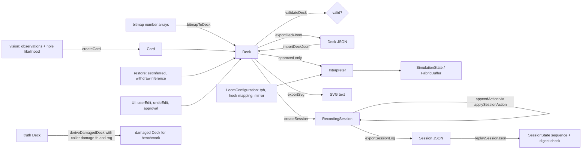

# Design Document

## Overview

This document designs the Card_Domain_Library in `src/domain`: pure TypeScript types and functions for Jacquard punched cards, ordered decks, evidence, auditable edit history, approval records, JSON import/export, a deterministic virtual loom, a versioned session log with deterministic replay, bitmap-to-deck generation and SVG export. It is an educational, Jacquard-inspired model. It makes no claim of compatibility with physical looms.

Design principles:

1. **Profile as data.** Every format-specific value (grid size, reserved positions, read order, hook mappings, threads-per-hook default, mirror options, dimensions) lives in a `MachineProfile` value with a per-field `VerificationStatus`. The Garín profile is one instance. All its format details are `unverified` (see "Historical assumptions requiring verification"). A correction to the profile requires no library code change.
2. **Pure and immutable.** No DOM, no `Date`, no network, no `Math.random`, no wall-clock value in any type. Recorded actions are ordered by `Sequence_Number`, identified by caller-supplied `Action_Id`. Expected failures return `Result`, never throw.
3. **Raw evidence is never overwritten; history is append-only.** Raw observation, algorithmic confidence, algorithmic evidence, human edits and approval are separate facts. Undo (of a user edit) and withdrawal (of an inference) each append an entry. Nothing is deleted or modified.
4. **Restoration_Confidence is algorithmic and may be `null`.** The field is always present and has type `number | null`. A number in [0,1] is an algorithmic estimate that the effective value is correct. `null` means "not evaluated": no algorithm has estimated correctness. `0` is an evaluated estimate of zero and is never equivalent to `null`. Detection and the vision constructor assign `null`, import from a bitmap assigns 1, and only inference assigns a numeric estimate from evidence. A user edit, an undo, an approval, a structure change and a replay never set or alter it. A withdrawal changes it only by restoring the value recorded in the Previous_Fields of the withdrawn inference (a number or `null`); it never computes a new value. A missing or `undefined` field is invalid and is never defaulted.
5. **Four coordinate systems are distinct types.** Branded numeric types prevent passing a `readIndex` where a `gridRow` is expected.
6. **Nothing is silently repaired.** Validation reports violations and returns the input unmodified. Import rejects unknown fields and partial data.
7. **Replay is reconstruction, not restart.** A recorded, versioned `Session_Log` is replayed through the same pure functions that produced it, and every step is checked against a recorded state digest.

Research summary that informed the design (no external research was needed; sources are the project steering files and the requirements):
- Format facts come from `jacquard-card-format.md`, which cites Rodas Lorente et al. (2025), https://doi.org/10.1007/s11042-025-20917-9. None are verified against the paper's figures yet.
- Principles for provenance, confidence and undo come from `restoration-principles.md`.
- Tech constraints come from `tech.md`: strict TypeScript, Vitest, fast-check, structured-cloneable values for later worker messages.
- Test rules come from `testing-standards.md`: explicit seed, bounded `numRuns`, stated preconditions, goldens in version control.

### Approved decisions

These were open questions in the earlier design. They are now approved and are no longer open.

| ID | Decision | Source |
|----|----------|--------|
| D1 | The fabric cap is 4,000,000 cells. Garín at threads-per-hook 16 therefore allows at most 625 passes. A UI that wants longer decks windows its rendering. | Req 8.11, 14.10, 14.11 |
| D2 | Undo covers user-edit entries only. Inference entries are reversed only by withdrawal (D10), never by undo. | Req 5.16 |
| D3 | A user edit does not set Restoration_Confidence. Confidence and Evidence of the cell stay as the algorithm left them. | Req 5.8 |
| D4 | Approval is an append-only list of Approval_Records with Action_Id and Sequence_Number. No timestamp. | Req 5.21 to 5.25 |
| D5 | Undo appends an Undo_Entry that references the reversed entry. No history entry is removed. | Req 5.13, 5.14 |
| D6 | Session replay is a separate component (`replaySession`), not an alias of `create`. | Req 9.13, 15 |
| D7 | Damage models belong to the benchmark spec. The domain provides only a neutral hook point. | Req 12.5 |
| D8 | Hook-to-warp mapping and hook-mapping selection are explicit data and configuration with no default. | Req 14 |
| D9 | Restoration_Confidence is a number in [0,1] or `null`. `null` means not evaluated and is distinct from `0`. Detection maps every detected cell to `null`. Only inference assigns a numeric value, and inference rejects `null`. | Req 5.1, 5.17, 5.18a, 7.12, 7.13, 12.2, 17 |
| D10 | `withdrawInference` reverses an accepted inference. It appends a `withdrawal` entry that restores the Previous_Fields recorded in the withdrawn `inference` entry (value or absence, provenance, confidence including `null`, evidence). It applies only when the latest Live_Entry of the cell is an `inference` entry. It appends an `unapproved` Approval_Record (cause `withdrawal`) when the Deck is approved. There is no operation that reverses a withdrawal; a new inference sets a value again. This replaces the restoration spec's fallback error `DOMAIN_AMENDMENT_REQUIRED`. | Req 5.26 to 5.33, 6.11, 6.12, 7.14, 7.15, 15.21, 15.22, 17.8 |

### Out of scope

Image detection, inference of missing cells, damage models, React UI and timers, benchmark harness, physical loom control, Garín5 dataset samples.

## Architecture

### Module layout

```
src/domain/
  index.ts                 single public export surface (Req 12.1), INTERFACE_VERSION
  result.ts                Result, DomainError, ErrorCode registry, stable messages
  brand.ts                 branded coordinate types and constructors
  limits.ts                LIMITS constants
  types.ts                 Card, Deck, Cell, Evidence, history, approval, schemaVersion constants
  profile/
    machineProfile.ts      MachineProfile, VerificationStatus, validateProfile, compileProfile
    garinProfile.ts        GARIN_PROFILE (every field unverified)
    readOrder.ts           read-order strategies, gridToReadIndex, readIndexToGrid, gridToPhysical
    hookMapping.ts         contiguous-visualization and repeat strategies, warp index functions
  card/
    card.ts                createCard, getCell, effectiveView
    edit.ts                userEdit, undoEdit, setInferred, withdrawInference, latestLiveEntry
  deck/
    deck.ts                createDeck, reorder, insert, remove, duplicate, accessors
    approval.ts            requestApproval, revokeApproval, approvalHistory, currentApproval
    validate.ts            validateDeck, violation collection
    compare.ts             deckEquals, compareCells, deriveDamagedDeck (neutral hook)
  io/
    canonicalJson.ts       schema-ordered stable JSON writer, shared by deck, session and digest; INTERNAL, not exported from index.ts (Req 7.17)
    schema.ts              key lists per type, unknown-field walk
    serialize.ts           exportDeckJson, importDeckJson
    migrate.ts             pure migrations by schemaVersion
  loom/
    config.ts              LoomConfiguration, makeLoomConfig, validateLoomConfig
    interpreter.ts         decodeCard, passResult, fabricCoordinate, FabricBuffer
    simulation.ts          create, step, pause, resume, seek, reset, runToEnd
    disclaimer.ts          SIMULATION_DISCLAIMER
  session/
    sessionLog.ts          SessionLog, SessionAction, SessionState types
    apply.ts               applySessionAction (single dispatcher used by append and replay)
    record.ts              createSession, appendAction (RecordingSession)
    replay.ts              replaySession, replaySessionJson
    digest.ts              stateDigest, DIGEST_ALGORITHM
    serialize.ts           exportSessionLog, importSessionLog
  bitmap/
    bitmapToDeck.ts        Bitmap_Converter
  svg/
    exportSvg.ts           SVG_Exporter, SVG_CAVEAT
docs/
  domain-errors.md         full error-code list (Req 12.7, 16.4)
  domain-svg-caveat.md     SVG caveat (Req 11.9)
  domain-loom.md           read order, hook mappings and consequences, mirror, calibration, assumptions
  domain-session-log.md    session log schema, digest algorithm and its non-cryptographic status
```

### Dependency rule and import-boundary test

`src/domain` imports only from within `src/domain` and TypeScript built-ins. An import-boundary test (`src/domain/__tests__/boundary.test.ts`) scans every `.ts` file under `src/domain`, tests included, and fails on:
- import specifiers resolving to `src/vision`, `src/restore`, `src/benchmark`, `src/ui` or `src/workers`, in relative or alias form;
- the identifiers `document`, `window`, `fetch`, `XMLHttpRequest`, `Date`, `Math.random`, `performance.now`, `setTimeout`, `setInterval`.

The scan uses the TypeScript compiler API inside the test only.

### Data flow



## Components and Interfaces

All code below is a type or signature contract, not an implementation.

### Result and errors

```ts
export type Result<T, E extends DomainError = DomainError> =
  | { readonly ok: true; readonly value: T }
  | { readonly ok: false; readonly error: E };

export interface DomainError {
  readonly code: ErrorCode;     // member of the ERROR_CODES registry
  readonly message: string;     // stable text from ERROR_MESSAGES[code]; may append names/numbers after a fixed prefix
  readonly path?: string;       // e.g. "cards[3].cells[17].initial.restorationConfidence"
}
export interface ViolationReport {
  readonly violations: readonly DomainError[]; // at most LIMITS.maxViolations (100)
  readonly totalViolations: number;            // may exceed violations.length
}
export interface ReportedError extends DomainError { readonly report: ViolationReport }
```

Public helpers in `result.ts`, part of the exported surface:

```ts
export function ok<T>(value: T): Result<T, never>;
export function err<E extends DomainError>(error: E): Result<never, E>;
/** Builds a DomainError from the registry. `detail` is appended after the fixed ERROR_MESSAGES[code] prefix; `path` is included only when given. */
export function makeError(code: ErrorCode, detail?: string, path?: string): DomainError;
```

The `ErrorCode` registry is the complete list in Requirement 16.1. It is defined once in `result.ts` as `ERROR_CODES` (a `readonly` tuple) and `ErrorCode` is derived from it. The full list is in "Error Handling". Codes are never renamed or reused; a code's meaning does not change across minor interface versions (Req 16.2).

### Branded coordinate types (Req 3.6)

```ts
declare const brand: unique symbol;
type Brand<T, B extends string> = T & { readonly [brand]: B };
export type GridRow = Brand<number, "GridRow">;
export type GridColumn = Brand<number, "GridColumn">;
export type ReadIndex = Brand<number, "ReadIndex">;       // hook h reads readIndex h
export type WarpIndex = Brand<number, "WarpIndex">;
export type PassIndex = Brand<number, "PassIndex">;
export type Millimetres = Brand<number, "Millimetres">;
export type ActionId = string;                             // caller supplied, never generated
export type SequenceNumber = number;                       // positive integer, assigned by the library

export interface GridPosition { readonly gridRow: GridRow; readonly gridColumn: GridColumn }
export interface PhysicalLocation { readonly xMm: Millimetres; readonly yMm: Millimetres }
export interface FabricCoordinate { readonly warpIndex: WarpIndex; readonly passIndex: PassIndex }
```

Constructors (`asGridRow`, `asReadIndex`, ...) return `Result` and check integer and range where the range is known (an optional exclusive upper bound). Brands are compile-time only, so values stay plain structured-cloneable numbers.

Error codes of the constructors (Req 3.7, 4.4, 4.11). A non-integer and an out-of-range value give the same code, so one concept never has two codes:

| Constructor | Error code for a non-integer, negative or out-of-range value |
|-------------|------------------------------------------------------------|
| `asGridRow`, `asGridColumn` | `POSITION_OUT_OF_RANGE` |
| `asReadIndex` | `READ_INDEX_OUT_OF_RANGE` |
| `asWarpIndex` | `POSITION_OUT_OF_RANGE` (a fabric position, Req 3.7) |
| `asPassIndex` | `SEEK_OUT_OF_RANGE` |
| `asMillimetres`, `asActionId`, `asSequenceNumber` | `INVALID_FORMAT` |

`POSITION_OUT_OF_RANGE` means a grid or fabric position out of range. It is also the code for a thread offset outside `[0, threadsPerHook)` (Req 3.7).

### Machine profile

```ts
export interface VerificationStatus {
  readonly status: "unverified" | "verified";
  readonly basis: "paper-figure" | "geometric-inference" | "unknown";
  readonly source?: string;   // page or figure; REQUIRED and non-empty when status is "verified"
  readonly note?: string;     // human-readable, shown by UI and exports
}

export type ProfileFieldKey =
  | "gridSize" | "reservedPositions" | "endHoles" | "readOrder" | "defaultThreadsPerHook"
  | "mirrorOptions" | "cardToPass" | "physicalDimensions";

export interface MachineProfile {
  readonly schemaVersion: 1;
  readonly profileId: string;                          // "garin-51x8"
  readonly displayName: string;
  readonly gridRows: number;                           // integer 1..256
  readonly gridColumns: number;                        // integer 1..256
  readonly readableCount: number;                      // must equal rows*cols - reserved count
  readonly reservedPositions: readonly ReservedPositionSpec[];
  readonly endHoles?: readonly EndHoleSpec[];          // non-grid features (Req 3.3)
  readonly readOrder: ReadOrderSpec;
  readonly hookMappings: readonly HookMappingSpec[];   // permitted mappings (Req 14.1)
  readonly defaultThreadsPerHook: number;              // 16 for Garín (unverified, A5)
  readonly mirrorOptions: readonly MirrorOrientation[];// includes "none" and "mirrored"
  readonly cardToPass: CardToPassSpec;                 // { kind: "one-card-per-pass" } (A8)
  readonly physicalDimensions?: PhysicalDimensions;
  readonly verification: Readonly<Record<ProfileFieldKey, VerificationStatus>>;
}

export interface ReservedPositionSpec { readonly gridRow: number; readonly gridColumn: number; readonly role: string }
export interface EndHoleSpec { readonly id: string; readonly description: string; readonly xMm?: number; readonly yMm?: number; readonly diameterMm?: number }
export type MirrorOrientation = "none" | "mirrored";
export type CardToPassSpec = { readonly kind: "one-card-per-pass" };   // room for future variants without schema break
export interface PhysicalDimensions {
  readonly cardWidthMm: number; readonly cardHeightMm: number;
  readonly originXMm: number; readonly originYMm: number;      // centre of grid position (0,0) (Req 4.10)
  readonly rowPitchMm: number; readonly columnPitchMm: number; readonly holeDiameterMm: number;
}

export type HookMappingKind = "contiguous-visualization" | "repeat";
export interface HookMappingSpec {
  readonly kind: HookMappingKind;
  readonly verification: VerificationStatus;           // each mapping has its own status (Req 14.1)
  readonly note?: string;
}

export type ReadOrderSpec =
  | { readonly kind: "column-major";
      readonly columnDirection: "right-to-left" | "left-to-right";
      readonly rowDirection: "bottom-up" | "top-down" }          // Garín: right-to-left, bottom-up
  | { readonly kind: "explicit"; readonly order: readonly { readonly gridRow: number; readonly gridColumn: number }[] };
```

**Compilation.** `compileProfile(profile): Result<CompiledProfile>` is pure. It produces `gridToRead` and `readToGrid` lookup tables and the reserved set. It is the only place that derives tables, so replacing `reservedPositions` in the profile data recomputes every table, `readableCount` check and conversion with no code change (Req 2.10). A `WeakMap` cache keyed on profile identity may memoise it; the cache never changes results.

```
compileProfile(p):
  validateProfile(p) -> first failure returned
  reserved = set of p.reservedPositions
  order = readOrder column-major: iterate columns in columnDirection, rows in rowDirection,
          skip reserved;  or readOrder explicit: use p.order (must list each readable position once)
  assert order.length == p.readableCount
  readToGrid[i] = order[i];  gridToRead[(row,col)] = i
```

**Garín profile (`GARIN_PROFILE`).** 51 rows, 8 columns, 408 positions, 8 reserved, 400 readable, default threads-per-hook 16, `mirrorOptions: ["none","mirrored"]`, `cardToPass: one-card-per-pass`, no `physicalDimensions`, `hookMappings` containing both `contiguous-visualization` and `repeat`.

**Reserved positions (A1).** The eight positions are a placeholder: row 25 (the middle row of 51), columns 0 to 7, role `"alignment (placeholder)"`. Their `VerificationStatus` is `{ status: "unverified", basis: "geometric-inference", note: "Location inferred from the 51 x 8 grid geometry. This is a placeholder. It was not observed in the paper's figures." }`. A correction is made by editing `reservedPositions` (and `verification.reservedPositions`) in profile data only. UI and SVG exports show the basis and note (Req 2.7, 11.10).

**Compiled profile (public types).** `compileProfile` returns the following. These types are part of the exported surface and the encoding below is documented, so callers may rely on it.

```ts
export interface CompiledGridPosition { readonly gridRow: number; readonly gridColumn: number }
export interface CompiledProfile {
  readonly gridRows: number;
  readonly gridColumns: number;
  readonly readableCount: number;
  readonly readToGrid: readonly CompiledGridPosition[];   // indexed by readIndex, length readableCount
  readonly gridToRead: readonly number[];                 // indexed by gridRow * gridColumns + gridColumn;
                                                          // -1 marks a reserved position; length gridRows * gridColumns
  readonly reserved: ReadonlySet<number>;                 // the same grid keys (gridRow * gridColumns + gridColumn)
}
export function validateProfile(p: unknown): Result<MachineProfile, ReportedError>;
export function compileProfile(p: MachineProfile): Result<CompiledProfile, ReportedError>;
```

The compile cache is keyed on object identity, so profiles are treated as immutable (Req 1.2). `GARIN_PROFILE` is deep-frozen at module load.

**Verification rules.** `validateProfile` returns the specific error code of the first violation at the top level, with the full violation report attached (`ReportedError`, Req 2.13): `PROFILE_COUNT_MISMATCH` for a readable-count mismatch, `HOOK_MAPPING_INVALID` for a bad mapping entry (unknown `kind` or invalid parameters, Req 14.5), and `INVALID_PROFILE` with a path only for violations that have no more specific code, including a field marked `verified` without a non-empty `source` (Req 2.11). `INVALID_PROFILE` is not a wrapper for the other two. The same applies to profile violations found inside `validateDeck` (Req 6.15).

### Cells, evidence, history and the Effective_View

```ts
export type Provenance = "observed" | "repeat-inferred" | "symmetry-inferred" | "ambiguous" | "user-edited";
export type Bit = 0 | 1;                                  // 1 = lifted, 0 = down
export interface RawObservation { readonly value?: Bit; readonly holeLikelihood?: number }  // never changed

export interface EvidenceRef { readonly kind: "card" | "cell" | "period" | "symmetry-axis" | "note";
  readonly cardId?: string; readonly readIndex?: number; readonly period?: number }
export interface Evidence { readonly text: string; readonly refs: readonly EvidenceRef[] }  // text <= 1000 chars

/** State at cell creation. Provenance is never "user-edited". */
export interface CellInitial {
  readonly effectiveValue?: Bit;
  readonly provenance: Exclude<Provenance, "user-edited">;
  readonly restorationConfidence: number | null;        // always present; number in [0,1] (algorithmic) or null = not evaluated; never undefined
  readonly evidence: Evidence;
}

export interface UserEditEntry {
  readonly kind: "user-edit"; readonly actionId: ActionId; readonly sequence: SequenceNumber;
  readonly previousValue?: Bit; readonly previousProvenance: Provenance;
  readonly newValue: Bit; readonly editNote: string;     // 1..1000 chars, distinct from Evidence
  readonly approvalBefore: ApprovalState;                // deck approval before this edit
}
/** Previous_Fields: the state of the cell immediately before an inference. Confidence may be null and is never coerced to 0. */
export interface PreviousFields {
  readonly value?: Bit;                                  // absent when the cell had no effective value
  readonly provenance: Provenance;
  readonly confidence: number | null;                    // always present; null = not evaluated
  readonly evidence: Evidence;
}
export interface InferenceEntry {
  readonly kind: "inference"; readonly actionId: ActionId; readonly sequence: SequenceNumber;
  readonly previous: PreviousFields;                     // view before this inference (Req 5.27)
  readonly value?: Bit; readonly provenance: "repeat-inferred" | "symmetry-inferred" | "ambiguous";
  readonly confidence: number | null;                    // setInferred requires a number in [0,1]; null occurs only on policy entries that copy a previous null
  readonly evidence: Evidence;
  readonly policyNote?: string;                          // ambiguous-as-down policy note lives here, not in Evidence (Req 5.22)
}
export interface UndoEntry {
  readonly kind: "undo"; readonly actionId: ActionId; readonly sequence: SequenceNumber;
  readonly reverses: ActionId;                           // Action_Id of the reversed user-edit entry
  readonly restoredValue?: Bit; readonly restoredProvenance: Provenance;
}
export interface WithdrawalEntry {
  readonly kind: "withdrawal"; readonly actionId: ActionId; readonly sequence: SequenceNumber;
  readonly reverses: ActionId;                           // Action_Id of the withdrawn inference entry (same cell)
  readonly restored: PreviousFields;                     // equals the Previous_Fields of the referenced inference entry (Req 6.12)
}
export type EditEntry = UserEditEntry | InferenceEntry | UndoEntry | WithdrawalEntry;
// Live_Entry: a user-edit entry no undo entry references, or an inference entry no withdrawal entry references.
// undo and withdrawal entries are never Live_Entries. latestLiveEntry(cell) returns the Live_Entry with the highest sequence, or undefined.

export interface Cell {
  readonly raw: RawObservation;                          // never overwritten (Req 5.8)
  readonly initial: CellInitial;
  readonly history: readonly EditEntry[];                // append-only; no entry removed or modified
}
// position in Card.cells === readIndex

export interface EffectiveView {                         // derived, never stored
  readonly effectiveValue?: Bit; readonly provenance: Provenance;
  readonly restorationConfidence: number | null;         // null = not evaluated (Req 17.3); never coerced to 0
  readonly evidence: Evidence;
  readonly holeLikelihood?: number;                      // from raw; a separate field and separate UI label
}
```

**Fold.** `effectiveView(cell)` folds `history` over `initial`:

```
view = from initial
for e in history:
  user-edit: view.value = e.newValue; view.provenance = "user-edited"       // confidence, evidence untouched
  inference: view.value = e.value; view.provenance = e.provenance;
             view.confidence = e.confidence; view.evidence = e.evidence
  undo:      view.value = e.restoredValue; view.provenance = e.restoredProvenance  // confidence, evidence untouched
  withdrawal: view.value = e.restored.value; view.provenance = e.restored.provenance;
              view.confidence = e.restored.confidence; view.evidence = e.restored.evidence  // null stays null
```

Consequences:
- Restoration_Confidence changes only through `inference` entries, `withdrawal` entries (which restore the Previous_Fields value, a number or `null`) or at creation. A user edit and an undo never touch it (Req 5.8, 5.14, 13.17, 17.8). A withdrawal changes only the cell it targets.
- A withdrawal restores value (or its absence), provenance, confidence and evidence exactly as recorded in the Previous_Fields of the withdrawn inference, and leaves `raw` untouched (Req 5.30). A user edit made after a withdrawal records the post-withdrawal view as its earlier value and provenance (Req 5.32). A `null` value passes through the fold unchanged and is never replaced by `0` or any default (Req 17.4).
- Hole_Likelihood (in `raw`), Restoration_Confidence (in the view) and the Deck's approval are three separate fields (Req 5.2). The UI labels them differently.
- An `ambiguous` cell with no value has `effectiveValue` absent (Req 5.4).
- Under the ambiguous-as-down policy the inference entry has `value: 0`, `provenance: "ambiguous"`, `confidence` (possibly `null`) and `evidence` copied from the previous view, and `policyNote` set. Evidence is not edited and a `null` confidence stays `null` (Req 5.22).

### Approval records and the Deck

```ts
export type ApprovalState = "unapproved" | "approved";
export interface ApprovalRecord {
  readonly actionId: ActionId;                           // same Action_Id as the causing action (Req 5.12)
  readonly sequence: SequenceNumber;                     // contiguous from 1 within the approvals list (Req 6.5)
  readonly state: ApprovalState;
  readonly cause: "init" | "approve" | "revoke" | "edit" | "undo" | "structure" | "withdrawal";
  readonly policyNote?: string;
}

export interface Card {
  readonly schemaVersion: 1;
  readonly cardId: string;                               // caller supplied, unique in deck
  readonly cells: readonly Cell[];                       // length === profile.readableCount; index === readIndex
}

export interface Deck {
  readonly schemaVersion: 1;
  readonly profile: MachineProfile;                      // full profile embedded (Req 2.8)
  readonly cards: readonly Card[];                       // 1..10,000, order = pass order (A8)
  readonly approvals: readonly ApprovalRecord[];         // append-only, non-empty; last is current (Req 5.21)
  readonly lastEntrySequence: number;                    // highest Sequence_Number used by any cell EditEntry in this deck
  readonly confidenceCalibration: "uncalibrated" | { readonly benchmarkRef: string };  // Req 12.8
}
export function currentApproval(deck: Deck): ApprovalState;          // last record's state
export function approvalHistory(deck: Deck): readonly ApprovalRecord[]; // full audit trail, no timestamps
```

**Sequence numbers.** There are two append-only sequences in a Deck. `ApprovalRecord.sequence` is contiguous from 1 within `approvals`. `EditEntry.sequence` is contiguous from 1 across all cell entries in the Deck, in order of application; `lastEntrySequence` stores the highest value so no scan is needed. An action that changes both (an edit on an approved deck) shares one `actionId` between its entry and its approval record. `actionId` uniqueness is enforced per list. A caller-supplied `actionId` that already appears in any entry or approval record returns `DUPLICATE_ACTION_ID`. This reading of Req 6.5 is marked [CONFIRM] in "Open questions".

An approved Deck must have no unresolved cell. A Deck is `approved` only through `requestApproval`.

### Weft colour layer and loom configuration

```ts
export interface WeftColourLayer {                       // user supplied, never part of a Card
  readonly schemaVersion: 1;
  readonly label: "user-supplied colour layer (not stored on punched cards)";
  readonly passColours: readonly { readonly passIndex: PassIndex; readonly colour: string }[];
  readonly warpColours: readonly { readonly warpIndex: WarpIndex; readonly colour: string }[];
  readonly defaultWeftColour?: string; readonly defaultWarpColour?: string;
}

export interface LoomConfiguration {
  readonly schemaVersion: 1;
  readonly profileId: string;
  readonly threadsPerHook: number;                       // integer 1..64; defaults to profile default at construction only
  readonly hookMapping: HookMappingKind;                 // explicit, NO default (Req 14.2)
  readonly mirror: MirrorOrientation;                    // explicit, NO default (Req 8.5)
  readonly colourLayer?: WeftColourLayer;
}
export interface LoomConfigInput { threadsPerHook?: number; hookMapping?: HookMappingKind; mirror?: MirrorOrientation; colourLayer?: WeftColourLayer }
export function makeLoomConfig(input: LoomConfigInput, profile: MachineProfile): Result<LoomConfiguration>;
```

`makeLoomConfig` check order (first failure returned, Req 8.18): `threadsPerHook` default from the profile then `INVALID_THREADS_PER_HOOK`; `hookMapping` absent then `HOOK_MAPPING_NOT_CONFIGURED`; `hookMapping` not permitted by the profile then `UNSUPPORTED_HOOK_MAPPING`; `mirror` absent then `MIRROR_NOT_CONFIGURED`; `mirror` not permitted then `UNSUPPORTED_MIRROR`. The same checks run inside `create` for configurations that arrive without going through `makeLoomConfig` (for example from JSON).

### Hook-to-warp mappings (profile data, explicit selection)

Two mappings are offered. Neither is claimed as verified.

| Mapping | Hook `h` drives warp indices | Standing |
|---------|------------------------------|----------|
| `contiguous-visualization` | `h * t + k`, `k = 0..t-1` | A display convenience. Not claimed as historical. |
| `repeat` | `h + k * readableCount`, `k = 0..t-1` | Historically motivated by Jacquard harness tie-ups, where one hook lifts several warp threads spaced across the width. Not claimed as verified. |

Here `t` is `threadsPerHook`. For both, `warpCount = readableCount * t` and mirror is applied afterwards: `mirrored(w) = warpCount - 1 - w`. The mapping choice does not alter the Deck.

```ts
/** Structural subset of LoomConfiguration; a LoomConfiguration is assignable to it. `hookMapping` and `mirror` are optional only so partial or unvalidated input (for example from JSON) is assignable. There is no default: the functions return HOOK_MAPPING_NOT_CONFIGURED or MIRROR_NOT_CONFIGURED when either is absent. */
export interface HookMappingConfig {
  readonly threadsPerHook: number;
  readonly hookMapping?: HookMappingKind;
  readonly mirror?: MirrorOrientation;
}
export function warpCount(profile: MachineProfile, cfg: HookMappingConfig): Result<number>;
export function hookWarpIndices(profile: MachineProfile, cfg: HookMappingConfig, hook: ReadIndex): Result<readonly WarpIndex[]>;
// pre-mirror, then mirror; result sorted ascending
```

Both functions return `Result` and never throw for expected failures (Req 14.13). Neither the hook mapping nor the mirror orientation has an implicit default (Req 8.5, 14.2). `HookMappingConfig` declares `hookMapping` and `mirror` optional only so that a `LoomConfiguration` and partial or unvalidated inputs are assignable; both functions reject an absent value. Check order, first failure returned, identical in `warpCount` and `hookWarpIndices`: (1) `INVALID_THREADS_PER_HOOK` (not an integer in [1, 64]); (2) `HOOK_MAPPING_NOT_CONFIGURED` (`hookMapping` absent); (3) `UNSUPPORTED_HOOK_MAPPING` (unknown kind, or not among `profile.hookMappings`); (4) `MIRROR_NOT_CONFIGURED` (`mirror` absent); (5) `UNSUPPORTED_MIRROR` (unknown value, or not among `profile.mirrorOptions`); (6) for `hookWarpIndices` only, `READ_INDEX_OUT_OF_RANGE` (`hook` not an integer in `[0, readableCount - 1]`). `HOOK_MAPPING_INVALID` is reserved for bad profile data (Req 14.5) and is never returned here.

```ts
export function validateLoomConfig(cfg: unknown, profile: MachineProfile): Result<LoomConfiguration>;
// Checks a LoomConfiguration that arrives without makeLoomConfig (for example from JSON). Shape first (wrong shape or profileId mismatch: INVALID_FORMAT), then the makeLoomConfig order:
// INVALID_THREADS_PER_HOOK, HOOK_MAPPING_NOT_CONFIGURED, UNSUPPORTED_HOOK_MAPPING, MIRROR_NOT_CONFIGURED, UNSUPPORTED_MIRROR. Never defaults an input.
```

Consequences with the 4,000,000-cell cap (D1), identical for both mappings, documented in `docs/domain-loom.md`:

| threadsPerHook | Garín warp count | Max passes under the cap | Note |
|----------------|------------------|--------------------------|------|
| 16 (default, unverified) | 6,400 | 625 | |
| 10 | 4,000 | 1,000 | |
| 64 | 25,600 | 156 | floor(4,000,000 / 25,600) |
| 1 | 400 | 10,000 | equals the maximum Deck size |

A Deck with more passes than the cap allows gives `FABRIC_TOO_LARGE` stating warp count, pass count and cap. The two mappings differ only in which warp threads each hook drives. The default 16 is `unverified` (A5, A11): it may instead be a property of the machine's hook-to-thread arrangement, so the mapping stays data.

### Interpreter and fabric

```ts
export type FabricCell = "warp" | "weft";
export interface FabricRow {
  readonly passIndex: PassIndex;
  readonly liftedHooks: readonly ReadIndex[];            // ascending
  readonly liftedWarpIndices: readonly WarpIndex[];      // ascending, after mirror; the canonical record of the row
}
export interface FabricBuffer {
  readonly warpCount: number; readonly passCount: number;
  readonly rows: readonly FabricRow[];                   // rows rendered so far
  readonly colours?: ResolvedColours;                    // only when a layer was supplied
  readonly disclaimer: typeof SIMULATION_DISCLAIMER;
}
export interface ResolvedColours { readonly label: "user-supplied colour layer";
  readonly warpColourByIndex: readonly string[]; readonly weftColourByPass: readonly string[] }
export function fabricCellAt(buf: FabricBuffer, c: FabricCoordinate): FabricCell;      // "warp" iff lifted
export function fabricToCells(buf: FabricBuffer): readonly (readonly FabricCell[])[];  // rectangular view (Req 8.12)

export function decodeCard(deck: Deck, cardIndex: number): Result<readonly Bit[]>;
// CARD_INDEX_OUT_OF_RANGE (cardIndex not an integer in [0, card count - 1]), then UNRESOLVED_CELL (Req 12.11)
export function passResult(deck: Deck, cfg: LoomConfiguration, passIndex: PassIndex): Result<FabricRow>;
// preconditions as below, then SEEK_OUT_OF_RANGE (passIndex not an integer in [0, passCount - 1])
export function fabricCoordinate(readIndex: ReadIndex, threadOffset: number, passIndex: PassIndex,
  cfg: LoomConfiguration, profile: MachineProfile): Result<FabricCoordinate>;
```

`fabricCoordinate` check order: the `HookMappingConfig` checks of `hookWarpIndices` (including `READ_INDEX_OUT_OF_RANGE`), then `POSITION_OUT_OF_RANGE` for a `threadOffset` that is not an integer in `[0, threadsPerHook)` (Req 3.7), then `SEEK_OUT_OF_RANGE` for a non-integer or negative `passIndex` (Req 4.11). Consistency: for every valid input, `fabricCoordinate(h, k, p, cfg, profile).warpIndex` equals the `k`-th element of the pre-mirror indices for hook `h`, after mirror, and therefore is a member of `hookWarpIndices(profile, cfg, h)`.

Rows store only lifted indices, so memory is proportional to lifted threads, not to the 4,000,000-cell cap. `fabricToCells` builds the rectangular view on demand. Performance is measured, not asserted (see Testing Strategy).

Precondition order (Req 8.18), first failure returned: (1) Loom_Configuration validity (`INVALID_FORMAT` for a wrong shape or `profileId` mismatch, then `INVALID_THREADS_PER_HOOK`, `HOOK_MAPPING_NOT_CONFIGURED`, `UNSUPPORTED_HOOK_MAPPING`, `MIRROR_NOT_CONFIGURED`, `UNSUPPORTED_MIRROR`); (2) `DECK_NOT_APPROVED`; (3) `UNRESOLVED_CELL`; (4) `FABRIC_TOO_LARGE`; (5) colour layer (`COLOUR_LAYER_OUT_OF_RANGE`, `INVALID_COLOUR_LAYER`).

Colours are read only from the `WeftColourLayer`. Without a layer the buffer has no `colours` field and symbolic values only (Req 8.13). `SIMULATION_DISCLAIMER = "Educational Jacquard-inspired simulation. Not compatible with, and does not drive, physical looms."` is attached to every `SimulationState` and `FabricBuffer`.

### Simulation (pure transitions, no timers)

```ts
export type RunStatus = "ready" | "running" | "paused" | "complete";
export interface SimulationState {
  readonly schemaVersion: 1;
  readonly deck: Deck;                                   // immutable snapshot taken at create
  readonly config: LoomConfiguration;
  readonly passIndex: PassIndex;                         // passes executed so far, 0..passCount
  readonly status: RunStatus;
  readonly fabric: FabricBuffer;
  readonly disclaimer: typeof SIMULATION_DISCLAIMER;
}
export function create(deck: Deck, cfg: LoomConfiguration): Result<SimulationState>;
export function step(s: SimulationState): Result<SimulationState>;       // PAUSED | ALREADY_COMPLETE
export function pause(s: SimulationState): SimulationState;
export function resume(s: SimulationState): SimulationState;
export function seek(s: SimulationState, passIndex: number): Result<SimulationState>; // SEEK_OUT_OF_RANGE
export function reset(s: SimulationState): SimulationState;
export function runToEnd(deck: Deck, cfg: LoomConfiguration): Result<SimulationState>;
```

Rules:
- `create` validates preconditions in the fixed order above and returns `passIndex 0`, status `ready`, empty rows.
- `step` on `paused` returns `PAUSED`; on `complete` returns `ALREADY_COMPLETE`. Neither returns a state copy, since the caller's input was never mutated. Otherwise it appends one `FabricRow`, increments `passIndex`, and sets `complete` when `passIndex` reaches `passCount`, else `running`.
- `pause` on `ready` or `running` sets `paused`; other statuses are returned unchanged. `resume` on `paused` sets `ready` when `passIndex` is 0, else `running`.
- `seek(s, n)` requires an integer in `[0, passCount]` and equals `reset` followed by `n` `step` calls.
- `reset` returns `passIndex 0`, empty rows, `ready`.
- There is no `replay` in this module. Replay is `replaySession` in `session/replay.ts` (D6, Req 9.13).
- All states are structured-cloneable plain data.

### Deck operations, edits and approval

```ts
// card.ts
export function createCard(profile: MachineProfile, cardId: string,
  observations: readonly CellSeed[]): Result<Card>;      // length must equal readableCount
export interface CellSeed { raw: RawObservation; initial?: Omit<CellInitial, "restorationConfidence"> }
// initial defaults: observed if raw.value present, else ambiguous with no value and evidence "no observation".
// createCard ALWAYS writes restorationConfidence: null (not evaluated); a seed cannot carry a confidence (Req 12.10).
// Seed provenance is "observed" or "ambiguous" only. Detection observes holes; it does not evaluate restoration correctness (Req 12.2).
export function getCell(deck: Deck, cardId: string, readIndex: number): Result<Cell>;   // UNKNOWN_CARD | READ_INDEX_OUT_OF_RANGE
export function effectiveView(cell: Cell): EffectiveView;
export function setObservation... // not provided: raw is fixed at creation

// edit.ts
export interface UserEditInput { cardId: string; readIndex: number; value: Bit; editNote: string; actionId: ActionId }
export function userEdit(deck: Deck, i: UserEditInput): Result<Deck>;
export function undoEdit(deck: Deck, i: { cardId: string; readIndex: number; actionId: ActionId }): Result<Deck>;
// undoEdit order: UNKNOWN_CARD, READ_INDEX_OUT_OF_RANGE, DUPLICATE_ACTION_ID, NOTHING_TO_UNDO
export interface InferenceInput { cardId: string; readIndex: number; actionId: ActionId;
  provenance: string; value?: Bit; confidence: number; evidence: Evidence }  // confidence is a finite number in [0,1]; null is rejected (an inference is an evaluation)
export function setInferred(deck: Deck, i: InferenceInput): Result<Deck>;
export interface WithdrawalInput { cardId: string; readIndex: number; actionId: ActionId }
export function withdrawInference(deck: Deck, i: WithdrawalInput): Result<Deck>;
export function latestLiveEntry(cell: Cell): UserEditEntry | InferenceEntry | undefined;

// deck.ts
export function createDeck(profile: MachineProfile, cards: readonly Card[], actionId: ActionId): Result<Deck>;
export function reorderCards(deck: Deck, order: readonly string[], actionId: ActionId): Result<Deck>;
export function insertCard(deck: Deck, card: Card, at: number, actionId: ActionId): Result<Deck>;
export function removeCard(deck: Deck, cardId: string, actionId: ActionId): Result<Deck>;
export function duplicateCard(deck: Deck, cardId: string, newCardId: string, actionId: ActionId): Result<Deck>;
export function getCellByCardAndIndex(deck: Deck, cardId: string, readIndex: number): Result<Cell>;

// approval.ts
export interface AmbiguousAsDownPolicy { readonly ambiguousAs: "down"; readonly note: string }
export function requestApproval(deck: Deck, i: { actionId: ActionId; policy?: AmbiguousAsDownPolicy }): Result<Deck>;
export function revokeApproval(deck: Deck, i: { actionId: ActionId }): Result<Deck>;
```

Behaviour:

- **`userEdit`.** Checks in order: `UNKNOWN_CARD`, `READ_INDEX_OUT_OF_RANGE`, `DUPLICATE_ACTION_ID`, `EDIT_NOTE_REQUIRED` (empty note), `EVIDENCE_TOO_LONG` (note over 1,000 chars). On success it returns a new Deck in which the cell gains one `user-edit` entry holding `actionId`, the next entry sequence, previous value and provenance, new value, `editNote` and `approvalBefore`. `raw`, `initial`, Restoration_Confidence and Evidence are unchanged. If the deck was `approved`, one `ApprovalRecord` of state `unapproved`, cause `edit`, same `actionId`, is appended. Every Restoration_Confidence, including `null`, is unchanged.
- **`undoEdit`.** The latest entry of that cell's history must be a `user-edit` entry that no `undo` entry reverses; otherwise `NOTHING_TO_UNDO`. Success appends one `undo` entry with `reverses` set to that entry's `actionId` and `restoredValue` / `restoredProvenance` taken from that entry's `previousValue` / `previousProvenance`. If `currentApproval(deck)` differs from the reversed entry's `approvalBefore`, an `ApprovalRecord` (cause `undo`, same `actionId`) carrying `approvalBefore` is appended. No entry is removed or modified, and Restoration_Confidence (including `null`) is untouched. Undo never reverses an inference (D2, Req 5.16); that is `withdrawInference`. Because the latest entry after an undo is an `undo` entry, a second `undoEdit` on the same cell returns `NOTHING_TO_UNDO` until a new edit is made (see Q4). The same holds when the latest entry is a `withdrawal` entry (Req 5.32).
- **`setInferred`.** Check order, first failure returned: `UNKNOWN_CARD`, `READ_INDEX_OUT_OF_RANGE`, `DUPLICATE_ACTION_ID`, then the input checks below, then `OBSERVED_CELL_PROTECTED` (protected observed cell), then `INVALID_EDIT` (protected user edit). `provenance` must be one of the five values or `INVALID_PROVENANCE`; `observed` gives `INFERENCE_CANNOT_BE_OBSERVED`; `user-edited` is not an inference provenance and gives `INVALID_PROVENANCE`. **Value rules (Req 5.34, 5.35):** `repeat-inferred` or `symmetry-inferred` without a `value` gives `INVALID_PROVENANCE`; `ambiguous` with a `value` gives `INVALID_PROVENANCE`. An `ambiguous` entry that carries an effective value is therefore written only by `requestApproval` with the explicit ambiguous-as-down policy, with `policyNote` set; `InferenceInput` has no `policyNote`, so `setInferred` can never produce a Deck that `validateDeck` rejects for this reason. `ambiguous` without a value is accepted (it records an unresolved cell with its evidence and confidence). Evidence text must be non-empty (`EVIDENCE_REQUIRED`) and at most 1,000 chars (`EVIDENCE_TOO_LONG`). Confidence must be a finite number in [0,1]. `null`, `undefined`, a non-number, `NaN`, an infinity or an out-of-range value returns `PROBABILITY_OUT_OF_RANGE` and leaves the Deck unchanged (Req 5.18a). If the cell's current view provenance is `observed`, the result is `OBSERVED_CELL_PROTECTED` whatever the inference's provenance or value: an observed value is overridden only by an explicit user action (`restoration-principles.md`), never by inference. This includes a cell that a user edit overrode and `undoEdit` then reversed, because the undo restores the view to `observed`, so the cell is protected again (R2-5). Such a cell can change again only through a new `userEdit`. If the cell's current provenance is `user-edited` and its latest user edit has not been reversed, the result is `INVALID_EDIT`: restoration must not overwrite a human decision. Success appends one `inference` entry whose `previous` field holds the Previous_Fields (the view before the call, including a `null` confidence and the earlier evidence), and leaves `raw` untouched. An inference after a withdrawal is accepted like any other when no un-reversed user edit protects the cell (Req 5.33).
- **`withdrawInference`.** Checks in this fixed order and returns the first failure, leaving the Deck unchanged: `UNKNOWN_CARD`; `READ_INDEX_OUT_OF_RANGE` (not an integer in `[0, readableCount - 1]`); `DUPLICATE_ACTION_ID` (the action id already exists in the Deck's history); `INVALID_EDIT` (the latest Live_Entry of the cell is a `user-edit` entry); `NOTHING_TO_WITHDRAW` (the cell has no Live_Entry, or its latest Live_Entry is not an `inference` entry). On success it appends one `withdrawal` entry holding the new `actionId`, the next entry sequence, `reverses` set to the withdrawn entry's `actionId`, and `restored` equal to that entry's `previous`. If `currentApproval(deck)` is `approved`, it also appends an `ApprovalRecord` (`unapproved`, cause `withdrawal`, same `actionId`), including when the withdrawn inference is the value an earlier approval covered; if `unapproved`, it appends no approval record. No entry is removed or modified, `raw` is untouched, and no other cell changes. Policy entries written by `requestApproval` are inference entries and are withdrawable by the same rules. No operation reverses a withdrawal (Req 5.33). Withdrawal is not a Session replay shortcut: it is applied through `applySessionAction` like every other action.
- **Structure operations** (reorder, insert, remove, duplicate) return a new Deck, keep each surviving cell byte for byte (provenance, evidence, confidence including `null`, history), and append an `unapproved` record (cause `structure`) with the supplied `actionId`. Check orders, first failure returned:
  - `reorderCards`: `DUPLICATE_ACTION_ID`, `INVALID_REORDER` (unknown or repeated `cardId`, or not a permutation).
  - `insertCard`: `DUPLICATE_ACTION_ID`, `CARD_INDEX_OUT_OF_RANGE` (`at` not an integer in `[0, card count]`, Req 6.14), `CELL_COUNT_MISMATCH` (the card's cell count differs from the Deck's `readableCount`; a `Card` carries no profile, so no `INVALID_FORMAT` case exists), `DUPLICATE_CARD_ID`, `INVALID_EDIT_HISTORY` (any cell of the supplied card has a non-empty `history`, Req 6.13), `DECK_SIZE_OUT_OF_RANGE` (result above 10,000 cards).
  - `removeCard`: `DUPLICATE_ACTION_ID`, `UNKNOWN_CARD`, `DECK_SIZE_OUT_OF_RANGE` (removing the last card).
  - `duplicateCard`: `DUPLICATE_ACTION_ID`, `UNKNOWN_CARD`, `DUPLICATE_CARD_ID` (`newCardId` exists), `INVALID_EDIT_HISTORY` (the source card has any cell with a non-empty `history`, Req 6.13), `DECK_SIZE_OUT_OF_RANGE`.

  Insert and duplicate reject Cards with history because copying entries would repeat Action_Ids and Sequence_Numbers, which must be unique deck-wide (Req 6.5). A Card with no history is inserted or duplicated with every field kept, so the "byte for byte" preservation above holds for it.
- **`createDeck`** checks: `DUPLICATE_ACTION_ID` is not applicable (empty history); `DECK_SIZE_OUT_OF_RANGE`, `DUPLICATE_CARD_ID`, `CELL_COUNT_MISMATCH`, `INVALID_EDIT_HISTORY` (a supplied card with history, since the new Deck starts at `lastEntrySequence` 0).
- **`createCard`** checks: `CELL_COUNT_MISMATCH` (seed count differs from `readableCount`), `INVALID_PROVENANCE` (a seed with provenance other than `observed` or `ambiguous`, Req 12.10), `OBSERVED_WITHOUT_OBSERVATION`, `PROBABILITY_OUT_OF_RANGE` (a `holeLikelihood` outside [0, 1] or not finite), `EVIDENCE_TOO_LONG`. No order requirement beyond this list.
- **`getCell` / `getCellByCardAndIndex`**: `UNKNOWN_CARD`, `READ_INDEX_OUT_OF_RANGE`.
- **`requestApproval`.** Check order: `DUPLICATE_ACTION_ID`, then `UNRESOLVED_CELLS` (below). If any cell has no effective value and no policy is supplied: `UNRESOLVED_CELLS` with up to 100 `{cardId, readIndex}` entries and a total count. With the explicit policy, every such cell gets one `inference` entry (value 0, provenance `ambiguous`, confidence (possibly `null`) and evidence copied from its previous view, `policyNote` set to the policy note, derived `actionId` `"<actionId>#<cardId>#<readIndex>"`). Each derived id is checked for uniqueness against every entry and approval record in the Deck, and against the other derived ids of the same call. A collision returns `DUPLICATE_ACTION_ID` and leaves the Deck unchanged, so no partial policy result exists (R2-9, Req 5.39). This check runs after the `UNRESOLVED_CELLS` check, because derived ids exist only when the policy applies. Then an `ApprovalRecord` (`approved`, cause `approve`, the supplied `actionId`, `policyNote`) is appended. Raw observation, Restoration_Confidence (including `null`) and Evidence are unchanged (Req 5.24).
- **`revokeApproval`** (check order: `DUPLICATE_ACTION_ID`) appends an `unapproved` record (cause `revoke`). The audit trail is the `approvals` list; no timestamp exists.

### Validation

```ts
export function validateProfile(p: unknown): Result<MachineProfile, ReportedError>;
export function validateDeck(d: unknown): Result<Deck, ReportedError>;
```

Violations are collected up to 100 with a total count. The input is never modified, repaired, clamped or defaulted (Req 6.4). Rules:

- Profile: rows and columns integers in [1,256]; reserved positions distinct and inside the grid; `readableCount` equals rows x columns minus reserved count; `defaultThreadsPerHook` in [1,64]; `mirrorOptions` non-empty and a subset of `{none, mirrored}` including `none`; `hookMappings` non-empty, each `kind` known with no unknown parameters; `verified` fields have a non-empty `source`.
- Deck: 1 to 10,000 cards; unique `cardId`; every card has exactly `readableCount` cells; `schemaVersion` supported.
- Cell, computed from `effectiveView`: provenance in the five values; `observed` with no `raw.value` gives `OBSERVED_WITHOUT_OBSERVATION`; `raw.holeLikelihood` finite in [0,1] when present, and every `restorationConfidence` (in `initial`), inference `confidence`, `previous.confidence` and `restored.confidence` either `null` or a finite number in [0,1], else `PROBABILITY_OUT_OF_RANGE` naming the cell (`null`, `0` and `1` accepted; `-0.0001`, `1.0001`, `NaN`, `Infinity`, `-Infinity` rejected); a `restorationConfidence` field that is absent or `undefined` gives `MISSING_REQUIRED_FIELD` with the cell path and is never treated as `null` (Req 17.2); an inference entry with `confidence: null` is valid only when it carries a `policyNote`; `repeat-inferred` and `symmetry-inferred` views need non-empty evidence of at most 1,000 chars; any evidence over 1,000 chars is `EVIDENCE_TOO_LONG`; `ambiguous` with a value requires an `inference` entry with `policyNote`.
- History: every `actionId` unique within the entry list; entry `sequence` values form `1..lastEntrySequence` with no gap or repeat across the deck; each `undo.reverses` names an earlier `user-edit` entry of the same cell that no earlier `undo` reverses, otherwise `INVALID_EDIT_HISTORY` with the path; each entry's `previous*` fields (and an inference entry's `previous` Previous_Fields, including confidence and evidence) match the view before it. Each `withdrawal.reverses` must name an earlier `inference` entry of the same cell that no earlier `withdrawal` reverses (a missing id, a `user-edit` entry, an inference of another cell, a later entry or an already-withdrawn inference gives `INVALID_EDIT_HISTORY` with the path of the withdrawal entry), and `withdrawal.restored` must equal the `previous` of the referenced inference entry (a mismatch is `INVALID_EDIT_HISTORY`). A `previous` or `restored` object lacking `confidence` gives `MISSING_REQUIRED_FIELD` with its path and is never defaulted. Action_Id uniqueness and sequence consistency apply to withdrawal entries exactly as to other entries (Req 6.11, 6.12).
- Approvals: non-empty and sequences contiguous from 1 (`INVALID_APPROVAL_HISTORY`); unique `actionId`s (`DUPLICATE_ACTION_ID`).
- Approved deck: no cell without an effective value (`UNRESOLVED_CELL` with card and `readIndex`).

The wrapper error for a Deck is `INVALID_DECK` with the report (`ReportedError`). A single-violation report still carries its specific code in `report.violations[0].code`. For a Machine_Profile the top-level code is the first violation's specific code, not a wrapper (Req 2.13).

**Validator code assignments (Req 6.15).** Approval list empty, or Approval_Record sequences not contiguous from 1: `INVALID_APPROVAL_HISTORY`. A duplicate Action_Id anywhere in the Deck (entries and approval records): `DUPLICATE_ACTION_ID`. An Edit_History entry sequence that is inconsistent (not `1..lastEntrySequence` without gap or repeat): `INVALID_EDIT_HISTORY`. Profile violations inside a Deck keep the profile's own codes, including `HOOK_MAPPING_INVALID`. A tampered `lastEntrySequence` is `INVALID_EDIT_HISTORY`.

### JSON serialization

```ts
export function exportDeckJson(deck: Deck, extras?: { weftColourLayer?: WeftColourLayer }): Result<string, ReportedError>;
// Order: INVALID_DECK (validateDeck report, Req 12.9), INVALID_COLOUR_LAYER, INVALID_FORMAT (colour layer of another shape)
export function importDeckJson(text: string): Result<ImportedDeck, ReportedError>;
export interface ImportedDeck { readonly deck: Deck; readonly weftColourLayer?: WeftColourLayer;
  readonly meta: { readonly sourceSchemaVersion: number; readonly migrations: readonly string[] } }
```

**Deck file schema** (key order below is the stable output order):

```json
{
  "format": "loom-lazarus-deck",
  "schemaVersion": 1,
  "deck": {
    "profile": { "...": "full MachineProfile incl. verification status and basis per field" },
    "cards": [
      { "cardId": "c-001",
        "cells": [
          { "raw": { "value": 1, "holeLikelihood": 0.97 },
            "initial": { "effectiveValue": 1, "provenance": "observed", "restorationConfidence": 0.97,
                         "evidence": { "text": "...", "refs": [] } },
            "history": [
              { "kind": "user-edit", "actionId": "a1", "sequence": 1, "previousValue": 1,
                "previousProvenance": "observed", "newValue": 0, "editNote": "...", "approvalBefore": "approved" },
              { "kind": "undo", "actionId": "a2", "sequence": 2, "reverses": "a1",
                "restoredValue": 1, "restoredProvenance": "observed" } ] },
          { "raw": { "value": 0, "holeLikelihood": 0.08 },
            "initial": { "effectiveValue": 0, "provenance": "observed", "restorationConfidence": null,
                         "evidence": { "text": "Detected from image; correctness not evaluated.", "refs": [] } },
            "history": [] } ] } ],
    "approvals": [ { "actionId": "init", "sequence": 1, "state": "unapproved", "cause": "init" } ],
    "lastEntrySequence": 2,
    "confidenceCalibration": "uncalibrated"
  },
  "weftColourLayer": { "...": "optional, separate, labelled top-level section" }
}
```

Shapes of the two history entries added for inference and withdrawal (same stable key order, written inside `history`):

```json
{ "kind": "inference", "actionId": "a3", "sequence": 3, "previous": { "provenance": "ambiguous", "confidence": null,
    "evidence": { "text": "No observation.", "refs": [] } },
  "value": 1, "provenance": "repeat-inferred", "confidence": 0.9, "evidence": { "text": "...", "refs": [] } }
{ "kind": "withdrawal", "actionId": "a4", "sequence": 4, "reverses": "a3",
  "restored": { "provenance": "ambiguous", "confidence": null, "evidence": { "text": "No observation.", "refs": [] } } }
```

Rules:
- **Single top-level `schemaVersion`.** The deck file carries one `schemaVersion` at the top, as in the example above. `deck` and the cards inside the file do not repeat it; the importer supplies `schemaVersion: 1` to the in-memory `Deck` and each `Card` (Req 7.16). By contrast, the `initialDeck` embedded in a Session_Log carries `schemaVersion` on the Deck and on each Card (see "Session log schema").
- **Internal writer.** The canonical writer and its `SchemaNode` type are internal to `src/domain` and are not exported from `index.ts` (Req 7.17). Later specs obtain canonical text only through `exportDeckJson`, `exportSessionLog` and `stateDigest`. The schema nodes stay private.
- **Stable output.** A schema-ordered canonical writer (`io/canonicalJson.ts`), two-space indent, `\n` line endings, the text ends with exactly one trailing `\n` (Req 7.16; goldens include it), no timestamps, finite numbers only, optional absent fields omitted (never `null`). The one exception is `restorationConfidence` (and an inference entry's `confidence` when it copies a null, and the `confidence` of every `previous` and `restored` object): the field is always written, and `null` is written as the JSON literal `null`, distinct from `0`. The writer never coerces `null` to `0` or `0` to `null`. Equal Decks give byte-identical text.
- **Null confidence on import.** The reader returns `null` as `null`. A cell that lacks `restorationConfidence` is a validator violation (`MISSING_REQUIRED_FIELD`, path to the cell); the reader does not default it to `null` or `0` and returns no partial Deck (Req 7.13).
- **Import order** (first failure returned, nothing partial): size check, above 8 MiB gives `INPUT_TOO_LARGE` before parsing; `JSON.parse` failure gives `INVALID_JSON`; `format` absent or different gives `INVALID_FORMAT`; `schemaVersion` not an integer or unsupported gives `UNSUPPORTED_SCHEMA_VERSION` naming supplied and supported versions; older supported versions are migrated by pure functions, recorded in `meta.migrations`; unknown field gives `UNKNOWN_FIELD` with path; `validateDeck` violations are returned as `INVALID_DECK` with the report. No partial Deck is ever returned.
- **Colour layer.** Only at top level as `weftColourLayer` with its label. Cards and cells have no colour fields, and the unknown-field walk enforces it (Req 7.9).
- **Migration.** `migrations: Record<number, (json: unknown) => unknown>`; version 1 is current, so the table is empty at release. A test injects a synthetic "version 0" migration to exercise the mechanism.

### Session log and deterministic replay

A `SessionLog` is the versioned record from which a session is reconstructed. Replay applies the recorded actions, in order, to the recorded initial Deck and configuration by calling the same pure functions that produced them, and checks a state digest after every action.

```ts
export const DIGEST_ALGORITHM = "fnv1a-64-v1";            // deterministic, non-cryptographic checksum
export type SessionActionKind =
  | "user-edit" | "undo-edit" | "set-inferred" | "withdraw-inference" | "request-approval" | "revoke-approval"
  | "reorder-cards" | "insert-card" | "remove-card" | "duplicate-card"
  | "sim-create" | "sim-step" | "sim-pause" | "sim-resume" | "sim-seek" | "sim-reset";

export interface SessionAction {
  readonly sequence: SequenceNumber;                     // contiguous from 1
  readonly actionId: ActionId;                           // unique within the log
  readonly kind: SessionActionKind;
  readonly payload: SessionPayload;                      // shape per kind, see below
  readonly stateDigest: string;                          // digest of the Session_State after this action
}                                                        // no timestamp field exists

export interface SessionLog {
  readonly format: "loom-lazarus-session";
  readonly schemaVersion: 1;
  readonly digestAlgorithm: typeof DIGEST_ALGORITHM;
  readonly initialDeck: Deck;                            // includes its MachineProfile
  readonly initialLoomConfiguration?: LoomConfiguration;
  readonly actionCount: number;                          // must equal actions.length
  readonly actions: readonly SessionAction[];
}

export interface SessionState {
  readonly deck: Deck;
  readonly simulation?: SimulationState;                 // present after sim-create
}
```

Payload per kind (all validated structurally before application; `actionId` of the Session_Action is the Action_Id passed to the deck function):

| kind | payload | Applied through |
|------|---------|-----------------|
| `user-edit` | `{ cardId, readIndex, value, editNote }` | `userEdit` |
| `undo-edit` | `{ cardId, readIndex }` | `undoEdit` |
| `set-inferred` | `{ cardId, readIndex, provenance, value?, confidence, evidence }` | `setInferred` |
| `withdraw-inference` | `{ cardId, readIndex }` | `withdrawInference`, with the Session_Action's `actionId` |
| `request-approval` | `{ policy? }` | `requestApproval` |
| `revoke-approval` | `{}` | `revokeApproval` |
| `reorder-cards` | `{ order }` | `reorderCards` |
| `insert-card` | `{ card, at }` | `insertCard` |
| `remove-card` | `{ cardId }` | `removeCard` |
| `duplicate-card` | `{ cardId, newCardId }` | `duplicateCard` |
| `sim-create` | `{ loomConfiguration? }` (defaults to the log's initial configuration; error if neither exists) | `create` on a snapshot of the current Deck |
| `sim-step`, `sim-pause`, `sim-resume`, `sim-reset` | `{}` | `step`, `pause`, `resume`, `reset` |
| `sim-seek` | `{ passIndex }` | `seek` |

`withdraw-inference` goes through the single dispatcher `applySessionAction`, in both `appendAction` and replay (Req 15.21). The resulting withdrawal entry and any `withdrawal`-cause approval record are part of the Deck and therefore of `stateDigest`. A failing `withdraw-inference` during replay returns `SESSION_ACTION_FAILED` with the underlying code (`UNKNOWN_CARD`, `READ_INDEX_OUT_OF_RANGE`, `DUPLICATE_ACTION_ID`, `INVALID_EDIT` or `NOTHING_TO_WITHDRAW`, Req 15.22). A simulation holds an immutable snapshot of the Deck taken at `sim-create`, so a later withdrawal does not alter a running simulation. Later deck edits do not alter it. Sim actions before `sim-create` fail with `SESSION_ACTION_FAILED`.

```ts
export interface RecordingSession { readonly log: SessionLog; readonly state: SessionState }  // state = after last action

export function createSession(deck: Deck, config?: LoomConfiguration): Result<RecordingSession, ReportedError>;
// validates the Deck first (Req 15.17); INVALID_DECK carries the violation report (Req 12.9); then validateLoomConfig codes for config; actionCount 0

/** Log-level context passed to the single dispatcher. */
export interface SessionLogContext { readonly initialLoomConfiguration?: LoomConfiguration }

/** One payload type per kind; SessionPayload is their union (shapes in the payload table). */
export interface UserEditPayload { cardId: string; readIndex: number; value: Bit; editNote: string }
export interface UndoEditPayload { cardId: string; readIndex: number }
export interface SetInferredPayload { cardId: string; readIndex: number; provenance: string; value?: Bit; confidence: number; evidence: Evidence }
export interface WithdrawInferencePayload { cardId: string; readIndex: number }
export interface RequestApprovalPayload { policy?: AmbiguousAsDownPolicy }
export type RevokeApprovalPayload = Record<string, never>;
export interface ReorderCardsPayload { order: readonly string[] }
export interface InsertCardPayload { card: Card; at: number }
export interface RemoveCardPayload { cardId: string }
export interface DuplicateCardPayload { cardId: string; newCardId: string }
export interface SimCreatePayload { loomConfiguration?: LoomConfiguration }
export type SimEmptyPayload = Record<string, never>;   // sim-step, sim-pause, sim-resume, sim-reset
export interface SimSeekPayload { passIndex: number }
export type SessionPayload = UserEditPayload | UndoEditPayload | SetInferredPayload | WithdrawInferencePayload
  | RequestApprovalPayload | RevokeApprovalPayload | ReorderCardsPayload | InsertCardPayload | RemoveCardPayload
  | DuplicateCardPayload | SimCreatePayload | SimEmptyPayload | SimSeekPayload;                  // eleven named payload interfaces/aliases plus SimEmptyPayload and SimSeekPayload
export interface SessionActionInput { actionId: ActionId; kind: SessionActionKind; payload: SessionPayload }
export function applySessionAction(state: SessionState, input: SessionActionInput, log: SessionLogContext): Result<SessionState>;
// the single dispatcher used by appendAction and replay (Req 15.5)
export function appendAction(s: RecordingSession, input: SessionActionInput): Result<RecordingSession>;
// order: DUPLICATE_ACTION_ID (actionId already in the log), SESSION_TOO_LARGE (log at 100,000 actions), then the action's own error
// applies to s.state, assigns sequence = actionCount + 1, records stateDigest, increments actionCount.
// On failure returns the failed action's error and the log is unchanged (nothing recorded).

export function stateDigest(state: SessionState): string;
export function replaySession(log: SessionLog): Result<readonly SessionState[], ReportedError>;
export function replaySessionJson(text: string): Result<readonly SessionState[], ReportedError>;
export function exportSessionLog(log: SessionLog): Result<string>;
export function importSessionLog(text: string): Result<SessionLog, ReportedError>;
```

**State_Digest.** `stateDigest` hashes, with 64-bit FNV-1a over UTF-8 bytes, the canonical JSON of `{ deck, simulation? }` produced by the shared canonical writer. In that form (the "digest form", Req 15.23) the simulation's deck snapshot is replaced by a `deckDigest` key holding the digest of that snapshot's canonical JSON, instead of a second copy of the deck. The in-memory `SimulationState` keeps the full `deck` snapshot and the persisted `SimulationState` schema node stays as is; only the digest input substitutes `deckDigest`, so the digest needs its own writer node (`SIMULATION_DIGEST_NODE`) that has `deckDigest` where `SIMULATION_STATE_NODE` has `deck`. A `null` Restoration_Confidence is written as the literal `null` in that canonical JSON, so a state with `null` and the same state with `0` have different digests. The result is 16 lowercase hex characters. The algorithm name is stored in the log. It detects corruption and accidental divergence. It is not tamper-proof and is never described as such (Req 15.19). The digest can be streamed through the writer without building the full string; whether that is needed is decided from measurement.

**Replay algorithm and failure order** (first failure wins; no partial sequence is ever returned, Req 15.8):

```
replaySessionJson(text):
  size > 32 MiB                          -> INPUT_TOO_LARGE   (before parsing)
  JSON.parse fails (incl. truncated)     -> INVALID_JSON
replaySession(log):
  format or digestAlgorithm unknown      -> INVALID_FORMAT
  schemaVersion unsupported/non-integer  -> UNSUPPORTED_SCHEMA_VERSION
  unknown field anywhere                 -> UNKNOWN_FIELD (path)
  actions.length > 100,000               -> SESSION_TOO_LARGE
  actionCount != actions.length          -> SESSION_TRUNCATED (declared and present counts)
  sequence not 1..n, or duplicate actionId -> SESSION_SEQUENCE_INVALID (path of first offender)
  validateDeck(initialDeck) fails        -> INVALID_DECK report (no action applied)
  states = [initial]
  for each action in order:
    kind unknown or payload invalid      -> SESSION_ACTION_INVALID (path)
    r = applySessionAction(prev, action)
    r is error                           -> SESSION_ACTION_FAILED (path, underlying code); no skip, repair or reorder
    stateDigest(next) != action.stateDigest -> SESSION_DIGEST_MISMATCH (path of first mismatching action)
    states.push(next)
  return states                          // initial state followed by one state per action
```

Replay leaves the input log unmodified (Req 15.20). Equal logs give state sequences whose canonical JSON is byte-identical across runs (Req 15.6). Export and import use the canonical writer; export, import, export gives identical text (Req 15.18).

**Session log schema** (stable key order):

The key set of `initialDeck` is part of the frozen persisted format (it fixes session-log bytes, `stateDigest` input and goldens): `schemaVersion`, `profile`, `cards` (each with `schemaVersion`, `cardId`, `cells`), `approvals`, `lastEntrySequence`, `confidenceCalibration` (Req 15.23). `exportSessionLog` order: `SESSION_TRUNCATED` (`actionCount` differs from `actions.length`), `SESSION_TOO_LARGE`, `INPUT_TOO_LARGE` (text over 32 MiB). `importSessionLog` runs the same order as `replaySessionJson` up to and including `UNKNOWN_FIELD`, without applying actions.

```json
{
  "format": "loom-lazarus-session",
  "schemaVersion": 1,
  "digestAlgorithm": "fnv1a-64-v1",
  "initialDeck": { "schemaVersion": 1, "profile": {}, "cards": [ { "schemaVersion": 1, "cardId": "c-001", "cells": [] } ],
                   "approvals": [], "lastEntrySequence": 0, "confidenceCalibration": "uncalibrated" },
  "initialLoomConfiguration": { "schemaVersion": 1, "profileId": "garin-51x8", "threadsPerHook": 16,
                                 "hookMapping": "repeat", "mirror": "none" },
  "actionCount": 2,
  "actions": [
    { "sequence": 1, "actionId": "s1", "kind": "request-approval", "payload": {}, "stateDigest": "9f2c0a1b3d4e5f60" },
    { "sequence": 2, "actionId": "s2", "kind": "sim-create", "payload": {}, "stateDigest": "0a1b2c3d4e5f6071" }
  ]
}
```

### Bitmap converter

```ts
export type Bitmap = readonly (readonly number[])[];
export function bitmapToDeck(bitmap: Bitmap, profile: MachineProfile,
  options: { cardIdPrefix: string; actionId: ActionId }): Result<Deck>;
```

- Checks in order: `readableCount` above 2,048 or width differing from `readableCount` gives `BITMAP_WIDTH_UNSUPPORTED` stating expected and supplied widths, with no crop, pad or scale (an empty bitmap `[]` has no width and reports `BITMAP_HEIGHT_UNSUPPORTED` instead, Req 10.10, so the height check runs first when the bitmap has no rows); height 0 or above 10,000 gives `BITMAP_HEIGHT_UNSUPPORTED`; a value other than 0 or 1, or unequal row lengths, gives `BITMAP_NOT_BINARY` naming the first row and column.
- Bitmap column `c` is `readIndex c`. Card ids are `${prefix}-${zero-padded row}`; deterministic.
- Every cell: `raw.value` = bit, `initial` provenance `observed`, `restorationConfidence` the number 1 (the specified import value; a supplied bitmap is ground-truth input, so it is not `null`), evidence text "Value supplied from a binary bitmap." with a `note` ref, `holeLikelihood` absent. The Deck starts with one `unapproved` record (cause `init`, the supplied `actionId`, sequence 1).
- Pattern space (documented): width `readableCount`, reserved positions carry no data. With `threadsPerHook = t`, fabric width is `readableCount * t` and each hook's value spans its `t` threads per the selected mapping: adjacent threads under `contiguous-visualization`, threads spaced `readableCount` apart under `repeat`. At `t = 1`, mirror `none`, either mapping, lifted fabric cells equal the bitmap 1 values row for row.
- Image decoding and thresholding are the caller's job.

### SVG exporter

```ts
export interface SvgExportOptions { readonly scale: number; readonly unit: "px" | "mm"; readonly profile: MachineProfile }
export function exportCardSvg(card: Card, deck: Deck, o: SvgExportOptions): Result<string>;
export function exportDeckSvg(deck: Deck, o: SvgExportOptions): Result<string>;
export const SVG_CAVEAT =
  "Not validated for physical laser cutting or any physical loom. Dimensions are unverified unless marked verified in the Machine_Profile.";
```

- **Profile rule (Req 11.11).** `exportCardSvg` uses `deck.profile`. If `o.profile.profileId` differs from `deck.profile.profileId` the result is `INVALID_FORMAT`. `exportDeckSvg` follows the same rule. Order: `INVALID_EXPORT_OPTIONS`, `INVALID_FORMAT` (profile id), `PHYSICAL_DIMENSIONS_UNAVAILABLE`, `UNKNOWN_CARD` (card not in the deck).
- `scale` must be a positive finite number and `unit` one of `px` or `mm`, else `INVALID_EXPORT_OPTIONS`. `mm` without `profile.physicalDimensions` gives `PHYSICAL_DIMENSIONS_UNAVAILABLE`.
- `px` layout is schematic: x = `gridColumn * scale`, y = `gridRow * scale`. Metadata says `geometry="schematic-grid"`; it is not a physical estimate. `mm` layout uses only declared pitches and origin times `scale`.
- One `<circle>` per lifted readable position (`id="c{cardIndex}-r{readIndex}"`, `class="lifted"`); cells whose view provenance is `repeat-inferred`, `symmetry-inferred` or `ambiguous`-as-down get class `inferred` and `data-provenance`. Reserved positions are separate `<circle class="reserved" id="reserved-{row}-{col}">`. When the reserved-position verification basis is `geometric-inference`, each reserved element carries a `<title>` "inferred location".
- Each card of a deck whose current approval is `unapproved` carries visible text "unapproved".
- `<metadata>`: `profileId`, `scale`, `unit`, and the verification status and basis of `gridSize`, `reservedPositions`, `endHoles`, `readOrder`, `physicalDimensions`. A `<desc>` element and a visible `<text>` both hold `SVG_CAVEAT`.
- Deterministic: fixed attribute order, numbers via `toFixed(3)` with trailing zeros trimmed, XML-escaped strings, no time or random ids. Equal inputs give byte-identical SVG.
- The words "laser-ready", "cut-ready" and "machine-ready" never appear in source, metadata, function names or docs. A test scans for them. `docs/domain-svg-caveat.md` repeats the caveat.

### Comparison and benchmark hooks (neutral)

```ts
export function deckEquals(a: Deck, b: Deck): boolean;                  // deterministic structural equality
export interface CellComparison { readonly total: number; readonly matching: number;
  readonly mismatchTotal: number;
  readonly mismatches: readonly { cardId: string; readIndex: ReadIndex; truth?: Bit; candidate?: Bit }[] } // capped at 1000
export function compareCells(truth: Deck, candidate: Deck): Result<CellComparison, ReportedError>;
// order: INVALID_DECK (either Deck fails validateDeck, with report), DECK_SHAPE_MISMATCH (different profileId, or different cardId lists; Req 12.9)

export type RandomFn = () => number;                                    // caller supplied, [0,1)
export type DamageFn = (rng: RandomFn, ctx: { cardId: string; readIndex: ReadIndex; raw: RawObservation }) => RawObservation;
export function deriveDamagedDeck(truth: Deck, damage: DamageFn, rng: RandomFn, actionId: ActionId): Result<Deck, ReportedError>;
// order: INVALID_DECK (truth fails validateDeck, with report), then the createCard codes for a damage result that is not a valid RawObservation
```

`deriveDamagedDeck` visits cells in card order then `readIndex` order, calls the caller's `damage` with the caller's `rng`, and builds a fresh Deck with new cells from the returned observations (history empty, `initial` as in `createCard`, `unapproved` record). It never reads or writes the truth Deck's raw values in place, defines no damage model and creates no randomness. Damage models and corruption policies belong to the benchmark spec (D7).

### Interface contracts for later specs

| Spec | Consumes from `src/domain` | Contract |
|------|---------------------------|----------|
| Vision | `GARIN_PROFILE`, `MachineProfile`, `gridToReadIndex`, `readIndexToGrid`, `gridToPhysical`, `createCard`, `CellSeed`, `RawObservation` | Vision converts grid positions to read indices through domain functions, never inventing a read order. Raw and hole likelihood enter only through `createCard`, which sets `restorationConfidence` to `null` (not evaluated) for every cell (Req 12.2). |
| Restoration | `Cell`, `Evidence`, `setInferred`, `withdrawInference`, `latestLiveEntry`, `PreviousFields`, `getCellByCardAndIndex`, `effectiveView`, `approvalHistory`, `currentApproval`, `userEdit` / `undoEdit` types, `Provenance` | Inference writes only through `setInferred` and is reversed only through `withdrawInference` (never `undoEdit`); `observed` rejected; `user-edited` cells not overwritten (`INVALID_EDIT`); a numeric Restoration_Confidence in [0,1] is assigned only here, and `null` is rejected. |
| UI | `create` / `step` / `pause` / `resume` / `seek` / `reset` / `runToEnd`, `FabricBuffer`, `fabricToCells`, `createSession`, `appendAction`, `replaySession`, `exportSessionLog`, `ERROR_CODES` and `ERROR_MESSAGES`, `SVG_CAVEAT`, `SIMULATION_DISCLAIMER`, `MachineProfile.verification` (status, basis, note per field and per hook mapping), `approvalHistory`, `effectiveView` | UI owns timers; each tick calls `step` (and `appendAction` when recording). UI shows unverified status and basis, and the `uncalibrated` marker. Benchmark results come from the benchmark spec's `BrowserReport`, not from detection or restoration metric functions. |
| Benchmark (spec 4) | `deckEquals`, `compareCells`, `deriveDamagedDeck`, `RandomFn`, `DamageFn`, `exportDeckJson`, `exportSessionLog`, `stateDigest`, `Deck` types, `Deck.confidenceCalibration` | Benchmark supplies the seeded RNG and the damage model. Domain supplies the neutral hook only. |

`INTERFACE_VERSION = "1.1.0"` is exported (1.1.0 adds `withdrawInference`, `latestLiveEntry`, `PreviousFields`, `WithdrawalEntry`, the `withdraw-inference` session kind, the `withdrawal` approval cause and `NOTHING_TO_WITHDRAW`; this amendment is the spec update Req 12.6 requires). The G1 review resolutions (see "Amendment record") are pre-freeze corrections: the interface has not been frozen, so the version stays 1.1.0.

**Additional public surface documented by this design (Req 12.1).** `ok`, `err`, `makeError`; `HookMappingConfig`; `CompiledProfile` and `CompiledGridPosition` (encoding in "Machine profile"); `validateLoomConfig`; `SessionLogContext`, `SessionPayload` and the payload types; and the migration entry points:

```ts
export interface MigrationOutcome { readonly json: unknown; readonly sourceSchemaVersion: number; readonly migrations: readonly string[] }
export function migrateToCurrent(json: unknown, migrations?: Readonly<Record<number, (json: unknown) => unknown>>): Result<MigrationOutcome>;
// UNSUPPORTED_SCHEMA_VERSION: not an integer, newer than current, or no migration for a lower version
```

`MIGRATIONS`, the key tables, `writeCanonicalJson` and `SchemaNode` are internal and are not exported (Req 7.17).

**Surface guard (Req 12.12).** `surface.test.ts` compares `index.ts` against a committed snapshot that records declaration text, not only names: the printed declarations (parameter and return types) of every export, produced with the TypeScript compiler API (or `tsc --declaration --emitDeclarationOnly` output of `index.ts`) inside the test. A changed parameter or return type fails the guard. A change to any exported signature after design approval requires a spec update (Req 12.6). Regenerating the snapshot is opt-in only (an explicit environment switch, never the default), is refused when the `CI` environment variable is set, and the regeneration run itself always fails after writing the file, so a run that rewrote the snapshot can never report success and the rewritten file shows as a diff to review (R2-2, Req 12.13, 13.29). The guard's comparison must not read a snapshot the same run has just written. Restoration_Confidence is documented as algorithmic and uncalibrated, with `null` meaning not evaluated; `Deck.confidenceCalibration` is `"uncalibrated"` unless a caller supplies a benchmark reference (Req 12.8). `docs/domain-loom.md` carries this text.

### Dependencies for later specs

Final spec order: 1 card-domain-and-loom-engine (this spec), 2 card-detection, 3 restoration-engine, 4 benchmark-and-evaluation, 5 UI. The benchmark-and-evaluation spec (4) consumes from this library the neutral `deriveDamagedDeck` hook (caller-supplied damage function and seeded random function; no damage models in the domain), canonical text through `exportDeckJson` and `exportSessionLog` (the canonical writer itself is internal), `stateDigest` and the Deck types. The UI spec (5) consumes the benchmark spec's `BrowserReport` for benchmark results and does not call detection or restoration metric functions for benchmark purposes.

The card-detection spec maps every detected cell with `restorationConfidence: null`, because detection observes holes and does not evaluate restoration correctness. Only the restoration spec sets a numeric Restoration_Confidence, and only through `setInferred`. The restoration spec undoes an accepted or selected inference by calling `withdrawInference`, never `undoEdit`; this replaces its fallback error `DOMAIN_AMENDMENT_REQUIRED`, and its `undo-action` on an accepted hypothesis can be implemented against this interface. A withdrawal restores the Previous_Fields (including a `null` confidence) and, on an approved Deck, appends an `unapproved` record with cause `withdrawal`. UI code shows `null` as "not evaluated" and never as 0%.

## Coordinate systems and conversions

| System | Type | Meaning | Addressed by |
|--------|------|---------|--------------|
| Grid | `GridPosition` | (gridRow, gridColumn) in the profile grid, 0-based, row 0 as drawn at the top | Card layout, vision |
| Physical | `PhysicalLocation` | millimetres on the card | Only from declared `physicalDimensions` |
| Machine read order | `ReadIndex` | `0..readableCount-1` over readable positions | Cells, hooks |
| Fabric | `FabricCoordinate` | (warpIndex, passIndex) in the cloth | Interpreter output |

```ts
export function gridToReadIndex(p: MachineProfile, pos: GridPosition): Result<ReadIndex>;   // POSITION_OUT_OF_RANGE | RESERVED_POSITION
export function readIndexToGrid(p: MachineProfile, i: number): Result<GridPosition>;        // READ_INDEX_OUT_OF_RANGE
export function gridToPhysical(p: MachineProfile, pos: GridPosition): Result<PhysicalLocation>; // PHYSICAL_DIMENSIONS_UNAVAILABLE, then POSITION_OUT_OF_RANGE (Req 4.10)
```

- Grid to read: table lookup after `compileProfile`. A non-integer or out-of-grid position gives `POSITION_OUT_OF_RANGE`, then a reserved position gives `RESERVED_POSITION`. `readIndexToGrid` gives `READ_INDEX_OUT_OF_RANGE` for a non-integer or out-of-range index (Req 4.11).
- Grid to physical (Req 4.10, assumption A3 unverified): uses only declared `physicalDimensions`. The origin is the centre of grid position (0,0): `xMm = originXMm + gridColumn * columnPitchMm` (x increases with `gridColumn`) and `yMm = originYMm + gridRow * rowPitchMm` (y increases with `gridRow`, row 0 at the top as drawn). Precondition order: `PHYSICAL_DIMENSIONS_UNAVAILABLE` first (a profile without dimensions never estimates), then `POSITION_OUT_OF_RANGE`.
- Read to physical has no direct path. It goes through the grid and only when dimensions are declared; there is no estimate from grid coordinates (Req 4.6).
- Hook to warp: the mapping formulas above, then mirror. Fabric coordinate of (hook `h`, thread offset `k`, pass `p`) is `(mirror(mapping(h, k)), p)`.
- Read order for Garín (documented in `docs/domain-loom.md`, assumption A4 unverified): column by column, starting at the rightmost column, bottom-up within a column, reserved positions skipped. "Bottom" means descending `gridRow`, which depends on A3.

## Loom semantics

1. **Decode.** Card bits ordered by `readIndex`; effective value 1 is lifted, 0 is down. An absent value gives `UNRESOLVED_CELL` with card and `readIndex`; there is no fallback.
2. **Execution order.** Pass `p` uses card `p` (A8). Pass count equals card count.
3. **Row.** `liftedHooks` are the `readIndex` values with bit 1; `liftedWarpIndices` is the union of `hookWarpIndices` for those hooks, ascending, after mirror. A cell is `warp` if its index is lifted, else `weft`.
4. **Colours.** Resolved once at `create` from explicit entries or defaults. An index outside the fabric gives `COLOUR_LAYER_OUT_OF_RANGE`. A structurally invalid layer, or a missing colour with no default, gives `INVALID_COLOUR_LAYER`.
5. **Mirror** reverses the warp index order after the mapping and never alters the Deck.
6. **Fabric cap.** `warpCount * passCount` above 4,000,000 gives `FABRIC_TOO_LARGE` (D1).

Performance targets are deferred. The tasks phase adds a measurement script (`npm run bench:domain`) for `runToEnd` at 625 passes x 6,400 warps, a 10,000-card deck export and a 100,000-action replay. Numbers are recorded in `docs`; no performance claim is made here.

## Data Models

### Schema versioning and limits

Every persisted type has `schemaVersion: 1` (`SUPPORTED_SCHEMA_VERSIONS = [1]`). Unsupported or non-integer versions give `UNSUPPORTED_SCHEMA_VERSION` with a message naming the supplied and supported versions.

```ts
export const LIMITS = {
  maxCardsPerDeck: 10_000, maxJsonBytes: 8 * 1024 * 1024, maxSessionLogBytes: 32 * 1024 * 1024,
  maxSessionActions: 100_000, maxBitmapRows: 10_000, maxBitmapColumns: 2_048,
  maxThreadsPerHook: 64, maxEvidenceChars: 1_000, maxEditNoteChars: 1_000,
  maxViolations: 100, maxFabricCells: 4_000_000, maxGridRows: 256, maxGridColumns: 256,
} as const;
```

Size checks use the UTF-8 byte length of the text, performed before `JSON.parse`, and use `>` (a text of exactly the limit is accepted, one byte more is rejected).

### Garín profile working values (all unverified)

| Field | Working value | Status and basis |
|-------|---------------|------------------|
| gridSize | 51 rows x 8 columns | unverified, unknown (A3) |
| reservedPositions | 8 placeholders, row 25, columns 0 to 7 | unverified, geometric-inference (A1) |
| endHoles | two declared, outside the grid, no geometry | unverified, unknown (A2) |
| readOrder | column-major, right-to-left, bottom-up, reserved skipped | unverified, unknown (A4) |
| hookMappings | `contiguous-visualization` and `repeat`, both permitted | each unverified (A5, A11) |
| defaultThreadsPerHook | 16 | unverified, unknown (A5) |
| mirrorOptions | none, mirrored | unverified, unknown (A6) |
| cardToPass | one-card-per-pass | unverified, unknown (A8) |
| physicalDimensions | absent | unverified, unknown (A9) |


## Correctness Properties

*A property is a characteristic or behavior that should hold true across all valid executions of a system-essentially, a formal statement about what the system should do. Properties serve as the bridge between human-readable specifications and machine-verifiable correctness guarantees.*

Reflection on redundancy. The prework found overlapping criteria and they are merged as follows. Req 4.1, 4.2, 4.9 and 13.4 form one bijection property. Req 3.4, 3.5, 4.3, 4.4 and 13.5 form one reserved-position property. Req 2.10 and 13.16 form one profile-only-correction property. Req 4.7, 8.2, 8.7, 14.6 to 14.8 and 13.15 form one hook-mapping property. Req 2.8, 7.1 to 7.3, 7.9, 7.10 and 13.6 form one deck round-trip property. Req 5.8 to 5.16, 13.12 and 13.17 are split into a single-edit property (P7) and an operation-sequence property (P8) because the second subsumes the first only for history shape, not for the exact restoration claim. Req 9.x and 13.10 form one stepping property. Req 8.15 and 13.7 stay separate from stepping because they compare two independent full runs. Replay (P18), session round trip (P19) and corruption boundaries (P20) are separate because their failure modes differ. The null-confidence criteria add three properties: P22 (null versus 0 round trip), P23 (edit, undo, approval, structure and replay preserve confidence including null) and P24 (interpreter and SVG ignore confidence). P5, P6 and P9 are extended rather than duplicated, and the validator boundary values are example tests. The withdrawal amendment adds P25 (withdrawal restores the view, including `null` confidence and approval cause), P26 (history is append-only over sequences that include withdrawals), P27 (deck JSON round trip with withdrawals), P28 (session replay with `withdraw-inference` actions) and P29 (validator rejects corrupted withdrawal entries); they stay separate from P7, P8, P5, P18 and P6 because those keep their original statements and numbering and their generators do not require withdrawals. Properties for criteria classified as example or edge case (Garín values, fabric cap boundary, migration, surface snapshot, one test per error code) are unit tests, listed in the Testing Strategy.

### Property 1: Read-order bijection

For any valid MachineProfile with 1 to 256 rows and columns, a distinct in-grid reserved set, and either read-order kind, `gridToReadIndex` maps the readable grid positions onto every integer in `[0, readableCount - 1]` exactly once, `readIndexToGrid(gridToReadIndex(g)) = g` for every readable `g`, and `gridToReadIndex(readIndexToGrid(i)) = i` for every `i`.

**Validates: Requirements 4.1, 4.2, 4.9, 13.4**

### Property 2: Reserved and out-of-range positions are rejected

For any valid MachineProfile and any reserved position, `gridToReadIndex` returns `RESERVED_POSITION`, no `readIndex` maps to a reserved position, and an attempt to set an instruction there returns `RESERVED_POSITION` with the Card unchanged. For any position outside the grid, the result is `POSITION_OUT_OF_RANGE`, and for any `readIndex` that is not an integer in `[0, readableCount - 1]`, the result is `READ_INDEX_OUT_OF_RANGE`.

**Validates: Requirements 3.4, 3.5, 4.3, 4.4, 13.5**

### Property 3: Reserved positions are corrected in profile data only

For any valid MachineProfile and any valid replacement reserved list (distinct, in-grid, size 0 to `min(8, rows * columns - 1)`), the profile with the list replaced and `readableCount` set to `rows * columns - reservedCount` still validates, `compileProfile` recomputes tables that keep the Property 1 bijection, and a Card and Deck created under it validate and approve with no other change. A profile whose `readableCount` differs from that product returns `PROFILE_COUNT_MISMATCH`.

**Validates: Requirements 2.5, 2.6, 2.10, 13.16**

### Property 4: Hook mapping and mirror

For any valid MachineProfile with `readableCount` 1 to 64, any `threadsPerHook` in [1, 64], each permitted hook mapping and each mirror option: every hook maps to exactly `threadsPerHook` distinct warp indices; the union over all hooks equals `[0, readableCount * threadsPerHook - 1]` with no overlap; `contiguous-visualization` yields consecutive indices `h * t + k`; `repeat` yields indices `h + k * readableCount`; mirrored indices equal `warpCount - 1 - w` of the unmirrored indices; `fabricCoordinate(h, k, p, cfg, profile).warpIndex` equals the `k`-th mirrored pre-mirror index of hook `h` and is a member of `hookWarpIndices(profile, cfg, h)`; and the Deck is unchanged. The mapping chosen does not change `warpCount`. `warpCount` and `hookWarpIndices` take a `HookMappingConfig` and return `Result` values: `ok` for every generated valid input, and for generated invalid input (unknown or unpermitted mapping kind, unpermitted mirror option) `UNSUPPORTED_HOOK_MAPPING` or `UNSUPPORTED_MIRROR` respectively, never a throw and never `HOOK_MAPPING_INVALID`.

**Validates: Requirements 4.7, 8.2, 8.3, 8.7, 14.6, 14.7, 14.8, 14.13, 13.15**

### Property 5: Deck JSON round trip and byte stability

For any valid Deck (generated profile with 1 to 16 rows and columns, or Garín, 1 to 6 cards, any mix of provenance, evidence, confidences drawn from `null` and numbers in [0,1], history entries including undo entries, approval records, calibration marker, optional colour layer), `importDeckJson(exportDeckJson(d))` returns a Deck deeply equal to `d`, exporting the imported Deck yields byte-identical text, no card or cell carries a colour field, and the colour layer appears only at top level.

**Validates: Requirements 2.8, 7.1, 7.2, 7.3, 7.9, 7.10, 7.12, 13.6**

### Property 6: Invalid decks and profiles are rejected, unmodified and unrepaired

For any valid Deck and any one seeded corruption from the enumerated list (duplicate `cardId`; wrong cell count; probability outside [0,1], `NaN` or an infinity; missing or `undefined` `restorationConfidence`; `observed` without raw value; missing evidence on an inferred cell; evidence over 1,000 chars; unsupported `schemaVersion`; approved deck with an unresolved cell; approval sequence gap or empty approvals (`INVALID_APPROVAL_HISTORY`); duplicate action id (`DUPLICATE_ACTION_ID`); inconsistent entry sequence (`INVALID_EDIT_HISTORY`); undo that references a missing, later or already-reversed entry; non-distinct reserved positions; `verified` field without source; unknown hook mapping kind), `validateDeck` returns failure whose report contains a violation with the specific code for that corruption, at most 100 violations are listed with a correct total, and the input is deeply equal to a copy taken before validation.

**Validates: Requirements 1.4, 1.7, 2.4, 2.11, 2.12, 5.5, 5.6, 5.7, 7.13, 17.1, 17.2, 6.1, 6.2, 6.3, 6.4, 6.5, 6.6, 6.10, 14.5, 13.11**

### Property 7: A user edit followed by its undo restores the effective view

For any valid Deck, any cell and any value and note of 1 to 1,000 chars, `userEdit` then `undoEdit` yields a Deck whose `effectiveView` for that cell has the same effective value, provenance, Restoration_Confidence and Evidence as before the edit, whose `currentApproval` equals the approval before the edit, whose cell history is the earlier history plus exactly two entries (a `user-edit` and an `undo` that references it), and whose `raw` is unchanged. Between the two operations Restoration_Confidence and Evidence equal their values before the edit, and the user-edit entry records the earlier value, earlier provenance, new value and note.

**Validates: Requirements 5.8, 5.9, 5.12, 5.13, 5.14, 13.12**

### Property 8: History is append-only and the effective view equals the fold

For any valid Deck and any sequence of up to 20 `userEdit`, `undoEdit` and `setInferred` operations (rejected operations are skipped and must leave the Deck unchanged), after every step each cell's history length never decreases, every earlier entry is deeply equal to its value before, every `undo` entry references an earlier `user-edit` entry of that cell that no earlier `undo` reverses, entry sequence numbers are contiguous from 1, Restoration_Confidence changes only by an `inference` entry, `raw` is unchanged, `validateDeck` succeeds, and `effectiveView` equals a fold of the full history recomputed independently. An `undoEdit` whose latest entry is not an un-reversed `user-edit` returns `NOTHING_TO_UNDO`.

**Validates: Requirements 5.13, 5.14, 5.15, 5.16, 6.5, 6.6, 13.17**

### Property 9: Inference rules and value invariants

For any valid Deck and any generated inference input, `setInferred` with provenance `observed` returns `INFERENCE_CANNOT_BE_OBSERVED`; with confidence `null`, `undefined`, `NaN`, an infinity or a number outside [0,1] returns `PROBABILITY_OUT_OF_RANGE`; with a value outside the five provenances returns `INVALID_PROVENANCE`; with empty evidence returns `EVIDENCE_REQUIRED`; on a cell whose current view provenance is `observed` (including a cell whose user edit was undone) returns `OBSERVED_CELL_PROTECTED`, and the cell's effective value, provenance and history are unchanged; on a cell whose latest user edit is not reversed returns `INVALID_EDIT`; a duplicate action id returns `DUPLICATE_ACTION_ID`; and every rejection leaves the Deck deeply equal to its input. For every accepted result, every Hole_Likelihood and every non-null Restoration_Confidence is finite and in [0,1], every cell with view provenance `repeat-inferred` or `symmetry-inferred` has non-empty evidence of at most 1,000 chars, and no operation produces provenance `observed` on a cell whose `initial` was not `observed`.

**Validates: Requirements 5.1, 5.3, 5.4, 5.5, 5.7, 5.11, 5.17, 5.18, 5.19, 5.36, 5.37, 5.38, 13.13, 13.28, 17.7**

### Property 10: Approval is an append-only audit trail

For any valid Deck and any sequence of up to 10 `requestApproval` (with and without the ambiguous-as-down policy), `revokeApproval` and edit operations, the `approvals` list only grows, its sequence numbers are contiguous from 1, its action ids are unique, and earlier records are unchanged. `requestApproval` on a Deck with an ambiguous cell that has no value and no policy returns `UNRESOLVED_CELLS` listing at most 100 entries and a correct total. With the policy, each such cell has value 0, provenance `ambiguous`, unchanged Restoration_Confidence and unchanged Evidence, and its policy note is in the inference entry. A successful approval changes no Restoration_Confidence, Evidence or raw observation.

**Validates: Requirements 5.2, 5.21, 5.22, 5.23, 5.24, 5.25**

### Property 11: Structure operations preserve cells and clear approval

For any valid Deck and any reorder (a permutation), insert, remove (leaving at least one card) or duplicate with a fresh action id, every surviving cell keeps its provenance, evidence, confidence and history unchanged, the Deck ends `unapproved` with an appended record carrying the action id, and a reorder that names an absent or repeated `cardId` returns `INVALID_REORDER` with the Deck unchanged.

**Validates: Requirements 6.7, 6.8**

### Property 12: Loom determinism

For any approved Deck and valid LoomConfiguration with a permitted hook mapping and mirror, two runs of `runToEnd` on deep copies of the inputs return deeply equal SimulationStates and FabricBuffers, byte-identical in canonical JSON, and the input Deck and configuration are unchanged.

**Validates: Requirements 1.2, 8.1, 8.10, 8.15, 13.7**

### Property 13: Swapping two different cards changes exactly two rows

For any approved Deck with at least two cards whose bit rows differ and any valid configuration, swapping two cards with different bit rows changes the fabric rows at exactly those two pass indices and leaves every other row equal.

**Validates: Requirements 8.10, 13.8**

### Property 14: Bitmap to Deck to fabric round trip

For any binary bitmap of width `readableCount` (profile with `readableCount` 1 to 64, or Garín) and height 1 to 40, `bitmapToDeck`, `requestApproval` and `runToEnd` with threads-per-hook 1, mirror `none` and either hook mapping produce rows whose lifted cells equal the bitmap 1 values row for row. For any bitmap with a wrong width, height 0 or over 10,000, a value other than 0 or 1, or unequal row lengths, the result is respectively `BITMAP_WIDTH_UNSUPPORTED`, `BITMAP_HEIGHT_UNSUPPORTED` or `BITMAP_NOT_BINARY` and nothing is cropped, padded or scaled.

**Validates: Requirements 10.1, 10.2, 10.4, 10.5, 10.6, 10.8, 13.9**

### Property 15: Stepping, seeking and runToEnd agree

For any approved Deck and valid configuration, repeated `step` from `create` to `complete` equals `runToEnd`; for any integer `n` in `[0, passCount]`, `seek(s, n)` equals `reset` followed by `n` steps; for any integer outside that range or any non-integer, `seek` returns `SEEK_OUT_OF_RANGE`; `step` on a `complete` state returns `ALREADY_COMPLETE` and on a `paused` state returns `PAUSED`; and `structuredClone` of every state is deeply equal to it.

**Validates: Requirements 9.2, 9.3, 9.4, 9.5, 9.6, 9.7, 9.8, 9.9, 9.10, 9.11, 9.12, 13.10**

### Property 16: Preconditions are checked in a fixed order

For any combination of an unapproved or approved Deck (including one corrupted to hold an unresolved cell), a configuration with a missing or invalid threads-per-hook, hook mapping or mirror (absent or not permitted), a fabric over the cap, and a bad colour layer, the interpreter returns the error of the first failing check in the order: configuration, `DECK_NOT_APPROVED`, `UNRESOLVED_CELL`, `FABRIC_TOO_LARGE`, colour layer, and produces no FabricBuffer.

**Validates: Requirements 8.4, 8.6, 8.8, 8.9, 8.11, 8.14, 8.17, 8.18, 14.2, 14.3, 14.4, 14.11**

### Property 17: Colours come only from the layer

For any approved Deck and configuration, a run without a colour layer yields a buffer with no `colours` field, and for any valid layer the symbolic lifted indices are identical to the run without it.

**Validates: Requirements 8.12, 8.13**

### Property 18: Replay reconstructs the session deterministically

For any valid Session_Log produced by `appendAction` from a valid initial Deck (Garín or generated profile with 1 to 16 rows and columns, 1 to 4 cards) with up to 30 seeded actions chosen from the 16 action kinds, `replaySession` called twice returns state sequences of length `actionCount + 1` whose canonical JSON is byte-identical per state and equal to the states held by the recording; the digest of every state equals the recorded `stateDigest`; the input log is deeply equal to a copy taken before replay; and a replay of a log whose actions include edits yields a final Deck that differs from `create` of the initial Deck (replay is not `create`).

**Validates: Requirements 9.13, 15.4, 15.5, 15.6, 15.7, 15.20, 13.18**

### Property 19: Session log export and import round trip

For any valid Session_Log as in Property 18, exporting, importing and exporting again yields identical JSON text, and the imported log is deeply equal to the original.

**Validates: Requirements 15.1, 15.2, 15.3, 15.18**

### Property 20: Corrupted, truncated and out-of-bounds input never yields a partial value

For any valid Deck JSON text and any generated cut point strictly before its last `}`, `importDeckJson` returns `INVALID_JSON`; for any valid Session_Log JSON text and any such cut point, `replaySessionJson` returns `INVALID_JSON`. For any valid Session_Log and any single seeded corruption (altered `stateDigest`; removed or reordered action; changed `actionCount`; duplicated `actionId`; unknown `kind`; invalid payload; action that fails when applied; unknown field; unsupported or non-integer `schemaVersion`; unknown `format` or `digestAlgorithm`), `replaySession` returns the matching code (`SESSION_DIGEST_MISMATCH`, `SESSION_SEQUENCE_INVALID`, `SESSION_TRUNCATED`, `SESSION_ACTION_INVALID`, `SESSION_ACTION_FAILED`, `UNKNOWN_FIELD`, `UNSUPPORTED_SCHEMA_VERSION`, `INVALID_FORMAT`) with the path of the first offender, and no state sequence is returned. Seeded byte corruption of a valid text never returns a value that differs from the original without an error.

**Validates: Requirements 1.4, 7.4, 7.5, 7.6, 7.7, 7.11, 15.8, 15.9, 15.10, 15.11, 15.12, 15.13, 15.14, 15.15, 15.16, 16.3, 13.19**

### Property 21: SVG export is deterministic and carries the caveat

For any valid Deck and valid options (positive finite scale, `px`, or `mm` when the profile declares dimensions), two exports of equal inputs are byte-identical; the text contains `SVG_CAVEAT` in both a `<desc>` and a visible `<text>`, the profile id, scale, unit and the verification status and basis; the output has one element per lifted readable cell and separately identified reserved elements; an `unapproved` Deck's cards are marked "unapproved"; reserved elements are labelled "inferred location" whenever the reserved basis is `geometric-inference`; and the strings "laser-ready", "cut-ready" and "machine-ready" never appear. For invalid options the result is `INVALID_EXPORT_OPTIONS`, and `mm` without dimensions returns `PHYSICAL_DIMENSIONS_UNAVAILABLE`.

**Validates: Requirements 11.1, 11.2, 11.3, 11.4, 11.5, 11.6, 11.7, 11.8, 11.10**

### Property 22: Null confidence round trip never coerces null and 0

For any valid Deck whose Restoration_Confidence values (in `initial` and, where a policy entry copies one, in inference entries) are drawn from `null` and numbers in [0,1], `importDeckJson(exportDeckJson(d))` returns a Deck in which every confidence value is strictly equal to the original (`null` stays `null`, `0` stays `0`, no value changes type), re-export is byte-identical, `null` appears in the text as the literal `null` and `0` as `0`, and two Decks that differ only by one cell's confidence being `null` versus `0` export to different text and have different `stateDigest` values.

**Validates: Requirements 7.3, 7.10, 7.12, 17.6**

### Property 23: Edit, undo, approval, structure and replay preserve confidence including null

For any valid Deck whose confidences are drawn from `null` and numbers in [0,1], and any sequence of up to 20 `userEdit`, `undoEdit`, `requestApproval` (with and without the policy), `revokeApproval`, reorder, insert, remove and duplicate operations, every surviving cell's `restorationConfidence` in `effectiveView` is strictly equal to its value before the sequence (`null` stays `null`, `0` is never introduced), and replaying a Session_Log of those operations yields states with the same confidences. Only a `setInferred` call that returns success (which sets a number) or a `withdrawInference` call that returns success (which restores the recorded Previous_Fields value, a number or `null`) changes a confidence (see P25).

**Validates: Requirements 5.8, 5.12, 5.14, 5.22, 5.24, 6.7, 17.4**

### Property 24: Interpreter and SVG ignore confidence

For any approved Deck and valid configuration, replacing every Restoration_Confidence in the Deck with any other value from `null` and numbers in [0,1] leaves `runToEnd` output and the SVG export byte-identical, provided every other field is equal.

**Validates: Requirements 17.5**

### Property 25: Withdrawal restores the Effective_View exactly

For any valid Deck, any cell whose latest Live_Entry is an `inference` entry, and any unused action id, `withdrawInference` returns a Deck in which that cell's `effectiveView` has the same effective value (or absence), provenance, Restoration_Confidence (a number or `null`, never coerced to `0`) and Evidence as the view the cell had immediately before that inference, `raw` is unchanged, the cell's history is the earlier history plus exactly one `withdrawal` entry whose `reverses` is the inference's action id and whose `restored` equals that inference's `previous`, every other cell and every Restoration_Confidence elsewhere is unchanged, and the approval list gains exactly one `unapproved` record with cause `withdrawal` and the same action id when the Deck was approved, and none when it was unapproved.

**Validates: Requirements 5.26, 5.27, 5.29, 5.30, 5.31, 13.21, 17.8**

### Property 26: History stays append-only and folds correctly with withdrawals

For any valid Deck and any sequence of up to 20 `userEdit`, `undoEdit`, `setInferred` and `withdrawInference` operations (rejected operations are skipped and must leave the Deck unchanged), after every step each cell's history length never decreases, every earlier entry is deeply equal to its value before, every `withdrawal` entry references an earlier un-withdrawn `inference` entry of the same cell, `validateDeck` succeeds, and `effectiveView` equals a fold of the full history recomputed independently. A `withdrawInference` on a cell whose latest Live_Entry is a `user-edit` returns `INVALID_EDIT`, on a cell with no Live_Entry or whose latest Live_Entry is not an inference returns `NOTHING_TO_WITHDRAW`, and `undoEdit` on a cell whose latest entry is a `withdrawal` returns `NOTHING_TO_UNDO`. A `userEdit` after a withdrawal records the post-withdrawal value and provenance as its earlier values, and a `setInferred` after a withdrawal is accepted when no un-reversed user edit protects the cell.

**Validates: Requirements 5.28, 5.29, 5.32, 5.33, 6.11, 13.22**

### Property 27: Deck JSON round trip with withdrawals

For any valid Deck whose Edit_History contains `inference` entries (with Previous_Fields) and `withdrawal` entries, with confidences drawn from `null` and numbers in [0,1], `importDeckJson(exportDeckJson(d))` returns a Deck deeply equal to `d`, re-export is byte-identical, and every `previous.confidence` and `restored.confidence` keeps its exact value (`null` stays `null`, `0` stays `0`).

**Validates: Requirements 7.14, 7.15, 17.6**

### Property 28: Session replay with withdraw-inference

For any valid Session_Log produced by `appendAction` from a valid initial Deck with up to 30 seeded actions that include `withdraw-inference` actions, `replaySession` called twice returns state sequences with byte-identical canonical JSON per state, the digest of every state equals the recorded `stateDigest`, and each state's Deck equals the Deck reached by calling `withdrawInference` directly. For any log in which one `withdraw-inference` action is made invalid (unknown card, out-of-range read index, reused action id, a cell whose latest Live_Entry is a user edit, or a cell with no inference), replay returns `SESSION_ACTION_FAILED` naming the action path and the underlying code, and no state sequence.

**Validates: Requirements 15.3, 15.21, 15.22, 13.24**

### Property 29: Corrupted withdrawal entries are rejected

For any valid Deck whose history contains a `withdrawal` entry and any one seeded corruption of it (reverses a missing action id; reverses a `user-edit` entry; reverses an inference of another cell; reverses a later entry; reverses an already-withdrawn inference; `restored` differs from the referenced `previous`; duplicate action id; non-consistent sequence number), `validateDeck` returns failure with `INVALID_EDIT_HISTORY` (or `DUPLICATE_ACTION_ID` / the sequence violation for the last two) at the path of that entry, a `restored` or `previous` object lacking `confidence` gives `MISSING_REQUIRED_FIELD`, and the input is deeply equal to a copy taken before validation.

**Validates: Requirements 6.11, 6.12, 13.25**

### Seed and generator register

Each property is `fc.assert(fc.property(...), { seed, numRuns })`. A property may consist of several `fc.assert` calls (for example separate valid and invalid variants) that all share the property's seed constant (Req 13.26). Property seeds are distinct constants `20260100 + n`. Non-property tests (generator self-checks and auxiliary writer properties) use the named auxiliary seeds `20260190` to `20260199`, recorded in `src/domain/__tests__/seeds.ts` and in this register; no literal seed appears in a test. `numRuns` never exceeds 500 (Req 13.1).

| Auxiliary seed | Use |
|----------------|-----|
| 20260190 | Generator self-check: `arbProfile` always validates |
| 20260191 | Generator self-check: `arbDeck` always validates |
| 20260192 | Canonical writer: `null` versus `0` and trailing-newline auxiliary property |
| 20260193 to 20260199 | Reserved for further auxiliary tests; each use is added to this table | Generators are defined in `src/domain/__tests__/generators.ts`.

| Property | Seed | numRuns | Generator precondition (stated in a comment beside the test) |
|----------|------|---------|-----------------------------------------------------------|
| P1 | 20260101 | 300 | `arbProfile` with 1 to 256 rows and columns; tables only, no card allocation; reserved size 0 to min(8, rows x cols - 1) |
| P2 | 20260102 | 200 | `arbProfile` 1 to 16 rows and columns, position chosen from reserved set or outside the grid |
| P3 | 20260103 | 200 | `arbProfile` plus `arbReservedList` (distinct, in-grid) |
| P4 | 20260104 | 300 | `arbProfile` with readableCount 1 to 64, threadsPerHook in [1,64], permitted mapping and mirror; computed on indices only, no Deck |
| P5 | 20260105 | 100 | `arbDeck` with 1 to 6 cards, profiles of 1 to 16 rows and columns or Garín, history built by public operations |
| P6 | 20260106 | 300 | `arbDeck` then one corruption from `arbCorruption` (enumerated list) |
| P7 | 20260107 | 200 | `arbDeck` with 1 to 3 cards, valid cell, value, note of 1 to 1,000 chars |
| P8 | 20260108 | 150 | `arbDeck` and an operation list of length 0 to 20 from `arbOp` (edit, undo, infer) |
| P9 | 20260109 | 200 | `arbDeck` and `arbInferenceInput` including invalid provenance, empty evidence, duplicate ids |
| P10 | 20260110 | 150 | `arbDeck` and an operation list of length 0 to 10 from approve (with and without policy), revoke, edit |
| P11 | 20260111 | 150 | `arbDeck` with 2 to 6 cards, permutation or invalid order from a seeded shuffle |
| P12 | 20260112 | 100 | `arbApprovedDeck` with 1 to 12 cards, threadsPerHook in [1,8] |
| P13 | 20260113 | 100 | `arbApprovedDeck` with at least two cards whose bit rows differ |
| P14 | 20260114 | 200 | `arbBitmap(readableCount)` height 1 to 40, plus a malformed-bitmap variant |
| P15 | 20260115 | 100 | `arbApprovedDeck` 1 to 12 cards, `n` from `fc.integer` including out-of-range and non-integers |
| P16 | 20260116 | 200 | `arbDeck` state variant x `arbBadConfig` variant x fabric-size variant (cap checked by config arithmetic, not by allocating 4,000,000 cells) |
| P17 | 20260117 | 100 | `arbApprovedDeck` 1 to 8 cards, `arbColourLayer` valid |
| P18 | 20260118 | 100 | `arbSessionActions` up to 30 seeded actions over `arbDeck` with 1 to 4 cards |
| P19 | 20260119 | 100 | same as P18 |
| P20 | 20260120 | 300 | valid Deck or Session_Log text, cut point in `[1, indexOfLastBrace - 1]`, or one corruption from `arbSessionCorruption`, or seeded byte positions |
| P21 | 20260121 | 100 | `arbDeck` 1 to 4 cards, options from `arbSvgOptions` including invalid ones |
| P22 | 20260122 | 200 | `arbDeck` 1 to 4 cards, confidences from `fc.oneof(fc.constant(null), fc.double({min:0,max:1,noNaN:true}))` including boundary `0` and `1`; a paired Deck that swaps one `null` for `0` |
| P23 | 20260123 | 150 | `arbDeck` 1 to 4 cards with null-biased confidences, operation list of length 0 to 20 from edit, undo, approve (with and without policy), revoke and structure operations; replay of the recorded log |
| P24 | 20260124 | 100 | `arbApprovedDeck` 1 to 8 cards, a second Deck equal except for a seeded confidence rewrite from `null` and [0,1] |
| P25 | 20260125 | 200 | `arbDeck` 1 to 3 cards with null-biased confidences, a cell given an inference by `setInferred` (latest Live_Entry is that inference), approved and unapproved variants |
| P26 | 20260126 | 150 | `arbDeck` and an operation list of length 0 to 20 from `arbOp` (edit, undo, infer, withdraw) including invalid inputs |
| P27 | 20260127 | 100 | `arbDeck` 1 to 4 cards whose history includes inference and withdrawal entries built by public operations, confidences from `null` and [0,1] |
| P28 | 20260128 | 100 | `arbSessionActions` up to 30 seeded actions over `arbDeck` 1 to 4 cards, including `withdraw-inference`, plus a seeded invalid-withdrawal variant |
| P29 | 20260129 | 200 | `arbDeck` with at least one withdrawal entry, then one corruption from `arbWithdrawalCorruption` (enumerated list tagged with the expected code) |

## Error Handling

- **No throws for expected failures.** Every public function returns `Result` or a plain value when failure is impossible (`pause`, `resume`, `reset`, `currentApproval`, `effectiveView`). Programmer errors (a TypeScript precondition broken through an unchecked cast) may throw and are unsupported.
- **Fixed check order per function**, so the same bad input always yields the same first error. The orders for the interpreter, `makeLoomConfig`, `userEdit`, `withdrawInference`, `importDeckJson` and `replaySessionJson` are given above.
- **No partial results.** On any error a function returns no value and every input is left unchanged. All functions are non-mutating by construction. Tests use a `deepFreeze` helper and a pre-copy comparison to catch mutation (Req 16.3).
- **Validation reports** carry up to 100 violations plus a total count. The wrapper code for a Deck is `INVALID_DECK`. A profile failure returns the specific code of its first violation at the top level, with the report attached; `INVALID_PROFILE` is used only for violations with no more specific code (Req 2.13). Each violation has its own stable code and path. `createSession`, `exportDeckJson`, `deriveDamagedDeck` and `compareCells` return `Result<T, ReportedError>` so the `INVALID_DECK` report reaches the caller (Req 12.9).
- **Resource limits** are checked before expensive work: JSON size before parse, session action count before replay, Deck size before per-cell validation, fabric size before building rows.
- **Stable messages.** `ERROR_MESSAGES[code]` holds a fixed text per code. A message may append names or numbers (for example supplied and supported versions) after the fixed prefix. The UI may reuse them.
- **Unverified status is data, not an error.** It is exposed and never blocks an operation.

### Error-code registry (Requirement 16.1)

`ERROR_CODES` contains at least the following, all documented in `docs/domain-errors.md`. A test fails when the registry and that document differ (Req 16.4), and each code has at least one example test that triggers it (Req 16.5).

| Area | Codes |
|------|-------|
| Schema and format | `UNSUPPORTED_SCHEMA_VERSION`, `INVALID_FORMAT`, `INVALID_JSON`, `INPUT_TOO_LARGE`, `UNKNOWN_FIELD`, `MISSING_REQUIRED_FIELD` (added for Req 7.13 and 17.2; a minor-version addition) |
| Profile | `INVALID_PROFILE`, `PROFILE_COUNT_MISMATCH`, `HOOK_MAPPING_INVALID`, `PHYSICAL_DIMENSIONS_UNAVAILABLE` |
| Positions and indices | `POSITION_OUT_OF_RANGE`, `RESERVED_POSITION`, `READ_INDEX_OUT_OF_RANGE` |
| Cells, evidence, edits | `OBSERVED_WITHOUT_OBSERVATION`, `PROBABILITY_OUT_OF_RANGE`, `INVALID_PROVENANCE`, `INFERENCE_CANNOT_BE_OBSERVED`, `EDIT_NOTE_REQUIRED`, `EVIDENCE_REQUIRED`, `EVIDENCE_TOO_LONG`, `DUPLICATE_ACTION_ID`, `NOTHING_TO_UNDO`, `NOTHING_TO_WITHDRAW`, `INVALID_EDIT`, `OBSERVED_CELL_PROTECTED`, `INVALID_EDIT_HISTORY`, `UNKNOWN_CARD` |
| Deck and approval | `UNRESOLVED_CELLS`, `UNRESOLVED_CELL`, `INVALID_DECK`, `DECK_SIZE_OUT_OF_RANGE`, `DUPLICATE_CARD_ID`, `CELL_COUNT_MISMATCH`, `INVALID_REORDER`, `DECK_SHAPE_MISMATCH`, `CARD_INDEX_OUT_OF_RANGE`, `INVALID_APPROVAL_HISTORY` |
| Loom configuration and run | `INVALID_THREADS_PER_HOOK`, `MIRROR_NOT_CONFIGURED`, `UNSUPPORTED_MIRROR`, `HOOK_MAPPING_NOT_CONFIGURED`, `UNSUPPORTED_HOOK_MAPPING`, `DECK_NOT_APPROVED`, `FABRIC_TOO_LARGE`, `COLOUR_LAYER_OUT_OF_RANGE`, `INVALID_COLOUR_LAYER` |
| Simulation | `ALREADY_COMPLETE`, `PAUSED`, `SEEK_OUT_OF_RANGE` |
| Bitmap and export | `BITMAP_WIDTH_UNSUPPORTED`, `BITMAP_HEIGHT_UNSUPPORTED`, `BITMAP_NOT_BINARY`, `INVALID_EXPORT_OPTIONS` |
| Session | `SESSION_DIGEST_MISMATCH`, `SESSION_TRUNCATED`, `SESSION_SEQUENCE_INVALID`, `SESSION_TOO_LARGE`, `SESSION_ACTION_INVALID`, `SESSION_ACTION_FAILED` |

The G1 review resolutions add `DECK_SHAPE_MISMATCH` (two Decks with different profile identifiers or `cardId` lists, from `compareCells`), `CARD_INDEX_OUT_OF_RANGE` (a card index or `insertCard` position outside the Deck) and `INVALID_APPROVAL_HISTORY` (empty approvals or approval sequences not contiguous from 1). They are pre-freeze additions; `docs/domain-errors.md`, the registry-sync test and one example test per code (Req 16.4, 16.5) cover them.

**Error codes per function (design statement of Req 12.1; every list is in check order where order matters).** Brand constructors: see "Branded coordinate types".

| Function | Codes |
|----------|-------|
| `validateProfile`, `compileProfile` | the first violation's specific code (`PROFILE_COUNT_MISMATCH`, `HOOK_MAPPING_INVALID`, `INVALID_PROFILE`), with report |
| `gridToReadIndex` | `POSITION_OUT_OF_RANGE`, `RESERVED_POSITION` |
| `readIndexToGrid` | `READ_INDEX_OUT_OF_RANGE` |
| `gridToPhysical` | `PHYSICAL_DIMENSIONS_UNAVAILABLE`, `POSITION_OUT_OF_RANGE` |
| `createCard` | `CELL_COUNT_MISMATCH`, `INVALID_PROVENANCE`, `OBSERVED_WITHOUT_OBSERVATION`, `PROBABILITY_OUT_OF_RANGE`, `EVIDENCE_TOO_LONG` |
| `userEdit` | `UNKNOWN_CARD`, `READ_INDEX_OUT_OF_RANGE`, `DUPLICATE_ACTION_ID`, `EDIT_NOTE_REQUIRED`, `EVIDENCE_TOO_LONG` |
| `undoEdit` | `UNKNOWN_CARD`, `READ_INDEX_OUT_OF_RANGE`, `DUPLICATE_ACTION_ID`, `NOTHING_TO_UNDO` |
| `setInferred` | `UNKNOWN_CARD`, `READ_INDEX_OUT_OF_RANGE`, `DUPLICATE_ACTION_ID`, `INFERENCE_CANNOT_BE_OBSERVED` / `INVALID_PROVENANCE` (inputs are disjoint, so their order is immaterial), `EVIDENCE_REQUIRED`, `EVIDENCE_TOO_LONG`, `PROBABILITY_OUT_OF_RANGE`, `OBSERVED_CELL_PROTECTED` (current view provenance is `observed`, including after an undone user edit), `INVALID_EDIT` |
| `withdrawInference` | `UNKNOWN_CARD`, `READ_INDEX_OUT_OF_RANGE`, `DUPLICATE_ACTION_ID`, `INVALID_EDIT`, `NOTHING_TO_WITHDRAW` (Req 5.28) |
| `createDeck`, `reorderCards`, `insertCard`, `removeCard`, `duplicateCard`, `requestApproval`, `revokeApproval` | orders in "Deck operations, edits and approval" |
| `getCell`, `decodeCard` | `UNKNOWN_CARD` / `CARD_INDEX_OUT_OF_RANGE` (`decodeCard` by card index), `READ_INDEX_OUT_OF_RANGE`, `UNRESOLVED_CELL` |
| `warpCount`, `hookWarpIndices` | `INVALID_THREADS_PER_HOOK`, `HOOK_MAPPING_NOT_CONFIGURED`, `UNSUPPORTED_HOOK_MAPPING`, `MIRROR_NOT_CONFIGURED`, `UNSUPPORTED_MIRROR`, then `READ_INDEX_OUT_OF_RANGE` (`hookWarpIndices` only) |
| `passResult`, `fabricCoordinate` | see "Interpreter and fabric" (`POSITION_OUT_OF_RANGE` for a thread offset, `SEEK_OUT_OF_RANGE` for a pass index) |
| `makeLoomConfig`, `validateLoomConfig`, `create` | `INVALID_FORMAT` (shape or `profileId` mismatch, `validateLoomConfig` and `create` only), `INVALID_THREADS_PER_HOOK`, `HOOK_MAPPING_NOT_CONFIGURED`, `UNSUPPORTED_HOOK_MAPPING`, `MIRROR_NOT_CONFIGURED`, `UNSUPPORTED_MIRROR`, then for `create` the interpreter order |
| `exportDeckJson` | `INVALID_DECK` (with report), `INVALID_COLOUR_LAYER`, `INVALID_FORMAT` |
| `importDeckJson` | order in "JSON serialization" |
| `createSession` | `INVALID_DECK` (with report), the `validateLoomConfig` codes |
| `appendAction` | `DUPLICATE_ACTION_ID`, `SESSION_TOO_LARGE`, then the action's own code |
| `exportSessionLog` | `SESSION_TRUNCATED`, `SESSION_TOO_LARGE`, `INPUT_TOO_LARGE` |
| `importSessionLog` | the `replaySessionJson` order up to and including `UNKNOWN_FIELD` (`INPUT_TOO_LARGE`, `INVALID_JSON`, `INVALID_FORMAT`, `UNSUPPORTED_SCHEMA_VERSION`, `UNKNOWN_FIELD`), without applying actions, then `SESSION_TOO_LARGE`, `SESSION_TRUNCATED`, `SESSION_SEQUENCE_INVALID`, `INVALID_DECK` (with report), as in the replay algorithm (R2-3) |
| `stateDigest` | never fails; the input is the canonical JSON of `{ deck, simulation? }` in digest form, including the writer's trailing `\n` (R2-4) |
| `bitmapToDeck` | `BITMAP_WIDTH_UNSUPPORTED`, `BITMAP_HEIGHT_UNSUPPORTED`, `BITMAP_NOT_BINARY` (an empty bitmap reports height first) |
| `exportCardSvg`, `exportDeckSvg` | `INVALID_EXPORT_OPTIONS`, `INVALID_FORMAT` (profile id), `PHYSICAL_DIMENSIONS_UNAVAILABLE`, `UNKNOWN_CARD` |
| `compareCells` | `INVALID_DECK`, `DECK_SHAPE_MISMATCH` |
| `deriveDamagedDeck` | `INVALID_DECK`, then the `createCard` codes |

Adding a code is a minor-version change. Removing or repurposing one needs a spec update. `NOTHING_TO_WITHDRAW` is added by the withdrawal amendment (Req 5.28, 16.1): `docs/domain-errors.md` must list it with its meaning (the cell has no Live_Entry, or its latest Live_Entry is not an `inference` entry), and the registry-sync test (Req 16.4) fails until both agree. An example test triggers it (Req 16.5).

## Testing Strategy

PBT applies: the library is pure functions, serializers, parsers and algorithms. Library: **fast-check** with **Vitest**. UI rendering is out of scope here.

### Property tests

- One property test per Correctness Property (P1 to P24), each a single `fc.assert(fc.property(...), { seed, numRuns })` using the seed and generator register above. No test uses `Math.random`, `Date.now` or the network (Req 13.3).
- Each carries a tag comment, for example `// Feature: card-domain-and-loom-engine, Property 7: A user edit followed by its undo restores the effective view`, and a precondition and seed comment adjacent to it, for example `// Precondition: arbDeck with 1 to 3 cards; seed 20260107` (Req 13.2, 13.20).
- On failure fast-check prints the seed and shrunk counterexample (`verbose: 1`). Every shrunk counterexample found becomes a permanent example test (Req 13.20).

### Generators

- `arbProfile`: rows and columns in [1,16] by default (up to 256 for P1, table-only); reserved set via a seeded shuffle of size 0 to `min(8, rows * cols - 1)`; read-order kind from `column-major` (all four direction pairs) and `explicit` (a seeded permutation of readable positions); hook mappings non-empty subset of the two kinds; mirror options including `none`; `readableCount` computed. Always passes `validateProfile`.
- `arbGarinDeck`: Garín profile, 1 to 4 cards, 400 cells each, sparse bit patterns.
- `arbCellSeed`: provenance consistent with its fields (observed has a raw value and matching effective value; inferred has evidence; ambiguous has none). `restorationConfidence` is drawn from `null` and numbers in [0,1], with `null`, `0` and `1` over-represented; inferred provenance with a numeric confidence only, since inference rejects `null`.
- `arbDeck(profile)`: cards from `arbCellSeed`; history and approvals built only by applying public operations with generated unique action ids, never by hand.
- `arbApprovedDeck`: `arbDeck` with unresolved cells resolved by user edits or the policy, then `requestApproval`.
- `arbConfig(profile)`: `threadsPerHook` in [1,8] for most properties (fabric stays under the cap), [1,64] for P4 (indices only); mapping and mirror drawn from the profile's permitted lists; `arbBadConfig` removes or invalidates one field.
- `arbOp`: edit, undo, inference and withdrawal operations with unique action ids and occasionally invalid inputs. `arbDeck` histories may include `withdrawInference` calls, applied only through the public function.
- `arbWithdrawalCorruption`: a fixed enumerated list (missing, wrong-kind, other-cell, later, already-withdrawn `reverses`; altered `restored`; duplicate action id; bad sequence), each tagged with the expected error code.
- `arbSessionActions`: a seeded sequence of the 16 action kinds, built by choosing kinds the current state accepts, so the recording always succeeds; the recording is the oracle for P18.
- `arbCorruption` and `arbSessionCorruption`: fixed enumerated lists chosen by `fc.constantFrom`, each tagged with the expected error code.
- `arbBitmap(readableCount)`: height 1 to 40, values 0/1, plus a malformed variant.
- Damage for tests is produced by a test-owned seeded damage function passed to `deriveDamagedDeck`, so ground truth is known (`testing-standards.md`).

### Unit and example tests

- Validator confidence boundaries (Req 17.1, 17.2): `null`, `0` and `1` accepted; `-0.0001`, `1.0001`, `NaN`, `Infinity` and `-Infinity` give `PROBABILITY_OUT_OF_RANGE`; a cell with the field absent or `undefined` gives `MISSING_REQUIRED_FIELD` naming the cell path and is not treated as `null`. Import of JSON lacking the field returns the violation and no Deck. A regression test regardless of generators: `null` round trips as `null` and `0` as `0`.
- Inference rejects `null`: `setInferred` with `confidence: null` returns `PROBABILITY_OUT_OF_RANGE` and the Deck is deeply equal to its input.
- `createCard` from vision-style seeds (raw value plus hole likelihood, no initial) gives every cell `restorationConfidence: null`; `bitmapToDeck` gives 1.
- Garín profile: 51 x 8, 408 positions, 8 reserved with basis `geometric-inference` and status `unverified`, 400 readable, default threads-per-hook 16 `unverified`, both hook mappings permitted, no physical dimensions, every field `unverified`.
- Second profile (5 x 3, 1 reserved) creates, validates and weaves with no code change.
- Warp counts and pass caps from Req 14.10: tph 16 gives 6,400 warps and accepts 625 passes but rejects 626; tph 10 gives 4,000 and 1,000; tph 64 gives 25,600 and 156; tph 1 gives 400 and 10,000. Identical for both mappings.
- Each `ErrorCode` has at least one example test that triggers it, including `INPUT_TOO_LARGE` at exactly 8 MiB (accepted) and 8 MiB plus one byte (rejected), the same for 32 MiB session text, 100,000 and 100,001 actions, 10,000 and 10,001 cards, and `INVALID_JSON` on truncated text.
- Approval: `UNRESOLVED_CELLS` capped at 100 with a total; ambiguous-as-down policy note is in the inference entry and Evidence is unchanged.
- Withdrawal (Req 13.23): a second `withdrawInference` on the same single inference returns `NOTHING_TO_WITHDRAW`; withdrawal beneath an un-reversed user edit returns `INVALID_EDIT`; withdrawal after that user edit was undone succeeds; `UNKNOWN_CARD`, `READ_INDEX_OUT_OF_RANGE` and `DUPLICATE_ACTION_ID` are returned in that order, before `INVALID_EDIT` and `NOTHING_TO_WITHDRAW`; an approved Deck becomes `unapproved` with cause `withdrawal`, and an unapproved Deck gains no approval record; a withdrawn inference whose previous confidence was `null` restores `null`; `undoEdit` after a withdrawal returns `NOTHING_TO_UNDO`; a new inference after a withdrawal is accepted; a `null` confidence is rejected by `setInferred` as before.
- Undo: after `undoEdit`, a second `undoEdit` on the same cell returns `NOTHING_TO_UNDO` (see Q4); undo of an edit made on an approved deck restores `approved` through a new approval record.
- Replay: a log with an edit followed by `sim-create` replays to a state that differs from `create` of the initial Deck; a log with one flipped digest returns `SESSION_DIGEST_MISMATCH` naming that action.
- Migration: a synthetic version-0 fixture with an injected migration records `meta.migrations`.
- Compile-time test: `// @ts-expect-error` shows a `ReadIndex` is not accepted as a `GridRow`.
- G1 review examples: `setInferred` with `ambiguous` plus a value, and with `repeat-inferred` and no value, returns `INVALID_PROVENANCE`; `insertCard` and `duplicateCard` of a card with history return `INVALID_EDIT_HISTORY`, and with an out-of-range `at` return `CARD_INDEX_OUT_OF_RANGE`; `decodeCard` with a bad index returns `CARD_INDEX_OUT_OF_RANGE`; `compareCells` of Decks with different profile ids or card ids returns `DECK_SHAPE_MISMATCH`; `createSession`, `exportDeckJson`, `deriveDamagedDeck` and `compareCells` of an invalid Deck return `INVALID_DECK` with a readable `report`; a `createCard` seed with `repeat-inferred` provenance returns `INVALID_PROVENANCE`; `bitmapToDeck([])` returns `BITMAP_HEIGHT_UNSUPPORTED`; `exportCardSvg` with a different `o.profile.profileId` returns `INVALID_FORMAT`; `asReadIndex(1.5)`, `asPassIndex(2.5)` and `asWarpIndex(1.5)` return `READ_INDEX_OUT_OF_RANGE`, `SEEK_OUT_OF_RANGE` and `POSITION_OUT_OF_RANGE`; `gridToPhysical` with no dimensions and an out-of-range position returns `PHYSICAL_DIMENSIONS_UNAVAILABLE`; `validateProfile` of a count mismatch returns `PROFILE_COUNT_MISMATCH` at the top level with a report; approvals with a sequence gap return `INVALID_APPROVAL_HISTORY`; exported canonical text ends with exactly one `\n`; `index.ts` exports neither `writeCanonicalJson` nor `SchemaNode`.
- Import-boundary test (Req 1.5, 1.6), forbidden-wording scan (Req 11.5), exported-surface snapshot of declaration text against a committed file (Req 12.1, 12.6, 12.12), error registry versus `docs/domain-errors.md` sync (Req 16.4), constants `SIMULATION_DISCLAIMER` and `SVG_CAVEAT` equal the required text, `INTERFACE_VERSION` present.
- Benchmark hook: `deriveDamagedDeck` with a test-owned damage function and seeded RNG gives a Deck that validates, is `unapproved`, and leaves the truth Deck deeply equal to its copy; `compareCells` of a Deck with itself has zero mismatches.

### Golden tests (Req 13.14)

Fixture: a fixed profile `golden-3x2` (3 rows, 2 columns, 1 reserved, both hook mappings permitted) with a 2-card Deck that includes one observed cell with `restorationConfidence: null` (the golden Deck JSON shows the literal `null`, Req 17.7), one observed cell with confidence `0`, one repeat-inferred cell, one ambiguous cell resolved by the policy, one user-edited cell with an undone edit, and one further ambiguous cell (confidence `null`) that receives a `repeat-inferred` inference which is later withdrawn, so the golden JSON shows an `inference` entry with `previous` (`confidence: null`) and a `withdrawal` entry with `restored`. Its approval history has three records: `init`, `approve`, then `unapproved` with cause `withdrawal`. The "approved" fixture state is the Deck right after `request-approval` (used by the approved SVG and fabric goldens); the "final" fixture state is the Deck after the session golden's last action (used by the Deck JSON golden and the unapproved SVG golden). Goldens live in `src/domain/__tests__/golden/` and are committed. Any change requires a stated reason in the commit message.
- `deck.golden.json` (Deck export).
- `deck-px.golden.svg` (approved) and `deck-unapproved-px.golden.svg`.
- `session.golden.json` (a Session_Log of that Deck with eight actions: user-edit, undo-edit, set-inferred, request-approval, sim-create, two sim-steps, withdraw-inference) with its recorded digests.
- `fabric-repeat.golden.json` and `fabric-contiguous-mirrored.golden.json` (`runToEnd`, tph 2).

### Integration points

UI and later specs test against domain output and do not re-implement engine logic. Domain tests never import them.

## Historical assumptions requiring verification

Consistent with the requirements. Each is `unverified` in `GARIN_PROFILE`. Code that depends on one carries a comment `// UNVERIFIED A<n>: see .kiro/steering/jacquard-card-format.md`. UI and exports show the status and basis.

| ID | Item | Design handling | Where in code |
|----|------|-----------------|---------------|
| A1 | Eight central alignment positions | Placeholder row 25, columns 0 to 7; basis `geometric-inference`; correction by profile data only | `garinProfile.ts` `reservedPositions`, `verification.reservedPositions` |
| A2 | Two larger end holes | Declared as `endHoles`, outside the grid, no geometry | `garinProfile.ts`, SVG metadata |
| A3 | Axis of 51 x 8, photo orientation, meaning of "bottom" | `gridRow 0` is the top as drawn; "bottom-up" is descending `gridRow` | `readOrder.ts`, `exportSvg.ts` |
| A4 | Read order over the 400 readable positions | `column-major`, right-to-left, bottom-up, reserved skipped | `readOrder.ts` |
| A5 | Threads-per-hook meaning and mapping | Default 16 in profile; both mappings as data; configuration must choose | `hookMapping.ts`, `config.ts` |
| A6 | Mirror handling (machine or design) | Explicit in `LoomConfiguration`, no default | `config.ts` |
| A7 | Symmetry not assumed | No symmetry logic in the domain | none |
| A8 | Card-to-pass mapping | `one-card-per-pass` in the profile | `simulation.ts` |
| A9 | Physical dimensions and hole sizes | Absent in Garín; `mm` export refused | `exportSvg.ts` |
| A10 | Garín5 dataset licence | No dataset content in this feature; fixtures are synthetic | none |
| A11 | Which hook mapping applies | Both offered, neither claimed as verified; `repeat` historically motivated, `contiguous-visualization` a display convenience | `hookMapping.ts`, `docs/domain-loom.md` |

## Open questions

Only genuinely open items remain. The earlier questions on the fabric cap, undo scope, user-edit confidence, replay semantics, state echo on errors, hook mapping and damage-hook placement are closed (see "Approved decisions").

- **[CONFIRM] Q1 Reserved placeholder location (A1).** The design uses row 25, columns 0 to 7 as a labelled placeholder so the count is 400. Confirm this placeholder, or supply another until the paper's figures are checked. Correction is profile data only.
- **[CONFIRM] Q2 Sequence numbering (Req 5, 6.5).** The design keeps two append-only sequences: approvals contiguous from 1 in their own list, and cell entries contiguous from 1 across the Deck (`lastEntrySequence`). An action that touches both shares its `actionId`. The alternative is one shared sequence across both lists, which cannot keep the approvals list contiguous from 1 as Req 6.5 states. Confirm the two-sequence reading.
- **[CONFIRM] Q3 Approval restore on undo (Req 5.14).** Undo appends an approval record carrying the state from before the reversed edit. If other actions changed the Deck after that edit, this can restore `approved` over unreviewed changes. The design follows Req 5.14 literally and appends the record only when it differs from the current state. Confirm, or restrict restoration to the case where no later action intervened.
- **[CONFIRM] Q4 Multi-level undo (Req 5.15).** Because the latest entry after an undo is an `undo` entry, a second undo on the same cell returns `NOTHING_TO_UNDO` until a new edit is made, so an earlier edit cannot be undone after a later one was undone. Confirm this limit, or amend Req 5.15 to walk back through earlier un-reversed user edits.
- **[CONFIRM] Q5 Reading of "bottom" (A3).** "Bottom-up" is implemented as descending `gridRow` with row 0 at the top as drawn. It changes if the paper shows the card in another orientation. Confirm after checking the figures.

## Requirements traceability

| Requirement | Design elements |
|-------------|-----------------|
| 1.1, 1.2 | Types with `schemaVersion`, immutability; P5, P8, P12; `deepFreeze` in tests |
| 1.3 | `Result`; Error Handling |
| 1.4 | `validateDeck`, `importDeckJson`; P6, P20 |
| 1.5, 1.6 | Import-boundary test; module layout |
| 1.7 | `cardId` caller supplied; P6 |
| 1.8 | No timestamp in any type; `sequence` ordering; boundary scan |
| 2.1 to 2.4 | `MachineProfile`, `GARIN_PROFILE`, `validateProfile`; Garín example tests; P6 |
| 2.5 | `PROFILE_COUNT_MISMATCH`; P3 |
| 2.6 | Profile-driven generators; second-profile example; P1 to P4 |
| 2.7, 2.9 | `VerificationStatus` with basis and note; Garín example; SVG metadata; P21 |
| 2.8 | `Deck.profile` embedded; P5 |
| 2.10 | `compileProfile`; P3 |
| 2.11, 2.12 | `INVALID_PROFILE`; P6 |
| 3.1 to 3.3 | Separate reserved and end-hole specs; cells by `readIndex`; Garín example |
| 3.4, 3.5 | `gridToReadIndex`; P2 |
| 3.6 | Branded types; compile test |
| 4.1 to 4.4, 4.9 | `readOrder.ts`; P1, P2 |
| 4.5, 4.6 | `gridToPhysical`; examples |
| 4.7 | `fabricCoordinate`; P4 |
| 4.8 | `docs/domain-loom.md` read-order section; A4 row |
| 5.1 to 5.4 | `Cell`, `CellInitial` (number or null), `effectiveView`; P8, P9 |
| 5.5 to 5.7 | Validator cell rules (null accepted, non-null range check); P6, P9, boundary examples |
| 5.8, 5.9, 5.10 | `userEdit`, `UserEditEntry`; P7, P23 |
| 5.11 | `DUPLICATE_ACTION_ID`; P9 |
| 5.12 | Edit on approved deck appends `unapproved` record; P7, P10 |
| 5.13, 5.14 | `undoEdit`, `UndoEntry`; P7, P8 |
| 5.15, 5.16 | `NOTHING_TO_UNDO`, user-edit-only undo (D2), inference reversed only by withdrawal (D10); P8, P26 |
| 5.17, 5.18, 5.19 | `setInferred`; P9 |
| 5.26 to 5.33 | `PreviousFields`, `InferenceEntry.previous`, `WithdrawalEntry`, `withdrawInference`, `latestLiveEntry`, fold `withdrawal` case, approval cause `withdrawal`, D10; P25, P26, withdrawal examples |
| 6.11, 6.12 | Validator history rules for `withdrawal` entries; P26, P29 |
| 7.14, 7.15 | Canonical JSON entry shapes for `inference` and `withdrawal`; P27 |
| 5.18a | `setInferred` rejects null and non-numeric confidence; P9, null-rejection example |
| 5.20 | `UNKNOWN_CARD`; example |
| 5.21 to 5.25 | `ApprovalRecord`, `requestApproval`, `approvalHistory`; P10 |
| 6.1 to 6.3 | `validateDeck`; P6 |
| 6.4 | Unmodified input on failure; P6 |
| 6.5, 6.6 | History and approval validation; P6, P8 |
| 6.7, 6.8 | Structure operations; P11 |
| 6.9 | `cardToPass` in profile; Garín example |
| 6.10 | Approved deck with unresolved cell; P6 |
| 7.1 to 7.3, 7.10 | Deck JSON schema, canonical writer; P5 |
| 7.4 to 7.7, 7.11 | Import order; P20, examples |
| 7.8 | `migrate.ts`; migration example |
| 7.12 | Canonical writer null literal; P5, P22 |
| 7.13 | `MISSING_REQUIRED_FIELD` violation, no defaulting; P6, boundary examples |
| 7.9 | Top-level `weftColourLayer`; P5 |
| 8.1, 8.2 | `decodeCard`, `passResult`; P4, P12 |
| 8.3 to 8.6 | `makeLoomConfig`; P16 |
| 8.7 | Mirror after mapping; P4 |
| 8.8, 8.9, 8.18 | Precondition order; P16 |
| 8.10 | Execution order; P13 |
| 8.11 | Fabric cap (D1); P16, cap example |
| 8.12 to 8.14 | Fabric rows, colour resolution; P16, P17 |
| 8.15 | P12 |
| 8.16 | `SIMULATION_DISCLAIMER`; example |
| 8.17 | `UNSUPPORTED_MIRROR`; P16 |
| 9.1 to 9.12 | Simulation transitions; P15 |
| 9.13 | `replaySession` separate from `create`; P18, replay example |
| 10.1 to 10.9 | `bitmapToDeck`; P14 |
| 11.1 to 11.3 | `SvgExportOptions`; P21 |
| 11.4 to 11.8 | SVG content and determinism; P21, goldens |
| 11.9 | `SVG_CAVEAT` constant; `docs/domain-svg-caveat.md` |
| 11.10 | "inferred location" label; P21 |
| 12.1 | `index.ts`; surface snapshot |
| 12.3 | Contracts table, restoration row (`withdrawInference`) |
| 12.2, 12.4, 12.5 | Interface contracts table (vision constructor sets `null`); neutral damage hook (D7); benchmark example; `createCard` null example |
| 12.6 | `INTERFACE_VERSION` |
| 12.7 | `docs/domain-errors.md` |
| 12.8 | `confidenceCalibration` marker; `null` = not evaluated documented in `docs/domain-loom.md` |
| 13.1 to 13.3, 13.20 | Seed and generator register and test rules |
| 13.4 | P1 |
| 13.5 | P2 |
| 13.6 | P5 |
| 13.7 | P12 |
| 13.8 | P13 |
| 13.9 | P14 |
| 13.10 | P15 |
| 13.11 | P6 |
| 13.12 | P7 |
| 13.13 | P9 (non-null confidences in [0,1]) |
| 13.14 | Golden tests |
| 13.15 | P4, Garín warp-count examples |
| 13.16 | P3, Garín reserved example |
| 13.17 | P8 |
| 13.21 | P25 |
| 13.22 | P26 |
| 13.23 | Withdrawal example tests |
| 13.24 | P27, P28 |
| 13.25 | P29 |
| 13.18 | P18 |
| 13.19 | P20, boundary examples |
| 14.1, 14.5 | `HookMappingSpec`; P6 |
| 14.2 to 14.4 | `makeLoomConfig`; P16 |
| 14.6 to 14.8 | Hook-to-warp formulas; P4 |
| 14.9, 14.10 | `docs/domain-loom.md`; consequences table; cap examples |
| 14.11 | `FABRIC_TOO_LARGE`; P16, cap example |
| 14.12 | Garín default 16, unverified; example |
| 15.1 to 15.4 | `SessionLog`, `SessionAction`, `appendAction`; P18, P19 |
| 15.3, 15.21, 15.22 | `withdraw-inference` kind and payload, dispatcher, digest, `SESSION_ACTION_FAILED` codes; P28 |
| 15.5 to 15.8 | `replaySession`, `stateDigest`; P18, P20 |
| 15.9 to 15.16 | Replay failure order; P20, examples |
| 15.17 | Initial Deck validated before replay; example |
| 15.18 | `exportSessionLog`, `importSessionLog`; P19 |
| 15.19 | `docs/domain-session-log.md`; digest documented as non-cryptographic |
| 15.20 | Input log unmodified; P18 |
| 16.1, 16.2 | `ERROR_CODES`, `ERROR_MESSAGES`; registry table (including `OBSERVED_CELL_PROTECTED`) |
| 16.3 | No partial results, inputs unchanged; P6, P9, P20 |
| 16.4, 16.5 | Registry and document sync test; one example per code |
| 17.1 | Validator boundary rules; boundary example tests; P6 |
| 17.2 | `MISSING_REQUIRED_FIELD`; P6, boundary examples |
| 17.3 | `EffectiveView.restorationConfidence` typed number or null; compile-time type test |
| 17.4 | Operations preserve confidence; P23 |
| 17.5 | P24 |
| 17.6 | P22; boundary examples |
| 17.7 | Null-rejection example; golden Deck JSON with `null` |
| 17.8 | Withdrawal restores only the Previous_Fields value, other cells unchanged; P23, P25 |
| Dependencies for later specs | "Dependencies for later specs" section; vision row of the contracts table |
| 2.13 | `validateProfile` specific top-level code; "Machine profile" verification rules |
| 3.7, 4.11 | Branded constructor code table; `fabricCoordinate` order |
| 4.10 | `gridToPhysical` origin, axes and order; "Coordinate systems and conversions" |
| 5.34, 5.35 | `setInferred` value rules; policy-only `ambiguous` with value |
| 5.36, 5.37, 5.38 | `OBSERVED_CELL_PROTECTED` in the `setInferred` check order and behaviour text, including an undone user edit; P9 |
| 5.39 | `requestApproval` derived Action_Id uniqueness check; `DUPLICATE_ACTION_ID` |
| 6.13, 6.14, 6.15 | Structure operation orders; validator code assignments |
| 7.16, 7.17 | Single top-level `schemaVersion`, trailing newline, internal writer; "JSON serialization" |
| 10.10 | `bitmapToDeck` empty bitmap |
| 11.11 | SVG profile rule |
| 12.13 | Surface guard regeneration opt-in, `CI` refusal, failing regeneration run; surface guard text |
| 12.9 to 12.12 | `ReportedError` returns, `CellSeed`, `decodeCard`, surface guard declaration text; error-codes-per-function table |
| 13.26 | Seed and generator register, auxiliary seeds |
| 13.27 | Example tests for `OBSERVED_CELL_PROTECTED` and derived-id `DUPLICATE_ACTION_ID` ordering; P9 |
| 13.28 | P9 invariant clause: inference never changes an `observed` cell |
| 13.29 | Surface guard regeneration example test |
| 14.13 | `HookMappingConfig`, `warpCount`, `hookWarpIndices` as `Result`; P4 |
| 15.23 | Session `initialDeck` key set, digest form with `deckDigest` |

## Amendment record

### G1 review resolutions (interface version stays 1.1.0)

Source: `docs/reviews/2026-11-26-g1-domain-interface.md` and the matching "G1 review resolutions" record in `requirements.md`. These are pre-freeze corrections: the interface was not yet frozen, so `INTERFACE_VERSION` remains `"1.1.0"` and Req 12.6 is not triggered. Numbering is unchanged.

| Review item | Design change |
|----|----|
| B-1 | `HookMappingConfig`; `warpCount` and `hookWarpIndices` return `Result` with the codes and order in "Hook-to-warp mappings". An absent `hookMapping` gives `HOOK_MAPPING_NOT_CONFIGURED` and an absent `mirror` gives `MIRROR_NOT_CONFIGURED` in both functions, with no implicit default; P4 and the `fabricCoordinate` consistency clause updated |
| B-2 | `createSession`, `exportDeckJson`, `deriveDamagedDeck`, `compareCells` return `Result<T, ReportedError>`; `DECK_SHAPE_MISMATCH` |
| S-1 | `setInferred` value rules; `ambiguous` with a value only via `requestApproval` policy |
| S-2 | `insertCard` and `duplicateCard` reject cards with history (`INVALID_EDIT_HISTORY`); `CARD_INDEX_OUT_OF_RANGE` for the insert position and `decodeCard` |
| S-3 | `CellSeed.initial: Omit<CellInitial, "restorationConfidence">`; seed provenance `observed` or `ambiguous` only |
| S-4 | `initialDeck` carries `schemaVersion` on the Deck and each Card; the deck file has one top-level `schemaVersion`; digest form uses `deckDigest` |
| S-5 | Canonical writer and `SchemaNode` internal; canonical text ends with one `\n`; later-spec dependency list uses `exportDeckJson`, `exportSessionLog`, `stateDigest` |
| S-6 | Worker-defined types documented: `SessionLogContext`, `SessionPayload` and payload types, `CompiledProfile`, `CompiledGridPosition` (encoding), `HookMappingConfig`, `validateLoomConfig`, `migrateToCurrent`, `MigrationOutcome`, `ok`, `err`, `makeError` |
| S-7 | `gridToPhysical` origin, axes, check order |
| S-8 | Error codes per function table; empty bitmap; SVG profile rule |
| S-9 | Validator code assignments; `INVALID_APPROVAL_HISTORY` |
| S-10 | `validateProfile` returns the specific first code with report |
| N-1 | Brand constructor code table; warp index and thread offset use `POSITION_OUT_OF_RANGE` |
| N-4 | Seed register: shared seed for multi-assert properties, auxiliary seeds 20260190 to 20260199 |
| N-5 | Surface guard records declaration text |

Not amended here: N-2 (error documentation on exports, a task matter), N-3 (covered by the `validateLoomConfig` statement), N-6 (documentation files, later tasks), N-7 (`GARIN_PROFILE` deep-freeze is stated in "Machine profile").

### G1 review round 2 resolutions (interface version stays 1.1.0)

Source: `docs/reviews/2026-11-26-g1-domain-interface-r2.md`. These are pre-freeze corrections; `INTERFACE_VERSION` remains `"1.1.0"` and Req 12.6 is not triggered. Numbering is unchanged. `requirements.md` and `tasks.md` are not touched by this amendment.

| Review item | Design change |
|----|----|
| R2-1 | The `exportSessionLog` row of "Error codes per function" (`SESSION_TRUNCATED`, `SESSION_TOO_LARGE`, `INPUT_TOO_LARGE`) and the order in "Session log schema" are confirmed as authoritative. The code and TSDoc must match them. The table is not wrong. `INVALID_FORMAT` for a non-finite number is not assigned to this function |
| R2-2 | Surface guard: regeneration is opt-in only, refused when `CI` is set, and the regeneration run fails after writing the file. Cites Req 12.13, 13.29 |
| R2-3 | Confirmed: `importSessionLog` runs the `replaySessionJson` order up to and including `UNKNOWN_FIELD`, then the log-level checks without applying actions. The previously missing table row is added and spells this out, which matches the wider TSDoc reading |
| R2-4 | Confirmed: the digest form replaces the simulation's deck with `deckDigest`; the persisted `SimulationState` node keeps the full deck. The digest input includes the writer's trailing `\n`. The previously missing `stateDigest` table row is added. The TSDoc must state both points |
| R2-5 | New code `OBSERVED_CELL_PROTECTED` in the registry, in the `setInferred` check order (after the input checks, before `INVALID_EDIT`), in its S-8 row and in the behaviour text, including a cell whose user edit was undone. Property 9 extended. Cites Req 5.36 to 5.38, 13.27, 13.28, 16.1 |
| R2-6 | `insertCard` check order rewritten: `DUPLICATE_ACTION_ID`, `CARD_INDEX_OUT_OF_RANGE`, `CELL_COUNT_MISMATCH`, `DUPLICATE_CARD_ID`, `INVALID_EDIT_HISTORY`, `DECK_SIZE_OUT_OF_RANGE`. No `INVALID_FORMAT` case exists |
| R2-7 | The interpreter precondition paragraph now starts with `INVALID_FORMAT`, matching the table. `createDeck` returning `INVALID_EDIT_HISTORY` stays as the design already states it; Req 6.13 does not cover `createDeck`, which is a requirements matter and is not changed here |
| R2-9 | Derived policy action ids are uniqueness-checked; a collision returns `DUPLICATE_ACTION_ID` with the Deck unchanged. Cites Req 5.39, 13.27 |

Not amended here: R2-8 (formatting defects in source, a task matter). `docs/domain-errors.md` and the registry-sync test must list `OBSERVED_CELL_PROTECTED` with an example test (Req 16.4, 16.5). Adding the code is a minor-version addition made before the freeze.
