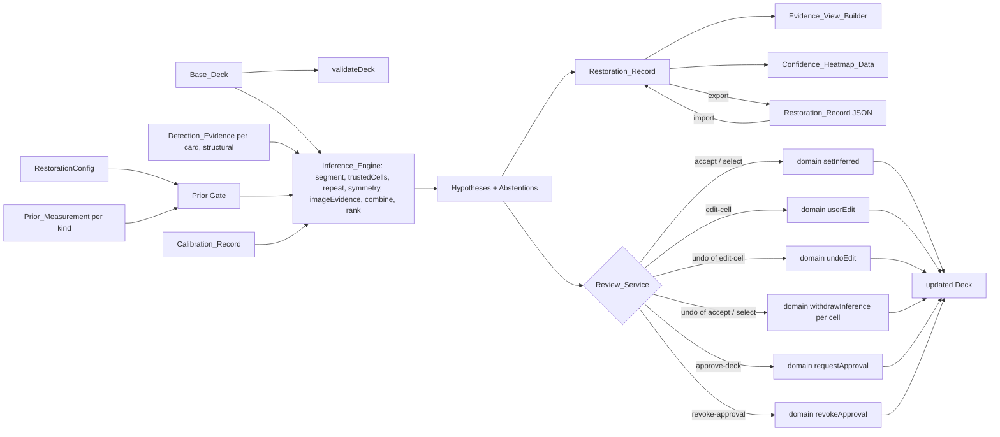

# Design Document

## Overview

This document designs the Restoration_Engine: a deterministic, pure TypeScript library in `src/restore` that proposes values for missing or ambiguous Jacquard card instructions, explains and quantifies every proposal, and routes every write to the domain through explicit human review and approval. It implements requirements 1–26 of `restoration-engine/requirements.md`, reusing domain types from `card-domain-and-loom-engine` and consuming (without importing) detection output types from `card-detection`.

Design principles, carried from the approved domain and detection designs and from steering:

1. **Deterministic algorithms only.** Repeat detection, mirror-symmetry evaluation and evidence combination are closed-form, documented functions of the input. No learned model proposes a value. An optional `DetectionAssistant`-style evidence (`AssistantEvidence`, consumed structurally through `CardDetectionRecord.assistantEvidence`) is displayed, never inferred from.
2. **Never silently invent.** A cell with insufficient evidence stays `ambiguous` with no effective value. A proposal is a `Hypothesis`, not a write. A write to the domain Deck happens only through `setInferred` (after acceptance) or `userEdit` (after a manual edit), never speculatively.
3. **Evidence and provenance over every number.** Every `Hypothesis_Confidence` carries a `CalibrationStatus`, every explanation is deterministic template text, and every synthetic-only prior usage carries a visible warning that survives acceptance and approval.
4. **Raw evidence is never overwritten; the Restoration_Record is append-only.** The Base_Deck's raw observations are copied once into the record and never touched again. Review actions, undos and superseding runs only append.
5. **Pure and immutable.** No DOM, no `Date`, no network, no `Math.random`, no wall-clock value anywhere. All randomness needed by test generators lives in test code; the library itself has none. Expected failures return `RestorationResult`, never throw.
6. **Leakage-proof by construction.** The Inference_Engine's input type structurally cannot carry a ground-truth value, a truth Deck or an evaluation label. A masked cell is represented only as an absent `raw.value` with provenance `ambiguous`.
7. **Deck mutation only through the approved domain contract.** Every domain write uses `setInferred`, `userEdit`, `undoEdit`, `withdrawInference`, `requestApproval` or `revokeApproval` exactly as those functions are typed in the domain design. `src/restore` never duplicates a domain type and never calls an undocumented domain API.

Research summary (no external research needed; sources are the project steering files and the three approved/draft specs already in context):
- Domain contract: `card-domain-and-loom-engine/design.md` — `Deck`, `Card`, `Cell`, `EffectiveView`, `Provenance`, `Bit`, `ActionId`, `SequenceNumber`, `Result`, `setInferred`, `userEdit`, `undoEdit`, `withdrawInference`, `latestLiveEntry`, `requestApproval`, `revokeApproval`, `effectiveView`, `validateDeck`, `readIndexToGrid`, `gridToReadIndex`, `ApprovalRecord`, `ApprovalState`. This design targets domain interface version 1.1.0, which adds `withdrawInference`, `latestLiveEntry`, the Live_Entry rule and `NOTHING_TO_WITHDRAW`.
- Detection contract: `card-detection/design.md` and `requirements.md` — `CardDetectionRecord`, `userConditionOverrides`, `Condition`, `notApplied`, `assistantEvidence`, `holeProbability`, `PolarityAssumption`.
- Restoration-principles steering: separate hole-probability and restoration-confidence fields; at most three ranked alternatives; non-empty explanations; deterministic restoration; never overwrite observed data; reversible history; calibration must be stated as calibrated or not.
- Jacquard-card-format steering: every assumption this document depends on (A3–A8) is unverified; the Restoration_Engine treats repetition and mirror symmetry as per-deck hypotheses, never defaults.
- Testing-standards steering: explicit seeds, bounded `numRuns`, stated generator preconditions, golden files in version control, synthetic/real separation, no tuning on held-out data.

### Approved decisions carried in from requirements.md

| ID | Decision | Source |
|----|----------|--------|
| Q5 (resolved) | A `Synthetic_Only_Prior` is disabled by default on `Deck_Origin: "real"` decks. An explicit, audited `enable-synthetic-prior` / `disable-synthetic-prior` action is required to use it, and every dependent output then carries `syntheticPriorWarning: true` and stays `uncalibrated`. A `Deck_Origin: "synthetic"` deck in a marked `Synthetic_Evaluation_Context` may use it without the warning. | Req 3.14–3.21 |
| D1 (restoration) | `setInferred` requires a finite numeric confidence in [0,1] and rejects `null`; `null` on a Deck cell always means "not evaluated". | domain design D9 |
| D2 (restoration) | The domain provides undo only for `user-edit` entries. An `inference` entry is reversed only by `withdrawInference`, never by `undoEdit`. | domain design D2, D10 |
| Roles (amendment) | Benchmark split roles are `tuning`, `calibration`, `held-out` and the sealed `test`. Restoration and `scripts/restoration-tune.ts` read only `tuning` and `calibration`. Official `held-out` and `test` metrics come only from the benchmark runner (spec 4). The spec order is domain, detection, restoration, benchmark, UI. | Req 3.4, 10.5–10.10, 24.1, 24.3, 26; benchmark-and-evaluation design |
| Attestation (amendment) | Attestations are per card: `syntheticAttestations` maps `cardId` to a `SyntheticImageAttestation`. A `synthetic` deck is valid only if every card whose detection evidence carries an `Image_Digest` has an entry whose `imageDigest` equals that digest. Cards without an `Image_Digest` need none. Synthetic data is never marked `real` to pass validation, and real photographs cannot be relabelled synthetic without a matching attestation. Each attestation is an unverified caller declaration. A validated synthetic deck may use a synthetic-scope prior with no enablement entry and no `syntheticPriorWarning`; it still needs a Prior_Measurement. No new error code. | Req 3.21–3.26, 25.23–25.28; docs/PLAN.md Section 5.3 |
| Q1 (resolved) | The domain was amended (interface version 1.1.0). Restoration reverses an accepted or selected inference by calling `withdrawInference` once per region cell. No fallback error and no restoration-side projection exist. | requirements.md Q1; domain design D10 |

### Out of scope

Image detection, damage models, accuracy targets, the benchmark harness, React UI and rendering, within-card periodicity detection (detection spec concern), learned/LLM-based restoration, historical colour inference, physical loom control, support for non-Garín card formats.

## Architecture

### Module layout

```
src/restore/
  index.ts                     single public export surface, RESTORATION_INTERFACE_VERSION
  result.ts                    RestorationResult, RestorationError, RESTORATION_ERROR_CODES/MESSAGES
  limits.ts                    RESTORATION_LIMITS constants
  types/
    inputs.ts                  RestorationInput, DetectionEvidenceInput (structural, vision-free), RestorationConfig
    cell.ts                    TargetCell, ProtectedCell, TrustedCell, RestorationRegion classifiers (pure predicates)
    hypothesis.ts               Hypothesis, Alternative, AbstentionReason, EvidenceItem, CalibrationStatus
    record.ts                  RestorationRecord, RunSection, RawObservationCopy, Diagnostic
    priors.ts                  PriorMeasurement, PriorGateState, DeckOrigin, SyntheticPriorEnablement
    calibration.ts             CalibrationRecord
    review.ts                  ReviewAction, ReviewOutcome, RestorationState (cell/region/deck)
    audit.ts                   AuditEntry, OpaqueTimestampLabel
  gating/
    priorGate.ts               evaluatePriorGate, enableSyntheticPrior, disableSyntheticPrior
    attestation.ts             validateSyntheticAttestation, validateOriginAndAttestation, SYNTHETIC_DECK_NOTICE
  regions/
    segment.ts                 segmentRegions (Target_Cell runs, Protected_Cell boundaries)
  inference/
    trustedCells.ts            collectTrustedCells (excludes inferred/ambiguous/overridden cells)
    repeat.ts                  Repeat_Prior evidence test and candidate derivation
    symmetry.ts                Symmetry_Prior evidence test and candidate derivation (card-sequence, within-card)
    imageEvidence.ts           Hole_Probability -> P(lifted) conversion, contradiction detection
    combine.ts                 log-odds combination of structural and image evidence
    rank.ts                    ranking, tie-break, abstention assembly
    explain.ts                 deterministic explanation templates
    wholeCard.ts               stretch: whole-card recovery
    engine.ts                  runInference (pure, orchestrates the above)
  calibration/
    apply.ts                   applyCalibration (raw confidence -> calibrated, or uncalibrated)
    validate.ts                validateCalibrationRecord
  record/
    build.ts                   buildRestorationRecord, supersede, integrityCheck
    serialize.ts               exportRestorationRecord, importRestorationRecord (+ Prior_Measurement, Calibration_Record)
  review/
    service.ts                 Review_Service: accept, select, edit, reject, acknowledge, undo, approve, revoke
    stateMachine.ts            deriveCellState, deriveRegionState, deriveDeckState, ALLOWED_TRANSITIONS
    domainWrite.ts             the exact setInferred/userEdit/undoEdit/withdrawInference/requestApproval/revokeApproval call sequences
  evidence/
    evidenceView.ts            Evidence_View_Builder
    heatmap.ts                 Confidence_Heatmap_Data builder
  determinism/
    ordering.ts                canonical (cardId position, readIndex, period/axis) iteration order
    leakageGuard.ts             masking contract helpers (maskCell, isMasked)
  tuning/
    roles.ts                   TuningRole, permitTuningRole, checkFileSetDisjoint (pure; Req 26.2–26.4)
    datasetFormat.ts           Minimal_Dataset_Format types, importMinimalDataset (pure; Req 26.1, 26.5–26.7)
  __tests__/
    generators.ts, synthetic/ (period/symmetry pattern builders), golden/, *.test.ts
docs/
  restoration-errors.md        full error-code list (Req 22.4)
  restoration-calibration.md   calibration method, roles, ECE reporting (Req 10.10, this design)
  restoration-priors.md        Prior_Measurement procedure, gating, Minimal_Dataset_Format, role allow-list, registry of recorded measurements (Req 26.8, 26.9)
scripts/
  restoration-tune.ts          thin offline CLI: measures Prior_Measurement and produces Calibration_Record JSON (see "Tuning script, role allow-list and Minimal_Dataset_Format")
```

No new top-level folder is introduced. The `scripts` folder already exists in `structure.md` (it holds thin TypeScript CLI entry points that may import the public index of any `src` folder, and no `src` folder imports it), so the folder part of the earlier Q7 is resolved. `restoration-tune.ts` holds no logic of its own beyond argument parsing and file I/O: role checking and format import live in `src/restore/tuning`, so they are unit- and property-testable without the CLI.

### Dependency rule and import-boundary test

`src/restore` imports only: `src/domain` through its public index (`src/domain/index.ts`), and TypeScript/JavaScript built-ins. It defines its own structural input types for detection evidence rather than importing `src/vision`, per Q6 below. It never imports `src/benchmark`, `src/ui` or `src/workers`.

**Domain dependency list.** The Restoration_Engine requires `src/domain` interface version 1.1.0 or a later compatible minor version. It uses these exports: `setInferred`, `userEdit`, `undoEdit`, `withdrawInference`, `latestLiveEntry`, `requestApproval`, `revokeApproval`, `effectiveView`, `getCellByCardAndIndex`, `currentApproval`, `approvalHistory`, `validateDeck`, `readIndexToGrid`, `gridToReadIndex`, and the types `Deck`, `Card`, `Cell`, `EffectiveView`, `EditEntry`, `PreviousFields`, `Provenance`, `Bit`, `ActionId`, `SequenceNumber`, `ApprovalState`, `ApprovalRecord`, `MachineProfile`, `GridPosition`, `Result`. It maps the domain code `NOTHING_TO_WITHDRAW` (added in 1.1.0) as described under "Audit trail and undo". A test compares the domain's exported `INTERFACE_VERSION` with the minimum version this design requires and fails when it is lower.

An import-boundary test (`src/restore/__tests__/boundary.test.ts`), using the TypeScript compiler API exactly as the domain and vision boundary tests do, fails on:
- any import specifier resolving to `src/vision`, `src/benchmark`, `src/ui` or `src/workers`, in relative or alias form;
- a `src/domain` file importing from `src/restore` (checked from the `src/restore` side by scanning `src/domain` for the reverse edge, mirroring the domain test's own check);
- the identifiers `document`, `window`, `fetch`, `XMLHttpRequest`, `Date`, `Math.random`, `performance.now`, `setTimeout`, `setInterval` in any file that contributes to a function producing a `Hypothesis`, a `RestorationRecord` or a Deck write.

### Data flow




## Components and Interfaces

All code below is a type or signature contract, or short pseudocode, not an implementation.

### Result and errors

```ts
export type RestorationResult<T, E extends RestorationError = RestorationError> =
  | { readonly ok: true; readonly value: T }
  | { readonly ok: false; readonly error: E };

export interface RestorationError {
  readonly code: RestorationErrorCode;      // member of RESTORATION_ERROR_CODES (closed tuple)
  readonly message: string;                 // stable text from RESTORATION_ERROR_MESSAGES[code]
  readonly path?: string;
  readonly domainCode?: string;             // present when code === "DOMAIN_RULE_REJECTED"
}
```

`RestorationResult` mirrors the domain `Result` discriminant and field names but is its own closed union (mirrors the `VisionResult` pattern in `card-detection/design.md`), because `DomainError.code` is the closed domain `ErrorCode` union and cannot carry a restoration code. A domain rejection is wrapped: `code: "DOMAIN_RULE_REJECTED"`, `domainCode` holds the underlying domain code, `path` and `message` copied from it.

### Structural detection-evidence input types (no `src/vision` import)

Per requirement 1 and the domain/detection Q6 pattern, `src/restore` defines its own input shape that `CardDetectionRecord` satisfies structurally (TypeScript structural typing; no import, no re-declaration of a domain type).

```ts
export type Condition = "observed" | "ambiguous" | "unknown";          // matches vision's Condition by shape

export interface DetectionEvidenceInput {
  readonly cardId: string;
  readonly profileId: string;
  readonly imageDigest: { readonly algorithm: string; readonly hex: string };
  readonly resultId: string;
  readonly polarity?: { readonly value: "hole-is-lifted" | "hole-is-down" };   // absent = no polarity recorded
  readonly perCell: readonly {
    readonly readIndex: number;
    readonly condition: Condition;
    readonly holeProbability?: number;                 // absent when condition is "unknown"
    readonly unknownReason?: string;
    readonly patchId: string;
    readonly findingIds: readonly string[];
  }[];
  readonly userConditionOverrides: readonly {
    readonly readIndex: number;
    readonly condition: "ambiguous" | "unknown";
    readonly actionId: string;
    readonly sequence: number;
    readonly note: string;
    readonly applied: boolean;
    readonly reviewState: "carried" | "confirmed" | "needs-review" | "discarded" | "superseded";
  }[];
  readonly notApplied: readonly { readonly actionId: string; readonly readIndexes: readonly number[] }[];  // Pending_Correction surface
  readonly assistantEvidence: readonly {
    readonly modelId: string; readonly modelVersion: string;
    readonly target: { readonly kind: "cell"; readonly readIndex: number } | { readonly kind: "region" | "finding" };
    readonly confidence: number; readonly explanation: string;
    readonly label: "model-generated proposal; not an observation";
  }[];
}
```

`CardDetectionRecord` (card-detection design) satisfies `DetectionEvidenceInput` structurally: every field this type reads exists on `CardDetectionRecord` with a compatible shape. No cast, no explicit conformance declaration, and no import is required — this resolves requirements.md Q6 (`[CONFIRM]` in requirements.md) in favour of structural input types with no `src/vision` import, matching the recommendation already written into `card-domain-and-loom-engine/design.md`'s own Q6 and `card-detection/design.md`'s V-decisions. See "Open questions" Q6 below for the one residual follow-up (keeping this type's field list in sync with `CardDetectionRecord` as detection evolves).

### Restoration input and configuration

```ts
export interface RestorationInput {
  readonly baseDeck: Deck;                                  // domain Deck, see card-domain-and-loom-engine/design.md
  readonly detectionEvidence?: ReadonlyMap<string, DetectionEvidenceInput>;  // keyed by cardId
  readonly config: RestorationConfig;
  readonly priorMeasurements?: ReadonlyMap<StructuralPriorKind, PriorMeasurement>;
  readonly calibrationRecord?: CalibrationRecord;
  readonly syntheticPriorEnablements?: readonly SyntheticPriorEnablementEntry[];  // in-effect enable/disable history
  readonly syntheticAttestations?: ReadonlyMap<string, SyntheticImageAttestation>;  // keyed by cardId; absent or empty for deckOrigin "real"; see "Synthetic image attestation"
}

export interface SyntheticImageAttestation {
  readonly generator: string;            // non-empty
  readonly generatorVersion: string;     // non-empty
  readonly sourceId: string;             // dataset or bundle identifier, non-empty
  readonly seed: number;                 // integer
  readonly parametersDigest: string;     // documented digest format (same format as Image_Digest hex plus algorithm)
  readonly imageDigest: string;          // documented digest format; must equal the evidence Image_Digest
}

export type StructuralPriorKind = "repeat" | "symmetry";
export type SymmetryAxisKind = "card-sequence" | "within-card";

export interface RestorationConfig {
  readonly schemaVersion: 1;
  readonly deckOrigin: "real" | "synthetic";                  // Deck_Origin, default "real"
  readonly syntheticEvaluationContext: boolean;                // default false; valid only with deckOrigin "synthetic"
  readonly enabledPriors: readonly StructuralPriorKind[];      // default []; disabled by default (Req 3.1)
  readonly symmetryAxes: readonly SymmetryAxisKind[];           // which axes to test when "symmetry" is enabled
  readonly seed: number;                                       // recorded; never used to break ties (Req 19.8)

  // Short-region and whole-card
  readonly shortRegionBound: number;                           // 1..40, default 6 (tuned, see "Deferred numeric defaults")
  readonly wholeCardRecoveryEnabled: boolean;                   // default false (Req 11.1)
  readonly wholeCardMinSupportingCards: number;                 // default 3

  // Repeat evidence test
  readonly maxRepeatPeriod: number;                             // 1..200, default 12
  readonly repeatMinComparable: number;                         // default 40
  readonly repeatAgreementThreshold: number;                    // [0,1], default 0.85
  readonly repeatChanceMargin: number;                          // [0,1], default 0.10
  readonly repeatMinSupportPairs: number;                       // default 3

  // Symmetry evidence test (shares the same shape of thresholds)
  readonly symmetryMinComparable: number;                       // default 40
  readonly symmetryAgreementThreshold: number;                  // default 0.85
  readonly symmetryChanceMargin: number;                        // default 0.10
  readonly symmetryMinSupportPairs: number;                     // default 3

  // Degenerate-pattern guard (shared)
  readonly degenerateDensityMargin: number;                     // [0, 0.5], default 0.05

  // Evidence combination
  readonly contradictionThreshold: number;                      // [0,1] log-odds-scale distance, default 0.6 (see combine.ts)

  // Limits (bounded by RESTORATION_LIMITS; see "Limits")
  readonly maxCardsPerRun: number;                              // <= domain 10,000, default 2,000
  readonly maxTargetCellsPerRun: number;                        // default 50,000
  readonly maxEvidenceItemsPerExplanation: number;              // default 12
  readonly maxReviewActionsPerRecord: number;                   // default 20,000
  readonly maxRecordTextBytes: number;                          // default 16 MiB
  readonly maxOpaqueTimestampLabelLength: number;                // default 64 (Q3)
}
```

`validateConfig(config): RestorationResult<RestorationConfig>` checks every numeric field against its documented range (first failure wins, returns `INVALID_CONFIGURATION` naming the field and its range), checks `0 <= repeatChanceMargin, symmetryChanceMargin <= 0.5`, and checks the first clause of Requirement 3.21: `syntheticEvaluationContext` true requires `deckOrigin === "synthetic"`, else `INVALID_CONFIGURATION` on `syntheticEvaluationContext`.

#### Synthetic image attestation (requirements 3.21 to 3.26)

An attestation is a declaration by the caller, bound to one image digest of one card. `RestorationInput.syntheticAttestations` is a map from `cardId` to `SyntheticImageAttestation`, because Detection_Evidence is also keyed by `cardId`: a deck has at most one attestation per card. The Restoration_Engine cannot prove how an image was made, and `docs/restoration-priors.md` and the code comment on `validateSyntheticAttestation` say so. The map guards one thing: a real photograph cannot be relabelled `synthetic` unless the caller also supplies a declaration naming that photograph's digest for that card. Who attaches entries:

- The benchmark runner builds one entry per card with a generated image from its dataset manifest.
- The Workbench attaches entries only for bundled assets whose digests match the committed Demo_Bundle manifest, and never for an uploaded file. Uploads are always `deckOrigin: "real"`. The demo deck holds several simulated intact context cards supplied as a bitmap, with no Detection_Evidence and therefore no attestation, plus one detected damaged card with an attestation. The Workbench also shows the persistent "Simulated demo card" badge.
- `src/restore` itself never creates an attestation.

```ts
export const SYNTHETIC_DECK_NOTICE = "Measured on synthetic data. This says nothing about historical cards.";

/** Field checks of one entry, in the order generator, generatorVersion, sourceId, seed (integer),
 *  parametersDigest (digest format), imageDigest (digest format). Returns the name of the first failing field. */
export function validateSyntheticAttestation(a: unknown): RestorationResult<SyntheticImageAttestation>;

/** Input-level check, run by the run entry point after validateConfig and before validateLimits and any inference.
 *  Digest comparison uses the canonical text form `<algorithm>:<hex>` of each evidence Image_Digest. */
export function validateOriginAndAttestation(input: RestorationInput): RestorationResult<void>;
```

`validateOriginAndAttestation` order, first failure wins. Every failure is `INVALID_CONFIGURATION` with `path` `syntheticAttestations[<cardId>]`, and `.<field>` appended when a field is the cause (no new error code, Req 3.26):

```
1. digestByCard = canonical "<algorithm>:<hex>" of the Image_Digest of every card whose Detection_Evidence carries one
   (cards without Detection_Evidence, or whose evidence has no Image_Digest, are not in the map)
   order = cardIds of the deck in deck order, then the remaining keys of syntheticAttestations in ascending cardId order
2. config.deckOrigin === "real" and syntheticAttestations has any entry
                                       -> path of the first entry in `order`                         (Req 3.23)
3. for each entry in `order` (config.deckOrigin === "synthetic"):                                   (Req 3.22)
     a. cardId absent from the Base_Deck                       -> path syntheticAttestations[<cardId>]
     b. card is not in digestByCard (no Image_Digest)          -> path syntheticAttestations[<cardId>]
     c. first failing field per validateSyntheticAttestation   -> path syntheticAttestations[<cardId>].<field>
     d. imageDigest differs from digestByCard[cardId]          -> path syntheticAttestations[<cardId>].imageDigest
4. for each card in deck order that is in digestByCard (config.deckOrigin === "synthetic"):          (Req 3.21)
     no entry for the cardId                                   -> path syntheticAttestations[<cardId>]
```

Cards without an `Image_Digest` need no attestation, so a mixed deck (intact context cards without evidence plus one attested damaged card) is valid. A `synthetic` deck with no image evidence at all needs no attestation. It is accepted as `synthetic`, because no photograph can be relabelled, and the Synthetic_Evaluation_Context rule of Req 3.20 applies unchanged. A `synthetic` deck in which a card has an `Image_Digest` and no matching entry is rejected at step 4, and an entry that names a card without image evidence is rejected at step 3b.

### Cell classification (pure predicates over `EffectiveView` and evidence)

```ts
export interface CellRef { readonly cardId: string; readonly readIndex: number }

export function isProtectedCell(view: EffectiveView, override: AppliedOverrideLike | undefined): boolean;
// true iff view.provenance === "observed"
//      or (view.provenance === "user-edited" and the latest user edit is not reversed — i.e. view reflects it)
//      or override?.applied === true

export function isTargetCell(view: EffectiveView): boolean;
// true iff view.provenance === "ambiguous" and view.effectiveValue === undefined

export function isTrustedCell(view: EffectiveView, override: AppliedOverrideLike | undefined): boolean;
// true iff (view.provenance === "observed" and override?.applied !== true)
//      or (view.provenance === "user-edited")
// repeat-inferred / symmetry-inferred / ambiguous are NEVER trusted (Req 2.9)

export interface AppliedOverrideLike { readonly applied: boolean }
```

These three predicates are the only place classification logic lives; every later component calls them rather than re-deriving provenance rules, so a single change keeps requirement 2 consistent everywhere.

### Region model

```ts
export interface RestorationRegion {
  readonly cardId: string;
  readonly startReadIndex: number;   // inclusive
  readonly endReadIndex: number;     // inclusive
  readonly length: number;           // endReadIndex - startReadIndex + 1
}

export function segmentRegions(card: Card, cellViews: readonly EffectiveView[], overrides: ReadonlyMap<number, AppliedOverrideLike>): readonly RestorationRegion[];
```

`segmentRegions` walks `readIndex` 0 to `readableCount - 1` in order, starts a region at the first `isTargetCell` position after a boundary, and closes it at the last consecutive `isTargetCell` position before the next `isProtectedCell` position or the end of the card (Req 2.12, 7.1–7.7). A card with every cell a Target_Cell yields one region of `length === readableCount`, routed to whole-card recovery (requirement 11) instead of requirement 7 per Req 7.6.

### Prior gate and synthetic enablement

```ts
export interface PriorMeasurement {
  readonly priorKind: StructuralPriorKind;
  readonly datasetId: string; readonly datasetSource: string; readonly datasetLicence: string;
  readonly licenceCheckStatus: "checked" | "unchecked";
  readonly redistributable: boolean;
  readonly scope: "synthetic" | "real";
  readonly benchmarkVersion: string; readonly datasetVersion: string; readonly seed: number;
  readonly splitRole: "tuning" | "calibration";            // Benchmark_Split_Role the measurement read; never held-out or test
  readonly sampleSize: number;
  readonly measuredFrequency: number;    // [0,1]
  readonly measuredReliability: number;  // [0,1]
  readonly evidenceTestParameters: Readonly<Record<string, number>>;
  readonly dataDescription: string;
}

export function validatePriorMeasurement(m: unknown): RestorationResult<PriorMeasurement>;
// first failure: missing field (including datasetVersion, splitRole) -> INVALID_PRIOR_MEASUREMENT (path);
// splitRole not "tuning" or "calibration" (held-out, test or unknown) -> INVALID_PRIOR_MEASUREMENT at splitRole;
// frequency/reliability outside [0,1]; sampleSize < 1; measurement.priorKind !== the kind it is supplied under

export type DeckOrigin = "real" | "synthetic";

export interface SyntheticAttestationRef {
  readonly cardId: string;
  readonly sourceId: string; readonly imageDigest: string;
  readonly declaration: "unverified caller declaration";   // fixed text, Req 3.26
}

export interface SyntheticPriorEnablementEntry {
  readonly actionId: ActionId; readonly sequence: SequenceNumber;
  readonly kind: "enable-synthetic-prior" | "disable-synthetic-prior";
  readonly priorKind: StructuralPriorKind;
  readonly note: string;                     // 1..1000 chars
  readonly opaqueTimestampLabel?: string;
}

export interface PriorGateState {
  readonly kind: StructuralPriorKind;
  readonly enabledInConfig: boolean;
  readonly hasValidMeasurement: boolean;
  readonly measurementScope: "synthetic" | "real" | "none";
  readonly isSyntheticOnly: boolean;          // true iff the only measurement found has scope "synthetic"
  readonly syntheticEnablementInEffect: boolean;  // true iff an enable- entry is in effect for deckOrigin "real"
  readonly effectivelyEnabled: boolean;       // the actual gate outcome used by the Inference_Engine
  readonly deckOrigin: DeckOrigin;
  readonly attestationRefs: readonly SyntheticAttestationRef[];   // one per attested card, in deck order; empty unless deckOrigin is "synthetic"
  readonly measurementRef?: { readonly priorKind: StructuralPriorKind; readonly benchmarkVersion: string; readonly scope: "synthetic" | "real" };
}

export function evaluatePriorGate(
  kind: StructuralPriorKind, config: RestorationConfig,
  measurements: ReadonlyMap<StructuralPriorKind, PriorMeasurement>,
  enablements: readonly SyntheticPriorEnablementEntry[],
  attestations?: ReadonlyMap<string, SyntheticImageAttestation>    // already validated by validateOriginAndAttestation
): RestorationResult<PriorGateState>;
```

For a synthetic deck that passed `validateOriginAndAttestation` (every card with an `Image_Digest` attested) the gate needs no `enable-synthetic-prior` entry, produces `syntheticPriorWarning: false`, and still returns `PRIOR_MEASUREMENT_MISSING` when no Prior_Measurement exists, because that check precedes every branch (Req 3.24). `PriorGateState` gains `deckOrigin` and `attestationRefs` (per attested card: `cardId`, the attestation's `sourceId` and `imageDigest`) so the record shows why no warning applies. For `real` decks the gate behaves exactly as before the amendment (Property 27).

`evaluatePriorGate` pseudocode (Req 3.1–3.21):

```
evaluatePriorGate(kind, config, measurements, enablements):
  enabledInConfig = kind in config.enabledPriors
  if not enabledInConfig: return gate with effectivelyEnabled = false   (Req 3.1, 3.3)
  measurement = measurements.get(kind)
  if measurement is absent: return error PRIOR_MEASUREMENT_MISSING(kind)          (Req 3.2)
  if measurement.licenceCheckStatus === "unchecked": mark local-only (not an error; Req 3.10 handled at bundling time, not gating)
  isSyntheticOnly = measurement.scope === "synthetic"      // only one measurement per kind is modeled per run
  if config.deckOrigin === "real" and isSyntheticOnly:
      inEffect = latest non-reversed enablement for kind, deckOrigin real
      if inEffect is "disable" or absent: return error PRIOR_NOT_VALIDATED_FOR_REAL_DECKS(kind)   (Req 3.15)
      else: gate.effectivelyEnabled = true, gate.syntheticEnablementInEffect = true               (Req 3.14, 3.18)
  elif config.deckOrigin === "synthetic" and attestationsValid(input) and isSyntheticOnly:
      // validated synthetic deck (per-card attestations), with or without syntheticEvaluationContext (Req 3.24)
      gate.effectivelyEnabled = true, gate.syntheticEnablementInEffect = false,
      gate.syntheticPriorWarning = false                                                            (Req 3.24)
      // a synthetic deck with no image evidence has no card needing an attestation, so attestationsValid
      // is true for it and the Synthetic_Evaluation_Context rule of Req 3.20 gives the same outcome
  else:
      gate.effectivelyEnabled = true
  return gate
```

`recordSyntheticPriorEnablement(entries, input): RestorationResult<readonly SyntheticPriorEnablementEntry[]>` appends one entry: rejects a duplicate `actionId` with `DUPLICATE_ACTION_ID`, an empty or over-long note with `NOTE_REQUIRED` / `NOTE_TOO_LONG`, and a `priorKind` that has no synthetic-only measurement with `INVALID_TRANSITION` (Req 3.16, 3.17). "In effect" means the latest entry for that `priorKind` (by `sequence`) is `enable-synthetic-prior`.

Every `Hypothesis`, `EvidenceView` and `ConfidenceHeatmapData` entry that depends on a gate with `syntheticEnablementInEffect === true` carries `syntheticPriorWarning: true` and the fixed text `SYNTHETIC_PRIOR_WARNING_TEXT = "Warning: this prior was derived from synthetic data and has not been validated on historical cards."` (Req 3.18), and its `CalibrationStatus` is forced to `"uncalibrated"` regardless of any `CalibrationRecord` (Req 3.19).


### Trusted-cell collection

```ts
export interface TrustedCellValue { readonly cardId: string; readonly readIndex: number; readonly value: Bit }

export function collectTrustedCells(deck: Deck, overrides: ReadonlyMap<string, ReadonlyMap<number, AppliedOverrideLike>>): readonly TrustedCellValue[];
```

One pass over every card and `readIndex`: include the cell's effective value iff `isTrustedCell(effectiveView(cell), override)` (Req 2.6, 2.9). The result is indexed by `(cardId, readIndex)` for O(1) lookup during evidence tests. This is the single source of "comparable" values that `repeat.ts` and `symmetry.ts` both consume, so a Target_Cell, an Applied_Override cell or an earlier inference can never leak into structural evidence.

### Repeat detection (requirement 4)

**Method: per-deck period search with an agreement-vs-chance evidence test.**

For a candidate period `p` in `[1, min(config.maxRepeatPeriod, cardCount - 1)]`, and for every `readIndex` position, the engine compares Trusted_Cell values of cards at distance `k·p` for every integer `k` (positive and negative) that stays inside the deck. This directly implements the "repeat period" hypothesis in requirement 4: card `i` and card `i + p` carry the same row.

```
for p in 1 .. min(maxRepeatPeriod, cardCount - 1):
  comparableCount = 0; agreeCount = 0; agreeingPairCount = 0
  density1 = 0; totalTrusted = 0            // for the Chance_Baseline
  for every ordered card pair (i, i+p) with i, i+p in [0, cardCount):
    pairComparable = 0; pairAgree = 0
    for readIndex in [0, readableCount):
      a = trusted(cardId[i], readIndex); b = trusted(cardId[i+p], readIndex)
      if a and b are both present:
        comparableCount += 1; pairComparable += 1
        if a.value === b.value: agreeCount += 1; pairAgree += 1
        density1 += a.value + b.value; totalTrusted += 2
    if pairComparable > 0 and pairAgree / pairComparable >= config.repeatAgreementThreshold:
      agreeingPairCount += 1
  if comparableCount === 0: continue                           // no evidence for this p
  density = density1 / totalTrusted                              // bit density among trusted cells compared
  chanceBaseline = density * density + (1 - density) * (1 - density)   // P(agree) under independence
  agreementFraction = agreeCount / comparableCount
  degenerate = density <= config.degenerateDensityMargin or density >= 1 - config.degenerateDensityMargin
  passes = not degenerate
           and comparableCount >= config.repeatMinComparable
           and agreementFraction >= config.repeatAgreementThreshold
           and agreementFraction - chanceBaseline >= config.repeatChanceMargin
           and agreeingPairCount >= config.repeatMinSupportPairs
  record EvidenceTestResult(p, comparableCount, agreeCount, agreeingPairCount, agreementFraction, chanceBaseline, density, passes, degenerate)
```

This is the `Evidence_Test` of requirement 4.3; `chanceBaseline` is the `Chance_Baseline` of the glossary, computed from the bit densities of the compared Trusted_Cells (Req glossary Chance_Baseline, 4.3). Every passing period is evaluated independently — their evidence is never merged (Req 4.9). A deck with no passing period yields `Abstention_Reason "NO_STRUCTURAL_EVIDENCE"` for every region the repeat prior alone could address (Req 4.4); `degenerate === true` instead yields `"DEGENERATE_PATTERN"` (Req 4.7).

**Candidate derivation for a Target_Cell**, given a passing period `p` (Req 4.5, 4.6):

```
deriveRepeatCandidate(targetCard, readIndex, p, trusted):
  supportingValues = []
  for k in ..., -2, -1, 1, 2, ... such that targetCard.index + k*p is inside the deck:
    v = trusted(cardAt(targetCard.index + k*p), readIndex)
    if v present: supportingValues.push(v.value)
  if supportingValues is empty: return Abstention("NO_STRUCTURAL_EVIDENCE")
  ones = count of 1s; zeros = count of 0s
  if ones === zeros: return Abstention("CONFLICTING_EVIDENCE")     // never tie-broken by position or seed (Req 4.6)
  value = ones > zeros ? 1 : 0
  agreeingCount = max(ones, zeros); totalCount = ones + zeros
  return StructuralCandidate{ value, provenance: "repeat-inferred", period: p,
                               supportingCount: totalCount, agreeingCount, comparableCellCount: ... }
```

The explanation template for a repeat candidate states the period, the number of supporting cards, the number of agreeing cards and the comparable cell count verbatim (Req 4.8, 9.1).

### Mirror symmetry (requirement 5)

**Method: per-deck, per-axis evidence test with a documented partner mapping.**

Two axis kinds are evaluated, only when the configuration enables them (Req 5.1):

- `card-sequence`: card `i` pairs with card `c - i` for an axis position `c` (integer or half-integer) in `[0, cardCount - 1]`. The engine searches every candidate `c` in steps of 0.5 and evaluates the same Evidence_Test shape as `repeat.ts` (comparable count, agreement fraction, Chance_Baseline margin, minimum agreeing pairs), substituting "pair at distance from axis `c`" for "pair at distance `p`". This axis depends on assumption A8 (card-to-pass mapping) and is marked unverified on every resulting Hypothesis (Req 5.6 reference, requirements.md R3).
- `within-card`: the partner of `readIndex` is given by a documented function of the `MachineProfile` (`withinCardPartner(profile, readIndex): number`, defined once in `symmetry.ts` and reused for every card independently). For Garín this is a placeholder reflection about the vertical centre of the read order, explicitly marked `// UNVERIFIED R4` pending A3–A6. The Evidence_Test for this axis compares `(cardId, readIndex)` against `(cardId, partner(readIndex))` within the *same* card, so "comparable count" and "agreeing pairs" are counted over cells, not card pairs.

```
evaluateSymmetryAxis(axisKind, candidateAxis, trusted, profile, config):
  comparableCount = 0; agreeCount = 0; agreeingUnitCount = 0; density1 = 0; total = 0
  for each comparison unit u (a card pair for card-sequence; a cell pair within one card for within-card):
    a, b = the two Trusted_Cell values of u, if both present
    if both present:
      comparableCount += 1
      if a.value === b.value: agreeCount += 1
      density1 += a.value + b.value; total += 2
      track per-unit agreement for agreeingUnitCount (same threshold rule as repeat.ts)
  same chanceBaseline / agreementFraction / degenerate / passes computation as repeat detection,
  using config.symmetry* thresholds
  return EvidenceTestResult
```

Each deck is evaluated independently; a symmetry conclusion for one deck is never carried to another (Req 5.4). A design that fails the Evidence_Test is treated as asymmetric for restoration purposes only — the engine never reports "this deck is asymmetric" as a historical claim, only "no symmetry Hypothesis was produced" (Req 5.8, A7). Candidate derivation for a Target_Cell mirrors `deriveRepeatCandidate`, substituting "the cell's symmetric partner" for "the cards at distance `k·p`"; a candidate is produced only if the partner is itself a Trusted_Cell (Req 5.5).

### Image evidence and combination (requirement 6)

**Hole-probability conversion** (Req 6.1, 6.2):

```ts
export function holeProbabilityToLiftedProbability(holeProbability: number, polarity: "hole-is-lifted" | "hole-is-down" | undefined): RestorationResult<number> {
  if (polarity === undefined) return err("NO_POLARITY_RECORDED");   // Req 6.2: do not combine; record the reason
  return ok(polarity === "hole-is-lifted" ? holeProbability : 1 - holeProbability);
}
```

**Combination rule: log-odds (logit) addition with a documented independence assumption.**

Structural evidence (from `repeat.ts` / `symmetry.ts`) yields a probability `P_struct(lifted)` derived from `agreeingCount / supportingCount` of the winning value, Laplace-smoothed by `(agreeingCount + 1) / (supportingCount + 2)` to avoid a 0 or 1 log-odds singularity when support is small. Image evidence yields `P_image(lifted)` from `holeProbabilityToLiftedProbability`. The combined probability is:

```
logit(p) = ln(p / (1 - p))
combinedLogit = logit(P_struct) + logit(P_image)      // naive-Bayes-style independence assumption
combinedP = 1 / (1 + exp(-combinedLogit))
hypothesisConfidence = combinedP if combinedP >= 0.5 else (1 - combinedP)   // confidence in the chosen value
chosenValue = combinedP >= 0.5 ? 1 : 0
```

**Documented independence assumption and its limit** (Req 6.3): this rule treats the structural prior's error process and the image classifier's error process as conditionally independent given the true bit. That is an approximation: both signals can fail together on the same physically damaged region (for example a torn corner that both breaks the repeating pattern's local evidence and produces unreliable `holeProbability`). The design does not attempt a joint model of correlated failure; it instead (a) applies the **contradiction rule** below as a documented safety valve, and (b) relies on calibration (requirement 10) measured on labelled data to correct any resulting systematic over- or under-confidence, rather than claiming the naive-Bayes combination is itself calibrated. This limitation is recorded in `docs/restoration-calibration.md` and in the `Hypothesis` explanation whenever both evidence kinds are combined (Req 9.1).

**Contradiction rule** (Req 6.4): if `|logit(P_struct) - logit(1 - P_image)| ` — i.e., the structural and image signals disagree in direction with a combined magnitude at or above `config.contradictionThreshold` on the logit scale — the engine lowers `hypothesisConfidence` by capping it at `max(0.5, hypothesisConfidence - 0.15)` (a fixed penalty, documented and tuned empirically; see "Deferred numeric defaults") and appends the contradiction statement to the explanation. The underlying structural candidate and its evidence are still recorded; only the confidence is adjusted, never the chosen value silently.

Other requirement-6 rules: a cell with `Condition: "unknown"` contributes no image evidence and the `unknownReason` is recorded in the explanation (Req 6.5); a cell with image evidence but no structural candidate never becomes a Hypothesis from image evidence alone — it abstains with `"NO_STRUCTURAL_EVIDENCE"` (Req 6.6, consistent with the "deterministic algorithms only" principle: image evidence alone is not enough to write an instruction); a Protected_Cell's `holeProbability` is never used as evidence about a *different* cell except through its already-collected Trusted_Cell value (Req 6.7); overlapping quality-finding identifiers are copied verbatim into the Hypothesis evidence (Req 6.8); `assistantEvidence` is never read by the Inference_Engine, only surfaced by the Evidence_View_Builder with its model id, version and label (Req 6.9).

### Region-level assembly, ranking and abstention (requirements 7, 8)

```ts
export type AbstentionReasonCode =
  | "PRIOR_NOT_ENABLED" | "NO_STRUCTURAL_EVIDENCE" | "INSUFFICIENT_SUPPORT" | "CONFLICTING_EVIDENCE"
  | "DEGENERATE_PATTERN" | "REGION_TOO_LARGE" | "NO_NEIGHBOURING_INFORMATION" | "PROTECTED_CELL"
  | "IMAGE_EVIDENCE_CONTRADICTS";

export interface Abstention {
  readonly region: RestorationRegion;
  readonly reason: AbstentionReasonCode;
  readonly values: Readonly<Record<string, number | string | boolean>>;  // structured context, e.g. { regionLength, bound }
}

export interface EvidenceItem {
  readonly kind: "card" | "cell" | "period" | "symmetry-axis" | "note";
  readonly cardId?: string; readonly readIndex?: number; readonly period?: number;
  readonly value?: Bit; readonly trustSource?: "observed" | "user-edited";
}

export type CalibrationStatus =
  | { readonly kind: "uncalibrated" }
  | { readonly kind: "calibrated"; readonly calibrationRecordRef: string };

export interface Hypothesis {
  readonly region: RestorationRegion;
  readonly rank: 1 | 2 | 3;
  readonly value: Bit;                            // for a region of length 1; see "Region-wide values" below for length > 1
  readonly provenance: "repeat-inferred" | "symmetry-inferred";
  readonly hypothesisConfidence: number;          // [0,1], after calibration (requirement 10)
  readonly rawConfidence: number;                 // pre-calibration value, always kept
  readonly calibrationStatus: CalibrationStatus;
  readonly evidenceKinds: readonly StructuralPriorKind[];   // one or both, when combined (Req 8.8)
  readonly evidenceItems: readonly EvidenceItem[];
  readonly explanation: string;                   // <= 1000 chars, deterministic template (requirement 9)
  readonly priorMeasurementRef?: { readonly priorKind: StructuralPriorKind; readonly benchmarkVersion: string };
  readonly syntheticPriorWarning: boolean;
  readonly deckOrigin: DeckOrigin;                // Req 3.25
  readonly attestationRefs?: readonly SyntheticAttestationRef[];   // attested cards whose image evidence the Hypothesis uses (its target card), Req 3.25; a card without an attestation has no image evidence
  readonly stretch?: true;                        // present only for whole-card recovery (requirement 11)
}
```

**Region-wide values.** A `RestorationRegion` of `length > 1` is evaluated cell-by-cell inside the region (each `readIndex` gets its own structural/image candidate per requirement 4–6), but requirement 8 ranks *Hypotheses per region*, not per cell. A `Hypothesis` for a multi-cell region therefore carries one assignment per cell of the region; the type above shows the single-cell case for brevity — the implementation type is `Hypothesis & { readonly values: ReadonlyMap<number, Bit> }` keyed by `readIndex`, with `value` retained as a convenience accessor equal to `values.get(region.startReadIndex)` when `region.length === 1`. Ranking, the three-alternative cap and non-padding apply to the *set of distinct full-region assignments*, not to individual cells, so that two Hypotheses of one region never assign the same multi-cell pattern (Req 8.1–8.4).

**Assembly and ranking pseudocode** (Req 8.1–8.9):

```
assembleRegion(region, cellCandidates):     // cellCandidates: readIndex -> list of { assignment, confidence, evidence }
  if region.length > config.shortRegionBound and not wholeCardRecoveryCase:
    return Abstention(region, "REGION_TOO_LARGE", { regionLength: region.length, bound: config.shortRegionBound })
  candidateAssignments = cross-product of per-cell candidates that are internally consistent
                          (i.e., every cell in the region has at least one candidate; an all-abstain cell aborts the region)
  if any cell in region has zero candidates: return Abstention(region, mostSpecificReasonAcrossCells)
  distinctAssignments = dedupe candidateAssignments by (values map, provenance)
  ranked = sort distinctAssignments by hypothesisConfidence descending,
           tie-break by (provenance "repeat-inferred" before "symmetry-inferred", then ascending readIndex of first cell, then ascending period/axis)
           -- a FIXED rule, never the seed (Req 8.2, 19.8)
  top3 = ranked.slice(0, 3)                                            // Req 8.1
  if top3.length === 0: return Abstention(region, "NO_STRUCTURAL_EVIDENCE")
  if top3.length === 1: return [top3[0]]                               // Req 8.4, exactly one Hypothesis
  return top3                                                           // Req 8.1, never padded to 3 (Req 8.3)
```

When a candidate combines both `repeat` and `symmetry` evidence kinds for the same assignment, the engine assigns `provenance` by the fixed rule "the kind with the higher individual `agreementFraction` wins the provenance label; both kinds are listed in `evidenceKinds` and the explanation" (Req 8.8). Every Target_Cell not covered by any Hypothesis of its region is listed as part of that region's `Abstention` (Req 8.9); there is no separate abstention record per cell.

### Explanation templates (requirement 9)

`explain.ts` renders a `Hypothesis`'s explanation as a fixed-order template, fully determined by its structured fields, so that equal inputs give byte-identical text (Req 9.2):

```
repeat-only:    "Repeat period {p}: {agreeingCount} of {supportingCount} supporting cards agree
                 ({comparableCellCount} comparable cells compared)."
symmetry-only:  "Mirror symmetry ({axisKind} axis at {axisPosition}): agreement {agreementFraction}
                 over {comparableCount} comparable cells; partner position {partnerPosition}."
combined:       repeat text + " " + symmetry text + " Combined via log-odds with structural/image independence
                 assumption; see docs/restoration-calibration.md."
+ if contradicted:            " Image evidence contradicted the structural candidate; confidence reduced."
+ if syntheticPriorWarning:    " " + SYNTHETIC_PRIOR_WARNING_TEXT + " prior measured on synthetic data only;
                                 real-card prevalence not measured."
+ if validated synthetic deck: " " + SYNTHETIC_DECK_NOTICE      // exact fixed text, Req 3.25
+ always:                      " Calibration: {calibrationStatus.kind}."
```

The notice is appended after the synthetic-prior warning text (if any) and before the calibration status, and counts toward the 1,000-character limit; truncation keeps the notice and the calibration status by shortening the evidence-item list first. On a validated synthetic deck the Calibration_Status is `uncalibrated` unless a valid Calibration_Record of scope `synthetic` applies (Req 3.25); `CalibrationRecord` therefore gains an optional `scope: "synthetic" | "real"` (absent means `real`), and `applyCalibration` treats a record whose scope differs from the deck origin as not applicable.

Up to `config.maxEvidenceItemsPerExplanation` individual evidence items (by `cardId`/`readIndex`) are listed by name with the total count appended ("and N more") when truncated (Req 9.1). If the assembled text exceeds 1,000 characters it is truncated with an ellipsis, and the full structured `evidenceItems` array (never parsed from text) remains in the `RestorationRecord` (Req 9.3, 9.4). `CalibrationStatus` always appears in the text (Req 9.6) and the synthetic-prior label text, when present, is the exact fixed string of Req 3.9/9.5.

### Whole-card recovery (requirement 11, stretch)

```ts
export function runWholeCardRecovery(card: Card, deck: Deck, config: RestorationConfig, gate: ReadonlyMap<StructuralPriorKind, PriorGateState>): RestorationResult<readonly (Hypothesis | Abstention)[]>;
```

Only called when `config.wholeCardRecoveryEnabled` is true and the card's region covers every cell (Req 11.1, 11.2). It reuses `repeat.ts`/`symmetry.ts` with the whole card as one region of `length === readableCount`, but requires `gate.effectivelyEnabled` for at least one kind and treats `config.wholeCardMinSupportingCards` as a floor on the comparable-pair count before any candidate is attempted (Req 11.2, 11.3: below the floor, `Abstention("NO_NEIGHBOURING_INFORMATION")`). Every resulting Hypothesis is marked `stretch: true` in the record and in the Evidence_View (Req 11.6), is produced per-region as in requirement 8 (so still at most three ranked alternatives), and is never written to the Deck without an explicit `accept-hypothesis`/`select-alternative` Review_Action scoped to that specific card (Req 11.7) — the Review_Service enforces this by requiring the caller to pass the card's single region explicitly, exactly as a bulk acceptance must list regions explicitly (Req 15.10).


### Confidence calibration (requirement 10)

**Method chosen: histogram binning (equal-width, 10 bins), not isotonic or Platt.** Rationale: the restoration-principles steering requires that confidence be "calibrated empirically on validation data" and that the uncalibrated state be visible wherever shown; it does not require a smooth monotonic curve. Histogram binning is the simplest method that (a) is trivially invertible and auditable per bin (the UI can show "in this confidence bucket, N of M historical recoveries were correct"), (b) needs no numerical optimizer to reproduce deterministically in the browser (just a lookup table), and (c) matches the `Calibration_Record`'s own "bin count" field already named in requirements.md glossary. Isotonic regression (a monotone step function fit by pool-adjacent-violators) is the documented fallback if histogram binning's bin-count sensitivity proves too coarse on real measurement data; Platt scaling (a single logistic fit) is rejected because it assumes a parametric sigmoid shape that this design has no evidence for. This choice is recorded, with its rationale, in `docs/restoration-calibration.md`.

```ts
export interface CalibrationRecord {
  readonly schemaVersion: 1;
  readonly method: "histogram-binning";
  readonly scope?: "synthetic" | "real";              // absent means "real"; a record applies only to decks of the same origin (Req 3.25)
  readonly calibrationRole: "calibration";            // Benchmark_Split_Role the fit read (only value allowed)
  readonly tuningRole: "tuning";                      // Benchmark_Split_Role used to choose thresholds (only value allowed)
  readonly calibrationFileSetIds: readonly string[];  // identifiers of the file sets the fit read
  readonly tuningFileSetIds: readonly string[];       // identifiers of the file sets used for tuning
  readonly datasetVersion: string;
  readonly sampleSizePerBin: readonly number[];      // length === binCount
  readonly seed: number; readonly benchmarkVersion: string;
  readonly binCount: number;                          // 10, fixed per design
  readonly expectedCalibrationError?: {               // optional: present only when measured on a role the fit did not read (Req 10.10)
    readonly value: number; readonly binCount: number; readonly sampleSize: number;
    readonly measuredOnRole: "tuning" | "held-out" | "test";   // never "calibration"
    readonly datasetVersion: string;
  };
  readonly validPriorKinds: readonly StructuralPriorKind[];
  readonly validSupportRange: { readonly min: number; readonly max: number };   // e.g. supportingCount range this record covers
  readonly mapping: readonly { readonly binLow: number; readonly binHigh: number; readonly calibratedValue: number }[];  // length === binCount
}

export function validateCalibrationRecord(r: unknown): RestorationResult<CalibrationRecord>;
// INVALID_CALIBRATION_RECORD (path of first violation) when: calibrationRole is not "calibration" or tuningRole is not
// "tuning" (Req 10.6); a calibrationFileSetIds entry equals or appears in tuningFileSetIds (equal or overlapping sets);
// either id list is empty; datasetVersion is missing; mapping.length !== binCount; any calibratedValue outside [0,1];
// expectedCalibrationError is present with measuredOnRole === "calibration" (the fit read that role) or a value outside [0,1]

export function applyCalibration(rawConfidence: number, supportingCount: number, priorKind: StructuralPriorKind,
  record: CalibrationRecord | undefined, deckOrigin: DeckOrigin = "real"): CalibrationStatus & { readonly value: number } {
  if (record === undefined) return { kind: "uncalibrated", value: rawConfidence };
  if ((record.scope ?? "real") !== deckOrigin) return { kind: "uncalibrated", value: rawConfidence };
  if (!record.validPriorKinds.includes(priorKind)) return { kind: "uncalibrated", value: rawConfidence };
  if (supportingCount < record.validSupportRange.min || supportingCount > record.validSupportRange.max)
    return { kind: "uncalibrated", value: rawConfidence };
  const bin = record.mapping.find(b => rawConfidence >= b.binLow && rawConfidence < b.binHigh) ?? record.mapping[record.mapping.length - 1];
  return { kind: "calibrated", calibrationRecordRef: record.benchmarkVersion, value: bin.calibratedValue };
}
```

**Data roles.** Restoration uses the four Benchmark_Split_Roles of `benchmark-and-evaluation` (split by Deck_Family, never by item): `tuning` (pick evidence-test thresholds, the contradiction penalty and the `RestorationConfig` defaults, and measure Prior_Measurements), `calibration` (fit the histogram-binning mapping only), `held-out` and the sealed `test` (neither is ever read by `src/restore` or `scripts/restoration-tune.ts`). This replaces the earlier seed-block convention. `validateCalibrationRecord` enforces the separation by rejecting wrong role names and equal or overlapping file-set identifiers (Req 10.5, 10.6).

**Expected calibration error (ECE).** Computed as `sum over bins of (bin weight) * |mean predicted confidence in bin - empirical accuracy in bin|`, with the bin count stated (10, fixed). A `CalibrationRecord` may carry an ECE only when it was measured on a role the fit did not read (Req 10.10), and the record states that role, the dataset version and the sample size. The tuning script can only read `tuning` and `calibration`, so the only ECE it can write is one measured on `tuning`, which is labelled as a development figure because `tuning` informed the thresholds. Official `held-out` and `test` calibration error is produced only by the benchmark runner (spec 4), is reported in the benchmark report, and is never written back into a Calibration_Record by restoration. The Restoration_Engine never computes or quotes an ECE that is not already present in a supplied `CalibrationRecord` (Req 10.11).

**Deck-level marker.** `confidenceCalibration` on the domain `Deck` (per `card-domain-and-loom-engine/design.md`) is set to `"uncalibrated"` unless *every* numeric confidence written to that Deck by this run carries `calibrated` status citing one shared `CalibrationRecord` reference; the Review_Service computes this once per `setInferred` sequence and passes the resulting marker value as part of the domain write metadata it is responsible for tracking (the domain `Deck.confidenceCalibration` field itself is set by whichever caller assembles the final export, using this computed value) (Req 10.9).

### Tuning script, role allow-list and Minimal_Dataset_Format (requirement 26)

Consistent with `tech.md` (Python only under `/research`, nothing in `/src` depends on it) and with the `scripts` rule of `structure.md`, calibration and prior-measurement artifacts are produced by the thin TypeScript CLI `scripts/restoration-tune.ts`. It must call the same `src/restore` inference functions the browser uses, so the mapping matches the algorithm it calibrates, which `/research` cannot do. The script only parses arguments, reads files and calls the pure functions below through the `src/restore` public index. The benchmark spec writes one Minimal_Dataset_Format file set per Benchmark_Split_Role, so no format change is needed (Req 26.1).

```ts
// src/restore/tuning/roles.ts
export type BenchmarkSplitRole = "tuning" | "calibration" | "held-out" | "test";
export type TuningPurpose = "prior-measurement" | "parameter-selection" | "calibration-fit";

export interface FileSetRef { readonly fileSetId: string; readonly declaredRole: string }   // role exactly as supplied; not yet trusted

/** Allow-list: "tuning" for prior-measurement and parameter-selection; "calibration" for calibration-fit.
 *  Anything else (held-out, test, or a name that is not one of the four roles) returns ROLE_NOT_PERMITTED_FOR_TUNING
 *  with a message that names the role and states it is not permitted for tuning or calibration.
 *  Pure: takes only the role string, so it can run before any file is opened. */
export function permitTuningRole(purpose: TuningPurpose, declaredRole: string): RestorationResult<"tuning" | "calibration">;

/** The calibration file set must not equal or overlap the tuning file set (Req 26.4): refuses with
 *  FILE_SET_OVERLAP naming the first shared fileSetId. */
export function checkFileSetsDisjoint(calibration: readonly FileSetRef[], tuning: readonly FileSetRef[]): RestorationResult<void>;
```

```ts
// src/restore/tuning/datasetFormat.ts  (Minimal_Dataset_Format, unchanged by the amendment)
export interface MinimalDatasetFile {
  readonly format: "loom-lazarus-restoration-tune-dataset";
  readonly schemaVersion: 1;
  readonly deck: unknown;                                         // a domain Deck JSON, validated by the domain importer
  readonly maskedCells: readonly { readonly cardId: string; readonly readIndex: number; readonly value: 0 | 1 }[];
  readonly datasetVersion: string;
  readonly familyKey?: string;                                    // optional; ignored by the importer (Req 26.5)
  readonly splitRole?: string;                                    // optional; ignored except for the mismatch check (Req 26.7)
}

/** Check order, first failure wins: size -> syntax -> format -> schemaVersion -> unknown field -> semantics.
 *  `familyKey` and `splitRole` are the only optional fields that are tolerated and dropped from the result.
 *  Any other field not documented in the format returns UNKNOWN_FIELD naming the path (Req 26.6).
 *  If `splitRole` is present and differs from `suppliedRole`, returns SPLIT_ROLE_MISMATCH naming both roles (Req 26.7).
 *  The mismatch check needs only the already-parsed header, never a cell. */
export function importMinimalDataset(text: string, suppliedRole: "tuning" | "calibration"): RestorationResult<MinimalDatasetFile>;
```

**Script flow (`restoration-tune.ts`).**

```
main(args):
  1. for each file set named on the command line, call permitTuningRole(purpose, declaredRole)     // role name only; no file opened yet
       held-out | test | unknown name -> exit non-zero with ROLE_NOT_PERMITTED_FOR_TUNING naming the role; read NO cell of that file set
  2. checkFileSetsDisjoint(calibration sets, tuning sets)                                          // FILE_SET_OVERLAP -> refuse, no cell read
  3. importMinimalDataset(text, suppliedRole) per file                                              // UNKNOWN_FIELD / SPLIT_ROLE_MISMATCH -> refuse that file
  4. prior-measurement and parameter-selection read `tuning` files only; the calibration fit reads `calibration` files only
  5. run runInference with calibrationRecord undefined -> raw confidences; bin against the masked cells' known values
  6. write versioned JSON artifacts, each carrying datasetVersion and role(s), via the serializers; validate with
     validatePriorMeasurement / validateCalibrationRecord before saving
  7. append (or verify) the entry for each written artifact in docs/restoration-priors.md's registry table (see below)
```

Steps 1 and 2 run on role names and file-set ids before any file content is parsed, which is how "refuse by name before reading cells" (Req 26.3) is guaranteed. Artifacts are committed as versioned JSON with a description of the data used (`tech.md`); the browser consumes them as plain values passed into `RestorationInput` and no `src/restore` code path reads a file or network resource to obtain them.

**`docs/restoration-priors.md` content (Req 26.8, 26.9).**
1. The Minimal_Dataset_Format: field list, types, the two tolerated optional fields (`familyKey`, `splitRole`), the rule that any other extra field is rejected with `UNKNOWN_FIELD`, and a worked example.
2. The role allow-list: which role feeds which purpose, which roles are refused by name (`held-out`, `test`, unknown), the disjointness rule for calibration versus tuning file sets, and the statement that official `held-out` and `test` metrics come only from the benchmark runner.
3. The Prior_Measurement procedure and gating (frequency and reliability definitions, synthetic versus real never pooled, generator-parameter label).
4. A registry table with one row for every committed Prior_Measurement and Calibration_Record: artifact path, kind, scope, `datasetVersion`, role or roles read, `benchmarkVersion`, seed, sample size, licence-check status. No measurement or calibration number is quoted anywhere unless its row exists (Req 26.9).

### Prior-measurement production

`scripts/restoration-tune.ts` also produces `PriorMeasurement` artifacts from `tuning`-role (or `calibration`-role, where stated in the registry) file sets, by running the Evidence_Test functions (`repeat.ts`/`symmetry.ts`, exported for script use) and recording, per the `PriorMeasurement` fields: `measuredFrequency` as the fraction of decks/cards for which the Evidence_Test reports support, and `measuredReliability` as the fraction of correct recovered values among masked cells of known value (Req 3.4, 3.5), plus `datasetVersion` and `splitRole`. A `synthetic`-scope measurement and a `real`-scope measurement are always written as two separate JSON files and are never merged, pooled or averaged by the script or by any downstream consumer (Req 3.7); the synthetic one is labelled, in its own `dataDescription` field and in every place its frequency is displayed, as "a generator parameter, not evidence of historical prevalence" (Req 3.8). `docs/restoration-priors.md` documents this procedure.

### Restoration_Record (requirement 12)

```ts
export interface RawObservationCopy {
  readonly cardId: string; readonly readIndex: number;
  readonly value?: Bit; readonly holeLikelihood?: number;         // copy of domain RawObservation, both possibly absent
  readonly patchId?: string; readonly imageDigest?: { readonly algorithm: string; readonly hex: string };
}

export interface RunSection {
  readonly runSequence: number;                 // 1, 2, 3... across the record's life
  readonly config: RestorationConfig;
  readonly seed: number;
  readonly priorGateStates: readonly PriorGateState[];
  readonly calibrationStatusRefs: readonly string[];
  readonly hypotheses: readonly Hypothesis[];     // including those never accepted
  readonly abstentions: readonly Abstention[];
  readonly diagnostics: readonly Diagnostic[];
  readonly baseDeckDigest: string;                // domain-equivalent content digest, same algorithm family as sessionLog's fnv1a-64
  readonly profileId: string;
  readonly verificationMarkersDepended: readonly string[];   // e.g. ["A3","A4","A8","R3","R4"]
  readonly perCardImageDigests: ReadonlyMap<string, { readonly algorithm: string; readonly hex: string }>;
  readonly perCardDetectionResultId: ReadonlyMap<string, string>;
}

export interface Diagnostic {
  readonly kind: "observed-contradicts-hypothesis" | "polarity-missing" | "override-excluded" | "pending-correction-blocking";
  readonly cardId: string; readonly readIndex?: number;
  readonly details: Readonly<Record<string, number | string | boolean>>;
}

export interface RestorationRecord {
  readonly format: "loom-lazarus-restoration-record";
  readonly schemaVersion: 1;
  readonly rawObservations: readonly RawObservationCopy[];     // one per Target_Cell / region cell at the time of the first run
  readonly runs: readonly RunSection[];                          // append-only; a new run appends, never replaces
  readonly reviewActions: readonly AuditEntry[];                 // requirement 17
  readonly supersededHypotheses: ReadonlyMap<string, "superseded">;  // keyed by a stable hypothesis id
  readonly syntheticPriorEnablements: readonly SyntheticPriorEnablementEntry[];
  readonly deckOrigin: DeckOrigin;                                   // Req 3.20, 3.25
  readonly syntheticAttestations?: readonly (SyntheticImageAttestation & { readonly cardId: string; readonly declaration: "unverified caller declaration" })[];   // per-card copies in deck order, each recorded as an unverified caller declaration (Req 3.26)
  readonly lastEntrySequence: number;
}

export function buildRestorationRecord(input: RestorationInput, runOutput: { hypotheses: readonly Hypothesis[]; abstentions: readonly Abstention[]; diagnostics: readonly Diagnostic[] }, previous?: RestorationRecord): RestorationResult<RestorationRecord>;
export function integrityCheck(record: RestorationRecord, deck: Deck): RestorationResult<void>;  // RECORD_DECK_MISMATCH
```

`buildRestorationRecord` copies every Target_Cell's and region-cell's `RawObservation` from the supplied `baseDeck` **once**, on the first run that touches that cell, and never again (Req 12.2, 12.3); a FOR-ALL property enforces this (`P5` below). Running again appends a new `RunSection` with `runSequence` incremented, and marks any earlier Hypothesis whose target cell has no recorded `Review_Outcome` as `superseded` (Req 12.6) — except a cell with Review_Outcome `accepted`, `selected` or `edited`, which keeps its decided value and is never re-proposed over (Req 12.7). `lastEntrySequence` is the single counter shared by `reviewActions` and `syntheticPriorEnablements`, exactly mirroring the domain Deck's own `lastEntrySequence` pattern, so that every entry across both lists is uniquely and contiguously numbered with no wall-clock time anywhere in the record (Req 12.8).

`integrityCheck` recomputes `baseDeckDigest` from the supplied `deck`, recomputes each `RawObservationCopy` against the deck's current `raw` field (which must be byte-for-byte unchanged, since `raw` is immutable in the domain — Req 12.4), and compares the record's claimed domain writes (tracked by Action_Id) against the deck's actual history; any mismatch returns `RECORD_DECK_MISMATCH` (Req 12.9).


### Writing into the domain (requirement 13)

Every domain write uses exactly the signatures from `card-domain-and-loom-engine/design.md`: `setInferred(deck, InferenceInput): Result<Deck>`, `userEdit(deck, UserEditInput): Result<Deck>`, `undoEdit(deck, {...}): Result<Deck>`, `withdrawInference(deck, { cardId, readIndex, actionId }): Result<Deck>`, `requestApproval(deck, {...}): Result<Deck>`, `revokeApproval(deck, {...}): Result<Deck>`. `src/restore` never redefines these types; it imports them through the domain index and constructs their argument objects.

```ts
export function applyAcceptedHypothesis(deck: Deck, hyp: Hypothesis, actionId: ActionId, record: RestorationRecord): RestorationResult<Deck> {
  // one setInferred call per cell of hyp.region, per Req 13.3
  let current = deck;
  for (const readIndex of cellsOf(hyp.region)) {
    const perCellActionId = `${actionId}#${hyp.region.cardId}#${readIndex}` as ActionId;   // exact format, Req 13.3
    const call: InferenceInput = {
      cardId: hyp.region.cardId, readIndex, actionId: perCellActionId,
      provenance: hyp.provenance, value: hyp.values.get(readIndex),
      confidence: hyp.hypothesisConfidence,     // calibrated value when a CalibrationRecord applies
      evidence: { text: hyp.explanation, refs: hyp.evidenceItems.map(toEvidenceRef) },
    };
    const r = domainSetInferred(current, call);
    if (!r.ok) return wrapDomainError(r.error);       // DOMAIN_RULE_REJECTED; deck and record left unchanged by the caller
    current = r.value;
  }
  return ok(current);
}

export function applyUserEdit(deck: Deck, i: { cardId: string; readIndex: number; value: Bit; note: string; actionId: ActionId }): RestorationResult<Deck> {
  const r = domainUserEdit(deck, { cardId: i.cardId, readIndex: i.readIndex, value: i.value, editNote: i.note, actionId: i.actionId as ActionId });
  return r.ok ? ok(r.value) : wrapDomainError(r.error);
}
```

Rules enforced by `review/domainWrite.ts` (Req 13.1, 13.2, 13.5–13.12): a Hypothesis is never written until a user records `accept-hypothesis` or `select-alternative` for it; a rejected domain call returns `DOMAIN_RULE_REJECTED` with the underlying code, except for the codes that the undo mapping table under "Audit trail and undo" maps to a specific restoration code (Req 13.5, 17.14), and leaves both the Deck and the `RestorationRecord` unchanged (the caller only commits the new Deck and a new `RunSection`/`AuditEntry` after every per-cell `setInferred` in a `Hypothesis` succeeds — an all-or-nothing batch at the call-site, since the domain itself has no multi-cell transaction primitive); a write to a cell with provenance `observed` returns `OBSERVED_CELL_PROTECTED` before any domain call is attempted; a write to a cell with an un-reversed user edit returns `USER_EDIT_PROTECTED`; every domain write's `Session_Action` kind (`set-inferred`, `user-edit`, `undo-edit`, `withdraw-inference`, `request-approval`, `revoke-approval`) matches the domain's own `SessionActionKind` union exactly, with no new kind defined (Req 13.8); a duplicate Action_Id (checked against both the Restoration_Record and the Deck's own history) returns `DUPLICATE_ACTION_ID`; while the Deck's `ApprovalState` is `"approved"`, every Review_Action other than `edit-cell`, `revoke-approval` and `undo-action` returns `DECK_APPROVED`; `requestApproval` is called with the ambiguous-as-down policy only when the user supplies it explicitly together with a note in an `approve-deck` Review_Action.

### State machine (requirement 14)

```ts
export type RestorationState = "detected" | "proposed" | "reviewed" | "approved";

export function deriveCellState(view: EffectiveView, hasUnreviewedHypothesis: boolean, hasReviewOutcome: boolean, deckApproved: boolean): RestorationState {
  if (deckApproved) return "approved";
  if (hasReviewOutcome) return "reviewed";
  if (hasUnreviewedHypothesis) return "proposed";
  return "detected";
}
export function deriveRegionState(cellStates: readonly RestorationState[]): RestorationState {
  if (cellStates.some(s => s === "proposed")) return "proposed";
  if (cellStates.some(s => s === "reviewed")) return "reviewed";
  return "detected";
  // "approved" is derived at the deck level only, from the domain Approval_State (Req 14.6-14.8), not composed here
}
export function deriveDeckState(currentApproval: ApprovalState, anyRegionProposed: boolean, anyReviewEntryExists: boolean): RestorationState {
  if (currentApproval === "approved") return "approved";
  if (anyRegionProposed) return "proposed";
  if (anyReviewEntryExists) return "reviewed";
  return "detected";
}

export const ALLOWED_TRANSITIONS: ReadonlyArray<{ readonly from: RestorationState; readonly to: RestorationState; readonly via: string }> = [
  { from: "detected", to: "proposed", via: "run" },
  { from: "detected", to: "reviewed", via: "user-edit-or-acknowledge" },
  { from: "proposed", to: "reviewed", via: "review-action" },
  { from: "reviewed", to: "proposed", via: "undo-review-action-or-new-run" },   // undo of accept, select or reject returns cells to proposed
  { from: "reviewed", to: "approved", via: "approve" },
  { from: "detected", to: "approved", via: "approve-with-no-unresolved-items" },
  { from: "approved", to: "reviewed", via: "user-edit-withdrawal-or-revoke" },   // Req 14.9; withdrawal appends an unapproved record with cause "withdrawal"
];

export function checkTransition(from: RestorationState, to: RestorationState, via: string): RestorationResult<void>;
// INVALID_TRANSITION naming current state, requested action, failed guard, when (from,to,via) is not in ALLOWED_TRANSITIONS
```

The Restoration_Engine never stores its own approval flag; `deriveDeckState`'s `currentApproval` parameter is always read live from the domain `currentApproval(deck)` (Req 14.8). `RECORD_DECK_MISMATCH` from `integrityCheck` additionally fires specifically when a derived state and the domain's `ApprovalState` disagree about "approved" (Req 14.12). Every transition in the table above corresponds to exactly one requirement-14 criterion; `checkTransition` is called by every `Review_Service` function before it does any work, so an invalid transition never reaches a domain call (Req 14.9, 14.10, 14.11). While a region is `approved`, only `edit-cell` and `undo-action` may change its cells, and each appends an `unapproved` Approval_Record through the domain (`userEdit`, `undoEdit` or `withdrawInference`, Req 14.11). Withdrawing an accepted inference on an approved Deck is the transition `approved` to `reviewed`. That `reviewed` is transient (Req 17.6c): the withdrawn cells return to `proposed` in the same operation, and the Deck state a caller reads afterwards is always `deriveDeckState` of Req 14.7 (so `proposed` while any withdrawn cell is `proposed`), never a stored `reviewed` (see "Audit trail and undo").

### Review actions and the Review_Service (requirement 15)

```ts
export type ReviewActionKind = "accept-hypothesis" | "select-alternative" | "edit-cell" | "reject-hypothesis"
  | "acknowledge-override" | "approve-deck" | "revoke-approval" | "undo-action";
export type ReviewOutcome = "accepted" | "selected" | "edited" | "rejected-left-unknown" | "acknowledged";

export interface ReviewActionInput {
  readonly kind: ReviewActionKind; readonly actionId: ActionId;
  readonly region?: RestorationRegion; readonly rank?: 1 | 2 | 3;
  readonly cell?: CellRef; readonly value?: Bit; readonly note?: string;
  readonly overrideActionId?: ActionId;
  readonly ambiguousAsDownPolicy?: { readonly note: string };
  readonly undoTargetActionId?: ActionId;
  readonly opaqueTimestampLabel?: string;
}

export function applyReviewAction(deck: Deck, record: RestorationRecord, input: ReviewActionInput): RestorationResult<{ readonly deck: Deck; readonly record: RestorationRecord }>;
```

Dispatch table (Req 15.1–15.11), each branch calling `checkTransition` first:

- `accept-hypothesis`: applies `region`'s rank-1 Hypothesis via `applyAcceptedHypothesis`; sets `Review_Outcome: "accepted"` on every cell of the region.
- `select-alternative`: requires `rank` to name an existing Hypothesis of the region, else `HYPOTHESIS_NOT_FOUND`; otherwise identical to `accept-hypothesis` but for that ranked Hypothesis, outcome `"selected"`.
- `edit-cell`: requires a 1–1000 character `note` (else `NOTE_REQUIRED`/`NOTE_TOO_LONG`); calls `applyUserEdit`; sets outcome `"edited"` and state `"reviewed"`; marks any pending Hypothesis of that specific cell `"superseded by user edit"`, leaving the rest of the region's Hypotheses untouched (Req 15.5).
- `reject-hypothesis`: sets outcome `"rejected-left-unknown"`; makes **no** domain call; the region's cells keep provenance `ambiguous` with no effective value.
- `acknowledge-override`: records the acknowledgement and optional note against `overrideActionId` in the `RestorationRecord`; makes no domain call; never alters or deletes the override itself.
- `approve-deck`: delegates to requirement 16's guard, then `requestApproval`.
- `revoke-approval`: delegates to domain `revokeApproval`.
- `undo-action`: delegates to requirement 17.

A caller requesting bulk acceptance must supply one `ReviewActionInput` per region explicitly (the function has no "accept all" mode); this is a calling-convention rule enforced by the absence of any batch parameter, not a runtime check (Req 15.10). A reference to a `cardId`/region/cell absent from the Base_Deck or record returns `REGION_NOT_FOUND` or `UNKNOWN_CARD` (Req 15.8).

### Approval (requirement 16)

```ts
export function approveDeck(deck: Deck, record: RestorationRecord, actionId: ActionId, policy?: { readonly note: string }): RestorationResult<{ readonly deck: Deck; readonly record: RestorationRecord }> {
  const proposedRegions = regionsWithState(record, deck, "proposed");
  if (proposedRegions.length > 0) return err("APPROVAL_BLOCKED", { reason: "PROPOSALS_UNREVIEWED", regions: proposedRegions.slice(0, 100), total: proposedRegions.length });
  const unresolvedOverrides = unresolvedAppliedOverrides(record);
  if (unresolvedOverrides.length > 0) return err("APPROVAL_BLOCKED", { reason: "OVERRIDES_UNRESOLVED" });
  const pending = pendingCorrections(record);
  if (pending.length > 0) return err("APPROVAL_BLOCKED", { reason: "PENDING_CORRECTIONS" });
  const r = domainRequestApproval(deck, { actionId, policy: policy ? { ambiguousAs: "down", note: policy.note } : undefined });
  if (!r.ok) return wrapDomainError(r.error);    // e.g. UNRESOLVED_CELLS when no policy and an ambiguous cell remains
  return ok({ deck: r.value, record: recordApproval(record, actionId, policy) });
}
```

The guard runs strictly before any domain call, in the order: unreviewed proposals (`PROPOSALS_UNREVIEWED`), unresolved Applied_Overrides (`OVERRIDES_UNRESOLVED`), Pending_Corrections (`PENDING_CORRECTIONS`), then the domain's own `UNRESOLVED_CELLS` check (wrapped as `DOMAIN_RULE_REJECTED`) (Req 16.1–16.5). On success, the effective value of every cell is unchanged by the approval call itself — the approved Deck contains only values that were already effective (observed, an already-accepted/selected Hypothesis, a user edit, or a just-applied policy value), because `requestApproval` in the domain design never turns an unreviewed inference into an effective value (Req 16.7, 16.8). Every `RawObservation`, every `Restoration_Confidence` (including `null`) and every `Evidence` field is left untouched by approval (Req 16.9), matching the domain's own `requestApproval` behaviour exactly. `revoke-approval` calls `domainRevokeApproval` and the derived Deck state becomes `"reviewed"` (Req 16.10). The domain `Action_Id` and `Sequence_Number` of a successful approval are recorded in the `RestorationRecord` (Req 16.11).


### Audit trail and undo (requirement 17)

```ts
export interface AuditEntry {
  readonly actionId: ActionId; readonly sequence: SequenceNumber;
  readonly kind: ReviewActionKind | "undo-action";
  readonly target: CellRef | RestorationRegion | "deck";
  readonly priorValue?: Bit; readonly priorProvenance?: Provenance; readonly priorReviewOutcome?: ReviewOutcome;
  readonly newValue?: Bit; readonly newProvenance?: Provenance;
  readonly note?: string;
  readonly reversesActionId?: ActionId;       // present on kind "undo-action"; references the reversed Review_Action
  readonly opaqueTimestampLabel?: string;     // Q3, resolved: optional, <= config.maxOpaqueTimestampLabelLength, never parsed
}
```

**Opaque timestamp label (Q3, resolved as requirements.md already states).** `opaqueTimestampLabel` is stored verbatim as a plain string if supplied, is never parsed, validated as a date, or read from a clock by this library, is capped at `config.maxOpaqueTimestampLabelLength` (default 64, Req 3 of requirements glossary / Req 17.3), and is excluded from every equality check, digest computation and determinism comparison the engine performs (Req 17.3, 19.1-19.3 use a comparison that strips this field first). This matches the requirements.md recommended default exactly; no further confirmation is needed.

**Decision record, Q1 (resolved).** The domain was amended (`card-domain-and-loom-engine` interface version 1.1.0). It now provides `withdrawInference`, `latestLiveEntry`, the `withdrawal` entry kind, the Live_Entry rule, the error code `NOTHING_TO_WITHDRAW` and the Session_Action kind `withdraw-inference`. `src/restore` reverses an accepted or selected inference by calling `withdrawInference` once per region cell. It keeps no projection of its own for "retracted" values, so the domain Deck stays the single place where a cell's current value is computed. The earlier fallback error `DOMAIN_AMENDMENT_REQUIRED` no longer exists.

**Two undo paths, never interchanged (Req 17.15).**

| Reviewed action being undone | Domain call | Notes |
|------------------------------|-------------|-------|
| `edit-cell` | `undoEdit` | Applies only to `user-edit` entries (Req 17.5). Multi-level limit inherited (Q4). |
| `accept-hypothesis`, `select-alternative` | `withdrawInference`, once per region cell | Applies only to `inference` entries (Req 17.6). |
| `reject-hypothesis` | none | Appends an undo entry; cells return to `proposed` (Req 17.6a). |
| `acknowledge-override` | none | Appends an undo entry; the override is unresolved again (Req 17.7). |
| `approve-deck`, `revoke-approval`, `undo-action` | none | Not reversible by `undo-action`: returns `NOTHING_TO_UNDO`. |

The domain functions used (public index, domain interface version 1.1.0, not redefined in `src/restore`):

```ts
withdrawInference(deck: Deck, i: { cardId: string; readIndex: number; actionId: ActionId }): Result<Deck>
latestLiveEntry(cell: Cell): UserEditEntry | InferenceEntry | undefined   // undo and withdrawal entries are never Live_Entries
undoEdit(deck: Deck, i: { cardId: string; readIndex: number; actionId: ActionId }): Result<Deck>
```

**Undo call sequence (Req 17.5, 17.6, 17.6a to 17.6c, 17.11, 17.14 to 17.16).**

```ts
export function undoReviewAction(deck: Deck, record: RestorationRecord,
  input: { actionId: ActionId; undoTargetActionId: ActionId; note?: string; opaqueTimestampLabel?: string }
): RestorationResult<{ readonly deck: Deck; readonly record: RestorationRecord }>;
```

```
undoReviewAction(deck, record, input):
  1. target = entry of record.reviewActions with actionId === input.undoTargetActionId
       absent                                                    -> UNKNOWN_ACTION_ID
     input.actionId already in record or in Deck history          -> DUPLICATE_ACTION_ID
     target already reversed, or its kind is not reversible,
       or its domain writes were already withdrawn               -> NOTHING_TO_UNDO
  2. checkTransition(...)                                         -> INVALID_TRANSITION
  3. switch target.kind:
     "edit-cell":
        r = undoEdit(deck, { cardId, readIndex, actionId: input.actionId })
        r not ok -> mapDomainUndoError(r.error, cell)             // table below
        append undo AuditEntry (reversesActionId = target.actionId)
     "accept-hypothesis" | "select-alternative":
        cells = cells of target.region, ascending readIndex
        // 3a. all-cells pre-check: NO domain write has happened yet (Req 17.6b)
        for readIndex in cells:
           e = latestLiveEntry(cell(deck, cardId, readIndex))
           e undefined                                            -> NOTHING_TO_UNDO (cell)
           e.kind === "user-edit"                                 -> USER_EDIT_PROTECTED (cell)   // Req 17.16
           e.actionId !== `${target.actionId}#${cardId}#${readIndex}`
                                                                  -> NOTHING_TO_UNDO (cell)       // latest inference is not the reversed action's
        // 3b. writes on a working Deck value (Deck is immutable); commit only if every call succeeds
        working = deck
        for readIndex in cells:
           r = withdrawInference(working, { cardId, readIndex,
                 actionId: `${input.actionId}#${cardId}#${readIndex}` })        // per-cell id, Req 17.6
           r not ok -> return mapDomainUndoError(r.error, cell)   // working discarded; deck and record unchanged
           working = r.value
        append undo AuditEntry (reversesActionId = target.actionId)
        each cell: Review_Outcome removed, Restoration_State back to "proposed"
     "reject-hypothesis":
        no domain call; append undo AuditEntry; each cell back to "proposed"      // Req 17.6a
     "acknowledge-override":
        no domain call; append undo AuditEntry; override unresolved again          // Req 17.7
```

Notes on the call sequence:
- The per-cell Action_Id of a withdrawal derives from the Action_Id of the **undo** action, not from the reversed action, because the domain requires every Action_Id in a Deck's history to be unique. The reversed action's per-cell ids are used only in the pre-check, to recognise that the cell's latest Live_Entry is the inference this action wrote.
- Because the pre-check runs over every cell before the first write, and the writes run on a working copy, a failure at any cell leaves the Deck and the Restoration_Record unchanged and writes nothing (Req 17.6b, 17.14, 1.9).
- On an approved Deck the first `withdrawInference` appends an `unapproved` Approval_Record with cause `withdrawal`. Later calls in the same undo find the Deck already `unapproved` and append none (domain Req 5.31). The Review_Service observes this and does not add an approval record of its own.
- The undo of an `edit-cell` made while the Deck was approved restores the earlier Approval_State through the domain's own appended Approval_Record (Req 17.10), observed and not re-implemented.
- The Restoration_Confidence (a number or `null`), Evidence, value or its absence and provenance of each withdrawn cell are restored by the domain from the Previous_Fields of the withdrawn inference. `src/restore` does not compute or coerce them, so `null` is never turned into `0` (Req 17.6).
- A user edit above an accepted inference is never removed implicitly. The pre-check returns `USER_EDIT_PROTECTED` until the user undoes the edit first (Req 17.16). After that undo, the inference is the latest Live_Entry again and the withdrawal can proceed.
- A second `undo-action` for the same acceptance finds the target already reversed and returns `NOTHING_TO_UNDO` at step 1, before any domain call (Req 17.11).

**Error mapping for undo and withdrawal (Req 13.5, 17.14).** `mapDomainUndoError` applies to every domain error returned by `undoEdit` or `withdrawInference` inside an `undo-action`. The Deck and the Restoration_Record are left unchanged in every case.

| Domain code returned | Restoration code returned | Notes |
|----------------------|---------------------------|-------|
| `NOTHING_TO_WITHDRAW` | `NOTHING_TO_UNDO` | |
| `NOTHING_TO_UNDO` | `NOTHING_TO_UNDO` | |
| `INVALID_EDIT` (from `withdrawInference`) | `USER_EDIT_PROTECTED` | Names the cell. A user edit protects the cell. |
| `UNKNOWN_CARD` | `UNKNOWN_CARD` | |
| any other code (for example `READ_INDEX_OUT_OF_RANGE`, `DUPLICATE_ACTION_ID`) | `DOMAIN_RULE_REJECTED` | `domainCode` holds the underlying code. |

The pre-check normally returns these codes before any domain call. The mapping table is the second line of defence and the one that applies to a failure that appears only inside a domain call.

**State effect (Req 14.9, 14.11, 17.6c).** An `undo-action` on an accepted or selected Hypothesis of an approved Deck is reported as the transition `approved` to `reviewed`, because the domain appended an `unapproved` Approval_Record with cause `withdrawal`. This `reviewed` is a transient step of the transition report only (Req 17.6c). The withdrawn cells return to `proposed` (Req 17.6), the allowed follow-on transition `reviewed` to `proposed`, and the Deck state derived afterwards always follows Req 14.7 from the domain Approval_State and the region states, so it is `proposed` when the withdrawn cells are `proposed` again. The example test for an approved Deck after a withdrawal pins this reading: it asserts the transient transition in the returned transition list and `proposed` from `deriveDeckState`, not `reviewed`.

**Other audit rules** (Req 17.1, 17.2, 17.4, 17.8, 17.9, 17.12, 17.13): every entry carries Action_Id, Sequence_Number, kind, target, prior value/provenance/outcome, new values, note and the optional label; Action_Id and Sequence_Number are the sole authoritative order; no function in `src/restore` reads the system clock; an automatic (not-yet-reviewed) Hypothesis is never itself "undone" or withdrawn, because it was never written to the Deck. It stays `proposed`, `rejected-left-unknown` or `superseded`; no undo removes or modifies a Restoration_Record entry or a domain history entry; `undoEdit`'s domain-side multi-level-undo limit (Q4 below) is inherited unchanged for `edit-cell` entries, and the Live_Entry rule of `withdrawInference` is inherited unchanged for accepted inferences; the `RestorationRecord`'s length never decreases across any sequence of actions and undos (Property 6).

**Q4 (multi-level undo), still open.** As in the domain design's own Q4, a second `undoEdit` on the same cell returns `NOTHING_TO_UNDO` until a new edit is made. This design inherits that limit and does not work around it. If a future domain amendment relaxes it, `undo-action` benefits with no change to `src/restore`, since it only calls `undoEdit` and surfaces the mapped `Result`. See "Open questions requiring confirmation".


### Restoration Evidence Mode and confidence heatmap (requirement 18)

```ts
export interface EvidenceView {
  readonly cropReference?: { readonly patchId: string; readonly imageDigest: { readonly algorithm: string; readonly hex: string } };
  readonly rawObservation: RawObservationCopy;
  readonly holeProbability?: number;
  readonly proposedValue?: Bit;
  readonly provenanceCategory: Provenance | "unresolved";
  readonly supportingEvidence: readonly EvidenceItem[];
  readonly hypothesisConfidence?: number;
  readonly calibrationStatus?: CalibrationStatus;
  readonly competingHypotheses: readonly Hypothesis[];     // rank 2 and 3, when present
  readonly reviewState: { readonly cellState: RestorationState; readonly reviewOutcome?: ReviewOutcome };
  readonly appliedOverride?: { readonly actionId: ActionId; readonly condition: "ambiguous" | "unknown"; readonly note: string; readonly reviewState: string };
  readonly abstention?: Abstention;
  readonly syntheticPriorWarning: boolean;
  readonly verificationMarkers: readonly string[];
  readonly deckOrigin: DeckOrigin;
  readonly attestationRefs?: readonly SyntheticAttestationRef[];   // attested cards whose evidence the view includes; absent when none
  readonly syntheticDeckNotice?: typeof SYNTHETIC_DECK_NOTICE;      // present exactly when deckOrigin is "synthetic"
  readonly syntheticPriorEnablementsInEffect: readonly SyntheticPriorEnablementEntry[];
}

export function buildEvidenceView(record: RestorationRecord, deck: Deck, cell: CellRef, detectionEvidence?: DetectionEvidenceInput): EvidenceView;

export interface ConfidenceHeatmapEntry {
  readonly readIndex: number;
  readonly confidence: number | null;                     // null preserved distinctly from 0 (Req 18.8)
  readonly provenanceCategory: Provenance | "unresolved";
  readonly restorationState: RestorationState;
  readonly gridPosition: GridPosition;                     // from domain readIndexToGrid
  readonly syntheticPriorWarning: boolean;
  readonly deckOrigin: DeckOrigin;
  readonly attestationRefs?: readonly SyntheticAttestationRef[];   // attested card of this heatmap's card, if any
}
export interface ConfidenceHeatmapData {
  readonly cardId: string;
  readonly cells: readonly ConfidenceHeatmapEntry[];       // one per readIndex, length === readableCount
  readonly holeProbabilityLayer: ReadonlyArray<number | undefined>;  // separate layer, independent of confidence (Req 18.9)
  readonly deckLevelSyntheticWarning?: { readonly priorKinds: readonly StructuralPriorKind[]; readonly text: string };
}
export function buildConfidenceHeatmap(record: RestorationRecord, deck: Deck, card: Card, profile: MachineProfile): ConfidenceHeatmapData;
```

Both builders are pure functions of their inputs (Req 18.10): no rendering instruction, colour, or pixel appears anywhere in their output. When no `DetectionEvidenceInput` exists for a cell, `cropReference` is absent and the view states that no image evidence was available (Req 18.2). `holeProbability` and `hypothesisConfidence` are always separate named fields (Req 18.3). An `uncalibrated` status carries the marker in both the `EvidenceView` and every `ConfidenceHeatmapEntry` that depends on it (Req 18.4). Applied-override detail (Req 18.5), abstention detail (Req 18.6), the Grid_Position conversion through the domain's own `readIndexToGrid` (Req 18.7, never re-implemented), the `null`-vs-`0` distinction (Req 18.8), the separate hole-probability layer (Req 18.9), the copied verification markers (Req 18.11) and the synthetic-prior fields at both cell and deck level (Req 18.12–18.14) are all present as typed above. For a validated synthetic deck, `deckOrigin: "synthetic"`, the `attestationRefs` of the cards involved (a card without an attestation has no image evidence, and the view says so) and (in the Evidence_View) the Synthetic_Deck_Notice appear in every view and heatmap entry, so the UI can show its "Simulated demo card" badge from data (Req 3.25).

### Determinism and the leakage guard (requirement 19)

```ts
export function canonicalCardOrder(deck: Deck): readonly string[];           // cardId in deck.cards position order
export function canonicalIterationOrder(deck: Deck, maxPeriodOrAxis: number): Iterable<{ readonly cardId: string; readonly readIndex: number; readonly periodOrAxis: number }>;
// iterates cardId (by position), then readIndex ascending, then period/axis position ascending — never object key order
```

No function that produces a `Hypothesis` or a `RestorationRecord` uses `Math.random`, `Date`, `fetch` or any environment-dependent value (Req 19.2; enforced by the same import-boundary test described above). Every loop in `repeat.ts`/`symmetry.ts`/`rank.ts` iterates in the order `canonicalIterationOrder` defines, so object-key iteration order of a `Map`/`Record` never leaks into the result (Req 19.3).

**Leakage-proof input type (Req 19.4–19.7).** `RestorationInput.baseDeck` is a domain `Deck`; the domain `Cell`/`RawObservation` types have no field for a "true" or "ground truth" value — a masked cell is represented purely as `raw.value` absent and `initial.provenance: "ambiguous"`. `RestorationInput` and every type it references (`RestorationConfig`, `DetectionEvidenceInput`, `PriorMeasurement`, `CalibrationRecord`) are defined entirely in `src/restore/types/`, none of which declares a field named or typed to carry a ground-truth label, a truth Deck, or an evaluation split identifier beyond the opaque split-name strings already specified for `CalibrationRecord`/`PriorMeasurement` (which the Inference_Engine itself never reads — only `applyCalibration`/`validatePriorMeasurement` do, and neither looks at cell values). The masking contract exposed to the benchmark spec is exactly: *mask cell `(cardId, readIndex)` by constructing a `Deck` where that cell's `RawObservation` has no `value` and `initial.provenance` is `"ambiguous"`* (Req 19.7); `maskCell`/`isMasked` in `determinism/leakageGuard.ts` are small helpers benchmark code may call, but they operate only on domain `Deck`/`Cell` shapes, never on a truth value. If a caller supplies a Base_Deck where a "masked" cell still carries a `raw.value`, the engine treats that value as a real observation — because `isTargetCell` is defined purely from `EffectiveView`, there is no way to mark a cell "secretly masked but still holding its true value" (Req 19.6).

A static import-boundary test additionally fails if any file in `src/restore` imports from `src/benchmark`, `src/ui`, `src/workers`, or imports `src/vision` at runtime (Req 19.5) — the only interaction with vision output is through the structural `DetectionEvidenceInput` type, which involves no import at all.

### Limits (requirement 20)

```ts
export const RESTORATION_LIMITS = {
  maxHypothesesPerRegion: 3, maxExplanationChars: 1_000, maxNoteChars: 1_000,     // fixed, never raised by config
  domainMaxCardsPerDeck: 10_000,                                                  // ceiling that config.maxCardsPerRun cannot exceed
} as const;

export function validateLimits(input: RestorationInput): RestorationResult<void>;
// LIMIT_EXCEEDED naming the limit, supplied value, permitted value — checked BEFORE any inference computation starts
```

`config.maxCardsPerRun`, `maxRepeatPeriod`, `shortRegionBound`, `maxTargetCellsPerRun`, `maxEvidenceItemsPerExplanation`, `maxReviewActionsPerRecord`, `maxRecordTextBytes` and `maxOpaqueTimestampLabelLength` are all configurable with documented ranges (Req 20.1); the three values above are fixed and `validateConfig` rejects any attempt to raise them (Req 20.2); `config.maxCardsPerRun` additionally cannot exceed the domain's own 10,000-card ceiling (Req 20.3). Time and memory budgets for a run on the bundled sample are deferred to measurement exactly as `card-detection/design.md` defers its own performance budgets — no number is claimed here before `scripts/restoration-tune.ts` (extended with a `--measure` mode) records one (Req 20.5).


### Serialisation (requirement 21)

```ts
export function exportRestorationRecord(record: RestorationRecord): RestorationResult<string>;
export function importRestorationRecord(text: string): RestorationResult<RestorationRecord>;
export function exportPriorMeasurement(m: PriorMeasurement): RestorationResult<string>;
export function importPriorMeasurement(text: string): RestorationResult<PriorMeasurement>;
export function exportCalibrationRecord(r: CalibrationRecord): RestorationResult<string>;
export function importCalibrationRecord(text: string): RestorationResult<CalibrationRecord>;
```

All three exporters use the same canonical-JSON approach as the domain and vision designs: a schema-ordered writer, two-space indent, `\n` line endings, no timestamps, `null` confidence written as the literal `null` and never coerced to `0`, `opaqueTimestampLabel` written only as a plain string field where present and excluded from any digest. Import check order (first failure wins, nothing partial, Req 21.2): size (`INPUT_TOO_LARGE`), syntax (`INVALID_JSON`), `format` (`INVALID_FORMAT`), `schemaVersion` (`UNSUPPORTED_SCHEMA_VERSION`), unknown field (`UNKNOWN_FIELD`, path), then semantic validation (`INVALID_RESTORATION_RECORD` naming the first violated invariant: confidence outside [0,1]; a numeric confidence on a Hypothesis with provenance `"observed"` — structurally impossible by the `Hypothesis` type's own provenance union, so this check guards only against a corrupted/hand-edited file; more than three Hypotheses in a region; a non-contiguous Sequence_Number; a duplicate Action_Id; a Review_Action referencing a missing entry; and, for the attestation data, `deckOrigin` `"real"` with any entry in `syntheticAttestations` or any `attestationRefs` anywhere in the record; `deckOrigin` `"synthetic"` with a card that has an image digest in the run sections (`perCardImageDigests`) and no entry for that `cardId`, or an entry whose `imageDigest` differs from that card's digest; an entry whose `cardId` is not a card of the record or has no image digest; an entry that fails the field rules of `validateSyntheticAttestation`; a duplicate `cardId` among the entries; an `attestationRefs` item whose `cardId`, `sourceId` or `imageDigest` differs from the record's entry for that card; a Hypothesis of a `"synthetic"` record whose explanation lacks `SYNTHETIC_DECK_NOTICE`; a `syntheticPriorWarning` of `true` on a Hypothesis of a `"synthetic"` record). Round-trip (export, import, export) is byte-identical for every valid value of all three types (Req 21.8). No image pixels or `Original_Image` are ever embedded (Req 21.11). The new serialised fields are `deckOrigin` and optional `syntheticAttestations` on the record (an array of per-card entries in deck order, each with `cardId` first; key order: after `syntheticPriorEnablements`, before `lastEntrySequence`), `deckOrigin` and optional `attestationRefs` on each Hypothesis, and `attestationRefs` inside each `PriorGateState` copy. An absent or empty attestation list is omitted, never written as `null`. Corruption handling follows the existing order: an unknown key inside an entry is `UNKNOWN_FIELD` naming its path (for example `syntheticAttestations[0].extra`), a wrong-typed field (for example a non-integer `seed`) is `INVALID_RESTORATION_RECORD` naming the path, and truncation is `INVALID_JSON`. The `schemaVersion` stays 1 because records written before this amendment lack only optional fields, except `deckOrigin`, which the importer defaults to `"real"` when absent (the only value a pre-amendment record could carry).

### Error registry and abstention codes (requirement 22)

```ts
export const RESTORATION_ERROR_CODES = [
  "DOMAIN_RULE_REJECTED", "DETECTION_EVIDENCE_MISMATCH", "INVALID_CONFIGURATION", "LIMIT_EXCEEDED",
  "PRIOR_MEASUREMENT_MISSING", "PRIOR_NOT_VALIDATED_FOR_REAL_DECKS", "INVALID_PRIOR_MEASUREMENT",
  "INVALID_CALIBRATION_RECORD", "OBSERVED_CELL_PROTECTED", "USER_EDIT_PROTECTED", "HYPOTHESIS_NOT_FOUND",
  "REGION_NOT_FOUND", "UNKNOWN_CARD", "INVALID_TRANSITION", "APPROVAL_BLOCKED", "DECK_APPROVED",
  "DUPLICATE_ACTION_ID", "UNKNOWN_ACTION_ID", "NOTHING_TO_UNDO", "NOTE_REQUIRED", "NOTE_TOO_LONG",
  "RECORD_DECK_MISMATCH", "INVALID_RESTORATION_RECORD", "INPUT_TOO_LARGE", "INVALID_JSON", "INVALID_FORMAT",
  "UNSUPPORTED_SCHEMA_VERSION", "UNKNOWN_FIELD",
  "NO_POLARITY_RECORDED",            // (+) added for Req 6.2's named reason
  "ROLE_NOT_PERMITTED_FOR_TUNING",   // (+) Req 26.3: held-out, test or unknown role given to the tuning script
  "FILE_SET_OVERLAP",                // (+) Req 26.4: calibration file set equals or overlaps the tuning file set
  "SPLIT_ROLE_MISMATCH",             // (+) Req 26.7: file's splitRole differs from the role it was supplied under
] as const;
export type RestorationErrorCode = typeof RESTORATION_ERROR_CODES[number];

export const ABSTENTION_REASONS = [
  "PRIOR_NOT_ENABLED", "NO_STRUCTURAL_EVIDENCE", "INSUFFICIENT_SUPPORT", "CONFLICTING_EVIDENCE",
  "DEGENERATE_PATTERN", "REGION_TOO_LARGE", "NO_NEIGHBOURING_INFORMATION", "PROTECTED_CELL",
  "IMAGE_EVIDENCE_CONTRADICTS",
] as const;
```

Both registries are closed tuples with a stable message per code in `RESTORATION_ERROR_MESSAGES`/an equivalent abstention-message table, documented in `docs/restoration-errors.md`, with a test failing when the registry and that document differ (Req 22.4), and at least one example test triggering every code and every abstention reason (Req 22.5). Neither registry extends the domain `ErrorCode` union (Req 22.3). Every function that can fail returns the domain-shaped `{ ok, error: { code, message, path? } }` (Req 22.6).

### Interfaces for later specs and module boundaries (requirement 23)

| Spec | Consumes from `src/restore` | Contract |
|------|------------------------------|----------|
| UI (spec 5) | `applyReviewAction`, `approveDeck`, `buildEvidenceView`, `buildConfidenceHeatmap`, `deriveCellState`/`deriveRegionState`/`deriveDeckState`, the unresolved-item list (`unresolvedAppliedOverrides`, `pendingCorrections`), `CalibrationStatus` markers, `PriorGateState`, `recordSyntheticPriorEnablement`/the enablement entries and `SYNTHETIC_PRIOR_WARNING_TEXT`, verification markers, `RESTORATION_ERROR_MESSAGES`/`ABSTENTION_REASONS` messages, the three serialisers | Exactly the functions and types named in requirements.md's "Dependencies for later specs → ui" row, all re-exported from `src/restore/index.ts`. For benchmark results the UI consumes the benchmark spec's `BrowserReport` and does not call restoration metric functions. |
| Benchmark (spec 4) | `runInference` (pure, no worker, no UI; the "restore()" entry point), `RestorationConfig` schema and defaults, `maskCell`/`isMasked` (the masking contract), `Hypothesis`/`Abstention` with both `rawConfidence` and `hypothesisConfidence` for every region, `PriorMeasurement`/`CalibrationRecord` schemas and validators, `importMinimalDataset` and `permitTuningRole` (so the benchmark's tuning export can be checked against the same format and role names) | Benchmark imports `src/restore` through its public index only. It drives `runInference` over masked synthetic/real decks, supplies no ground truth to inference, reads raw (uncalibrated) confidence for its own accuracy and ECE computation, writes one Minimal_Dataset_Format file set per role (only `tuning` and `calibration` for restoration), and is the only producer of official `held-out` and `test` metrics. `src/restore` never imports `src/benchmark`. |

**Attestation attachment (Req 3.21 to 3.26).** The benchmark runner builds one `SyntheticImageAttestation` per card with a generated image from its dataset manifest and passes them in `RestorationInput.syntheticAttestations`, keyed by `cardId`. The UI (Workbench) attaches an entry only for a bundled card image whose digest matches its committed Demo_Bundle manifest, never for an uploaded file (uploads always run with `deckOrigin: "real"`), supplies none for the simulated intact context cards that carry no image evidence, and shows a persistent "Simulated demo card" badge from `deckOrigin`, `attestationRefs` and the Synthetic_Deck_Notice. Each attestation is an unverified caller declaration; `src/restore` validates and records it and never creates one. The index also exports `SyntheticImageAttestation`, `SyntheticAttestationRef`, `SYNTHETIC_DECK_NOTICE`, `validateSyntheticAttestation` and `validateOriginAndAttestation`. These are additive and made before the interface freeze, so `RESTORATION_INTERFACE_VERSION` stays `"1.0.0"`.

**Evaluation support (Req 24.1, 24.3).** `src/restore` exposes per-region outputs (Hypotheses, Abstentions, raw and calibrated confidence) so the benchmark can compute damaged-cell accuracy, calibration error, abstention rate and whole-card recovery rate, each with benchmark version, seed, split role and sample size. Restoration computes no official `held-out` or `test` metric. Neither `src/restore` nor the tuning script tunes or calibrates on `held-out` or `test`, and synthetic and real evaluations are reported in separate sections and never pooled. An abstention counts as not correct in accuracy over all targets, and accuracy over answered targets is reported separately with its coverage.

`RESTORATION_INTERFACE_VERSION = "1.0.0"` is exported; any exported-signature change after approval requires a spec update (Req 23.4). `src/restore` imports from `src/domain` only through its public index (Req 23.5) and never duplicates a domain type (every type above either reuses a domain type by name — `Deck`, `Card`, `Cell`, `EffectiveView`, `ActionId`, `SequenceNumber`, `Bit`, `Provenance`, `ApprovalState`, `MachineProfile`, `GridPosition` — or is a restoration-specific type with no domain equivalent). The import-boundary test and the forbidden-API scan (Req 23.6, 23.7) are described above under "Dependency rule and import-boundary test". A Web Worker adapter, if one is added in the UI or workers layer, exchanges only typed, versioned, structured-cloneable messages built from the types above and contains no inference logic itself (Req 23.8) — `src/restore` defines no worker protocol of its own, reusing the detection spec's protocol pattern only as a precedent, not as a dependency.

## Data Models

### Deferred numeric defaults

Every threshold named with a "default" value in `RestorationConfig` above (`shortRegionBound: 6`, `maxRepeatPeriod: 12`, `repeatAgreementThreshold: 0.85`, `repeatChanceMargin: 0.10`, `repeatMinSupportPairs: 3`, the matching `symmetry*` fields, `degenerateDensityMargin: 0.05`, `contradictionThreshold: 0.6`, the confidence-penalty constant `0.15`) is an **initial value**, exactly as `card-detection/design.md` treats its own thresholds: chosen for internal consistency and plausibility, not yet validated by measurement on a tuning split. `scripts/restoration-tune.ts` is the single place these constants are re-derived from `tuning`-role data only and exported as a versioned JSON overlay (consistent with `tech.md`'s "Tuned constants exported from `/research` are versioned JSON with a description of the data used", including the dataset version and role); `RestorationConfig`'s hard-coded defaults are replaced by loading that JSON, never by editing the constant inline without a recorded measurement. No accuracy or recovery-rate number is claimed in this document (Req 24.4).

### Garín-specific values used by `symmetry.ts`

The `within-card` partner mapping function is defined once, generically, over any `MachineProfile`'s `readableCount` and `readOrder`, and is applied to the Garín profile without a Garín-specific code path — consistent with `card-domain-and-loom-engine/design.md`'s "profile as data" principle. Its concrete placeholder definition for Garín (reflection about the read-order midpoint) is marked `// UNVERIFIED R4` and is listed in "Historical assumptions requiring verification" below.


## Correctness Properties

*A property is a characteristic or behavior that should hold true across all valid executions of a system — essentially, a formal statement about what the system should do. Properties serve as the bridge between human-readable specifications and machine-verifiable correctness guarantees.*

Properties P23 to P25 were appended by the amendment for requirement 26 (and 10.6). Properties P26 and P27 were appended by the attestation amendment (requirements 3.21 to 3.26 and 25.23 to 25.28). P1 to P22 are not renumbered.

Reflection on redundancy: requirement 25 of requirements.md already enumerates the test suite's required properties one for one (25.1–25.22). Rather than re-deriving a second, overlapping property list from requirements 1–24's individual criteria and then merging it against requirement 25 (which would double-count roughly twenty properties, exactly the redundancy the sibling domain and vision designs warn against), this section defines P1–P22 directly from requirement 25's list, and the traceability table at the end maps every criterion of requirements 1–24 onto the property (or properties) that already covers it. A handful of requirement-25 items are themselves one property each with no merge needed; none were found to be redundant with each other, because each names a distinct mechanism (raw preservation, bounds, unknown-stays-unknown, approval-exactness, undo, recovery, structure-free, gating, leakage, determinism, hypotheses shape, protection, state-machine, round-trip/corruption, metamorphic, golden, counterexample conversion, synthetic-prior).

### Property 1: Unchanged deck produces no hypothesis

For all valid Decks in which every cell has an effective value, a restoration run produces no Hypothesis, an unchanged Deck, and no cell state other than `"detected"`.

**Validates: Requirements 25.4**

### Property 2: Raw observations are preserved

For all valid Decks and all sequences of up to 20 Restoration_Engine operations, every Raw_Observation of the Deck equals its value before the sequence and equals its copy in the Restoration_Record.

**Validates: Requirements 12.3, 12.4, 25.5**

### Property 3: Confidence and provenance bounds hold

For all runs, every numeric Hypothesis_Confidence and every confidence written to a Deck is finite and within [0, 1]; every cell without a written Hypothesis keeps its Restoration_Confidence (including `null`) strictly unchanged; no `null` is coerced to `0`.

**Validates: Requirements 10.1, 10.3, 25.6**

### Property 4: Unknown stays unknown

For all Decks with Target_Cells for which no supported Hypothesis exists, those cells keep provenance `ambiguous` and no effective value through a run, a `reject-hypothesis` action, and an approval attempt without a policy (which returns `UNRESOLVED_CELLS`).

**Validates: Requirements 8.5, 15.6, 16.5, 25.7**

### Property 5: Approval is exact

For all sequences of Review_Actions ending in a successful approval, the effective value of every cell equals the observed value, or the accepted/selected Hypothesis value, or the user-edited value, or the policy value, and no unreviewed Hypothesis value is effective.

**Validates: Requirements 16.7, 16.8, 25.8**

### Property 6: Undo and withdrawal restore prior state and never shrink the record

For all sequences of up to 20 Review_Actions and undos on a valid Deck (approved or unapproved), the Restoration_Record and the domain Edit_History never shrink and earlier entries stay equal; the Raw_Observation is unchanged on every path; an undo of `edit-cell` (through `undoEdit`) restores the prior effective value, provenance, Review_Outcome and Approval_State of its target in the Effective_View; an undo of `accept-hypothesis` or `select-alternative` (through `withdrawInference`, once per cell, with Action_Id `<actionId>#<cardId>#<readIndex>`) restores each cell to the effective value or its absence, provenance, Restoration_Confidence (including `null`, never coerced to `0`) and evidence it had before the reversed action and returns the cells to `proposed`; an undo of `reject-hypothesis` makes no domain call; and when any cell of the region fails the pre-check, no cell is written. Example tests cover a withdrawal blocked by an un-reversed user edit (`USER_EDIT_PROTECTED`), a second undo of the same acceptance (`NOTHING_TO_UNDO`), and an approved Deck that becomes `unapproved` after a withdrawal, where the transient `approved` to `reviewed` transition is reported and the derived Deck state is `proposed` per Req 14.7.

**Validates: Requirements 17.5, 17.6, 17.6a, 17.6b, 17.6c, 17.8, 17.9, 17.13, 17.15, 17.16, 25.9**

### Property 7: Known structure is recovered under documented conditions

For all synthetic decks constructed with a known Repeat_Period (or a known Symmetry_Axis), a non-degenerate bit density, at least `config.repeatMinSupportPairs` (or `symmetryMinSupportPairs`) repeats, and at most the documented fraction of cells masked, every masked cell covered by a Hypothesis is recovered with its true value in the top-ranked Hypothesis.

**Validates: Requirements 4.5, 4.6, 5.5, 25.10**

### Property 8: Structure-free decks produce no structural hypothesis

For all decks constructed so that no two cards agree above the Chance_Baseline margin at any candidate period and no axis passes the Evidence_Test, no `repeat-inferred` or `symmetry-inferred` Hypothesis is produced.

**Validates: Requirements 4.4, 5.3, 25.11**

### Property 9: Prior gating is enforced

For all configurations with a Structural_Prior kind disabled or lacking a valid Prior_Measurement, no Hypothesis of that kind is produced, and enabling a kind without a valid Prior_Measurement returns `PRIOR_MEASUREMENT_MISSING`.

**Validates: Requirements 3.1, 3.2, 3.3, 25.12**

### Property 10: No leakage from masked ground truth

For all decks built by masking a truth deck, including attested synthetic decks, the restoration output is deeply equal across two truth decks that differ only in the masked cells' true values, and a static test confirms no `src/restore` module imports a ground-truth, benchmark or damage module.

**Validates: Requirements 19.4, 19.6, 25.13, 25.28**

### Property 11: Determinism

For all inputs, including attested synthetic runs, two runs produce deeply equal Restoration_Records, byte-identical exported text, and deeply equal Decks, with the Opaque_Timestamp_Label excluded from the comparison.

**Validates: Requirements 19.1, 25.14, 25.28**

### Property 12: Hypothesis shape invariants

For all runs, each region has at most three Hypotheses ranked by non-increasing confidence, each Hypothesis has a non-empty explanation of at most 1,000 characters and at least one supporting evidence item, and no Hypothesis has provenance `observed`.

**Validates: Requirements 8.1, 8.2, 8.3, 8.6, 25.15**

### Property 13: Protected cells are never changed by inference

For all operation sequences, the effective value and provenance of each observed cell, each cell with an un-reversed user edit, and each Applied_Override cell is unchanged by any Inference_Engine run, and an inferred write to such a cell returns `OBSERVED_CELL_PROTECTED`, `USER_EDIT_PROTECTED`, or no write.

**Validates: Requirements 2.2, 2.3, 2.5, 25.16**

### Property 14: The state machine only takes allowed transitions

For all sequences of Review_Actions, only the transitions of the `ALLOWED_TRANSITIONS` table occur, the derived Deck state agrees with the domain Approval_State, and a rejected action leaves the Deck and the Restoration_Record deeply equal to their earlier values.

**Validates: Requirements 14.9, 14.10, 25.17**

### Property 15: Record, measurement and calibration round trip; corruption is caught

For all valid Restoration_Records, Prior_Measurements and Calibration_Records, export, import and export yields identical text; truncation at generated cut points returns `INVALID_JSON`; seeded single-byte corruption never returns a value that differs from the original without an error.

**Validates: Requirements 21.8, 25.18**

### Property 16: Contradicting evidence never increases confidence

For all decks with a supported repeat Hypothesis, changing one supporting Trusted_Cell to contradict the value does not increase the Hypothesis_Confidence of that value.

**Validates: Requirements 6.4, 25.19**

### Property 17: Golden fixtures are stable

A fixed small deck's Restoration_Record export, Evidence_View data and Confidence_Heatmap_Data are committed goldens; any change requires a stated reason.

**Validates: Requirements 25.20**

### Property 18: Shrunk counterexamples become permanent examples

Every shrunk counterexample found by any property test in this suite is converted into a permanent example test.

**Validates: Requirements 25.21**

### Property 19: Synthetic-prior enablement, warning and reversal behave correctly

For all `Deck_Origin: "real"` decks with a Synthetic_Only_Prior enabled in the configuration: (a) without a recorded `enable-synthetic-prior` entry, the run returns `PRIOR_NOT_VALIDATED_FOR_REAL_DECKS` and produces no Hypothesis of that kind; (b) with the entry, every produced Hypothesis of that kind, its Evidence_View and its heatmap entries carry `syntheticPriorWarning: true`, the fixed warning text, and `CalibrationStatus: "uncalibrated"`; (c) after a `disable-synthetic-prior` entry, a later run produces no Hypothesis of that kind; and (d) the enabling and disabling entries have distinct Action_Ids and contiguous Sequence_Numbers.

**Validates: Requirements 3.14, 3.15, 3.16, 3.17, 3.18, 3.19, 25.22**

### Property 20: Isolated-cell and short-region bounds are enforced

For all Restoration_Regions, a region with `length <= shortRegionBound` is evaluated for Hypotheses; a region with `length > shortRegionBound` abstains with `REGION_TOO_LARGE` naming the length and the bound; a region of `length === 1` is treated as an isolated cell; and every Target_Cell not covered by a Hypothesis is reported with an Abstention.

**Validates: Requirements 7.2, 7.3, 7.4, 7.7**

### Property 21: Explanations are deterministic and reference real evidence

For all Hypotheses, the explanation text is reproducible from the structured fields by the fixed template, never exceeds 1,000 characters, and names only evidence items that are present in `evidenceItems`.

**Validates: Requirements 9.1, 9.2, 9.3**

### Property 22: Prior measurement and calibration record validation rejects malformed data

For all generated Prior_Measurement and Calibration_Record values with one seeded violation (missing field including `datasetVersion` or `splitRole`, a `splitRole` of `held-out`, `test` or an unknown name, out-of-range frequency/reliability, sample size below 1, mismatched prior kind for Prior_Measurement; a calibration or tuning role other than `calibration` or `tuning`, equal or overlapping file-set ids, wrong mapping length, out-of-range calibrated value, an ECE measured on the `calibration` role for Calibration_Record), validation returns the matching error code and the input is left unchanged.

**Validates: Requirements 3.4, 3.6, 10.5, 10.6, 10.10**

### Property 23: Only tuning and calibration roles are permitted, and refusal precedes any read

For all role strings (the four Benchmark_Split_Roles, case variants, empty strings and arbitrary text) and all purposes, `permitTuningRole` returns success exactly for `tuning` with the purposes `prior-measurement` and `parameter-selection` and for `calibration` with `calibration-fit`, and otherwise returns `ROLE_NOT_PERMITTED_FOR_TUNING` naming the role; and for all file sets given to the tuning flow with a refused role, a reader instrumented to fail on any cell access is never asked for a cell.

**Validates: Requirements 26.2, 26.3**

### Property 24: Minimal_Dataset_Format extra-field and role-mismatch rule

For all valid Minimal_Dataset_Format files, adding any combination of `familyKey` and `splitRole` (with `splitRole` equal to the supplied role) leaves the imported value deeply equal to the import of the original file; adding any other field at any generated path returns `UNKNOWN_FIELD` naming that path; and a `splitRole` that differs from the supplied role returns `SPLIT_ROLE_MISMATCH` naming both roles, with no partial value in either error case.

**Validates: Requirements 26.1, 26.5, 26.6, 26.7**

### Property 25: Calibration and tuning file sets are disjoint

For all pairs of calibration and tuning file-set lists, `checkFileSetsDisjoint` succeeds if and only if the two lists share no `fileSetId`; otherwise it returns `FILE_SET_OVERLAP` naming a shared id, and for any identical pair it fails.

**Validates: Requirements 10.6, 26.4**

### Property 26: Attestation validity and rejection cases

For all decks of 3 to 12 cards, some with Detection_Evidence carrying an `Image_Digest` and some without, and all `syntheticAttestations` maps: (a) with `deckOrigin` `synthetic`, an entry whose `imageDigest` differs from its card's evidence digest, or that lacks or empties any field, or has a non-integer `seed`, or a malformed `parametersDigest` or `imageDigest`, returns `INVALID_CONFIGURATION` naming `syntheticAttestations[<cardId>]` and the first failing field in the order of `validateOriginAndAttestation`, and produces no Hypothesis and no record; (b) with `deckOrigin` `synthetic`, a card that has an `Image_Digest` and no entry returns `INVALID_CONFIGURATION` naming `syntheticAttestations[<cardId>]` of the first such card in deck order, and a deck whose cards without an `Image_Digest` have no entry is valid; (c) with `deckOrigin` `real`, any entry returns `INVALID_CONFIGURATION` naming `syntheticAttestations[<cardId>]` of the first entry; (d) with `deckOrigin` `synthetic`, an entry keyed by a `cardId` that is not in the deck, or by a card whose Detection_Evidence has no `Image_Digest`, returns `INVALID_CONFIGURATION` naming `syntheticAttestations[<cardId>]`. A valid map (one matching entry per card with an `Image_Digest`, including a mixed deck of intact context cards without evidence plus one attested damaged card) passes this validation, and no new Restoration_Error_Code is used.

**Validates: Requirements 3.21, 3.22, 3.23, 3.26, 25.23, 25.24, 25.25**

### Property 27: Attested synthetic decks use the prior without warning, and real decks are unchanged

For all decks with a known Repeat_Period, `deckOrigin` `synthetic`, valid per-card attestations for every card with an `Image_Digest` (including mixed decks whose context cards have no image evidence) and a valid synthetic-scope Prior_Measurement, a run with the prior enabled and no `enable-synthetic-prior` entry produces Hypotheses with `syntheticPriorWarning` false, the `SYNTHETIC_DECK_NOTICE` in each explanation, `deckOrigin` and the per-card attestation references in the record, every Evidence_View and every heatmap entry, and Calibration_Status `uncalibrated`; the same run without the Prior_Measurement returns `PRIOR_MEASUREMENT_MISSING`. For all `deckOrigin` `real` decks, outputs and errors equal those required by Requirements 3.14 to 3.19, so the attestation mechanism changes nothing for real decks (a `real` run with and without the code path produces deeply equal results).

**Validates: Requirements 3.24, 3.25, 3.26, 25.26, 25.27**

### Seed and generator register

Each property is a single `fc.assert(fc.property(...), { seed, numRuns })`. The block start 20260500 matches requirement 25.1 (golden tests 20260600). Seeds are distinct constants `20260500 + n`, continuing the numbering convention of the domain (`20260100+`) and vision (`20260200+`) specs. `numRuns` never exceeds 500. Generators live in `src/restore/__tests__/generators.ts`.

| Property | Seed | numRuns | Generator precondition (stated in a comment beside the test) |
|----------|------|---------|-----------------------------------------------------------|
| P1 | 20260501 | 150 | `arbFullyResolvedDeck`: every cell has an effective value, 1 to 8 cards |
| P2 | 20260502 | 150 | `arbDeck` 1 to 6 cards, operation list of length 0 to 20 from `arbRestorationOp` |
| P3 | 20260503 | 200 | `arbRunOutput` over `arbDeck` with mixed provenance and null/number confidences |
| P4 | 20260504 | 150 | `arbDeck` with at least one unsupportable Target_Cell, plus reject/approve-without-policy sequence |
| P5 | 20260505 | 150 | `arbReviewActionSequence` of length 0 to 15 ending in `approve-deck` |
| P6 | 20260506 | 150 | `arbReviewActionSequence` plus `arbUndoSequence` over accept, select, reject, edit-cell and approve, length 0 to 20, on approved and unapproved decks |
| P7 | 20260507 | 100 | `arbPeriodicDeck(period, density)` / `arbSymmetricDeck(axisKind)`, 6 to 20 cards, masked fraction <= documented bound |
| P8 | 20260508 | 100 | `arbStructureFreeDeck`: cards drawn independently at random, no induced correlation |
| P9 | 20260509 | 150 | `arbConfig` with priors disabled or `arbPriorMeasurement` omitted |
| P10 | 20260510 | 100 | `arbTruthDeckPair` differing only on masked cells, same mask |
| P11 | 20260511 | 100 | `arbRestorationInput` (deck, config, evidence, measurements, calibration) |
| P12 | 20260512 | 200 | `arbRunOutput` across many region shapes |
| P13 | 20260513 | 150 | `arbDeck` with observed/user-edited/overridden cells, plus `arbRestorationOp` sequence |
| P14 | 20260514 | 150 | `arbReviewActionSequence`, length 0 to 20, including invalid transitions |
| P15 | 20260515 | 200 | `arbRestorationRecord`/`arbPriorMeasurement`/`arbCalibrationRecord`, cut points and seeded byte corruption |
| P16 | 20260516 | 100 | `arbPeriodicDeck` plus one seeded contradicting flip |
| P17 | 20260517 | n/a (golden, not property) | fixed `golden-3card` fixture |
| P18 | 20260518 | n/a (process rule, not property) | — |
| P19 | 20260519 | 100 | `arbRealDeck` with a synthetic-only `PriorMeasurement`, enable/disable sequences |
| P20 | 20260520 | 200 | `arbRegionLengthDeck` spanning lengths 0 to `2*shortRegionBound` |
| P21 | 20260521 | 150 | `arbHypothesis` with varying evidence-item counts, including truncation cases |
| P22 | 20260522 | 300 | `arbPriorMeasurement`/`arbCalibrationRecord` each with one seeded corruption field (now including role, datasetVersion, file-set overlap and ECE-role violations) |
| P23 | 20260523 | 300 | `arbRoleString` (four valid roles, case variants, empty, arbitrary text) x `arbTuningPurpose`; reader instrumented to throw on any cell access |
| P24 | 20260524 | 200 | `arbMinimalDatasetFile` valid, plus `arbExtraField` (generated path and name, excluding `familyKey`/`splitRole`), `arbSplitRole` |
| P25 | 20260525 | 300 | `arbFileSetRefList` pairs, with seeded shared-id and identical-list cases |
| P26 | 20260526 | 300 | `arbAttestedInput`: deck of 3 to 12 cards where a generated subset has evidence digests (the rest are context cards without evidence), `deckOrigin`, and a `syntheticAttestations` map with at most one seeded violation (missing or empty field, non-integer seed, malformed digest, digest mismatch, entry on a real deck, entry keyed by a card without an evidence digest or by an unknown `cardId`, a card with an evidence digest and no entry) |
| P27 | 20260527 | 100 | `arbPeriodicDeck` with `deckOrigin` `synthetic`, valid per-card attestations (mixed decks included) and synthetic-scope `arbPriorMeasurement`; paired with `arbRealDeck` runs compared against the pre-amendment gate outcomes of P19 |


## Error Handling

- **No throws for expected failures.** Every public function returns `RestorationResult` or a plain value when failure is impossible (`deriveCellState`, `canonicalCardOrder`). An unexpected exception is not caught and converted silently; the design relies on exhaustive input validation (`validateConfig`, `validateLimits`, `validatePriorMeasurement`, `validateCalibrationRecord`) running before any inference computation, matching the domain and vision designs' own "no partial results" rule.
- **Fixed check order per function.** `evaluatePriorGate`, `approveDeck`, `importRestorationRecord` each have a stated, fixed check order above, so the same bad input always yields the same first error.
- **No partial results.** On any error, every input is left unchanged; a rejected domain call never commits a partial multi-cell `setInferred` sequence (the Review_Service either succeeds for every cell of a Hypothesis's region or rolls back to the pre-call Deck reference it already held, since no domain call before the failing one is ever persisted by the caller).
- **Resource limits checked first.** `validateLimits` runs before the Inference_Engine touches any card.
- **Stable messages.** `RESTORATION_ERROR_MESSAGES[code]` and the abstention-reason messages are fixed text, documented in `docs/restoration-errors.md`.
- **Unverified status is data, not an error.** Verification markers are copied and displayed; they never block an operation.

## Testing Strategy

PBT applies: the engine is pure functions, algorithms, serializers and a state machine over plain data. Library: **fast-check** with **Vitest**, matching `tech.md` and the sibling specs.

### Property tests

One property test per Correctness Property (P1–P22), each a single `fc.assert(fc.property(...), { seed, numRuns })` using the seed and generator register above. No test uses `Math.random`, `Date.now` or the network. Each carries a tag comment, for example `// Feature: restoration-engine, Property 7: Known structure is recovered under documented conditions`, with an adjacent precondition and seed comment. On failure, fast-check prints the seed and the shrunk counterexample (`verbose: 1`); every shrunk counterexample becomes a permanent example test (P18/Req 25.21).

### Generators

- `arbPeriodicDeck(period, density)`: builds `cardCount` cards by choosing one random row pattern per residue class modulo `period` (bit density away from 0/1 by at least `degenerateDensityMargin`), then copying it to every card at that residue, so the true period is known by construction; a seeded fraction of cells (bounded by the documented recovery condition) is then masked.
- `arbSymmetricDeck(axisKind)`: for `card-sequence`, builds cards in mirrored pairs about a chosen axis position; for `within-card`, builds each card's row to already satisfy `withinCardPartner`; masks a seeded fraction.
- `arbStructureFreeDeck`: draws every card's bits independently and uniformly, verified post-hoc (in the generator, by running the same Evidence_Test the engine uses) to confirm no period or axis accidentally passes, retrying with a new seed on the rare accidental pass.
- `arbRealDeck`/`arbTruthDeckPair`: thin wrappers producing a `Deck` plus a masked variant and, for P10, a second truth Deck sharing the identical mask but different masked-cell true values.
- `arbRestorationOp`, `arbReviewActionSequence`, `arbUndoSequence`: build only through the public `applyReviewAction`/`approveDeck`/undo functions, with generated valid and invalid inputs, mirroring the domain and vision specs' own rule that history is built only by public operations, never by hand.
- `arbRestorationRecord`, `arbPriorMeasurement`, `arbCalibrationRecord`, `arbHypothesis`: data generators satisfying every structural invariant, built independently of a real inference run for speed, as the domain spec's `arbDetectionResult`-style generators do.
- Damage/masking in tests is produced by a test-owned seeded function applied to a valid Deck, per `testing-standards.md`, so ground truth is always known to the test and never reachable by the Inference_Engine.

### Unit and example tests

- One example test per `RestorationErrorCode` and per `AbstentionReasonCode` (Req 22.5).
- Worked examples for the log-odds combination formula (hand-computed expected `combinedP` for a small table of `P_struct`/`P_image` pairs), including the Laplace-smoothing boundary (`supportingCount` 0 and 1).
- Histogram-binning `applyCalibration` worked example: a fixed 10-bin `CalibrationRecord` and a table of raw confidences mapped to expected calibrated values, including the "no matching valid prior kind" and "support count out of range" fallback-to-uncalibrated cases.
- `evaluatePriorGate` worked examples for each branch in its pseudocode (disabled, missing measurement, real+synthetic-only+enabled, real+synthetic-only+disabled/absent, validated synthetic (per-card attestations)+synthetic-only with and without `syntheticEvaluationContext`, synthetic without image evidence in an evaluation context, plain real/non-synthetic-only).
- Attestation regression examples (Req 25.25): (a) a `synthetic` deck with image evidence on one card and no entry for it returns `INVALID_CONFIGURATION` naming `syntheticAttestations[<cardId>]`; (b) a mixed deck of several context cards without Detection_Evidence plus one damaged card with image evidence and a matching entry is valid; (c) a deck of two cards with image evidence, one attested and one not, returns `INVALID_CONFIGURATION` naming the unattested `cardId`; (d) the same mixed deck as (b) with `deckOrigin` `real` and the entry supplied returns `INVALID_CONFIGURATION`.
- Further attestation examples (Req 3.21 to 3.26): one example per failing field in the check order of `validateOriginAndAttestation`; an entry keyed by a `cardId` that is not in the deck, and one keyed by a card with no `Image_Digest`, each return `INVALID_CONFIGURATION` naming `syntheticAttestations[<cardId>]`; a validated synthetic deck with the prior enabled and no Prior_Measurement returns `PRIOR_MEASUREMENT_MISSING`; a record round trip that carries per-card attestations, and an import that drops the entry of the attested card from a synthetic record fails with `INVALID_RESTORATION_RECORD`; a golden check that the explanation on a synthetic deck ends with `SYNTHETIC_DECK_NOTICE` before the calibration sentence. A static test confirms no `src/restore` code constructs a `SyntheticImageAttestation` (only validates and copies one).
- Region segmentation worked examples: a card with no Target_Cells, one of all Target_Cells (routed to whole-card recovery), one with Protected_Cells splitting two regions, one with a region exactly at `shortRegionBound` (accepted) and one at `shortRegionBound + 1` (abstains).
- Undo example tests (Req 25.9): (1) withdrawal blocked by an un-reversed user edit above the accepted inference returns `USER_EDIT_PROTECTED` and the Deck and record are deeply equal to their earlier values; (2) a second `undo-action` for the same acceptance returns `NOTHING_TO_UNDO`; (3) an approved Deck becomes `unapproved` (cause `withdrawal`) after the undo of an accepted Hypothesis, and the reported transition is `approved` to `reviewed`, which is transient (Req 17.6c): the same test asserts that `deriveDeckState` returns `proposed` afterwards per Req 14.7 and not `reviewed`. Further examples: a pre-check failure at the last cell of a multi-cell region writes nothing to earlier cells; the previous `null` confidence returns as `null` after withdrawal; the domain `INTERFACE_VERSION` is at least 1.1.0.
- Compile-time test: `// @ts-expect-error` shows a `ReadIndex`-shaped domain value is not accepted where a restoration `CellRef.readIndex: number` is expected without going through the domain's own branded-type constructors — documents that `src/restore` deliberately uses plain `number` for `readIndex` at its own boundary (matching `InferenceInput`'s own `readIndex: number` field in the domain design) rather than re-branding it.
- Tuning-script examples (Req 26): `held-out`, `test` and an unknown role name (for example `"validation"`) each return `ROLE_NOT_PERMITTED_FOR_TUNING` naming the role; a calibration file set that equals the tuning set and one that shares a single id each return `FILE_SET_OVERLAP`; a file with `familyKey` and `splitRole` imports unchanged; a file with a stray field returns `UNKNOWN_FIELD` with its path; a `splitRole` of `calibration` supplied under `tuning` returns `SPLIT_ROLE_MISMATCH`. A CLI smoke test runs `restoration-tune.ts` on a tiny committed fixture and on a refused role, and checks exit codes and that no artifact is written on refusal.
- Registry-sync test (Req 26.8, 26.9): every committed Prior_Measurement and Calibration_Record JSON has a row in `docs/restoration-priors.md` listing its role or roles and `datasetVersion`, and the test fails when a committed artifact has no row or a row names a role or dataset version that differs from the artifact.
- ECE example: a Calibration_Record with `expectedCalibrationError.measuredOnRole: "calibration"` is rejected; one measured on `tuning` imports and is shown labelled as a development figure.
- Import-boundary test, forbidden-identifier scan, exported-surface snapshot, error-registry-vs-`docs/restoration-errors.md` sync test, `RESTORATION_INTERFACE_VERSION` present — one test each, mirroring the domain and vision suites exactly.

### Golden tests (Req 25.20)

Fixture: a fixed 3-card deck under a small generated profile (not Garín, to keep the fixture small and avoid depending on unresolved Garín verification items in a committed golden), with one repeat-inferred cell, one symmetry-inferred cell, one short region that abstains with `REGION_TOO_LARGE` at a deliberately tiny configured bound, one Applied_Override cell, and one cell carrying a `syntheticPriorWarning`. Goldens live in `src/restore/__tests__/golden/` and are committed:
- `restoration-record.golden.json`
- `evidence-view.golden.json`
- `confidence-heatmap.golden.json`

Any change to a golden requires a stated reason in the commit message, per `testing-standards.md`.

### Integration points

The UI and benchmark specs test against `src/restore`'s exported functions and do not re-implement inference, calibration or the state machine. `src/restore` tests never import `src/ui` or `src/benchmark`.

## Historical assumptions requiring verification

Carried forward unchanged from requirements.md's own table, plus one restoration-specific item (the `within-card` partner-mapping placeholder used by `symmetry.ts`):

| ID | Item | Restoration dependence and handling | Affects |
|----|------|-------------------------------------|---------|
| R1 | Prevalence of row repetition across the card sequence in historical decks | Unknown. Repeat prior disabled by default; gated behind a recorded `PriorMeasurement`; per-deck Evidence_Test required regardless. | `repeat.ts`, `gating/priorGate.ts` |
| R2 | Prevalence of mirror symmetry in historical designs | Unknown. Same gating as R1; A7 states designs need not be symmetric, so no default assumes it. | `symmetry.ts`, `gating/priorGate.ts` |
| R3 | Meaning of a `card-sequence` reflection axis | Depends on A8 (card-to-pass mapping). Marked unverified on every resulting Hypothesis. | `symmetry.ts` |
| R4 | Meaning of a `within-card` partner mapping | Depends on A3–A6. The placeholder `withinCardPartner` function is marked `// UNVERIFIED R4` and is a reflection-about-midpoint guess pending the paper's figures. | `symmetry.ts` |
| R5 | Whether a Hole_Probability near the threshold can be combined with a structural candidate by the chosen log-odds rule | The combination rule and its independence assumption are a design choice (see "Image evidence and combination"); measurement, not this document, validates it. | `combine.ts` |
| R6 | Hole polarity (hole means `lifted` or `down`) | Taken unchanged from the detection record's `polarity` field; a wrong polarity inverts every `Image_Evidence` conversion. | `imageEvidence.ts` |
| A8 | Card-to-pass mapping | Inherited unchanged from the domain profile; one card per pass in deck order. | `repeat.ts`, `symmetry.ts` |
| A10 | Licence and terms of the Garín5 dataset | Checked by `scripts/restoration-tune.ts` before any measurement dataset is bundled or redistributed; no dataset content is committed by this feature. | prior-measurement production |

## Open questions requiring confirmation

- **Q1 (resolved).** The domain was amended (interface version 1.1.0) with `withdrawInference`, `latestLiveEntry`, the Live_Entry rule and `NOTHING_TO_WITHDRAW`. Restoration reverses an accepted or selected inference through `withdrawInference`, as specified under "Audit trail and undo". No confirmation is needed.
- **Q2 (resolved, inherited from requirements.md, no further confirmation needed).** A Hypothesis is written to the Deck only after `accept-hypothesis`/`select-alternative`, never at proposal time — implemented throughout "Writing into the domain" above.
- **Q3 (resolved, inherited from requirements.md, no further confirmation needed).** The optional `opaqueTimestampLabel`, capped at `config.maxOpaqueTimestampLabelLength` (default 64), is implemented exactly as specified under "Audit trail and undo".
- **[CONFIRM] Q4 Multi-level undo of edits.** The domain `undoEdit` reverses only the latest un-reversed user edit of a cell, so a second undo on the same cell returns `NOTHING_TO_UNDO` until a new edit is made (domain open question Q4). This design inherits that limit for `edit-cell` (Req 17.12) and attempts no workaround in `src/restore`. Recommended: accept the limit now and revisit if the UI needs deeper undo, which would amend the domain.
- **Q5 (resolved by the user, no further confirmation needed).** Implemented in full under "Prior gate and synthetic enablement" and verified by Property 19.
- **[CONFIRM] Q6 Keeping `DetectionEvidenceInput` in sync with `CardDetectionRecord`.** This design resolves the import question (structural types, no `src/vision` import — matching the recommendation already in `card-domain-and-loom-engine/design.md` and `card-detection/design.md`) with no further confirmation needed on the *approach*. What remains open is process: `DetectionEvidenceInput`'s field list must be manually kept a structural subset of `CardDetectionRecord` as the detection spec evolves, since TypeScript's structural typing gives no automatic warning if the two diverge in an incompatible way (for example, if `CardDetectionRecord.perCell[].condition` were ever renamed). Options: (a) accept the manual-sync risk, covered only by the compile-time `// @ts-expect-error`-style assignability test already listed under "Unit and example tests"; (b) add a small `satisfies`-style compile-time check in `card-detection`'s own test suite asserting `CardDetectionRecord satisfies DetectionEvidenceInput`-shaped compatibility (requires a `card-detection` spec/code change, out of scope for this document to mandate). Recommended: (a) now, revisit (b) only if a real divergence bug occurs.
- **Q7 Location of `scripts/restoration-tune.ts` (folder part resolved).** `structure.md` now lists `scripts` (thin TypeScript CLI entry points that may import the public index of any `src` folder; no `src` folder imports `scripts`), so `scripts/restoration-tune.ts` needs no further steering change. What stays open is only where the committed Prior_Measurement and Calibration_Record JSON artifacts live. The benchmark spec commits its own reports under `data/benchmark`. **[CONFIRM] Q7a:** put restoration artifacts under a new `data/restoration/` sub-folder with a README stating source, licence and roles (recommended, since `data` already exists and `structure.md` requires a README for folders with third-party material), or place them beside the benchmark's committed outputs in `data/benchmark`.
- **Q8 Seed-block start (resolved).** Plan amendment A0-6: the block starts at 20260500 (golden tests 20260600), matching requirement 25.1 and this design's register. No confirmation is needed.
- **Q9 Attestation granularity (resolved by the user, plan finding C-18).** Attestations are per card: `RestorationInput.syntheticAttestations` maps `cardId` to an attestation (see "Synthetic image attestation"). A card without an `Image_Digest` needs none, so the demo deck of simulated intact context cards plus one detected damaged card is valid. No further confirmation is needed.

## Requirements traceability

| Requirement | Design elements |
|-------------|-----------------|
| 1.1 to 1.10 | `RestorationInput`, `validateConfig`, `validateLimits`, `DetectionEvidenceInput` mismatch checks, `RunSection` recorded digests/markers |
| 2.1 to 2.12 | `isProtectedCell`/`isTargetCell`/`isTrustedCell`, `segmentRegions`; P13 |
| 3.1 to 3.20 | `gating/priorGate.ts`, `PriorMeasurement` (now with `datasetVersion` and `splitRole`, 3.4), `SyntheticPriorEnablementEntry`; P9, P19, P22 |
| 3.21 to 3.23 | `gating/attestation.ts`: `validateConfig` (first clause), `validateOriginAndAttestation`, `validateSyntheticAttestation`, `RestorationInput.syntheticAttestations` (per card, errors name `syntheticAttestations[<cardId>]`); P26 |
| 3.24 to 3.26 | `evaluatePriorGate` validated-synthetic branch, `SyntheticAttestationRef` (per card), `SYNTHETIC_DECK_NOTICE`, `deckOrigin`/`attestationRefs` on `Hypothesis`, `RestorationRecord`, `EvidenceView`, `ConfidenceHeatmapEntry`, `CalibrationRecord.scope`, serialisation fields; P27 |
| 4.1 to 4.10 | `inference/repeat.ts`; P7, P8 |
| 5.1 to 5.9 | `inference/symmetry.ts`; P7, P8 |
| 6.1 to 6.9 | `inference/imageEvidence.ts`, `inference/combine.ts`; P16 |
| 7.1 to 7.7 | `regions/segment.ts`, region-length guard in `rank.ts`; P20 |
| 8.1 to 8.9 | `inference/rank.ts`; P12 |
| 9.1 to 9.6 | `inference/explain.ts`; P21 |
| 10.1 to 10.12 | `calibration/apply.ts`, `calibration/validate.ts`, `CalibrationRecord` (roles, file-set ids, `datasetVersion`, optional ECE with `measuredOnRole`; 10.5, 10.6, 10.10); P3, P22, P25 |
| 11.1 to 11.7 | `inference/wholeCard.ts` |
| 12.1 to 12.9 | `record/build.ts`, `integrityCheck`; P2 |
| 13.1 to 13.12 | `review/domainWrite.ts`, `applyAcceptedHypothesis`, `applyUserEdit`; undo write path and error mapping in "Audit trail and undo" (`withdrawInference`, Session_Action kind `withdraw-inference`); P6 |
| 14.1 to 14.12 | `review/stateMachine.ts`, `ALLOWED_TRANSITIONS` (including `approved` to `reviewed` by user edit, withdrawal or revoke); P6, P14 |
| 15.1 to 15.11 | `review/service.ts`, `applyReviewAction` |
| 16.1 to 16.12 | `approveDeck`; P5 |
| 17.1 to 17.16 | "Audit trail and undo": `undoReviewAction`, all-cells pre-check, per-cell ids `<actionId>#<cardId>#<readIndex>`, error mapping table, `AuditEntry`; the transient `reviewed` of 17.6c in the state-machine note and the "State effect" paragraph; P6 |
| 18.1 to 18.14 | `evidence/evidenceView.ts`, `evidence/heatmap.ts` |
| 19.1 to 19.8 | `determinism/ordering.ts`, `determinism/leakageGuard.ts`; P10, P11 |
| 20.1 to 20.5 | `limits.ts`, `RESTORATION_LIMITS`, `validateLimits` |
| 21.1 to 21.11 | `record/serialize.ts`; P15 |
| 22.1 to 22.6 | `result.ts`, `RESTORATION_ERROR_CODES`, `ABSTENTION_REASONS` |
| 23.1 to 23.8 | "Interfaces for later specs and module boundaries", import-boundary test |
| 24.1 to 24.6 | "Deferred numeric defaults", "Evaluation support (Req 24.1, 24.3)" in the interfaces section, `scripts/restoration-tune.ts`, docs tables |
| 25.1 to 25.22 | Correctness Properties P1–P22 (direct mapping, see section header); 25.9 is P6 (both undo paths and its three example tests). Seed block 20260500 resolved (Q8) |
| 25.23, 25.24 | P26 (per-card mismatch and misuse cases) |
| 25.25 | The four attestation regression examples (a) to (d) in the unit tests, covering the mixed-deck valid case and the unattested-card and real-deck rejections |
| 25.26, 25.27 | P27 (attested synthetic prior behaviour including mixed decks; real decks unchanged) |
| 25.28 | P10 and P11 extended to attested synthetic runs |
| 26.1 to 26.9 | "Tuning script, role allow-list and Minimal_Dataset_Format", `tuning/roles.ts`, `tuning/datasetFormat.ts`, `scripts/restoration-tune.ts`, `docs/restoration-priors.md` registry; P23, P24, P25, tuning-script and registry-sync tests |

## Amendment record

Targeted amendment to match the amended `requirements.md` (requirements 3.4, 10.5, 10.6, 10.10, 24.1, 24.3 and new requirement 26) and `benchmark-and-evaluation/design.md`. Existing numbering is unchanged.

- Overview and decisions table: covers requirements 1 to 26. A row records the four Benchmark_Split_Roles and the spec order (domain, detection, restoration, benchmark, UI).
- Module layout: added `src/restore/tuning/roles.ts` and `datasetFormat.ts` (pure role and format checks). `scripts/restoration-tune.ts` is a thin CLI over them. The `scripts` folder already exists in `structure.md`.
- `PriorMeasurement` records `datasetVersion` and `splitRole` (`tuning` or `calibration`). `CalibrationRecord` records `calibrationRole`, `tuningRole`, file-set ids, `datasetVersion` and an optional ECE with the role it was measured on, which cannot be `calibration`. The seed-block split convention is replaced by roles.
- New section "Tuning script, role allow-list and Minimal_Dataset_Format": allow-list refused by name before any cell is read, calibration and tuning file sets must be disjoint, unchanged format with `familyKey` and `splitRole` ignored, other extra fields `UNKNOWN_FIELD`, `splitRole` mismatch refused, and the content of `docs/restoration-priors.md` including its registry table.
- Error registry: added `ROLE_NOT_PERMITTED_FOR_TUNING`, `FILE_SET_OVERLAP` and `SPLIT_ROLE_MISMATCH`. Requirement 22.1 lists a minimum set, so these are additions that need a matching entry in `docs/restoration-errors.md`.
- Official `held-out` and `test` metrics come only from the benchmark runner. Interface table: benchmark is spec 4 and consumes `runInference`, `CalibrationRecord` and the masking contract through the public index only. The UI is spec 5 and consumes the benchmark `BrowserReport`.
- Added properties P23 to P25 (seeds 20260523 to 20260525), updated P22, added tuning-script, registry-sync and ECE tests, and traceability rows for requirement 26 and the changed criteria.
- Open questions: Q7 folder part resolved, Q7a (artifact location) added, Q8 records the unchanged seed-block disagreement (requirements 25.1 says 20260400, this design uses 20260500) for user confirmation.

### Second amendment (plan amendments A0-4 and A0-6, docs/PLAN.md Section 5.3)

Targeted amendment to match the second amendment of `requirements.md`. Numbering is unchanged. `tasks.md` and `requirements.md` are not touched by this edit, and `tasks.md` needs a follow-up update.

- Decisions table: added the attestation row. Synthetic data is never marked `real` to pass validation.
- Module layout: added `gating/attestation.ts`.
- `RestorationInput` gains optional `syntheticAttestation: SyntheticImageAttestation` (generator, generatorVersion, sourceId, seed, parametersDigest, imageDigest). New section "Synthetic image attestation" defines `validateSyntheticAttestation`, `validateOriginAndAttestation`, its first-failure-wins order and `INVALID_CONFIGURATION` paths (missing attestation, attestation on a real deck or a deck with no `Image_Digest`, field failures, digest mismatch), who attaches an attestation (benchmark from its manifest; Workbench only for bundled assets with matching manifest digests, never uploads), and the statement that it is an unverified caller declaration. No new error code.
- `evaluatePriorGate` gains an attested-synthetic branch: no enablement entry, `syntheticPriorWarning` false, `PRIOR_MEASUREMENT_MISSING` still applies, real decks unchanged. `PriorGateState` carries `deckOrigin` and `attestationRef`.
- `deckOrigin` and `attestationRef` added to `Hypothesis`, `RestorationRecord` (with the attestation copy), `EvidenceView` and `ConfidenceHeatmapEntry`. Added `SYNTHETIC_DECK_NOTICE`, appended to explanations on attested decks. `CalibrationRecord` gains an optional `scope`, so `uncalibrated` holds unless a synthetic-scope record applies.
- Serialisation: new fields, importer invariants and corruption handling for the attestation data.
- 17.6c: the `reviewed` state after a withdrawal is transient. The state-machine note, the "State effect" paragraph, P6 and the undo example test now pin that the derived Deck state follows 14.7.
- Added P26 (attestation validity and rejection) and P27 (attested synthetic prior behaviour; real decks unchanged) with seeds 20260526 and 20260527. Extended P10 and P11 to attested runs. Extended the seed register, unit tests and traceability (3.21 to 3.26, 25.23 to 25.28).
- Open questions: Q8 resolved (seed block 20260500). Q9 added as [CONFIRM] (one attestation per deck).

### Third amendment (open question Q9, plan finding C-18, approved by the user)

Targeted amendment to match the third amendment of `requirements.md`. Numbering is unchanged. `requirements.md` and `tasks.md` are not touched by this edit, and `tasks.md` needs a follow-up update. The second-amendment bullets above describe the single-attestation form that this amendment replaces.

- `RestorationInput.syntheticAttestation` is replaced by `syntheticAttestations: ReadonlyMap<cardId, SyntheticImageAttestation>`. A card without an `Image_Digest` needs no entry, so mixed decks (intact context cards without evidence plus one attested damaged card) are valid.
- `validateOriginAndAttestation` is rewritten per card (Req 3.21 to 3.23): real deck with any entry, unknown `cardId`, card without an `Image_Digest`, field failures, digest mismatch, and a card with an `Image_Digest` and no entry. Errors are `INVALID_CONFIGURATION` naming `syntheticAttestations[<cardId>]` (plus `.<field>` where a field is the cause), evaluated in deck order, then by `cardId` for keys absent from the deck. No new error code. `validateSyntheticAttestation` now checks one entry's fields only.
- `SyntheticAttestationRef` gains `cardId`. `attestationRef` becomes `attestationRefs` on `PriorGateState` (all attested cards), `Hypothesis`, `EvidenceView` and `ConfidenceHeatmapEntry`. `RestorationRecord.syntheticAttestation` becomes the per-card list `syntheticAttestations`. `evaluatePriorGate` takes the validated map. The Synthetic_Deck_Notice applies to every Hypothesis of a validated synthetic deck.
- Serialisation: per-card entries, importer invariants (per-card coverage, unknown or duplicate `cardId`, ref consistency) and corruption paths such as `syntheticAttestations[0].extra`.
- P26 and P27 rewritten per card with the mixed-deck cases and the generator register updated. The four regression examples of requirement 25.25 are listed in the unit tests. Traceability rows 3.21 to 3.23 and 25.23 to 25.25 updated.
- Q9 resolved; its [CONFIRM] is removed.
