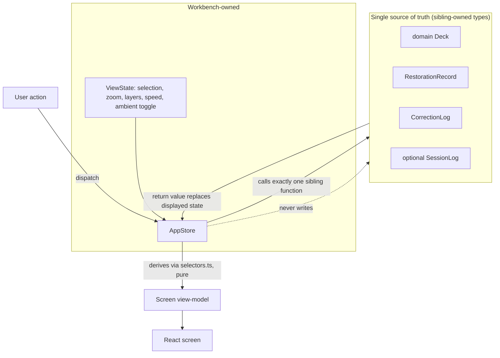
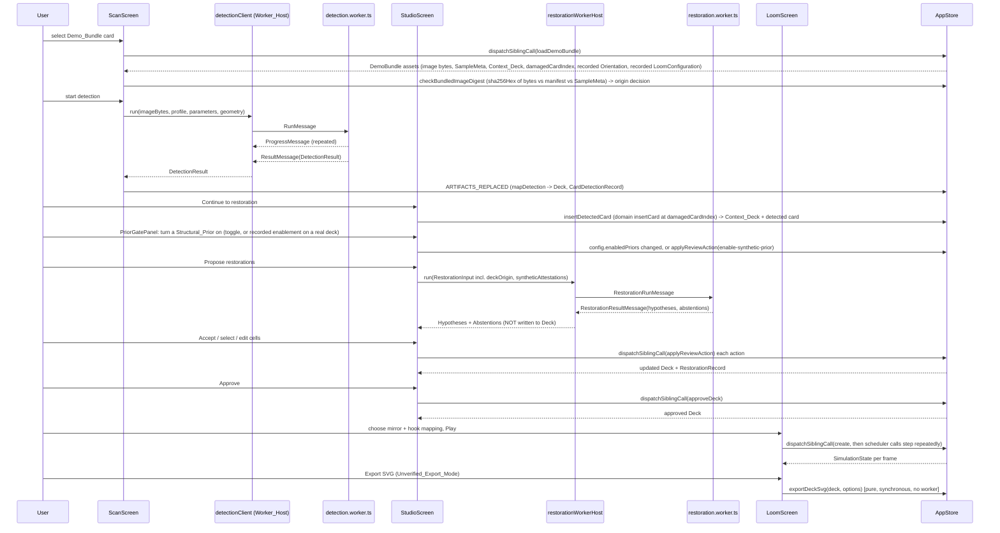

# Design Document

## Overview

This document designs the Workbench: the browser application in `src/ui`, with worker entry points in `src/workers`, that turns the domain, detection and restoration engines into one journey (photograph or bundled sample, detection, evidence-based restoration, human approval, deterministic virtual loom, export), plus a read-only Benchmark Lab and a build-time-generated Kiro Trail. It implements `web-app-workbench/requirements.md` (requirements 1-31), approved with Q4 and Q6 resolved and amended for plan batch A0 (see "Amendment record" at the end of this document). The user also approved "Benchmark Lab P1, essential results in P0": the Results_Summary is P0, the full Benchmark Lab stays P1.

The Workbench holds no engine logic and no second copy of the truth. The single source of truth is the domain `Deck`, the restoration `RestorationRecord`, and the detection `CorrectionLog`. Every screen derives its view from these three records through the sibling public APIs; every user action that changes them calls exactly one sibling function and replaces the displayed state with what that function returned.

Design principles, carried from the four approved sibling designs and the steering files:

1. **View state and truth are different types, never merged.** `ViewState` (selected cell, zoom, active layer, panel visibility, playback speed, ambient-effects toggle) is a plain object the Workbench owns. It is never written into a `Deck`, a `RestorationRecord`, a `CorrectionLog` or a `SessionLog`.
2. **One validator per boundary, owned by whoever owns the type.** Requirement 30 is implemented literally: every external input is validated once, by the module that owns its type. The Workbench adds exactly four validators of its own, for the four boundaries no sibling owns (Trail data, Demo Bundle manifest, route parameters, user-entered text).
3. **Workers do the heavy work; the UI thread never does.** Detection and restoration run in Web Workers behind a typed, versioned, structured-cloneable protocol. The loom interpreter is pure and synchronous (it is small arithmetic over lifted indices), so it runs on the UI thread, and the UI owns its own `requestAnimationFrame` scheduler on top of the domain's pure `step`/`seek` transitions.
4. **Every number has a question it answers.** A restoration confidence is never shown without its calibration marker. A `null` confidence is never shown as a number. An unverified profile field is never shown as if verified. A benchmark metric is shown exactly as the report states it, never recomputed.
5. **Reuse real exports, not requirements-document names.** Where this document's requirements (written before the sibling designs existed in final form) name a function or type that the sibling's approved design calls something else, this design uses the sibling's actual exported name and records the difference in the reconciliation table below. No code in this project calls a function that does not exist.

Research summary: no external research was needed. Sources are the four approved sibling `design.md` documents (`card-domain-and-loom-engine` interface 1.1.0, `card-detection`, `restoration-engine`, `benchmark-and-evaluation`), this spec's own approved `requirements.md`, and the steering files `ui-design-system.md`, `tech.md`, `structure.md`, `testing-standards.md`, `restoration-principles.md`, `jacquard-card-format.md`, `kiro-evidence.md`. Contrast ratios in the design tokens section were computed directly (WCAG relative luminance formula) for every token pairing named in the tables, including an 8%-white-mix "noise" overlay approximating the ambient background texture; the computed numbers are reported, not assumed.

## Reconciliation table (Q1)

The approved `requirements.md` for this spec names dependencies descriptively (written before all four sibling designs were final). This table maps each name used in requirements.md to the actual exported symbol in the approved sibling `design.md`, as this design uses it. Where a name does not exist as such in the sibling, the closest real export is named and the gap, if any, is listed under "Amendments needed in sibling specs".

| requirements.md name | Real export used | From | Notes |
|---|---|---|---|
| `Garín_Profile` | `GARIN_PROFILE` | domain `profile/garinProfile.ts` | capitalisation/accent fixed |
| Approval_Record accessors | `approvalHistory(deck)`, `currentApproval(deck)` | domain `deck/approval.ts` | |
| Edit_History accessors | `Cell.history`, `latestLiveEntry(cell)` | domain `types.ts`, `card/edit.ts` | |
| Deck_Serializer export/import | `exportDeckJson`, `importDeckJson` | domain `io/serialize.ts` | |
| Session_Log builder | `createSession`, `appendAction` | domain `session/record.ts` | |
| Bitmap_Converter | `bitmapToDeck` | domain `bitmap/bitmapToDeck.ts` | not used in P0 |
| SVG_Exporter | `exportCardSvg`, `exportDeckSvg` | domain `svg/exportSvg.ts` | |
| Cutting_Caveat constant | `SVG_CAVEAT` | domain `svg/exportSvg.ts` | exact text in Export design |
| Educational_Label constant | `SIMULATION_DISCLAIMER` | domain `loom/disclaimer.ts` | |
| interface version constant (domain) | `INTERFACE_VERSION` ("1.1.0") | domain `index.ts` | |
| ErrorCode registry (domain) | `ERROR_CODES`, `ERROR_MESSAGES` | domain `result.ts` | |
| `detect` through Detection_Client | `createDetectionClient(factory).run(...)` | vision `client/detectionClient.ts` | Worker_Host wraps this |
| Detection_Worker protocol | `RunMessage`/`ProgressMessage`/`ResultMessage`/`ErrorMessage`/`ReadyMessage`, `PROTOCOL_VERSION` | vision `protocol/messages.ts` | |
| Manual_Correction_Service | `recordGeometryCorrection`, `recordCellCorrection`, `resolveReview`, `undoCorrection`, `foldGeometry`, `restartStageFor`, `reconcile`, `correctionLayer` | vision `corrections/*` | |
| Correction_Log exporter/importer | `exportCorrectionLog`, `importCorrectionLog` | vision `corrections/serialize.ts` | |
| `mapDetection` / `CardDetectionRecord` | `mapDetection`, `CardDetectionRecord`, `UserConditionOverride` | vision `mapping/*` | |
| Detection_Result exporter/importer | `exportDetectionResult`, `importDetectionResult` | vision top-level serialisation | |
| Vision_Error_Code registry | `VISION_ERROR_CODES`, `VISION_ERROR_MESSAGES` | vision `result.ts` | |
| Implementation_Stamp | `ImplementationStamp` | vision `types` | |
| interface version constant (vision) | `VISION_INTERFACE_VERSION` | vision `index.ts` | |
| restoration run function | `runInference` (per the restoration `inference/engine.ts` orchestration function, re-exported from `src/restore/index.ts`) | restoration `index.ts` | requirements.md's generic phrase; actual export name used verbatim in code |
| review service operations | `applyReviewAction` (dispatch by `ReviewActionKind`), `approveDeck`, `undoReviewAction`, `recordSyntheticPriorEnablement` | restoration `review/service.ts`, `gating/priorGate.ts` | one dispatcher, not nine functions |
| Hypothesis/Abstention types | `Hypothesis`, `Abstention` | restoration `types/hypothesis.ts` | |
| Evidence_View builder | `buildEvidenceView` | restoration `evidence/evidenceView.ts` | |
| Confidence_Heatmap_Data builder | `buildConfidenceHeatmap` | restoration `evidence/heatmap.ts` | |
| Restoration_State accessors | `deriveCellState`, `deriveRegionState`, `deriveDeckState` | restoration `review/stateMachine.ts` | |
| Calibration_Status markers | `CalibrationStatus` | restoration `types/hypothesis.ts` | |
| Prior_Gate state | `PriorGateState`, `evaluatePriorGate` | restoration `gating/priorGate.ts` | |
| Record_Serializer | `exportRestorationRecord`, `importRestorationRecord` | restoration `record/serialize.ts` | |
| Restoration_Error_Code / Abstention_Reason registries | `RESTORATION_ERROR_CODES`, `RESTORATION_ERROR_MESSAGES`, `ABSTENTION_REASONS` | restoration `result.ts`, `types/hypothesis.ts` | |
| interface version constant (restoration) | `RESTORATION_INTERFACE_VERSION` | restoration `index.ts` | |
| browser-safe Report_Reader | a browser-safe import from `src/benchmark/report/browserReport.ts` (no Node-only API on its static-import closure, per that design's boundary test) | benchmark `report/browserReport.ts` | requirements.md's "Report_Reader" is this module; there is no separate factory function, the module's exports (`BrowserReport` type, `buildBrowserReport`'s sibling import-side reader, see below) are used directly |
| Browser_Report / index types | `BrowserReport`, `BrowserReportIndexEntry` | benchmark `report/browserReport.ts` | |
| `MetricValue` | `MetricValue` | benchmark `evaluation/metricValue.ts` | |
| interval statuses | `BootstrapInterval`, `BootstrapNotEstimated` | benchmark `evaluation/bootstrap.ts` | |
| `ReliabilityData` | `ReliabilityData`, `ReliabilityBin` | benchmark `evaluation/calibrationMetrics.ts` | |
| user-comparison statuses | `UserComparisonSection` | benchmark `userStudy/studyResult.ts` | |
| real-photograph track result | `RealPhotographTrackResult` | benchmark `tracks/realPhotographTrack.ts` | |
| threshold entry statuses | `ThresholdEntry` + `evaluateThresholdStatus` | benchmark `threshold/thresholdRegister.ts` | |
| honesty-statement constants | `BrowserReport.honestyStatements` (fixed strings written once into the report, not a separate exported constant list) | benchmark `report/browserReport.ts` | the Workbench reads them from the loaded report, it does not import a constant array |
| `ComponentStamp` | `ComponentStamp` | benchmark `report/benchmarkReport.ts` | |
| `unverifiedMarkers` | `BrowserReport.unverifiedMarkers` | benchmark `report/browserReport.ts` | |
| Benchmark_Error_Code registry | `BENCHMARK_ERROR_CODES`, `BENCHMARK_ERROR_MESSAGES` | benchmark `result.ts` | |
| committed quick-profile Browser_Report and its index | `data/benchmark/browser/index.json` and the quick-profile report file beside it, written by the benchmark browser-report script (plan item A0-7, now fixed) | benchmark `report/browserReport.ts` output | the Workbench reads only this folder (requirement 18.21) |
| `Synthetic_Image_Attestation` | `SyntheticImageAttestation` (`generator`, `generatorVersion`, `sourceId`, `seed`, `parametersDigest`, `imageDigest`) | restoration `types` (restoration design "Synthetic image attestation") | one per card with image evidence, in `RestorationInput.syntheticAttestations` keyed by `cardId` |
| `deckOrigin`, `syntheticAttestations` inputs | `RestorationConfig.deckOrigin` (`"real" \| "synthetic"`), `RestorationInput.syntheticAttestations` (`ReadonlyMap<string, SyntheticImageAttestation>`) | restoration `types` | the Workbench supplies both from the Demo_Bundle check of requirement 31 |
| `Synthetic_Deck_Notice` | `SYNTHETIC_DECK_NOTICE` | restoration `gating/attestation.ts` | shown as supplied, never authored by the Workbench |
| Prior toggle (attested synthetic deck) | `RestorationConfig.enabledPriors` (`StructuralPriorKind` = `"repeat" \| "symmetry"`) plus `evaluatePriorGate` | restoration `config`, `gating/priorGate.ts` | a configuration toggle, no enablement entry |
| Prior enablement (real deck) | `applyReviewAction` kinds `enable-synthetic-prior` and `disable-synthetic-prior` (backed by `enableSyntheticPrior`, `disableSyntheticPrior`) | restoration `review/service.ts`, `gating/priorGate.ts` | note of 1 to 1,000 characters required |
| card-insert operation | `insertCard(deck, card, at, actionId)` | domain `deck/structure` (`Result<Deck>`) | used once to put the detected card into the Context_Deck at `damagedCardIndex` |
| `SampleMeta` and its validator | `SampleMeta` (`format: "loom-lazarus-sample-meta"`, `schemaVersion: 1`, `generator`, `generatorVersion`, `sourceId`, `seed`, `parametersDigest`, `imageDigest`, `orientation`, `profileId`, `synthetic: true`) and the detection `SampleMeta` validator | vision public index | the Workbench validates its Demo_Bundle copy through this validator, not its own |
| Image digest text form | `CardDetectionRecord.imageDigestText` (`"sha-256:<lowercase hex>"`) | vision `mapping/*` | compared by string with the manifest and `SampleMeta` digests |
| Image digest function | `sha256Hex` (async, `crypto.subtle`), the function that produces Image_Digest | vision `hash.ts` | digests the bundled image bytes in the browser. Whether the vision public index re-exports it is open: see "Amendments needed", item 6 |

No sibling function this design needs is missing (the one open point is whether the vision index re-exports `sha256Hex`); every other gap found is a *metadata* gap (a marker the UI wants to show but the domain does not yet expose), listed under "Amendments needed in sibling specs", not a missing function.

## Architecture

### Module layout

```
src/ui/
  index.ts                        (not a public surface for siblings; Workbench is a leaf app, nothing imports it)
  main.tsx                        Vite entry, mounts <App/>, no business logic
  app/
    App.tsx                       Shell: left nav, workbench area, inspector area, routing outlet
    routes.ts                     ROUTE_SCREENS tuple, parseRoute, buildRoute (route-param validator, Boundary k)
    AppStore.ts                   the store (see "State management", Q2) and its root reducer
    sessionArtifacts.ts           SessionArtifacts type (Deck, RestorationRecord, CorrectionLog, optional SessionLog)
                                   and the ONLY module allowed to hold a live reference to them
  viewState/
    types.ts                      ViewState tree: per-screen UI-only state, selection, zoom, layers, speed
    selectors.ts                  pure functions (ViewState, SessionArtifacts) -> screen view-models
    provenanceMarker.ts           Provenance_State -> {colour, shape, label} (design-token driven, pure)
    confidenceDisplay.ts          (number|null, CalibrationStatus) -> Restoration_Confidence_Display
    errorMap.ts                   ErrorMap: every sibling + Workbench code -> {message, recoveryAction}
    clickCounter.ts               pure Click-counting state machine for the Quick_Loom_Demo test (req 4)
  workers/host/
    detectionClient.ts            thin wrapper around vision's createDetectionClient + a WorkerFactory
    restorationWorkerHost.ts      Worker_Host for runInference (see "Worker orchestration")
    workerFactory.ts              WorkerFactory implementations (module worker URL) for both hosts
    protocolVersion.ts            UI-side protocol version checks, shared by both hosts
  boundaries/
    routeParams.ts                Workbench-owned validator for route/deep-link parameters (Boundary k)
    userText.ts                   Workbench-owned validator for notes, labels, colour text (Boundary l)
    demoBundleManifest.ts         Workbench-owned validator for the Demo_Bundle manifest (Boundary h, partial)
    trailData.ts                  Workbench-owned validator for generated Trail_Data (Boundary i)
    boundaryRegistry.ts           WORKBENCH_ERROR_CODES tuple + the Boundary-to-Owner-Validator map (used by
                                   the "no second validator" lint test)
  demoBundle/
    demoBundleTypes.ts            DemoBundleManifest type (image ref, imageDigest, damagedCardIndex, recorded
                                   Orientation, recorded LoomConfiguration, context-deck ref, SampleMeta ref,
                                   precomputed DetectionResult ref, precomputed approved Deck ref, placeholder flag)
    loadDemoBundle.ts             loads + validates every Demo_Bundle asset through ITS OWNING importer
                                   (importDetectionResult, importDeckJson, SampleMeta validator, ...), plus the
                                   manifest validator
    attestation.ts                checkBundledImageDigest (sha-256 of the bytes vs manifest vs SampleMeta) and
                                   buildBundledAttestations (SampleMeta -> syntheticAttestations, damaged card only)
    deckOrigin.ts                 decideDeckOrigin: the ONLY module that produces a deckOrigin and an attestation
                                   map for a restoration run (requirement 31; see "Deck origin and attestation")
    contextDeck.ts                insertDetectedCard: the one call of the domain insertCard that builds the deck
                                   handed to restoration (requirement 31.8)
  trail/
    trailTypes.ts                 TrailData, TrailEntry (mirrors the build script's output schema)
    loadTrailData.ts              fetch + validate the generated static asset
  screens/
    scan/            ScanScreen.tsx, viewModel.ts, components/ (CardViewer2D, OverlayLayer, AlignmentEditor,
                      QualityFindingsList, UploadDropzone)
    studio/          StudioScreen.tsx, viewModel.ts, components/ (CardViewer, RegionInspector,
                      AlternativesPanel, CorrectionToolbar, ApprovalPanel, PriorGatePanel [P0],
                      DeckContextNotice [P0], SideBySide, OverrideList)
    loom/            LoomScreen.tsx, viewModel.ts, components/ (LoomStage, PlaybackControls,
                      WeaversNotesPanel, HookLiftPanel)
    lab/             LabScreen.tsx, viewModel.ts, components/ (ResultsSummary [P0], HonestyStatements [P0],
                      ReportPicker, MetricTable, ReliabilityDiagram, BaselineComparison,
                      FailureExampleList, ThresholdTable)
    trail/           TrailScreen.tsx, viewModel.ts, components/ (TrailTimeline, CreditsPanel, AboutPanel)
    start/           StartScreen.tsx (the first-run view of requirement 4), viewModel.ts
  shared/
    layout/          Shell.tsx, LeftNav.tsx, Inspector.tsx, ResponsiveFrame.tsx
    export/          ExportPanel.tsx, exportModes.ts (Verified/Unverified availability logic),
                      requiredVerifiedFields.ts (the eleven-entry table of requirement 14.2)
    glossary/        GlossaryTooltip.tsx, GlossaryPanel.tsx, glossaryTerms.ts (requirement 19.1 term list)
    guidance/        FirstRunPanel.tsx, HelpControl.tsx
    status/          StatusBanner.tsx, ErrorBoundary.tsx, ScreenState.tsx (loading/empty/error/incomplete/needs-review),
                      SimulatedDemoBadge.tsx [P0] (the "Simulated demo card" badge with the Deck_Origin),
                      ContextCardLabel.tsx [P0] ("Simulated intact cards (synthetic)")
    a11y/            SkipLink.tsx, LiveRegion.tsx, FocusTrap.tsx, useReducedMotion.ts, useFocusAnnounce.ts
    tokens/          colour.ts, type.ts, space.ts, motion.ts, motif.ts (generated from the Design Tokens
                      section; a sync test compares them against this document, see Testing Strategy)
  persistence/
    workspaceStorage.ts           opt-in-only localStorage/IndexedDB wrapper (P2), never auto-restoring
  __tests__/
    generators.ts, golden/, *.test.tsx, boundary.test.ts, bannedWording.test.ts

src/workers/
  detection.worker.ts              thin adapter, imports src/vision only (per vision's own design)
  restoration.worker.ts            thin adapter, imports src/restore only, mirrors vision's worker pattern
                                    with its own small protocol (see "Worker orchestration")

scripts/
  build-trail.ts                   converts docs/KIRO_TRAIL.md -> data/generated/trail-data.json at build time
  build-demo-bundle.ts             copies the detection sample into data/demo, builds the manifest and the
                                    context deck; renders no image (requirement 31.11)

data/
  samples/                         (owned by detection) card-synthetic-sample.png and sample.meta.json
  demo/                            Demo_Bundle assets (see "Demo Bundle"), README with source and licence
  benchmark/browser/               (owned by the benchmark spec) index.json and the committed quick-profile
                                    BrowserReport(s); the only report location the Workbench reads
```

### Dependency rule and import-boundary test

- `src/ui` and `src/workers` import `src/domain`, `src/vision` and `src/restore` only through their `index.ts`, and `src/benchmark` only through `report/browserReport.ts` (confirmed Node-free by that module's own boundary test). `src/workers` may import the public indexes of `src/vision`, `src/restore` and `src/domain` (plan item A0-2, in line with `structure.md`), so `restoration.worker.ts` importing `src/restore` is allowed.
- No file outside `src/ui`/`src/workers` imports from `src/ui` or `src/workers` (the Workbench is a leaf; nothing depends on it).
- `src/ui/__tests__/boundary.test.ts`, using the TypeScript compiler API exactly as the four sibling boundary tests do, fails on: an import specifier in `src/ui`/`src/workers` resolving to a non-index module of `src/domain`/`src/vision`/`src/restore`, or to any module of `src/benchmark` outside the browser-safe reader path; any file in `src/domain`, `src/vision`, `src/restore`, `src/benchmark` importing `src/ui` or `src/workers`; a Node-only module (`fs`, `path`, Node's `crypto`) imported by any file reachable from `src/ui`'s own render path (scripts are exempt); and a module in `src/ui` that re-implements a sibling computation (checked by an explicit deny-list of forbidden local function *names* that duplicate sibling concepts -- `computeReadOrder`, `computeConfidence`, `computeAccuracy` and similar -- maintained beside the test, per requirement 1.9).
- A second test, `src/ui/__tests__/validatorOwnership.test.ts`, scans `src/ui` for `JSON.parse` call sites and flags any that is not immediately followed by a call to one of the Owner_Validators listed in `boundaryRegistry.ts` (requirement 30.6).

### Layering: view state versus the single source of truth



`AppStore` holds two kinds of state in two separate slices that are never merged into one object: `artifacts: SessionArtifacts` (the three-or-four sibling records, replaced wholesale on every successful sibling call) and `view: ViewState` (everything else). A selector function takes both slices and returns a plain, serialisable view-model; no component reads `artifacts` or `view` directly except through a selector, so a test can assert "no JSX file imports `Deck`'s field names directly" as a lint rule backing requirement 1.4 and 1.7.

### State management (Q2, resolved)

**Recommendation: a single small reducer-style store (a hand-written `createStore(reducer, initialState)` of about 40 lines, modelled on Redux's minimal API) with React's built-in `useSyncExternalStore` for subscription, no state-management library dependency.**

Rationale, weighed against the alternatives:

| Option | Correctness/determinism fit | Bundle cost | Testability | Decision |
|---|---|---|---|---|
| Redux Toolkit | Good; reducers are pure, matches the "replace displayed state with the sibling's return value" rule directly | ~12 KB gzip plus React bindings; immer adds proxy-based mutation that is unnecessary here because every sibling call already returns a fresh immutable value | Good, well understood | Not chosen: the immutability machinery is redundant when every truth value is already immutable from its source |
| Zustand/Jotai | Good; minimal API | ~1-3 KB gzip | Good | Not chosen: adds a dependency for something a 40-line reducer does with zero dependency and full control over the two-slice separation above |
| React Context + `useReducer` only, no external store | Good for small trees; but every consumer of `artifacts` re-renders on any `view` change unless split into multiple contexts, which reintroduces most of a store's complexity by hand | 0 KB | Good | Not chosen alone: used *underneath* the store (see below), not as the whole mechanism |
| Hand-written reducer + `useSyncExternalStore` (chosen) | Pure reducer, one dispatch path, two independently-subscribable slices (components can subscribe to `view` alone or `artifacts` alone via a selector-based `useStoreSlice(selector)` hook built on `useSyncExternalStore`, avoiding the Context re-render problem without a library) | 0 KB beyond React itself | Reducer is a pure function: trivial to unit-test and to property-test (click-counter state machine, approval-blocking derivation) | **Chosen** |

The store's reducer never calls a sibling function directly; sibling calls happen in thunks dispatched from screen event handlers (`dispatchSiblingCall(fn, args)` in `AppStore.ts`), which await the async worker-backed calls (detection, restoration) or call the synchronous domain functions directly (`userEdit`, `undoEdit`, approval, loom `step`), then dispatch a single `ARTIFACTS_REPLACED` or `ARTIFACTS_CALL_FAILED` action with the sibling's `Result`/`VisionResult`/`RestorationResult`/`BenchmarkResult` value. This keeps every reducer case a pure, synchronously-testable function of `(state, action)`, matching the property-testing approach the sibling specs already use, and satisfies requirement 1.6 (a failed call leaves `artifacts` and the displayed state unchanged, because the reducer for `ARTIFACTS_CALL_FAILED` only ever updates an `error` field in `view`, never `artifacts`).

### Routing and deep links

Five screens plus the start view, addressed by a fixed path list; no nested dynamic segments, no image/deck/record/personal data in the address (requirement 25.8).

```ts
export const ROUTE_SCREENS = ["start", "scan", "studio", "loom", "lab", "trail"] as const;
export type RouteScreen = typeof ROUTE_SCREENS[number];

export interface ParsedRoute { readonly screen: RouteScreen }

export type RouteParamError = { readonly code: "UNKNOWN_SCREEN" | "MALFORMED_ROUTE"; readonly suppliedValue: string };

/** Boundary (k). Accepts only a value from ROUTE_SCREENS; anything else (unknown string, extra segments,
 *  query parameters, a value containing markup) returns an error and the caller opens the start view.
 *  Never uses the raw string as a DOM id, a file path, or part of a request URL (requirement 30.4). */
export function parseRoute(pathname: string): { readonly ok: true; readonly value: ParsedRoute } | { readonly ok: false; readonly error: RouteParamError };
export function buildRoute(screen: RouteScreen): string;   // the only place a path string is constructed
```

A screen that is reachable but blocked by a missing prerequisite (for example `/loom` with an unapproved deck) still renders its own empty state (requirement 3.6); `parseRoute` only rejects a screen identifier that is not in `ROUTE_SCREENS` at all. No other deep-link parameter exists in this design (requirement 29.2 marks this frozen at this document's approval).

### Worker orchestration

Two Worker_Hosts exist, both following the same shape vision's own `DetectionClient`/`WorkerFactory` pattern already defines, so the Workbench adds no second worker-protocol design, only a restoration-specific instance of the same pattern.

```ts
// workers/host/detectionClient.ts -- thin wrapper, no logic beyond wiring
import { createDetectionClient, type WorkerFactory, type DetectionClient } from "<vision index>";
export function createWorkbenchDetectionClient(factory: WorkerFactory): DetectionClient; // passthrough

// workers/host/restorationWorkerHost.ts -- a small protocol, mirroring vision's RunMessage/ProgressMessage/
// ResultMessage/ErrorMessage shape, because restoration's design exports runInference as a plain async
// function with no worker protocol of its own (restoration design, "Interfaces for later specs": "A Web
// Worker adapter ... exchanges only typed, versioned, structured-cloneable messages ... src/restore defines
// no worker protocol of its own"). This design is that adapter.
export const RESTORATION_PROTOCOL_VERSION = 1;
export interface RestorationRunMessage { readonly protocolVersion: number; readonly runId: string; readonly type: "run";
  readonly input: SerialisableRestorationInput }                      // structurally cloneable form of RestorationInput
export interface RestorationResultMessage { readonly protocolVersion: number; readonly runId: string; readonly type: "result";
  readonly hypotheses: readonly Hypothesis[]; readonly abstentions: readonly Abstention[] }
export interface RestorationErrorMessage { readonly protocolVersion: number; readonly runId: string; readonly type: "error";
  readonly error: RestorationError }
export interface RestorationCancelMessage { readonly protocolVersion: number; readonly runId: string; readonly type: "cancel" }
export interface RestorationWorkerHost {
  run(input: RestorationInput, opts: { readonly runId: string; readonly onProgress?: (fraction: number) => void }):
    Promise<RestorationResult<{ readonly hypotheses: readonly Hypothesis[]; readonly abstentions: readonly Abstention[] }>>;
  cancel(runId: string): void;
}
export function createRestorationWorkerHost(factory: WorkerFactory): RestorationWorkerHost;
```

`restoration.worker.ts` imports only `src/restore`'s public index and calls `runInference` inside the `run` message handler; because `runInference` has no internal progress checkpoints exposed by its design, the host reports two progress events only (`0` on start, `1` on completion) rather than inventing granularity the engine does not provide -- this is recorded under "Amendments needed" as something a later restoration minor version could improve, not something this design fabricates. Cancellation of a restoration run is best-effort: the worker is terminated and recreated (restoration's `runInference` is a pure computation with no partial side effects to undo, so terminating it mid-flight leaves no artifact to clean up, unlike detection's checkpointed cancellation). The loom `Interpreter` (`step`, `seek`, `runToEnd`) is synchronous pure arithmetic over at most `4,000,000` cells (the domain's own `FABRIC_TOO_LARGE` ceiling) and is never moved to a worker; it runs on the UI thread inside the scheduler described under "Loom rendering design", and its budget is validated by measurement (performance section) rather than assumed safe.

`SerialisableRestorationInput` carries `deckOrigin` and the attestations as a plain array of `{ cardId, attestation }` pairs (a `Map` is rebuilt inside the worker adapter), so the message stays structured-cloneable and the attestation list is the exact list `decideDeckOrigin` produced. The worker adapter adds, removes or alters no attestation.

Both hosts version their protocol with an integer (requirement 29.3) and reject a mismatched `protocolVersion` with `UNSUPPORTED_PROTOCOL_VERSION` (detection, already defined by vision) or a Workbench-registered equivalent code for the restoration host, both routed through the Error_Map.

### Data flow for the P0 journey



Every arrow into `Store` in this diagram is one call to exactly one sibling function (or, for `loadDemoBundle`/`checkBundledImageDigest`/`mapDetection`/`exportDeckSvg`, one Workbench or sibling pure function); the Workbench never computes a detection, inference, metric or loom value itself (requirement 1.9). The upload path differs in three places only: no Context_Deck is inserted into (restoration runs on the single card, requirement 31.10), `deckOrigin` is `"real"` with no attestation, and the prior toggle is replaced by the recorded `enable-synthetic-prior` flow.

### Error mapping layer

```ts
export type ErrorSource = "domain" | "vision" | "restoration" | "benchmark" | "workbench";
export interface ErrorMapEntry { readonly message: string; readonly recoveryActions: readonly string[] }
export type ErrorMapKey = `${ErrorSource}:${string}`;              // e.g. "domain:DUPLICATE_ACTION_ID"
export const ERROR_MAP: Readonly<Record<ErrorMapKey, ErrorMapEntry>>;

export interface MappedError {
  readonly source: ErrorSource; readonly code: string; readonly message: string;
  readonly recoveryActions: readonly string[];
  readonly values?: Readonly<Record<string, string | number | boolean>>;   // supplied/permitted limits, violated path
  readonly originalMessage: string;                                         // shown only in a details area
}
export function mapError(source: ErrorSource, code: string, originalMessage: string, values?: Record<string, unknown>): MappedError;
```

`ERROR_MAP` has one entry per code in `domain.ERROR_CODES`, `vision.VISION_ERROR_CODES`, `restoration.RESTORATION_ERROR_CODES`, `restoration.ABSTENTION_REASONS`, `benchmark.BENCHMARK_ERROR_CODES`, and `WORKBENCH_ERROR_CODES` (defined in `boundaries/boundaryRegistry.ts`, covering the four Workbench-owned boundaries plus `UNKNOWN_SCREEN`/`MALFORMED_ROUTE`). A build-time and test-time check (`errorMapCoverage.test.ts`) imports every one of those six registries and fails if a code has no `ERROR_MAP` entry, or an entry has an empty `message` or an empty `recoveryActions` array (requirement 20.2). `mapError` is called at exactly one place per sibling call site (the `dispatchSiblingCall` thunk, on `{ok:false}`), so a screen component never constructs its own error text. `CANCELLED` maps to a neutral, non-failure-styled entry (requirement 20.7).

### Runtime validation at boundaries (requirement 30)

| # | Boundary | Owner_Validator called | Workbench module |
|---|---|---|---|
| a | Uploaded image | detection intake (inside `detect`/the worker pipeline; the Workbench passes raw bytes and reads the returned `VisionError`) | `screens/scan/components/UploadDropzone.tsx` |
| b | Imported Deck JSON | `importDeckJson` | `shared/export/ExportPanel.tsx` (import flow) |
| c | Imported Session_Log | `importSessionLog` | same |
| d | Imported Detection_Result | `importDetectionResult` | `demoBundle/loadDemoBundle.ts`, export/import flow |
| e | Imported Correction_Log | `importCorrectionLog` | same |
| f | Imported Restoration_Record | `importRestorationRecord` | same |
| g | Benchmark report index / BrowserReport file | the browser-safe reader's importer in `report/browserReport.ts` | `screens/lab/LabScreen.tsx` |
| h | Demo_Bundle assets: image, `sample.meta.json` copy, `context-deck.json`, `detection-result.json`, `approved-deck.json`, manifest (including `damagedCardIndex` and `imageDigest`) | image via detection intake; `SampleMeta` via detection's `SampleMeta` validator; `context-deck.json` and `approved-deck.json` via `importDeckJson`; `detection-result.json` via `importDetectionResult`; PLUS the Workbench's own `demoBundleManifest.ts` for the manifest shape itself (requirement 30.10) | `demoBundle/loadDemoBundle.ts` |
| i | Generated Trail_Data | Workbench's own `trailData.ts` (no sibling owns this type) | `trail/loadTrailData.ts` |
| j | Saved local session data (P2) | the importers of (b), (e), (f) | `persistence/workspaceStorage.ts` |
| k | Route / deep-link parameters | Workbench's own `routeParams.ts` | `app/routes.ts` |
| l | User-entered text (notes, labels, colours) | Workbench's own `userText.ts`, then the domain's colour validator (`INVALID_COLOUR_LAYER`/`COLOUR_LAYER_OUT_OF_RANGE` from `makeLoomConfig`'s colour path) for colour values specifically | `screens/studio`, `screens/loom/components/WeaversNotesPanel.tsx` |

```ts
// boundaries/userText.ts -- Workbench-owned, Boundary (l)
export type UserTextKind = "note" | "weaversLabel";
export interface UserTextError { readonly code: "TEXT_LENGTH_OUT_OF_RANGE" | "TEXT_CONTROL_CHAR"; readonly kind: UserTextKind; readonly min: number; readonly max: number }
export function validateUserText(kind: UserTextKind, raw: string): { readonly ok: true; readonly value: string } | { readonly ok: false; readonly error: UserTextError };
// note: trims, requires 1..1000 chars after trim, rejects control chars other than \n and \t (requirement 30.3)
// weaversLabel: 1..64 chars, same control-char rule

// boundaries/demoBundleManifest.ts -- Workbench-owned, Boundary (h) manifest shape only
export interface DemoBundleManifest {
  readonly format: "loom-lazarus-demo-bundle"; readonly schemaVersion: 1;
  readonly imagePath: string;                                  // "card.png", a copy of data/samples/card-synthetic-sample.png
  readonly imageDigest: string;                                // "sha-256:<lowercase hex>" of the bytes of card.png
  readonly imageLicenceNote: string;
  readonly sampleMetaPath: string;                             // "sample.meta.json", a copy of the detection SampleMeta
  readonly contextDeckPath: string;                            // "context-deck.json"
  readonly damagedCardIndex: number;                           // integer, 0..(context deck length); position of the detected card after insertion
  readonly recordedOrientation: 0 | 90 | 180 | 270;
  readonly recordedLoomConfiguration: { readonly hookMapping: string; readonly mirror: string; readonly threadsPerHook: number };
  readonly precomputedDetectionResultPath?: string;            // Req 6.8 fallback, regenerated from the real pipeline
  readonly precomputedApprovedDeckPath: string;                // regenerated from the real pipeline
  readonly placeholder: boolean;                               // true while the files come from test doubles (requirement 31.12)
}
export function validateDemoBundleManifest(json: unknown): { readonly ok: true; readonly value: DemoBundleManifest } | { readonly ok: false; readonly error: WorkbenchError };
// checks: format/schemaVersion/unknown-field (same discipline as every sibling importer), orientation in
// {0,90,180,270}, hookMapping/mirror are non-empty strings (the ACTUAL permitted sets are re-checked by
// makeLoomConfig against the loaded MachineProfile once the profile is known -- this validator only
// rejects structurally wrong JSON, never duplicates the domain's semantic check), imageDigest matches
// ^sha-256:[0-9a-f]{64}$, damagedCardIndex is an integer >= 0. The upper bound (<= context deck length)
// needs the loaded deck, so loadDemoBundle checks it right after importDeckJson returns the Context_Deck
// and reports DEMO_BUNDLE_MANIFEST_INVALID with path "damagedCardIndex" (requirement 30.10).

// boundaries/trailData.ts -- Workbench-owned, Boundary (i)
export function validateTrailData(json: unknown): { readonly ok: true; readonly value: TrailData } | { readonly ok: false; readonly error: WorkbenchError };
// format/schemaVersion/unknown-field, entry array shape, generatedAt/commit as opaque non-empty strings

// boundaries/routeParams.ts -- Workbench-owned, Boundary (k): see parseRoute above
```

```ts
// boundaries/boundaryRegistry.ts
export const WORKBENCH_ERROR_CODES = [
  "UNKNOWN_SCREEN", "MALFORMED_ROUTE", "TEXT_LENGTH_OUT_OF_RANGE", "TEXT_CONTROL_CHAR",
  "DEMO_BUNDLE_MANIFEST_INVALID", "DEMO_BUNDLE_DIGEST_MISMATCH", "TRAIL_DATA_INVALID", "WORKSPACE_DATA_INVALID",
] as const;
// DEMO_BUNDLE_DIGEST_MISMATCH (requirement 30.11): the bundled image digest, the manifest imageDigest and the
// SampleMeta imageDigest are not all equal. Not a load failure: the bundle still loads, as an unattested image
// with deckOrigin "real" (requirement 31.4). The code carries the computed and the expected digest as values.
export type WorkbenchErrorCode = typeof WORKBENCH_ERROR_CODES[number];
export interface WorkbenchError { readonly code: WorkbenchErrorCode; readonly message: string; readonly path?: string }

// the Boundary-to-Owner map the validatorOwnership test reads
export const BOUNDARY_OWNERS: Readonly<Record<string, "domain" | "vision" | "restoration" | "benchmark" | "workbench">> = {
  "image-upload": "vision", "deck-json": "domain", "session-log": "domain", "detection-result": "vision",
  "correction-log": "vision", "restoration-record": "restoration", "benchmark-report": "benchmark",
  "sample-meta": "vision", "context-deck": "domain",
  "demo-bundle-manifest": "workbench", "trail-data": "workbench", "route-params": "workbench", "user-text": "workbench",
};
```

Every Boundary failure, including a Workbench-owned one, returns an error that `mapError` covers (requirement 30.9); every Boundary has a corrupted-input test supplying at least one truncated, one wrongly-typed, one oversized/out-of-range and one unknown-field input where applicable (requirement 30.8), listed under Testing Strategy.

### Persistence (opt-in, minimal, P2)

`persistence/workspaceStorage.ts` exposes `saveWorkspace(artifacts)`, `loadStoredWorkspace()`, `clearStoredData()`. `saveWorkspace` is called only from a "Save workspace in this browser" control's click handler, never automatically and never on a timer. It serialises `Deck`, `CorrectionLog`, `RestorationRecord` (never the image, unless the user separately opts into "also save the original image") via their own exporters, writes to `localStorage` under one namespaced key, and returns a plain confirmation string. `loadStoredWorkspace` never runs at mount; `App.tsx` checks `hasStoredWorkspace()` (a cheap existence check, no parse) once on first load and, if true, asks the user before calling `loadStoredWorkspace`, which then re-validates every piece through its owning importer (Boundary j) exactly as a file import would, and reports `WORKSPACE_DATA_INVALID` through the same Error_Map path on failure, offering `clearStoredData()`.

### Build-time Kiro Trail conversion

```ts
// scripts/build-trail.ts (Node, not part of src/ui's runtime bundle; tech.md's "Python only under /research"
// rule does not apply here because this is a one-off TypeScript build step over an existing Markdown file,
// consistent with the sibling specs' own "scripts/ holds thin TypeScript CLI entry points" convention)
export interface TrailEntry {
  readonly date: string; readonly task: string; readonly surface: string;
  readonly steering: readonly string[]; readonly featureSpec?: string;
  readonly hooksFired: string; readonly mcpToolsUsed: string; readonly bugfixSpec: string;
  readonly tests: string; readonly screenshots: readonly string[]; readonly commits: readonly string[];
  readonly decisions: string;
}
export interface TrailData {
  readonly format: "loom-lazarus-trail-data"; readonly schemaVersion: 1;
  readonly generatedAt: string; readonly sourceCommit: string;
  readonly entries: readonly TrailEntry[];
  readonly excludedCount: number;
}
export interface ExclusionReport { readonly entryIndex: number; readonly reason: string }
export function parseTrailMarkdown(text: string): readonly RawTrailEntry[];        // one block per "### YYYY-MM-DD" heading
export function verifyEntry(entry: RawTrailEntry, repoRoot: string): { readonly ok: true; readonly value: TrailEntry } | { readonly ok: false; readonly reason: string };
// confirms at least one evidence reference exists and is checkable at build time: a commit hash found via
// `git cat-file -e <hash>`, a spec folder under .kiro/specs that exists, a hook file under .kiro/hooks that
// exists, or a screenshot file under docs/trail/ that exists. A "Decisions" field with no checkable
// reference fails verification UNLESS at least one other field (Commits/Hooks fired/Screenshots/Feature
// Spec) supplies one.
export function buildTrailData(markdownText: string, repoRoot: string, sourceCommit: string, generatedAt: string):
  { readonly data: TrailData; readonly exclusions: readonly ExclusionReport[] };
```

The script reads `docs/KIRO_TRAIL.md`, runs `git rev-parse HEAD` for `sourceCommit`, and uses the build's own wall-clock time for `generatedAt` (this is the one place in the whole system a timestamp is permitted, because `generatedAt` is explicitly labelled "generated at build time" and is never treated as engine data or compared for determinism, matching the domain's `Opaque_Timestamp_Label` precedent of "stored verbatim, never parsed"). It writes `data/generated/trail-data.json` (gitignored, per `structure.md`'s "Scripts ... write generated data only under `data/generated`"), prints every exclusion with its reason to the build log, and exits non-zero only on a missing or empty source file after writing the Workbench's documented empty-state payload (`entries: [], excludedCount: 0`) so the build never fails outright over an empty trail (requirement 17.7). The Vite build copies `data/generated/trail-data.json` into the static bundle as `trail-data.json`; `trail/loadTrailData.ts` fetches it at runtime and validates it with `validateTrailData` before `TrailScreen` renders it, exactly like any other static JSON asset (requirement 17.2).

### Demo Bundle

The Demo_Bundle lives under `data/demo/` with a README stating source and licence (requirement 25.10; `structure.md`'s rule that every `data` folder with third-party material carries one). Its contents:

| Asset | Format | Owning importer |
|---|---|---|
| `card.png` | a byte-for-byte copy of detection's `data/samples/card-synthetic-sample.png`. The builder renders no image of its own (requirement 31.11) | detection intake (via `detect`) |
| `sample.meta.json` | a copy of detection's `data/samples/sample.meta.json`: `SampleMeta` with `generator`, `generatorVersion`, `sourceId`, `seed`, `parametersDigest`, `imageDigest` (`"sha-256:<hex>"`), `orientation`, `profileId`, `synthetic: true` | detection's `SampleMeta` validator |
| `context-deck.json` | the Context_Deck: simulated intact cards built from a bitmap through the domain `bitmapToDeck`, no image evidence, every card labelled "Simulated intact cards (synthetic)" in the UI | `importDeckJson` |
| `manifest.json` | `DemoBundleManifest` (image digest, `damagedCardIndex`, recorded Orientation, recorded `LoomConfiguration` fields, asset paths, `placeholder` flag) | Workbench's `validateDemoBundleManifest` |
| `detection-result.json` (optional) | a precomputed `DetectionResult` for the Image_Backend-load-failure fallback (Q3, resolved below), regenerated from the real pipeline | `importDetectionResult` |
| `approved-deck.json` | a precomputed, already-approved `Deck` for the Quick_Loom_Demo, regenerated from the real pipeline | `importDeckJson` |

**Placeholder phase and regeneration.** Before the headless engine passes its gate (plan G3), `scripts/build-demo-bundle.ts` builds a Placeholder_Bundle from test doubles: `manifest.placeholder` is `true`, each placeholder file carries a visible placeholder marker in its content (a `placeholder` note field where the format allows one, otherwise the README table), and the README lists them. After the gate, the script is re-run against the real pipeline (`detect`, then restoration and approval of the damaged card through the sibling APIs) to regenerate `detection-result.json` and `approved-deck.json`, and sets `placeholder` to `false`. The release build runs a check (`assertNoPlaceholderBundle`) that reads `manifest.placeholder` and the placeholder markers in the built `dist/` copy of `data/demo` and fails the build if any is present (requirement 31.12). A placeholder bundle never produces an attestation: `checkBundledImageDigest` returns an unattested decision whenever `manifest.placeholder` is `true`.

**Q3, resolved:** the fallback ships. If the Image_Backend fails to load (`BACKEND_LOAD_FAILED`) and `precomputedDetectionResultPath` is present in the manifest, `ScanScreen` offers "Continue with a precomputed result", loads it through `importDetectionResult`, and labels every value derived from it `"precomputed, not detected in your browser"` in the inspector and the condition summary (requirement 6.8). If the field is absent, `ScanScreen` shows only the failure state; the Workbench never fabricates a result. The Quick_Loom_Demo path (requirement 4) never depends on live detection at all -- it loads `approved-deck.json` directly -- so a Backend failure never blocks the three-Click journey.

The recorded `LoomConfiguration` in `manifest.json` is shown on `LoomScreen` as an explicit, labelled selection ("chosen by the demonstration, change it below"), never as a silently-applied default (requirement 4.3, 4.8); it is validated against the loaded `MachineProfile`'s permitted `hookMappings`/`mirrorOptions` through `makeLoomConfig` before use, so a manifest that names an unsupported option surfaces through the normal Error_Map path (`UNSUPPORTED_HOOK_MAPPING`/`UNSUPPORTED_MIRROR`) rather than crashing.

## Deck origin, attestation and deck context (requirement 31)

Synthetic data is never marked `real` to pass validation, and a real photograph is never marked `synthetic` to avoid the real-deck warning. Two small modules, `demoBundle/deckOrigin.ts` and `demoBundle/contextDeck.ts`, are the only places that decide the origin or build the deck handed to restoration.

### Attestation flow

```ts
// demoBundle/attestation.ts
export interface DigestCheck {
  readonly ok: boolean;
  readonly computedDigest: string;           // "sha-256:<hex>" of the bytes actually loaded
  readonly manifestDigest: string;
  readonly sampleMetaDigest: string;
}
/** Async because sha256Hex uses crypto.subtle. Pure over its arguments. */
export function checkBundledImageDigest(imageBytes: Uint8Array, manifest: DemoBundleManifest, meta: SampleMeta): Promise<DigestCheck>;
// ok iff computedDigest === manifestDigest && computedDigest === sampleMetaDigest. Compared as strings.

/** One entry, for the damaged card only. Context cards carry no image evidence and get none. */
export function buildBundledAttestations(damagedCardId: string, meta: SampleMeta): ReadonlyMap<string, SyntheticImageAttestation>;
// { generator, generatorVersion, sourceId, seed, parametersDigest, imageDigest } copied from meta, unchanged.

// demoBundle/deckOrigin.ts
export type DeckOriginDecision =
  | { readonly deckOrigin: "synthetic"; readonly attestations: ReadonlyMap<string, SyntheticImageAttestation>; readonly source: "demo-bundle" }
  | { readonly deckOrigin: "real"; readonly attestations: ReadonlyMap<string, never>;                            // always empty
      readonly source: "upload" | "demo-bundle-unattested"; readonly reason?: { readonly computedDigest: string; readonly expectedDigest: string } | "placeholder-bundle" };
export function decideDeckOrigin(input:
  | { readonly kind: "demo-bundle"; readonly check: DigestCheck; readonly meta: SampleMeta; readonly damagedCardId: string; readonly placeholder: boolean }
  | { readonly kind: "upload" }): DeckOriginDecision;
```

Sequence for the bundled card:

1. `loadDemoBundle` validates every asset through its owner (boundary table, row h) and returns the bytes, `SampleMeta`, Context_Deck and manifest.
2. The Scan screen calls `checkBundledImageDigest` once, when the card is selected (requirement 5.10). The result is kept in `ViewState` as view data, not in Session_Artifacts.
3. After detection, the user continues to restoration. `decideDeckOrigin({kind: "demo-bundle", ...})` returns `synthetic` with one attestation, keyed by the damaged card's `cardId`, only when `check.ok` is true and `placeholder` is false. Otherwise it returns `real`, an empty map, and the reason: the computed and the expected digest (shown by `StatusBanner` through `DEMO_BUNDLE_DIGEST_MISMATCH` and the Error_Map), or "placeholder bundle". In that case the badge is not shown as an attestation claim (requirement 31.4).
4. The restoration worker call receives `deckOrigin` and the attestations from the decision unchanged. `src/restore` still validates them: it requires every card with an `Image_Digest` in its evidence to have an entry whose `imageDigest` equals it, and returns `INVALID_CONFIGURATION` otherwise. The Workbench does not duplicate that check. It only avoids sending an attestation it has not confirmed.

Wording: the attestation is shown as "declaration by the sample generator, bound to this image digest", never as proof of how the image was made (requirement 31.6).

### Uploads are always real

Code path: `UploadDropzone` and the file picker produce an `UploadedImage` value; only `decideDeckOrigin({kind: "upload"})` is called for it, and that branch has no code that reads a `SampleMeta`, a manifest or any attestation, and returns the fixed `real` decision with an empty map. No control, configuration value, file content or route parameter feeds the `demo-bundle` branch: that branch is reachable only with a `DigestCheck` built from the bytes loaded from `data/demo` by `loadDemoBundle`. The tests that enforce this (requirement 31.7), listed again under Testing Strategy:

- `attestationOwnership.test.ts` (static): through the TypeScript compiler API, fails if `syntheticAttestations`, `buildBundledAttestations` or `SyntheticImageAttestation` is referenced in `src/ui` outside `demoBundle/attestation.ts`, `demoBundle/deckOrigin.ts` and the worker host that forwards the decision; fails if `deckOrigin: "synthetic"` appears as a literal anywhere except `deckOrigin.ts`; and fails if `UploadDropzone.tsx` or any module under `screens/scan/components/` imports from `demoBundle/attestation.ts`.
- `uploadOrigin.test.ts` (runtime): feeds the upload flow files whose bytes equal the bundled image, and a file with a `sample.meta.json` beside it. In every case the run input has `deckOrigin: "real"` and no attestation, and no Simulated_Demo_Badge renders.
- `digestMismatch.test.ts`: a bundled image with one byte changed gives `real`, the stated reason and no badge-as-attestation.

### Deck-context step

```ts
// demoBundle/contextDeck.ts
import { insertCard, type Deck, type Card, type Result, type ActionId } from "<domain index>";
export function insertDetectedCard(contextDeck: Deck, detectedCard: Card, damagedCardIndex: number, actionId: ActionId): Result<Deck>;
// calls insertCard(contextDeck, detectedCard, damagedCardIndex, actionId) once and returns its Result unchanged.
// No other deck construction. An out-of-range index or a duplicate cardId returns the domain's error, mapped by the Error_Map.
```

`detectedCard` is the card that `mapDetection` returned from the Detection_Result, and `actionId` comes from the Workbench's action-id generator (a counter from configuration, no clock, no `Math.random`). The Domain_Deck passed to restoration is the `Deck` that `insertCard` returned, and restoration's `detectionEvidence` input holds the `CardDetectionRecord` for the damaged card only; the context cards have none. Because the context cards were built by `bitmapToDeck`, restoration sees their cells as `observed`, and the repeat and symmetry priors can use them.

`DeckContextNotice` shows the step's outcome in the Studio screen: for the demo path, "The detected card was placed at position {n+1} among {m} simulated intact cards (synthetic)"; for an upload with no Context_Deck, "Only structure within this card is available for this deck. Repeat evidence across cards needs more cards." (requirement 31.10). In the upload case `insertDetectedCard` is not called: the deck is created from the single detected card by the domain `createDeck` through `dispatchSiblingCall`, and restoration runs on that single card.

### Badge and labels

`SimulatedDemoBadge` renders the text "Simulated demo card" and the Deck_Origin (`synthetic`) in `Shell`'s header slot, next to the approval status, whenever `artifacts.deck` has a card whose `cardId` has an attestation in the current `DeckOriginDecision`, or while the Quick_Loom_Demo's precomputed approved deck is loaded. It is driven by `deckOrigin` and `attestationRefs` from the restoration records, and for the precomputed deck by `manifest.placeholder === false` and a passing `DigestCheck`. It is absent for every deck built from an upload. `ContextCardLabel` renders "Simulated intact cards (synthetic)" on each Context_Deck card in the Studio card list, in the Loom card list and in the Compare view. In the inspector of every cell, region and hypothesis of an attested synthetic deck, the Workbench shows `SYNTHETIC_DECK_NOTICE` exactly as the restoration layer supplies it (from the `Evidence_View.syntheticDeckNotice` field), and never authors a replacement.

## Design Tokens

All contrast ratios below were computed from the WCAG 2.x relative-luminance formula against the stated background, and separately against that background mixed 8% toward white (`mix(bg, #FFFFFF, 0.08)`), used as a conservative stand-in for the ambient fog/noise/motif layer so that the "measured against actual backgrounds including noise" rule (`ui-design-system.md`) is honoured by a worst-case approximation at this stage; `design.md`'s own automated contrast test (requirement 22.3) samples real rendered pixels later and is the authority once the motif renders exist. Every pairing below meets the 4.5:1 (text) / 3:1 (UI component) rule at both the plain and the noise-mixed background, except where marked, which is resolved by lightening the token (shown as the "used" value).

### Colour palette

| Token | Hex | Role |
|---|---|---|
| `color.bg.0` | `#121016` | app background (charcoal) |
| `color.bg.1` | `#1A1720` | panel / card-viewer background |
| `color.bg.2` | `#231F2C` | raised panel (inspector, modal) |
| `color.bg.purple` | `#2A1F3D` | deep-purple accent background (hero sections, Lab charts backdrop) |
| `color.border.default` | `#9A8FB8` | default hairline border (raised from an earlier `#8A7FA8` to clear 3:1 on noise; see table below) |
| `color.text.primary` | `#EDE8F5` | primary text |
| `color.text.secondary` | `#B8B0C9` | secondary text |
| `color.text.muted` | `#A199B5` | muted/caption text (only for non-essential text; essential text uses primary or secondary) |
| `color.accent.amber` | `#E3AE55` | antique amber: observation, the loom, "verified"-adjacent affordances |
| `color.accent.cyan` | `#72D8E2` | ghost-cyan: inference, restoration, "proposal" affordances |
| `color.state.danger` | `#FF8A93` | errors, destructive actions |
| `color.state.warn` | `#F2C14E` | needs-review, unverified warnings |
| `color.state.success` | `#8FD9A8` | approved, confirmed |
| `color.focus` | `#FFD27A` | focus ring (never reused for any other meaning) |

### Contrast measurements

| Pairing | Background | Ratio | Background + noise (8% white mix) | Ratio | Meets 4.5:1 text / 3:1 component? |
|---|---|---|---|---|---|
| `text.primary` on `bg.0` | `#121016` | 15.71 | `#1E1C22` | 12.92 | Yes (text) |
| `text.primary` on `bg.1` | `#1A1720` | 14.71 | `#28252C` | 11.76 | Yes |
| `text.primary` on `bg.2` | `#231F2C` | 13.39 | `#302C38` | 10.53 | Yes |
| `text.secondary` on `bg.0` | `#121016` | 9.08 | | 7.47 | Yes |
| `text.secondary` on `bg.1` | `#1A1720` | 8.50 | | 6.80 | Yes |
| `text.secondary` on `bg.2` | `#231F2C` | 7.74 | | 6.09 | Yes |
| `text.muted` on `bg.1` | `#1A1720` | 6.52 | | 5.21 | Yes (caption-only use) |
| `accent.amber` on `bg.0`/`bg.1` | | 9.40 / 8.80 | | 7.74 / 7.04 | Yes (text) |
| `accent.cyan` on `bg.0`/`bg.1` | | 11.37 / 10.64 | | 9.35 / 8.51 | Yes |
| `state.danger` on `bg.1` | | 7.84 | | 6.27 | Yes |
| `state.success` on `bg.1` | | 10.66 | | 8.53 | Yes |
| `state.warn` on `bg.1` | | 10.54 | | 8.43 | Yes |
| `color.focus` on `bg.0`/`bg.1` | | 13.27 / 12.42 | | 10.92 / 9.94 | Yes (>=3:1 component) |
| `bg.0` (as text) on `accent.amber` | | 9.40 | n/a (solid fill, no noise) | | Yes |
| `bg.0` on `accent.cyan` | | 11.37 | | | Yes |
| `border.default` (`#9A8FB8`) on `bg.1` | `#1A1720` | 5.89 | | 4.71 | Yes (>=3:1) -- superseded an initial `#8A7FA8` (4.79/3.83, still passing but with less margin) |
| `border.default` on `bg.2` | `#231F2C` | 5.37 | | 4.22 | Yes |

Every text pairing clears 4.5:1 and every border/component pairing clears 3:1 even under the noise approximation; none required a fallback beyond the one border lightening recorded above. `tokens/colour.ts` exports these exact hex values so the sync test (Testing Strategy) can diff the rendered CSS variables against this table.

### Provenance and state markers

Colour is never the only signal (requirement 22.1). Each `Provenance_State` plus the two display-only states gets a distinct hex, a distinct shape/pattern, and a fixed label, verified distinguishable in greyscale by shape and label alone (Testing Strategy, monochrome test).

| Provenance_State | Colour | Shape/pattern | Label |
|---|---|---|---|
| `observed` | `#E3AE55` (amber) | filled circle | "observed" |
| `repeat-inferred` | `#72D8E2` (cyan) | circle with horizontal hatch | "inferred (repeat)" |
| `symmetry-inferred` | `#B9A4FF` (violet-cyan) | circle with diagonal hatch | "inferred (symmetry)" |
| `ambiguous` | `#FF8FB8` (rose) | dashed-outline circle, no fill | "ambiguous" |
| `user-edited` | `#8FD9A8` (success green) | circle with a corner tick mark | "edited by you" |
| `unknown` (display-only) | `#A199B5` (muted) | circle with an "x" glyph, no fill | "unknown" |
| `needs-review` (display-only) | `#F2C14E` (warn) | circle with a triangular flag glyph | "needs review" |
| reserved position (non-cell) | `#5A5468` (neutral, distinct from every provenance) | small square, not a circle | "reserved, not an instruction" |

Measured against `bg.1` (`#1A1720`): `observed` 8.80, `repeat-inferred` 10.64, `symmetry-inferred` 8.27, `ambiguous` 8.32, `user-edited` 10.66, `unknown` 6.52, `needs-review` 10.54 -- all clear 3:1 for the marker glyph/outline as a UI component, and clear 4.5:1 where used as inline text in the legend.

The Simulated_Demo_Badge and the context-card label are text labels, not provenance states: they use `color.text.primary` on `color.bg.2` (13.39 plain, 10.53 with noise) with a `color.accent.cyan` outline (10.64 on `bg.1`, 8.51 with noise; at least 3:1 as a component), a perforation-dot glyph, and the literal text, so the badge never relies on colour alone. It sits in the Shell header at all widths.

### Confidence ramp (not colour-only)

The restoration-confidence heatmap layer uses a five-step amber-to-violet ramp PLUS a distinct hatch density, so a colourblind or greyscale view still orders confidence correctly by pattern density, and `null` is never a point on the ramp:

| Step | Confidence range | Colour | Pattern |
|---|---|---|---|
| "not evaluated" | `null` | `#3A3642` (near-background, distinct) | diagonal cross-hatch (X), never empty/blank |
| very low | `[0, 0.2)` | `#3B3350` | sparse dots |
| low | `[0.2, 0.4)` | `#5A4C86` | light hatch |
| medium | `[0.4, 0.6)` | `#7C66B8` | medium hatch |
| high | `[0.6, 0.8)` | `#A58BE0` | dense hatch |
| very high | `[0.8, 1.0]` | `#E3AE55` (amber, reused intentionally: "approaching observed-level trust") | solid fill |

The "not evaluated" swatch is rendered with its own glyph (a hollow circle with a question-mark-free dash, label "not evaluated") so it is never visually interpolated as "between low and very low" (requirement 9.6, 26.2). Every numeric step additionally carries the `CalibrationStatus` marker text ("uncalibrated" or "calibrated vN") directly beside the percentage, never only in a separate legend (requirement 26.1).

### Typography

| Token | Font | Size / line-height | Use |
|---|---|---|---|
| `type.display` | "Spectral" (serif, self-hosted) | 28px / 36px | screen titles, the demo start view |
| `type.heading` | "Spectral" | 20px / 28px | section headings, panel titles |
| `type.body` | "Inter" (sans, self-hosted) | 15px / 22px | body text, inspector fields |
| `type.label` | "Inter", medium weight | 13px / 18px | field labels, Provenance_Marker labels |
| `type.mono` | "JetBrains Mono" (self-hosted) | 13px / 20px | `readIndex`, Action_Id, digests, grid coordinates |

**Font loading strategy:** both families are self-hosted as WOFF2 under `src/ui/assets/fonts/`, loaded via `@font-face` with `font-display: swap`, and subset to Latin + the punctuation this project's strings use, keeping combined weight under an initial budget of 120 KB (measured, not asserted -- see Performance budgets). No `@import` of a Google Fonts or any third-party font URL exists anywhere in the codebase; a test (`noExternalFontRequests.test.ts`) scans built CSS/HTML for `fonts.googleapis.com`/`fonts.gstatic.com`/any cross-origin `url()` in a `@font-face` block and fails if found (requirement 3.9, 25.2).

### Spacing, radii, elevation

| Token | Value |
|---|---|
| `space.1` … `space.8` | 4, 8, 12, 16, 24, 32, 48, 64 px (4px base scale) |
| `radius.sm` | 4px (buttons, inputs) |
| `radius.md` | 8px (panels) |
| `radius.lg` | 16px (the card viewer frame) |
| `elevation.0` | none (flat panels on `bg.0`) |
| `elevation.1` | `0 1px 2px rgba(0,0,0,0.4)` (raised panel on `bg.1`) |
| `elevation.2` | `0 4px 16px rgba(0,0,0,0.5)` (modal, popover) |

### Motion

| Token | Duration | Easing | Reduced-motion substitution |
|---|---|---|---|
| `motion.microInteraction` | 120ms | `ease-out` | unchanged (too short to be a vestibular concern) |
| `motion.panelEnter` | 180ms | `cubic-bezier(0.2,0.8,0.2,1)` | 0ms (instant show) |
| `motion.loomPass` | 220ms per pass (initial value; see Loom rendering design) | `linear` (matches the deterministic frame step) | replaced entirely by step-through; no timed animation runs |
| `motion.ambientFog` | 40s loop | `linear` | disabled entirely (opacity 0, no animation-frame cost) |
| `motion.threadShimmer` | 6s loop | `ease-in-out` | disabled entirely |

No token's fastest configured repetition exceeds three cycles per second (requirement 22.7); `motion.loomPass` at its fastest configured playback speed (the playback-speed ceiling defined in `screens/loom/viewModel.ts`, initial value 8 passes/second) is explicitly checked against this limit by the flash-rate test in Testing Strategy, and the ceiling is set below three-per-second by construction (a pass transition is a colour/shape change, counted conservatively as a potential flash).

### Motifs and their performance limits

Fog, thread and perforation motifs are pre-rendered, low-resolution (initial value: 256x256) tiled background images or a single CSS `radial-gradient`/`conic-gradient` layer with CSS animation only on `background-position`/`opacity` (never `filter` or per-pixel canvas work), composited behind content at an initial opacity ceiling of 0.12 so contrast never depends on the motif being absent. No motif runs inside the card viewer or the loom stage's own canvas/SVG surface; it is strictly a `Shell`-level background layer, toggleable by the ambient-effects control (requirement 22.6) and always off under `prefers-reduced-motion` (requirement 22.4). A measured frame-budget check (Testing Strategy, Performance section) confirms the motif layer's own cost is excluded from the main-thread budget attributed to detection/restoration/loom work.

## Screen Wireframes

Layout convention on every screen (desktop): left navigation (fixed, ~220px), central workbench (flexible), contextual right inspector (fixed, ~320px, shown only when a screen defines inspector content). Tablet: inspector moves below the workbench or becomes a dismissible overlay. Narrow: left nav collapses to a menu button; inspector becomes a bottom sheet. P0 elements are marked `[P0]`; P1 `[P1]`; P2 `[P2]`.

### Start view (first load, requirement 4)

```
Desktop (>=1024px)
+--------------------------------------------------------------------------------+
| [P0] Loom Lazarus   [P0] (Simulated demo card: synthetic)  Credits | Educational |
|                                         simulation | Glossary                    |
+--------------------------------------------------------------------------------+
|                                                                                  |
|            A damaged punched card, faintly lit, floats center-stage            |
|                                                                                  |
|   [P0] "Watch the loom weave the demonstration deck"   [P0] "Walk through      |
|         (Quick_Loom_Demo -- Click 1)                        the full           |
|                                                              restoration"       |
|                                                                                  |
|   [P0] Results summary (read-only, from the committed quick report): link     |
|         "See recorded results"  -> Lab screen, Results_Summary                  |
|   [P1] (dismissible) First-run note: "No upload needed. Everything stays in    |
|         your browser." [Got it]                                                |
+--------------------------------------------------------------------------------+
```
Narrow (<768px): the two primary actions stack full-width; the card art shrinks but both action labels stay visible with no scroll to reach them (requirement 4.1). The badge appears only after the demonstration deck is loaded (it is absent on the very first render, before any deck exists, and absent for any uploaded deck).

"Walk through the full restoration" opens the Scan screen with an ordered step list above the stage: 1 detect, 2 add to the context deck, 3 turn on a structural prior, 4 propose, 5 review, 6 approve, 7 weave, 8 export, with the current step marked by text and a marker (requirement 4.9). The step list is derived from `artifacts` presence (detection result, deck with the detected card, prior gate state, hypotheses, approval state, simulation state, export), not stored as separate state.

### Scan & Detect

```
Desktop, state = loading (detection running)
+------+--------------------------------------------+----------------------------+
| Nav  |  [P0] Stage: "geometry"  == 42% ==  [Cancel]|  [P0] Inspector (empty     |
| Scan*|                                              |  until a position is       |
| Studio|   [rectified/original toggle]  [zoom][pan] |  selected)                  |
| Loom |   +--------------------------------------+   |                           |
| Lab  |   |      card photo with hole/grid/      |   |  "Select a position on    |
| Trail|   |      quality overlays (toggles        |   |   the card to see its     |
|      |   |      below) [P0 holes/uncertain,       |   |   evidence."              |
|      |   |       P1 grid/findings]                |   |                           |
|      |   +--------------------------------------+   |                           |
|      |   [P0] Digest check: computed sha-256:ab12.. |                           |
|      |   = manifest = sample metadata, or the       |                           |
|      |   mismatch reason. Upload: "treated as a     |                           |
|      |   real photograph".                          |                           |
|      |   +--------------------------------------+   |                           |
|      |   Legend: o observed-hole o observed-none    |                            |
|      |           ? ambiguous  x unknown  [] reserved |                           |
+------+--------------------------------------------+----------------------------+
```
Empty state: "No image yet -- choose the bundled card or upload one [P1]." Error state (`failed`): failure stage, reason, values/thresholds, suggested actions, "Fix alignment manually [P1]". Incomplete-data (`aligned-with-warnings`): condition counts shown with a warning banner, overlays still rendered.

Tablet: overlay toggles move into a collapsible drawer above the image. Narrow: zoom/pan become pinch + on-screen +/- buttons; stage/progress pins to the top under the nav menu button.

### Restoration Studio

```
Desktop, state = loaded, one region selected, demonstration deck (attested synthetic)
+------+----------------------------------------+------------------------------+
| Nav  | [P0] (Simulated demo card: synthetic)   |  [P0] Region inspector        |
| Scan | [P0] DeckContextNotice: "Detected card  |  readIndex 142  card c-07     |
| Studio*|  placed at position 4 among 7          |  Provenance: repeat-inferred  |
| Loom |  simulated intact cards (synthetic)"     |  Confidence: 0.81 (uncal.)   |
| Lab  | [P0] Layers: *Provenance  Heatmap  Hole |  Evidence: "Repeat period 3: |
| Trail|        likelihood  Evidence  State      |   11 of 13 supporting cards  |
|      |   +----------------------------------+   |   agree ..."                 |
|      |   |   large card grid, cell markers   |   |  Synthetic deck notice       |
|      |   |   per Provenance_State legend      |   |   (text from restoration)    |
|      |   |   below the design-tokens table    |   |  [P0] Alternatives (<=3):     |
|      |   +----------------------------------+   |    1. down  0.81 [Accept]     |
|      |   Legend: amber=observed cyan-hatch=     |    2. lifted 0.34 [Select]    |
|      |   repeat violet-hatch=symmetry rose-     |  [P0] [Reject] [Edit value]   |
|      |   dash=ambiguous green-tick=edited       |  [P1] Condition override      |
|      |   grey-X=unknown                         |  [P0] Undo my edit /          |
|      | [P0] PriorGatePanel (see below)          |     Withdraw accepted sugg.   |
|      | [P0] Propose restorations | [P0] Approve |                              |
|      |   (blocking reasons listed if disabled)  |                              |
+------+----------------------------------------+------------------------------+

[P0] PriorGatePanel, case 1: attested synthetic deck (toggle, no note, no real-deck warning)
  Structural prior        State                        Control
  repeat                  off | on (measurement v3,    [ ] Use this prior   (enabled only while a valid
                          scope synthetic)                 Prior_Measurement exists for the kind)
  symmetry                off                          [ ] Use this prior   (disabled: "no valid
                                                           measurement for symmetry")
  "Measured on synthetic data..." (Synthetic_Deck_Notice) on every dependent item.

[P0] PriorGatePanel, case 2: real deck (upload) -- recorded enablement
  repeat (synthetic-only prior)   disabled   [Enable on this real deck...]
    -> note field (1..1000 chars)  [Record enablement]  -> shows Action_Id and Sequence_Number
  Fixed Synthetic_Prior_Warning text on every dependent item and a deck-level warning while enabled.
  No toggle of case 1 is offered.
```
Upload without a context deck: the DeckContextNotice reads "Only structure within this card is available for this deck. Repeat evidence across cards needs more cards." and no badge is shown.

Empty: "No detected card yet -- go to Scan & Detect." Loading: "Running restoration..." with progress. Error: mapped restoration error with recovery action. Incomplete-data: count of `unknown`/`ambiguous` cells banner above the grid. Needs-review: a list panel above the grid: "3 corrections need your review" with confirm/discard per item `[P1]`.

Tablet: inspector becomes a slide-up panel triggered by selecting a cell; legend collapses under a "Legend" disclosure. Narrow: layer toggles become a single dropdown; Alternatives list becomes full-width cards below the (now smaller) card grid.

### Virtual Loom

```
Desktop, state = ready to choose configuration
+------+----------------------------------------+------------------------------+
| Nav  | [P0] Mirror: ( ) none ( ) mirrored      | [P0] Active card: c-07        |
| Scan | [P0] Hook mapping: ( ) contiguous        |  lifted hooks: 4,9,12,...     |
| Studio| ( ) repeat   [both shown unverified]    |  warp threads driven: ...     |
| Loom*| [P0] Threads/hook: [16] (unverified)     | [P0] Pass 12 / 400            |
| Lab  |                                          | "Educational simulation --    |
| Trail|  +------------------------------------+  |  not compatible with          |
|      |  |   LoomStage: woven cloth grows      |  |  physical looms."             |
|      |  |   left-to-right, warp/weft symbols   |  +------------------------------+
|      |  +------------------------------------+  | [P1] Weaver's Notes panel      |
|      | [P0][Step][Play][Pause][Seek__][Reset]  |  "colour supplied by you,      |
|      | [P1] Speed: 1x 2x 4x   [P1][Replay sess]|   not stored on the cards"     |
+------+----------------------------------------+------------------------------+
```
Empty (unapproved deck): "Only an approved deck runs on the loom. [Go to approval]" with no run controls. Incomplete-data: "choose a mirror orientation and a hook mapping" disables Play/Step. Partial: paused mid-run, progress text "Paused at pass 12 of 400". Error: mapped interpreter error (e.g. `FABRIC_TOO_LARGE`) with the values involved.

Tablet/narrow: configuration controls collapse above the stage; playback controls pin to the bottom as a fixed bar.

For the demonstration deck, the Shell header shows the Simulated_Demo_Badge on this screen too, and the card list beside the active card labels each Context_Deck card "Simulated intact cards (synthetic)".

### Results summary (P0) and Benchmark Lab (P1)

The Lab route renders two layers. The P0 Results_Summary is a read-only table of the committed quick-profile Browser_Report read from `data/benchmark/browser/index.json`: the honesty statements verbatim, the synthetic section and the real-photograph section as separate blocks, each metric with its sample size and Split_Role, `undefined`, `not-estimated` and `not-evaluated` shown as words with reasons, and the Component_Stamp. It has no chart and no report picker (it shows the quick-profile report the index names). The P1 Lab adds the picker, intervals charts, reliability diagram, baselines, thresholds and failure examples below.

```
Desktop, Results_Summary [P0] (state = report loaded)
+------+----------------------------------------+------------------------------+
| Nav  | [P0] "Synthetic results measure the     | Dataset: v3  seed 20260700   |
| Lab* |  system on generated data..." (verbatim) | Split: held-out  n=840 fam.  |
|      | SYNTHETIC       accuracy(all) 0.71       | Profile: quick               |
|      |   accuracy(answered) 0.88  coverage 0.80 | ComponentStamp: dom 1.1.0 .. |
|      | REAL PHOTOGRAPHS   not evaluated (reason)|                              |
+------+----------------------------------------+------------------------------+
```
(Numbers in this wireframe are placeholders for layout only; the screen shows only values read from the report.)

```
Desktop, state = report loaded
+------+----------------------------------------+------------------------------+
| Nav  | [P1] Report: [quick-2026-01 v] digest..  | Dataset: v3  seed 20260700   |
| Scan | [P1] "Synthetic results do not predict   | Split: held-out  n=840 fam.  |
| Studio|  performance on historical cards."       | ComponentStamp: dom 1.1.0 .. |
| Loom |                                          |                              |
| Lab* |  SYNTHETIC OVERVIEW        REAL PHOTOS    |                              |
|      |  accuracy(all) 0.71 [0.68,0.74]  not      |                              |
|      |  accuracy(answered) 0.88          evaluated|                             |
|      |  [ReliabilityDiagram: 10 bins,            |                              |
|      |   empty bins shown empty]                 |                              |
|      |  Baselines: B1 0.52  B2 0.59  B3 0.61      |                              |
|      |   paired diff vs B2: +0.12 [0.08,0.16]    |                              |
|      |  Thresholds: accuracy>=0.70 "not set"      |                              |
+------+----------------------------------------+------------------------------+
```
Empty (both layers): "No committed report is bundled in this build." and no number. Error (both layers): mapped benchmark error, no partial report. Incomplete-data: `undefined` metrics shown as the word "undefined" with reason; `not-estimated` intervals with reason. Partial: tracks individually marked `not-evaluated`.

### Kiro Trail / About (P1, credits P0)

```
Desktop, state = loaded
+------+----------------------------------------+------------------------------+
| Nav  | [P0] Credits: Rodas Lorente et al. 2025  | [P1] About: version, engine  |
| Scan |  (DOI link), Garin5 dataset, resources   |  Component_Stamp              |
| Studio| [P1] Timeline (date-ordered):            |                              |
| Loom |   2026-01-05 "Domain spec approved"        |                              |
| Lab  |     evidence: spec folder, commit abc123   |                              |
| Trail*|   2026-01-09 "Detection worker wired"      |                              |
|      |     screenshot: docs/trail/...png          |                              |
|      | [P1] Limitations: unverified card format,  |                              |
|      |   synthetic benchmark, uncalibrated conf.,  |                              |
|      |   educational simulation                   |                              |
|      | "generated at build time: 2026-02-01, abc1"|                              |
+------+----------------------------------------+------------------------------+
```
Empty: "No verified Kiro trail entries are bundled in this build" plus the build stamp, no placeholder entry.

## Components and Interfaces

### Component breakdown

Component tree (screen-owned subtrees only; `Shell` wraps every screen). Each row names the requirement(s) the component is primarily responsible for; a component may also depend on shared components listed once.

```
Shell                                   (req 3)
├─ LeftNav                              (req 3.1, 3.6)
├─ Inspector (slot)                     (req 3.1)
├─ SimulatedDemoBadge [P0]              (req 3.10, 31.5)
├─ StatusBanner / ErrorBoundary         (req 20.4-20.6, 27)
├─ SkipLink, LiveRegion                 (req 21.9, 21.7)
├─ CreditsPanel + GlossaryTooltip entry (req 3.2-3.3, 3.8, 19)
└─ <route outlet>
   ├─ StartScreen                       (req 4)
   ├─ ScanScreen                        (req 5-8)
   │  ├─ UploadDropzone [P1]            (req 5.2-5.3, 5.11, 30a; never calls attestation code)
   │  ├─ DemoCardPicker + DigestCheckNotice [P0] (req 5.1, 5.6, 5.10, 31.3-31.4)
   │  ├─ CardViewer2D                   (req 5.3-5.4, 7.9)
   │  │  └─ OverlayLayer                (req 7.1-7.4, 7.10)
   │  ├─ ProgressBar + CancelControl    (req 6.1-6.4)
   │  ├─ QualityFindingsList [P1]       (req 7.6-7.7)
   │  └─ AlignmentEditor [P1]           (req 8.1-8.10)
   ├─ StudioScreen                      (req 9-13)
   │  ├─ CardViewer                     (req 9.1-9.12)
   │  │  ├─ ProvenanceLegend
   │  │  └─ LayerToggles
   │  ├─ DeckContextNotice [P0]         (req 31.8-31.10; context-card labels via ContextCardLabel)
   │  ├─ PriorGatePanel [P0]            (req 10.3-10.4, 10.9-10.12; two cases, see contract below)
   │  ├─ RegionInspector                (req 11.1-11.10)
   │  ├─ AlternativesPanel              (req 11.3-11.4, 12.1)
   │  ├─ CorrectionToolbar              (req 12.1-12.14)
   │  ├─ OverrideList [P1]              (req 12.5, 13.6)
   │  ├─ ApprovalPanel                  (req 13.1-13.9)
   │  └─ SideBySide [P1]                (req 13.7)
   ├─ LoomScreen                        (req 15)
   │  ├─ ConfigPicker (mirror/hook/tph) (req 15.2-15.4)
   │  ├─ LoomStage                      (req 15.6, 15.12)
   │  ├─ HookLiftPanel                  (req 15.6)
   │  ├─ PlaybackControls               (req 15.7, 15.9-15.10, 15.15)
   │  └─ WeaversNotesPanel [P1]         (req 15.13-15.14)
   ├─ LabScreen                         (req 18; Results_Summary P0, the rest P1)
   │  ├─ ResultsSummary [P0]            (req 18.20-18.21, 18.3-18.9)
   │  ├─ HonestyStatements [P0]         (req 18.5)
   │  ├─ ReportPicker [P1]
   │  ├─ MetricTable
   │  ├─ ReliabilityDiagram
   │  ├─ BaselineComparison
   │  ├─ ThresholdTable
   │  └─ FailureExampleList
   └─ TrailScreen [P1, credits P0]      (req 17, 3.2-3.3)
      ├─ TrailTimeline
      └─ AboutPanel

ExportPanel (shared, mounted from Studio and Loom)   (req 14, 16)
GlossaryPanel (shared, opened from Shell)             (req 19)
```

### Key component contracts

```ts
export interface CardViewerProps {
  readonly card: CardViewModel;                 // derived via selectors.ts from Deck + RestorationRecord
  readonly activeLayer: "provenance" | "heatmap" | "holeLikelihood" | "evidence" | "state";
  readonly selectedCell?: { readonly cardId: string; readonly readIndex: number };
  readonly onSelectCell: (ref: { readonly cardId: string; readonly readIndex: number }) => void;
  readonly onKeyboardMove: (direction: "up" | "down" | "left" | "right" | "home" | "end" | "cardStart" | "cardEnd") => void;
}
export interface RegionInspectorProps {
  readonly evidenceView: EvidenceView | undefined;              // restoration's own type, read-only
  readonly reviewState: { readonly cellState: RestorationState; readonly reviewOutcome?: string };
  readonly onAccept: () => void; readonly onSelectAlternative: (rank: 1 | 2 | 3) => void;
  readonly onReject: () => void; readonly onEditValue: (value: 0 | 1, note: string) => void;
}
export interface AlternativesPanelProps { readonly hypotheses: readonly Hypothesis[]; readonly abstention?: Abstention; /* at most 3, never padded */ }
export interface CorrectionToolbarProps {
  readonly onUndoEdit: () => void;               // calls domain undoEdit
  readonly onWithdrawInference: () => void;       // calls restoration's undo-action (withdrawInference under it)
  readonly undoAvailable: boolean; readonly withdrawAvailable: boolean;
  readonly blockedReason?: MappedError;           // e.g. USER_EDIT_PROTECTED
}
export type PriorGateCase = "attested-synthetic" | "real";
export interface PriorGateRow {
  readonly kind: StructuralPriorKind;                           // "repeat" | "symmetry"
  readonly gate: PriorGateState;                                // from evaluatePriorGate, never recomputed
  readonly hasValidMeasurement: boolean;                        // taken from the gate state's measurementRef
}
export interface PriorGatePanelProps {
  readonly gateCase: PriorGateCase;                             // from DeckOriginDecision: synthetic => attested-synthetic, real => real
  readonly rows: readonly PriorGateRow[];
  readonly syntheticDeckNotice?: string;                        // SYNTHETIC_DECK_NOTICE text, supplied by restoration (case 1)
  readonly syntheticPriorWarning?: string;                      // SYNTHETIC_PRIOR_WARNING_TEXT, supplied by restoration (case 2)
  // case 1: a configuration toggle; the next run receives config.enabledPriors changed. No note, no entry.
  readonly onToggleKind?: (kind: StructuralPriorKind, on: boolean) => void;
  // case 2: recorded enablement through applyReviewAction(enable-synthetic-prior | disable-synthetic-prior)
  readonly onRecordEnablement?: (kind: StructuralPriorKind, enable: boolean, note: string) => void;   // note validated 1..1000 by userText
  readonly lastError?: MappedError;                             // e.g. PRIOR_MEASUREMENT_MISSING, shown with the previous gate state kept
}
export interface DeckContextNoticeProps {
  readonly kind: "demo-context-deck" | "upload-single-card";
  readonly damagedCardPosition?: number;                        // 1-based, demo only
  readonly contextCardCount?: number;                           // demo only
}
export interface SimulatedDemoBadgeProps { readonly deckOrigin: "synthetic"; /* rendered only for synthetic; never rendered for real */ }
export interface ResultsSummaryProps {
  readonly report: BrowserReport;                               // loaded through the browser-safe reader, read-only
}
export interface ApprovalPanelProps {
  readonly blockers: readonly { readonly kind: "PROPOSALS_UNREVIEWED" | "OVERRIDES_UNRESOLVED" | "PENDING_CORRECTIONS" | "UNRESOLVED_CELLS"; readonly count: number; readonly totalCount: number; readonly onFocusFirst: () => void }[];
  readonly approvalState: "unapproved" | "approved"; readonly onApprove: (policy?: { readonly note: string }) => void;
  readonly onRevoke: () => void;
}
export interface ExportPanelProps {
  readonly deck: Deck; readonly approvalState: "unapproved" | "approved";
  readonly requiredFieldsStatus: readonly RequiredVerifiedFieldStatus[];   // the eleven entries, see Export design
  readonly onExportJson: () => void;
  readonly onExportSvg: (mode: "verified" | "unverified", options: { readonly scale: number; readonly unit: "px" | "mm" }) => void;
}
export interface LoomStageProps {
  readonly fabric: FabricBuffer;                 // domain type, read-only
  readonly passIndex: number; readonly passCount: number;
  readonly colourLayer?: ResolvedColours;         // from the domain interpreter, never computed here
  readonly reducedMotion: boolean;
}
export interface PlaybackControlsProps {
  readonly status: "ready" | "running" | "paused" | "complete";
  readonly onStep: () => void; readonly onPlay: () => void; readonly onPause: () => void;
  readonly onSeek: (passIndex: number) => void; readonly onReset: () => void;
  readonly speed?: number;                        // [P1]
}
export interface ReliabilityDiagramProps { readonly data: ReliabilityData; }   // renders empty bins as empty, never 0
export interface BaselineComparisonProps { readonly baselines: readonly { readonly id: "B1" | "B2" | "B3"; readonly name: string; readonly metric: MetricValue }[]; readonly pairedDifferences: readonly { readonly id: "B1" | "B2" | "B3"; readonly interval: BootstrapInterval | BootstrapNotEstimated; readonly distinguishable?: boolean }[]; }
export interface GlossaryTooltipProps { readonly term: string; readonly onOpen: () => void; readonly onClose: () => void; }
```

`CardViewer2D` (Scan) and `CardViewer` (Studio) are separate components (different overlay sets, different interaction models: Scan shows image-space polygons over a photo, Studio shows a synthetic grid of cells) and deliberately do not share a base class; they share only the `OverlayLayer`/`ProvenanceLegend` rendering primitives and the design tokens.

## Interaction Contracts

### Keyboard maps

| Screen | Key | Action |
|---|---|---|
| Studio (card focused) | Arrow keys | move selection by one cell in that grid direction |
| Studio | Home / End | jump to first/last readable position of the focused card |
| Studio | Page Up / Page Down | jump to the same `readIndex` on the previous/next card ("card-level jumps") |
| Studio | Enter / Space on a region | open AlternativesPanel for that region |
| Studio | `A` | Accept top Hypothesis of the selected region (also exposed as a visible button; shortcut is remappable/disable-able) |
| Studio | `E` | open the edit-value form for the selected cell |
| Studio | `U` | Undo my edit (if available) |
| Studio | `W` | Withdraw accepted suggestion (if available) |
| Studio | `Ctrl/Cmd+Enter` | Approve (only enabled per ApprovalPanel blockers) |
| Loom | `S` | Step |
| Loom | `P` | Play/Pause toggle |
| Loom | `R` | Reset |
| Loom | `[` / `]` | decrease/increase playback speed (P1) |
| Any | `?` | open the keyboard-shortcuts help view |
| Any | `Esc` | close the open inline explanation, dialog or popover |
| Any (card/image viewer focused) | `+` / `-` | zoom in/out; arrow keys pan |

Every single-character shortcut above is listed in the help view and can be disabled or remapped (requirement 21.5); none is the only way to perform its action (every one has a visible on-screen control too).

### Focus management

- Screen change: focus moves to the new screen's main heading (`h1`, `tabindex="-1"`), and the change is announced via a visually-hidden `LiveRegion` with `aria-live="polite"` (requirement 21.7).
- Opening a modal (export confirmation is explicitly NOT a modal per requirement 14.5; the only modals are the Keyboard Help view and the Glossary panel) traps focus inside it and returns focus to the control that opened it on close (requirement 21.5).
- A cell gaining focus in the Studio grid exposes, via `aria-label` built by a pure `cellAriaLabel(view)` function, its `readIndex`, `GridPosition`, `Provenance_State`, effective value, confidence display with calibration marker, and region state as one string (requirement 21.4).
- Errors that block the current action move focus to the error summary region (`role="alert"`, `tabindex="-1"`); errors scoped to one item (one cell, one file) are shown inline next to that item and do not move focus (requirement 20.4-20.5).

### ARIA roles and live regions

| Element | Role / attribute |
|---|---|
| `LiveRegion` (screen-change announcer, progress announcer) | `role="status"`, `aria-live="polite"` |
| Error summary (blocking) | `role="alert"`, `aria-live="assertive"` |
| Studio card grid | `role="grid"`, each cell `role="gridcell"` with the composed `aria-label` above |
| `ProgressBar` (detection/restoration) | `role="progressbar"` with `aria-valuenow`/`aria-valuemin`/`aria-valuemax` |
| `AlternativesPanel` list | `role="listbox"`, each alternative `role="option"` |
| `SkipLink` | a visually-hidden-until-focus anchor to `#main-content` |

### State machines as seen by the UI

**Restoration review (per region), mirroring `deriveRegionState`'s inputs, never recomputing them:**

```
detected --(Propose restorations succeeds, Hypothesis exists for region)--> proposed
proposed --(accept-hypothesis / select-alternative / reject-hypothesis via applyReviewAction)--> reviewed
reviewed --(undo-action on that region's accepted/selected entry)--> proposed
detected --(user-edit-or-acknowledge)--> reviewed
reviewed --(approve-deck succeeds, deck-wide)--> approved
approved --(edit-cell / withdrawal / revoke-approval)--> reviewed
```
The Studio screen never transitions a region itself; it calls `applyReviewAction`/`approveDeck`/`undoReviewAction` and re-derives the displayed state from the returned Deck/Record via `deriveRegionState`/`deriveDeckState`, exactly mirroring restoration's own `ALLOWED_TRANSITIONS` table. An attempted transition the table forbids returns `INVALID_TRANSITION`, mapped to a plain message, with the Studio screen's displayed state unchanged.

**Loom playback (UI-owned wrapper around the domain's pure transitions):**

```
ready --(Play)--> running --(scheduler reaches passCount)--> complete
running --(Pause)--> paused --(Play/resume)--> running
ready/running/paused --(Reset)--> ready
any --(Seek n)--> (reset then n steps) --> running or complete, matching domain seek(s,n) semantics
```
Every transition above calls exactly one of the domain's `create`/`step`/`pause`/`resume`/`seek`/`reset` and replaces `SimulationState` with its return value; the scheduler (see Loom rendering design) decides *when* to call `step` during `running`, never *whether* the transition is valid -- validity is the domain's.

### Exact sibling calls behind each user action

| User action | Call |
|---|---|
| Edit a cell value with a note | `userEdit(deck, { cardId, readIndex, value, editNote, actionId })` |
| Undo my edit | `undoEdit(deck, { cardId, readIndex, actionId })` |
| Accept / select alternative / reject / edit-cell / acknowledge-override (Studio) | `applyReviewAction(deck, record, { kind, actionId, ... })` |
| Withdraw accepted suggestion | `undoReviewAction(deck, record, { actionId, undoTargetActionId, note? })` (restoration's `undo-action`, which internally calls the domain's `withdrawInference` once per region cell) |
| Approve | `approveDeck(deck, record, actionId, policy?)` |
| Revoke approval | `revokeApproval(deck, { actionId })` |
| Record a geometry correction (Scan, P1) | `recordGeometryCorrection(log, input, ctx)` then re-run `detect` with `foldGeometry(log)`/`restartStageFor` |
| Record a cell correction (Scan, P1) | `recordCellCorrection(log, input, current)` -- no detection re-run |
| Confirm/discard a needs-review correction | `resolveReview(log, input, current, tolerances?)` |
| Enable/disable a synthetic-only prior on a real deck (note required) | `recordSyntheticPriorEnablement(entries, input)` (the `enable-synthetic-prior` / `disable-synthetic-prior` review actions) then re-run restoration |
| Turn a Structural_Prior on or off on an attested synthetic deck | change `RestorationConfig.enabledPriors` for the next `runInference`; `evaluatePriorGate` returns the resulting state; no enablement entry, no deck change |
| Insert the detected card into the Context_Deck | `insertCard(contextDeck, detectedCard, damagedCardIndex, actionId)` |
| Digest the bundled image | `sha256Hex(imageBytes)` (vision), compared as strings with the manifest and `SampleMeta` digests |
| Loom config choice | `makeLoomConfig(input, profile)` then `create(deck, config)` |
| Loom Step/Play tick/Seek/Reset | `step`/`seek`/`reset`/`pause`/`resume` on the current `SimulationState` |
| Export Deck JSON | `exportDeckJson(deck, extras?)` |
| Export SVG | `exportDeckSvg(deck, options)` / `exportCardSvg(card, deck, options)` |

### Approval-blocking message contract

`ApprovalPanel` receives exactly the structured reasons `approveDeck` returns inside its `APPROVAL_BLOCKED` error (`PROPOSALS_UNREVIEWED`, `OVERRIDES_UNRESOLVED`, `PENDING_CORRECTIONS`) or the wrapped `UNRESOLVED_CELLS` list, each already carrying up to 100 items and a total count; the panel never recomputes these counts itself, it only groups and renders what the call returned, with one focus-moving link per reason (requirement 13.1-13.2).

### The three-Click path and click counting

```ts
export interface ClickCounterState { readonly clicks: number; readonly firstPassVisible: boolean }
export type ClickCounterAction = { readonly kind: "click"; readonly isCountable: boolean } | { readonly kind: "passWoven" };
export function clickCounterReducer(state: ClickCounterState, action: ClickCounterAction): ClickCounterState;
```
A "Click" per the Glossary is one activation by pointer press or Enter/Space on a focused control; scrolling, hovering, focus movement and typing never increment the counter. Page load counts as zero. Dismissing the first-run guidance panel is explicitly marked `isCountable: false` wherever it is wired (requirement 4.6), so `clickCounterReducer` never increments on that dismissal. The reducer is pure and is the thing the property test in Testing Strategy exercises; the real click handlers in `StartScreen`/`LoomScreen` dispatch `{kind:"click", isCountable:true}` for the two primary actions and Play/Step, and `{kind:"passWoven"}` when `fabric.rows.length` grows by one.

### P0 survival with every P2 feature disabled

A Vite build flag (`VITE_DISABLE_P2=1`) causes `shared/layout/Shell.tsx` to render no ambient-motif layer, `persistence/workspaceStorage.ts`'s save control to be unmounted, `WeaversNotesPanel`'s colour controls to stay but with no opt-in storage behind them, and `screens/loom/viewModel.ts` to skip the synchronised-zoom and deep-link-beyond-screen-route code paths entirely (those are P2 features that do not exist yet in P0/P1 code, so "disabling" them is "not building them" rather than a runtime flag in most cases -- the flag's real job, tested by the end-to-end suite, is the ambient-motif and persistence toggles, which are the only P2 items implemented as always-present code with an off-switch). The end-to-end P0 journey test (requirement 28.1) runs against a build with this flag set, proving the P0 path needs none of it. The `PriorGatePanel`, `DeckContextNotice`, `SimulatedDemoBadge` and `ResultsSummary` are P0 and sit outside this flag: they are present in that build, and the journey needs them (requirement 2.7).

## Loom Rendering Design

The domain's `Interpreter`/`Simulation` module (`create`, `step`, `pause`, `resume`, `seek`, `reset`, `runToEnd`) is pure, synchronous, and owns no timer (card-domain-and-loom-engine design, "Simulation (pure transitions, no timers)"). The Workbench owns the *only* clock in this path.

### Scheduler

```ts
export interface LoomScheduler {
  start(onTick: () => void): void;      // begins calling onTick at the current speed via rAF + fixed-step accumulator
  stop(): void;
  setSpeed(passesPerSecond: number): void;
}
export function createLoomScheduler(): LoomScheduler;
```

`createLoomScheduler` uses `requestAnimationFrame` with a fixed-step accumulator: each rAF callback adds the real elapsed time to an accumulator and calls `onTick` (which dispatches one `step` call through the store) once per `1000 / passesPerSecond` ms accumulated, carrying remainder forward, so playback speed is stable regardless of frame-rate jitter and never calls `step` faster than the configured speed even if the browser drops frames. `onTick`'s dispatched `step` is the one and only place `SimulationState` changes during `running`; the scheduler itself holds no simulation state, only timing. While `prefers-reduced-motion` is requested, `LoomStage`/`PlaybackControls` never call `scheduler.start()`; "Play" instead becomes a manual-or-timed single-step affordance per requirement 15.15, and if the user explicitly opts into a timed reduced-motion playback, the scheduler's configured speed ceiling (8 passes/second, see Design Tokens motion table) already keeps it under three transitions per second.

### Rendering

`LoomStage` renders the active card's hook-lift instructions and the growing cloth from `FabricBuffer.rows` (lifted warp indices only, per the domain's own memory-efficient row representation) using an HTML `<canvas>` for the cloth (one `fillRect` per lifted cell per new row, incremental -- never redrawing the whole buffer on each tick) and an SVG overlay for the active card's hook markers (a small, fixed-size element count, so SVG's DOM cost is acceptable there). Warp and weft are rendered as two distinct fill patterns (not just two colours), per `ui-design-system.md`'s colour-independence rule. When a `WeftColourLayer` (Weaver's Notes) is supplied, `ResolvedColours` (computed by the domain interpreter, never by the Workbench) supplies the per-warp/per-pass colours directly; `LoomStage` paints them without deriving or guessing any colour itself.

### Mirror and hook-mapping controls

`ConfigPicker` never pre-selects a value for a deck the user brought in; both radios start unselected and `Play`/`Step` stay disabled with the visible reason "choose a mirror orientation and a hook mapping" until both are chosen (requirement 15.2), per `makeLoomConfig`'s own `HOOK_MAPPING_NOT_CONFIGURED`/`MIRROR_NOT_CONFIGURED` checks, which the Workbench surfaces directly rather than silently defaulting. For the Demo_Bundle, the recorded configuration from `manifest.json` is shown pre-filled and explicitly labelled "chosen by the demonstration" (requirement 4.8), which is visually and behaviourally distinct from a Workbench default because no code path sets it without that label.

## Export Design

### Deck JSON export

`ExportPanel`'s "Export Deck JSON" calls `exportDeckJson(deck, extras?)` directly (no worker; the function is small and synchronous) and triggers a browser download via an object URL, with a file name of the form `<cardIdPrefix>-<approvalState>.deck.json` (requirement 16.1). An optional `WeftColourLayer` is included only as the separate top-level `weftColourLayer` section the domain writer already produces, never merged into card content (requirement 16.5).

### SVG export: two modes

```ts
export interface RequiredVerifiedFieldStatus {
  readonly id: "gridSize" | "physicalDimensions" | "endHoles" | "reservedPositions" | "orientation" | "holePolarity"
    | "readOrder" | "hookMapping" | "defaultThreadsPerHook" | "mirror" | "cardToPass";
  readonly label: string;                                 // plain-language name shown in the UI
  readonly status: "verified" | "unverified" | "no-marker-available";
  readonly basis?: string; readonly note?: string; readonly source?: string;
}
export function computeRequiredVerifiedFieldStatuses(profile: MachineProfile, selectedHookMapping: string, selectedMirror: string): readonly RequiredVerifiedFieldStatus[];
export function isVerifiedExportAvailable(statuses: readonly RequiredVerifiedFieldStatus[]): boolean;   // true iff every entry is "verified"
```

The eleven `Required_Verified_Fields` entries (requirement 14.2) map to domain `MachineProfile.verification` markers as follows; three of the eleven have **no** domain marker today, and `computeRequiredVerifiedFieldStatuses` reports those as `"no-marker-available"` (which `isVerifiedExportAvailable` treats as unverified, never as passing):

| Entry | Domain marker used | Has a marker today? |
|---|---|---|
| (a) `gridSize` | `profile.verification.gridSize` | yes |
| (b) `physicalDimensions` | `profile.verification.physicalDimensions` | yes |
| (c) `endHoles` | `profile.verification.endHoles` | yes |
| (d) `reservedPositions` | `profile.verification.reservedPositions` | yes |
| (e) orientation (D3) | none | **no** -- reported `"no-marker-available"` |
| (f) hole polarity (D7) | none | **no** -- reported `"no-marker-available"` |
| (g) `readOrder` | `profile.verification.readOrder` | yes |
| (h) hook-to-warp mapping used | `profile.hookMappings[].verification` (filtered to the one selected for export) | yes, per-mapping |
| (i) threads-per-hook in use | `profile.verification.defaultThreadsPerHook` | yes |
| (j) mirror handling used | `profile.verification.mirrorOptions` | yes |
| (k) `cardToPass` | `profile.verification.cardToPass` | yes |

Because (e) and (f) have no marker, `Verified_Export_Mode` is unavailable for every profile shipped today, including a hypothetically fully-verified Garín profile, until the domain amendment listed below lands; this is the honest, literal consequence of requirement 14.2-14.3 and is not worked around.

`ExportPanel` renders both buttons always: "Export SVG (verified)" -- present, `disabled` while `!isVerifiedExportAvailable(...)`, with the reason "these profile fields are not verified" and every non-verified entry named with its basis/note beneath it; "Export SVG (unverified, not validated for physical cutting)" -- always enabled once a Deck exists, downloads on the single activation with **no** confirmation dialog and **no** acknowledgement checkbox (requirement 14.5, the resolved Q4), and shows, directly on the control before the click, the same `Unverified_Assumption_Metadata` (every unverified entry by name and basis, plus the exact `SVG_CAVEAT` text) that `exportDeckSvg`'s own `<metadata>`/`<desc>`/visible-`<text>` output embeds, so the on-screen summary and the file content state the identical facts.

```ts
export const BANNED_EXPORT_WORDS = ["laser-ready", "cut-ready", "machine-ready"] as const;
```
A build-and-test-time scan (`bannedWording.test.ts`) greps every string literal under `src/ui` and every exported SVG fixture for these three phrases and fails on a match (requirement 14.6).

A request for unit `mm` when `profile.physicalDimensions` is absent is refused before any export call is attempted, by checking the same condition `exportDeckSvg`/`exportCardSvg` would reject with `PHYSICAL_DIMENSIONS_UNAVAILABLE`; the panel offers `px` instead and states it is a screen unit (requirement 14.7). Scale and unit are always explicit, required fields on the export form; an invalid value is caught client-side before the call and additionally mapped from `INVALID_EXPORT_OPTIONS` if it ever reaches the domain function (requirement 14.8). While the deck is `unapproved`, the export control still works (the domain exporter marks every card "unapproved" and every inferred cell inferred on its own), and `ExportPanel` shows that status next to the control (requirement 14.9).

## Benchmark Lab Design

`LabScreen` reads only committed, static `BrowserReport` files through the browser-safe reader in `src/benchmark/report/browserReport.ts` (no benchmark computation ever runs in the browser, per requirement 18.1). `ReportPicker` lists the index entries (`BrowserReportIndexEntry`: dataset identity, `executionProfile`, `reportDigest`, track statuses) and loads the selected file; any load/validation failure maps through `ERROR_MAP["benchmark:<code>"]` with no partial report ever rendered (requirement 18.3).

Rendering rules, enforced by `MetricTable`/`ReliabilityDiagram`/`BaselineComparison`/`ThresholdTable` as pure presentational components with no fallback branch that invents a number:

- `MetricValue` with `status: "undefined"` renders the literal word **"undefined"** followed by its `reason`, in the same cell a defined value would occupy -- never `0`, `1`, empty, or a dash (requirement 18.8).
- `BootstrapInterval`/`BootstrapNotEstimated` render as `[lower, upper]` or the literal **"not estimated"** with its `reason` (e.g. `INSUFFICIENT_FAMILIES`) (requirement 18.9).
- `ReliabilityDiagram` draws a bin with `predictionCount === 0` as a visibly empty bin (no bar, a distinct hatch placeholder), never as zero accuracy (requirement 18.11).
- `BaselineComparison` always shows B1/B2/B3 by name, the paired difference and its interval per `StructureLabel`, and renders `distinguishable === false` as the literal **"not distinguishable"** (requirement 18.12).
- `ThresholdTable` shows each entry's `status` exactly as `evaluateThresholdStatus` returns it (`"met"`/`"not-met"`/`"not-set"`/`"not-evaluated"`), with `"not set"` rendered verbatim for an unset threshold, never omitted (requirement 18.13).
- The synthetic section and the real-photograph section are two physically separate components with no shared table, chart, or summary row (requirement 18.6); when the real track's `RealPhotographTrackResult.status === "not-evaluated"`, the section shows "not evaluated" with the recorded reason and no number (requirement 18.7).
- `FailureExampleList` shows exactly the fields the report embeds (Item id, seed, damage level, category) and never a pixel or a truth artifact the report does not carry (requirement 18.15).
- The report's `honestyStatements` array is rendered verbatim, unshortened, unrephrased, as a dedicated `HonestyStatements` block (requirement 18.5).
- `unverifiedMarkers` feed a "What is not verified" link shared with the cross-cutting view of requirement 26.4.
- Two reports with different `ComponentStamp`s are never placed in one `BaselineComparison`/`MetricTable` view without an explicit "different component versions" label (requirement 18.19); `LabScreen`'s `ReportPicker` is single-select only in P0/P1 to keep this simple -- a future comparison view is out of scope here.

**Results_Summary (P0).** `ResultsSummary` and `HonestyStatements` are the P0 subset of this screen (the user approved "Benchmark Lab P1, essential results in P0"). `LabScreen` always loads `data/benchmark/browser/index.json` through the browser-safe reader and renders `ResultsSummary` for the quick-profile entry the index lists; the P1 `ReportPicker`, charts, baselines, thresholds and failure examples mount below it only when built. `ResultsSummary` applies the same rendering rules as the list below (words, never fabricated numbers; separate synthetic and real-photograph sections; verbatim honesty statements) with no chart, and shows the same empty and error states: index missing means "No committed report is bundled in this build" with no number; an invalid index or report shows the mapped `BENCHMARK_ERROR_CODES` message with no partial report (requirements 18.3, 18.4, 18.20).

Static report location (requirement 18.21, plan item A0-7): `data/benchmark/browser/index.json` and the `BrowserReport` files it lists beside it, copied into the Vite static bundle unchanged (no transform, no re-signing). The Workbench fetches only from that folder and makes no other report path known to the reader. Size stays under the benchmark design's own `BROWSER_REPORT_MAX_BYTES` ceiling (2 MiB initial value, 64 KiB-8 MiB documented range) -- the Workbench does not re-check this at load time, trusting the sibling's own build-time guarantee, but a corrupted-input test (Testing Strategy) still exercises an oversized file through the importer's own `INPUT_TOO_LARGE` path.

## Data Models

The Workbench introduces no new persisted domain data; every record of lasting value (`Deck`, `RestorationRecord`, `CorrectionLog`, `SessionLog`) is a sibling-owned type, imported, never redefined. The Workbench's own data models are either pure view-state (never serialised as a source of truth) or the four Boundary-owned types below.

```ts
// view-state tree (viewState/types.ts) -- never a source of truth, never exported to a sibling
export interface ViewState {
  readonly route: ParsedRoute;
  readonly scan: { readonly selectedPositionRef?: { readonly cardId: string; readonly readIndex: number };
                   readonly overlayToggles: Readonly<Record<"holes" | "grid" | "reserved" | "unknownRegions" | "findings", boolean>>;
                   readonly zoom: number; readonly pan: { readonly x: number; readonly y: number };
                   readonly activeRunId?: string;
                   readonly source?: "demo-bundle" | "upload";                 // which intake produced the current image
                   readonly digestCheck?: DigestCheck };                       // demo-bundle only; view data, never a source of truth
  readonly studio: { readonly selectedCellRef?: { readonly cardId: string; readonly readIndex: number };
                     readonly activeLayer: "provenance" | "heatmap" | "holeLikelihood" | "evidence" | "state";
                     readonly zoom: number; readonly sideBySideOpen: boolean };
  readonly loom: { readonly mirror?: "none" | "mirrored"; readonly hookMapping?: "contiguous-visualization" | "repeat";
                   readonly threadsPerHook?: number; readonly speed: number; readonly weaversNotesOpen: boolean };
  readonly lab: { readonly selectedReportId?: string };
  readonly ambientEffectsEnabled: boolean;                 // session-only toggle, requirement 22.6
  readonly firstRunDismissed: Readonly<Record<RouteScreen, boolean>>;
  readonly lastError?: MappedError;
}

// session artifacts (app/sessionArtifacts.ts) -- references to sibling-owned truth, never copied/transformed
export interface SessionArtifacts {
  readonly deck?: Deck;                       // domain type
  readonly restorationRecord?: RestorationRecord;   // restoration type
  readonly correctionLog?: CorrectionLog;      // vision type
  readonly sessionLog?: SessionLog;            // domain type, optional
  readonly detectionResult?: DetectionResult;  // vision type, most recent run
}
```

The four Workbench-owned Boundary types (`DemoBundleManifest`, `TrailData`/`TrailEntry`, `ParsedRoute`, the user-text validation result) are defined where introduced above (Build-time Kiro Trail conversion; Demo Bundle; Routing; Runtime validation at boundaries) and are not repeated here.

## Error Handling

- **No throws for expected failures.** Every sibling call already returns a `Result`/`VisionResult`/`RestorationResult`/`BenchmarkResult`; `dispatchSiblingCall` never lets one throw past the reducer boundary -- an unexpected exception inside a thunk is caught by the nearest `ErrorBoundary` and shown as "something went wrong in the interface" (requirement 20.6), never as the primary message a stack trace would produce.
- **Single error path.** Every failure, from any of the five sources (domain, vision, restoration, benchmark, workbench), passes through `mapError` before reaching a screen; no screen component constructs user-facing error text itself.
- **No partial state.** `ARTIFACTS_CALL_FAILED` never touches `artifacts`; `SessionArtifacts` and the displayed values are exactly what they were before the failed call (requirement 1.6), mirrored by every Boundary validator returning no partial value on failure (requirement 30.5).
- **Scoped versus blocking errors.** An error tied to one item (one cell, one region, one file) renders inline next to that item; only an error that blocks the user's current whole-screen action moves focus to the error summary region (requirement 20.4-20.5).
- **`CANCELLED` is not styled as failure.** Mapped to a neutral message with no error colour/icon (requirement 20.7).
- **Resource limits checked first, boundary by boundary.** Every Workbench-owned validator checks size/type before attempting a full parse, mirroring the sibling convention (`INPUT_TOO_LARGE` before `JSON.parse`) wherever the Workbench itself parses JSON (Trail data, Demo Bundle manifest).
- **Stable messages.** `ERROR_MAP` entries are fixed text per `(source, code)` pair, covered by the exhaustive `errorMapCoverage.test.ts`.


Every value below is an **initial value**, to be validated by measurement exactly as the sibling specs treat their own thresholds (card-detection design V7, benchmark-and-evaluation design "Execution profiles"); none is claimed met before a recorded run, and `docs/ui-measurements.md` will record reference hardware, browser versions and the numbers once measured.

| Budget | Initial value | Measurement method |
|---|---|---|
| Initial JS transfer (excl. Image_Backend) | <= 250 KB gzip | Vite build size-report, checked in CI against this ceiling as a warning, not a hard failure until measured |
| Image_Backend asset size/load | inherited from vision's own budget (<=150 KiB typed-array; <=3 MiB OpenCV.js if adopted), loaded lazily on first detection run, never on page load | vision's own `scripts/vision-measure.ts`; the Workbench adds a Playwright assertion that no backend request fires before the first "start detection" click |
| First contentful paint | <= 2.0s on reference hardware | Playwright + `PerformanceObserver` on the Start screen |
| Interaction latency (cell select, layer toggle) | <= 100ms to visible update | Playwright timing around a click and the next paint, on the largest supported deck (10,000 cards x 400 cells is the domain's own ceiling; the Workbench measures at a realistic demo scale and separately at that ceiling) |
| Main-thread blocking during detection | <= 100ms longest task (matches vision's own budget, since detection runs in vision's worker; the Workbench's own measurement confirms no main-thread regression from message handling) | Playwright `longtask` `PerformanceObserver`, mirroring vision's own test |
| Time from first Click to first woven pass (Quick_Loom_Demo) | <= 2 Clicks, no explicit time ceiling beyond "immediate" | the existing end-to-end journey test (requirement 4.10) asserts the Click count; a separate timing assertion is added once measured |
| Memory for the largest supported deck | not yet bounded; measured via browser `performance.memory` where available, else reported "not measured in this browser" | manual + Playwright-assisted measurement on Chromium |
| Font payload | <= 120 KB combined (both families, subset) | build size-report |

Rendering approach validated by the interaction-latency measurement (requirement 24.8): `CardViewer`'s cell grid is virtualised beyond an initial threshold (400 cells, i.e. always for Garín-sized cards) using absolute positioning with only the visible viewport's cells mounted as DOM nodes, re-using vision's and the domain's own "profile as data" pattern to size the grid without hard-coding 51x8; selecting a cell or toggling a layer updates only the affected DOM nodes (React key-stable list, no full remount), which the Playwright interaction-latency test is the authority on, not this document.

## Correctness Properties

This feature is predominantly UI rendering, routing, worker orchestration and screen composition over engines that already own their correctness properties (domain, vision, restoration, benchmark each have their own approved Correctness Properties sections). Per the workflow's PBT-applicability rule, a dedicated Correctness Properties section is not warranted here: most of this design has no meaningful "for all inputs X" statement (a screen layout, a wireframe, a component's props contract). The parts of the Workbench that genuinely are pure functions over a wide input space (provenance-marker uniqueness, confidence display, the click counter, route parsing, boundary validators, export-mode availability) are still tested with property-based tests, with explicit seeds and preconditions; they are listed under "Testing Strategy -> Unit and property tests" below rather than restated as a separate properties section, to avoid the redundancy the workflow guidance itself warns against.

## Testing Strategy

### Unit and property tests (Vitest + fast-check)

Seeds are distinct constants starting at `20260800`, continuing the numbering convention of the four sibling specs (`20260100+`, `20260200+`, `20260500+`, `20260700+`). `numRuns` is bounded at 500, per the project convention; UI property tests are data-only (no DOM, no browser) so they run at the higher end of that range where useful.

| Property | Seed | numRuns | Precondition / subject |
|---|---|---|---|
| P1: Provenance markers are pairwise distinct by shape+label | 20260801 | 50 (small finite domain) | every `Provenance_State` plus `unknown`/`needs-review`/reserved, checked pairwise |
| P2: `confidenceDisplay` shows "not evaluated" iff `null` | 20260802 | 300 | `fc.oneof(fc.constant(null), fc.double({min:0,max:1,noNaN:true}))` x both `CalibrationStatus` kinds |
| P3: Error_Map covers every registry code | 20260803 | n/a (exhaustive, not random) | imports the six registries directly; a structural test, listed here for traceability only |
| P4: Click counter never exceeds the counted path for the Quick_Loom_Demo | 20260804 | 200 | `arbClickSequence` (mix of countable clicks, non-countable dismissals, pass-woven events), asserts a correct Quick_Loom_Demo sequence reaches `firstPassVisible` at or before the 2nd countable click |
| P5: Route parser accepts exactly the five screens plus start | 20260805 | 300 | `fc.oneof(fc.constantFrom(...ROUTE_SCREENS), fc.string())`; malformed input always yields `UNKNOWN_SCREEN`/`MALFORMED_ROUTE`, never a crash |
| P6: User-text validator boundaries | 20260806 | 300 | `arbUserText` (0..1100 chars, with/without control chars) for both `note` and `weaversLabel` kinds, boundary-exact at 1/1000/64 chars |
| P7: `requiredVerifiedFieldStatuses`/`isVerifiedExportAvailable` correctness | 20260807 | 300 (mirrors sibling requirement 28.10's own property) | `arbProfileVerificationCombination`: each of the eleven entries independently `verified`-with-citation / `verified`-without-citation / `unverified` / absent; Verified mode available iff all eleven are `verified`-with-citation |
| P8: Keyboard map completeness | 20260808 | n/a (exhaustive) | every essential operation of requirement 21.3 has at least one keyboard path registered; structural, not random |
| P9: Demo bundle manifest / Trail data validators reject malformed input without partial values | 20260809 | 300 | `arbJsonCorruption` (missing field, wrong type, unknown field, oversized) against both Workbench-owned validators |
| P10: `clusterBootstrap`/`MetricValue` rendering never fabricates a number | 20260810 | 200 | `arbMetricValue` (defined/undefined), `arbBootstrapInterval`/`NotEstimated`; rendered text always equals the documented literal for the undefined/not-estimated case |

Every shrunk counterexample becomes a permanent example test, per the project-wide convention; no test uses `Math.random`, `Date.now()` or the network.

### Component tests (Vitest + React Testing Library)

One test file per component listed in "Component Breakdown", asserting props-to-render-output for the loading/empty/error/incomplete-data/needs-review states each screen defines (requirement 27), and that every rendered numeric confidence carries a `CalibrationStatus` marker (requirement 26.7).

### Playwright end-to-end and accessibility

- **P0 journey** (requirement 28.1-28.4, 28.14): from first load, Demo_Bundle selection (digest check passes), detection, **assertion that the detected card now sits in the Context_Deck at `damagedCardIndex` (read from the deck returned by `insertCard`, with the context cards labelled "Simulated intact cards (synthetic)")**, **turning a Structural_Prior on through the PriorGatePanel toggle and asserting the resulting gate state and the Synthetic_Deck_Notice**, restoration accept/select/edit, approval, Loom mirror+hook-mapping choice, play-to-completion, Deck JSON and Unverified SVG export; asserts Verified mode present-and-disabled with named entries, the single-activation no-dialog download, the Cutting_Caveat text and metadata in the downloaded file, and the banned-wording scan on that file.
- **Upload-path journey** (requirement 28.15): a second Playwright test uploads a generated card file, asserts the run input carries `deckOrigin: "real"` with no attestation and that no Simulated_Demo_Badge renders, asserts the "within-card structure only" notice, turns a Synthetic_Only_Prior on through the recorded `enable-synthetic-prior` flow with a note, and asserts the Synthetic_Prior_Warning on every dependent item and that the case-1 toggle is not offered. The upload file's bytes are the bundled image's bytes in one variant, to prove that identical bytes still give `real`.
- **Origin and bundle tests** (requirement 31.7, 30.10, 30.11): `attestationOwnership.test.ts` (static, described under "Deck origin, attestation and deck context"), `uploadOrigin.test.ts`, `digestMismatch.test.ts` (bundled image with one byte changed, and separately a manifest digest that differs from the `SampleMeta` digest: both give `real`, the stated reason and no attestation), `badgePlacement.test.tsx` (the badge renders on every screen that shows the demonstration deck, including Loom and Compare, and on none that shows an uploaded deck), `placeholderBundle.test.ts` (a manifest with `placeholder: true` never yields an attestation, and `assertNoPlaceholderBundle` fails a build output that contains one), and a corrupted-input test for each added Boundary input (truncated `sample.meta.json`, `damagedCardIndex` of `-1`, `1.5` and `contextDeck.length + 1`, malformed `imageDigest`, unknown manifest field).
- **Results_Summary test**: loads the committed `data/benchmark/browser/index.json` through the browser-safe reader and asserts the honesty statements verbatim and the words "undefined", "not estimated" and "not evaluated" wherever the report records those statuses, and the empty and error states when the file is missing or corrupted (requirement 18.20, 18.3, 18.4).
- **Keyboard-only P0 journey** (requirement 28.6): the same path, no pointer events.
- **Accessibility suite** (requirement 28.5): axe-core via `@axe-core/playwright` on every screen in every defined state, zero violations at WCAG 2.1 AA; plus the contrast test (sampling rendered pixels behind text/markers/focus rings per the Design Tokens table, failing below 4.5:1/3:1), the reduced-motion emulation test (`prefers-reduced-motion: reduce`, asserting ambient motifs stop and Loom playback becomes step-through with identical data), and the flash-rate test (measuring the fastest configured transition rate against the three-per-second ceiling).
- **Monochrome test**: renders `StudioScreen`'s card in CSS `grayscale(1)` and asserts every Provenance_Marker pair still differs by shape/pattern and label text (requirement 22.9).
- **Import-boundary and ownership tests**: `src/ui/__tests__/boundary.test.ts`, `validatorOwnership.test.ts` (both described under Architecture).
- **Banned-wording scan**: `bannedWording.test.ts` (described under Export Design).
- **Determinism/fixed-seed**: the journey test uses a fixed Demo_Bundle and fixed seeds, waits only on observable state (no wall-clock sleeps), and prints the seed and failing step on failure (requirement 28.8).
- **Design-token sync test**: diffs `tokens/colour.ts`/`tokens/type.ts`/`tokens/motion.ts` against this document's tables (a small script comparing exported constants to a checked-in copy of the tables), failing if they diverge without this document being updated first.
- **Trail build test**: feeds `scripts/build-trail.ts` a fixture Markdown with one valid entry, one entry with a missing evidence file, and one malformed entry, asserting exactly the valid entry survives and the two exclusions are reported (requirement 17.12).
- **Boundary corrupted-input tests** (requirement 30.8): one test per Boundary row in the table under "Runtime validation at boundaries" above, each supplying a truncated/wrongly-typed/oversized/unknown-field variant and asserting the mapped error, no partial value, and unchanged `SessionArtifacts`.
- **Visual regression policy**: golden screenshots are NOT taken for every screen state (too brittle against the ambient-motif layer's intentional non-determinism in position, even though colour/shape is deterministic); instead, golden tests (requirement 28.12) cover only the *view-model* JSON for a fixed small deck (legend data, heatmap legend, inspector data), matching the sibling specs' own "golden the data, not the pixels" convention, with one exception: the Export Design's downloaded SVG fixture is a golden file (inherited from the domain's own SVG determinism guarantee), since that file's byte content is a correctness property, not a rendering style choice.

### Playwright MCP

Playwright MCP is used only as a development-time tool for agent-driven manual verification during implementation (per `tech.md`: "Playwright MCP is a development tool, not a runtime dependency"); it is never part of the committed automated suite above and never a build or deploy dependency.

## Requirements Traceability

| Requirement | Design elements |
|---|---|
| 1.1-1.11 | Module layout; Dependency rule; Layering diagram; `AppStore`/`dispatchSiblingCall`; Worker orchestration |
| 2.1-2.7 | Tiers marked `[P0]`/`[P1]`/`[P2]` throughout Wireframes, Component Breakdown, Interaction Contracts; "P0 survival with every P2 feature disabled" (2.7: `PriorGatePanel` is P0 and part of the journey) |
| 3.1-3.10 | `Shell`, `LeftNav`, `Inspector`; Start-view and every screen wireframe's header row; Font loading strategy (3.9); `SimulatedDemoBadge` and the badge note under Design Tokens (3.10) |
| 4.1-4.10 | Start-view wireframe (including the full-journey step list, 4.9); Demo Bundle section; Click counter; Quick_Loom_Demo data-flow sequence |
| 5.1-5.11 | Scan wireframe (digest line); `UploadDropzone`; `DemoCardPicker`/`DigestCheckNotice`; `checkBundledImageDigest` (5.10); upload treated as real (5.11, "Uploads are always real"); Boundary (a); Demo Bundle fallback (Q3) |
| 6.1-6.9 | Worker orchestration (`detectionClient`); Scan progress/cancel wireframe states |
| 7.1-7.10 | `CardViewer2D`/`OverlayLayer`; Provenance/marker tokens; Scan legend |
| 8.1-8.10 | `AlignmentEditor` [P1]; Manual-correction calls table |
| 9.1-9.13 | `CardViewer` (Studio); Provenance/confidence-ramp tokens; Layer toggles |
| 10.1-10.12 | Restoration data-flow sequence; Studio wireframe with `PriorGatePanel` (both cases); `PriorGatePanelProps`; Prior-gate rows of the sibling calls table (`enabledPriors` toggle, `recordSyntheticPriorEnablement`); "Deck origin, attestation and deck context" (10.1 inputs) |
| 11.1-11.10 | `RegionInspector`, `AlternativesPanel`; Exact sibling calls table |
| 12.1-12.14 | `CorrectionToolbar`; State machine (restoration review); Exact sibling calls table |
| 13.1-13.9 | `ApprovalPanel`; Approval-blocking message contract; `SideBySide` [P1] |
| 14.1-14.10 | Export Design (Verified/Unverified modes, `requiredVerifiedFieldStatuses`, banned-wording scan) |
| 15.1-15.16 | Loom wireframe; Loom Rendering Design (scheduler, `ConfigPicker`, `WeaversNotesPanel`) |
| 16.1-16.7 | Export Design (Deck JSON); `ExportPanel` |
| 17.1-17.12 | Build-time Kiro Trail conversion; Trail wireframe; Trail build test |
| 18.1-18.21 | Benchmark Lab Design (Results_Summary P0 paragraph and static report location, 18.20-18.21); Results summary and Lab wireframes; `ResultsSummary`, `HonestyStatements` |
| 19.1-19.7 | `GlossaryPanel`/`GlossaryTooltip`; `FirstRunPanel` |
| 20.1-20.8 | Error mapping layer; `StatusBanner`/`ErrorBoundary` |
| 21.1-21.9 | Keyboard maps; Focus management; ARIA roles |
| 22.1-22.10 | Design Tokens (colour/contrast/motion/motifs); Monochrome test |
| 23.1-23.7 | Wireframes' tablet/narrow notes; `ResponsiveFrame` |
| 24.1-24.8 | Performance and Bundle Budgets; Worker orchestration (lazy backend load) |
| 25.1-25.10 | Persistence section; Demo Bundle (no user photos); Playwright privacy test (Testing Strategy) |
| 26.1-26.7 | Confidence ramp tokens; "What is not verified" link (Benchmark Lab Design); P2/P7 property tests |
| 27.1-27.7 | `StatusBanner`/`ScreenState`; per-screen state notes in Wireframes |
| 28.1-28.16 | Testing Strategy (Playwright end-to-end including card insertion and prior toggle (28.14), the upload-path test (28.15), origin and bundle tests (28.16); accessibility, property tests, golden tests) |
| 29.1-29.5 | Reconciliation table (Q1); Worker protocol versions; this document's component contracts section marked frozen at approval |
| 30.1-30.11 | Runtime validation at boundaries table (row h, `sample-meta`, `context-deck`); `boundaries/*`; `DemoBundleManifest` validator; `DEMO_BUNDLE_DIGEST_MISMATCH`; `validatorOwnership.test.ts` |
| 31.1-31.12 | "Deck origin, attestation and deck context": attestation flow (31.1, 31.3, 31.4, 31.6), uploads are always real (31.2, 31.7), deck-context step (31.8, 31.10), badge and labels (31.5, 31.9), Demo Bundle placeholder phase and builder (31.11, 31.12); Testing Strategy origin and bundle tests |

## Amendments Needed in Sibling Specs

Listed only; none are applied by this document, per the user's explicit instruction and the approved requirements.md's own "Amendments to earlier specs" section, which this reproduces and makes concrete against the real exports found during design.

Applied elsewhere and therefore removed from this list: the worker import rule (plan A0-2, detection design), the committed report location `data/benchmark/browser/` (plan A0-7), the `deckOrigin` and per-card `syntheticAttestations` inputs and the `SYNTHETIC_DECK_NOTICE` (plan A0-4, restoration design), `SampleMeta` and the single sample producer (plan A0-5, A0-9, detection design), and the domain `insertCard` operation (domain design). The domain marker items below remain open.

1. **Domain `MachineProfile` markers for orientation (D3) and hole polarity (D7).** No `VerificationStatus` field exists for either today. Until added, `computeRequiredVerifiedFieldStatuses` reports both as `"no-marker-available"`, so `Verified_Export_Mode` cannot become available for any profile. Options: (a) add `profile.verification.orientation` and `profile.verification.holePolarity` to `MachineProfile` (a domain minor-version addition); (b) confirm that `card-detection`'s `PolarityAssumption`/orientation-source fields are the intended home instead, and have the Workbench read them from the `DetectionResult`/`CardDetectionRecord` rather than the profile. Recommended: (a), because requirement 14.2 frames all eleven entries as *profile* facts, and detection's own orientation/polarity fields are per-run assumptions about one photograph, not a profile-level verification status.
2. **Domain markers for hole spacing, hole sizes and end-hole geometry.** `physicalDimensions` and `endHoles` currently carry one verification status each as a whole; requirement 14.2(b)/(c) distinguishes "card dimensions" from "hole spacing and hole sizes" and "end-hole positions" from "end-hole sizes." Recommended: confirm that the existing single markers are intended to cover their whole group (simplest, no domain change), or split them if a future measurement verifies one part before another.
3. **Domain SVG exporter metadata for the selected hook mapping, threads-per-hook and mirror.** `exportDeckSvg`'s `<metadata>` today lists `gridSize`, `reservedPositions`, `endHoles`, `readOrder`, `physicalDimensions` verification status (per that design's own "SVG exporter" section); it does not yet include the hook-mapping/threads-per-hook/mirror statuses used for a given export. Until added, `ExportPanel` lists these three Required_Verified_Fields entries in the on-screen `Unverified_Assumption_Metadata` summary from the profile directly, but the downloaded file's own `<metadata>` cannot yet carry them, so the on-screen summary and file content diverge for exactly these three entries. Recommended: extend `exportDeckSvg`'s options to accept the selected `hookMapping`/`mirror`/`threadsPerHook` and write their verification status into `<metadata>`.
4. **Domain: a single accessor for the eleven Required_Verified_Fields statuses.** Today the Workbench's `computeRequiredVerifiedFieldStatuses` reads eight separate `profile.verification.*` fields plus one per-hook-mapping field, and has no marker at all for two more. Recommended: once items 1-2 land, add one domain export (for example `requiredExportVerificationStatus(profile, selection)`) so the eleven-entry logic is defined once, in the domain, not duplicated in the Workbench; until then, the Workbench's own `computeRequiredVerifiedFieldStatuses` is the only implementation and is documented here as a stand-in.
5. **Restoration: richer progress reporting for `runInference`.** The restoration design explicitly leaves worker-protocol design to a later consumer ("A Web Worker adapter ... src/restore defines no worker protocol of its own"). `runInference` itself exposes no intermediate checkpoints, so `restorationWorkerHost`'s progress is only 0/1. Recommended: no spec change required for P0 (the Workbench's "running..." state with no fraction is honest and sufficient); revisit only if restoration later adds internal staging that could report real progress.
6. **Detection: export `sha256Hex` (or a thin `digestBytes` wrapper) from the `src/vision` public index.** `checkBundledImageDigest` needs the same function that produces Image_Digest, so that the computed digest and the `SampleMeta` digest use one algorithm and one text form. Today `sha256Hex` lives in `hash.ts`; the detection design does not say whether the index re-exports it. If it does not, add the export (a minor vision interface addition). The Workbench must not write its own hash function.
7. **`structure.md`: the `ui` dependency line.** Per requirements.md's own amendment item 7, `structure.md`'s dependency-direction note should name the benchmark browser-safe reader subpath explicitly (`src/benchmark/report/browserReport.ts`) so the import-boundary tests across specs agree on exactly one allowed path.
8. **`kiro-evidence.md`: state the build-time verification rule.** Per requirements.md's own amendment item 9, `kiro-evidence.md` should state the same "at least one checkable evidence reference" rule `scripts/build-trail.ts`'s `verifyEntry` implements, so the steering file and the converter cannot drift.

## Assumptions Requiring Verification

Unchanged from the approved `requirements.md`'s own table (A1-A11, W1-W7, D3, D7); this design adds no new assumption. W6 (the attestation is a caller declaration bound to an image digest, not proof of origin) is handled by the wording rule and the attachment rules of "Deck origin, attestation and deck context"; W7 (context cards are simulated stand-ins) by the `ContextCardLabel` and `DeckContextNotice` text. This design resolves W1 concretely via the reconciliation performed in "Export Design" (the three entries with no domain marker are now named exactly, not left as a category). Every dependence on an unverified Garín fact in this document carries the same `// UNVERIFIED <id>` comment convention the four sibling designs use, applied at the point each is read (`computeRequiredVerifiedFieldStatuses`, `ConfigPicker`, the Studio legend's "reserved, not an instruction" marker).

## Open Questions Requiring Confirmation

- **Q1 Export names -- resolved by this document.** The Reconciliation table above is the authoritative mapping from requirements.md's descriptive names to real sibling exports. No further confirmation needed; a future sibling signature change triggers requirement 29.1's "spec update" rule, not a re-opening of this question.
- **Q2 State management -- resolved by this document.** A hand-written reducer store with `useSyncExternalStore`, justified in "State management (Q2, resolved)" above. No external state library is added.
- **[CONFIRM] Q3 Precomputed fallback.** Resolved as "ship it": the Demo_Bundle includes an optional precomputed `DetectionResult`, used only on `BACKEND_LOAD_FAILED`, labelled "precomputed, not detected in your browser." If the user prefers the stricter alternative (show only the failure, no fallback), remove the `precomputedDetectionResultPath` field and its branch in `loadDemoBundle.ts`/`ScanScreen`; everything else in this design is unaffected either way.
- **Q4 Verified export fields and acknowledgement -- resolved by the user (per requirements.md).** Implemented exactly as decided: eleven entries, no acknowledgement step for the unverified download. See Export Design.
- **[CONFIRM] Q5 "Replay".** This design keeps the two operations named distinctly: `PlaybackControls`' "Replay" button (restart the scheduler at pass 0 and play) versus a separate "Replay session" affordance mounted from `LoomScreen`/`StudioScreen` that calls the domain's `replaySession`/`replaySessionJson` with digest verification, surfaced through the Error_Map for `SESSION_DIGEST_MISMATCH` and the other session errors. Recommended default: keep both, as designed; if judged confusing, option (b) is to drop the digest-verified "Replay session" affordance from P1 scope entirely and keep only playback Replay, deferring session replay to a later iteration.
- **Q6 Schema validation at boundaries -- resolved by the user (per requirements.md).** Implemented exactly as decided in "Runtime validation at boundaries (requirement 30)" above: one Owner_Validator per sibling-owned type, four Workbench-owned validators for the rest.
- **[CONFIRM] Q7 Internationalisation.** Recommended default (per requirements.md): English only, every user-facing string centralised (this design centralises them in `shared/glossary/glossaryTerms.ts` for glossary terms and co-located `strings.ts` files per screen for the rest) so a later translation pass touches no component logic. No action needed unless the user wants i18n scaffolding now.
- **Q8 Benchmark Lab tier -- resolved by the user ("Benchmark Lab P1, essential results in P0").** The Results_Summary is P0 and reads `data/benchmark/browser/index.json` through the browser-safe reader; the full Lab is P1. See "Benchmark Lab Design".
- **[CONFIRM] Q9 Trail_Screen tier.** Recommended default (per requirements.md): P1, with the credits control and Educational_Label staying P0 inside `Shell` (already designed that way above, independent of `TrailScreen` itself).
- **[CONFIRM] Q10 Hosting.** Out of scope for this design; static hosting with no server, consistent with `tech.md`. No specific provider is named here.

## Amendment record

| # | Change | Source | Sections touched |
|---|--------|--------|------------------|
| 1 | Demo_Bundle redefined: `card.png` copied from detection's `data/samples/card-synthetic-sample.png`, a copy of `sample.meta.json` (`SampleMeta`), `context-deck.json`, `damagedCardIndex` and `imageDigest` in the manifest, `detection-result.json` and `approved-deck.json` regenerated from the real pipeline, a `placeholder` flag, and a release-build check that fails on any placeholder. The builder renders no image. | requirements.md amendment row 4; requirements 31.11, 31.12, 30.10 | Module layout; Demo Bundle; Runtime validation at boundaries (row h, manifest, `DEMO_BUNDLE_DIGEST_MISMATCH`) |
| 2 | New section "Deck origin, attestation and deck context": digest check against manifest and `SampleMeta`, `syntheticAttestations` for the damaged card only, `deckOrigin: "synthetic"` on success and `real` with a stated reason on mismatch or placeholder, uploads always `real` with a named code path and enforcing tests, insertion of the detected card through the domain `insertCard` before restoration, the single-card statement for uploads, the Simulated_Demo_Badge and context-card labels. | Requirements 3.10, 5.10, 5.11, 31 | New section; Data flow for the P0 journey; Worker orchestration; Design Tokens (badge note); Wireframes (Start, Scan, Studio, Loom) |
| 3 | `PriorGatePanel` moved to P0 with two cases (attested synthetic toggle with the Synthetic_Deck_Notice; real-deck recorded enablement with note and Synthetic_Prior_Warning), added to the component tree, contracts, Studio wireframe, sibling-calls table and P0 flow. P0 survival rule updated. | Requirements 2.7, 10.3 to 10.12 | Components and Interfaces; Wireframes; Interaction Contracts |
| 4 | Results_Summary added as P0 (reads `data/benchmark/browser/index.json` through the browser-safe reader); Q8 resolved by the user's "Benchmark Lab P1, essential results in P0". | Requirements 18.20, 18.21 | Benchmark Lab Design; Wireframes; Component tree; Open questions |
| 5 | Playwright journey extended with card insertion and turning a prior on; second upload-path test; origin, digest-mismatch, badge, placeholder and Boundary corrupted-input tests; Results_Summary test. | Requirements 28.14 to 28.16, 31.7 | Testing Strategy |
| 6 | Reconciliation table extended (attestation types and inputs, `SYNTHETIC_DECK_NOTICE`, prior toggle and enablement, `insertCard`, `SampleMeta`, digest function, report path). Traceability rows updated to requirements 2.7, 3.10, 5.11, 10.12, 18.21, 28.16, 30.11, 31. Sibling amendments list: applied items (worker import rule, report path, attestation inputs, `SampleMeta`, `insertCard`) removed, domain marker items kept, one new item (vision index export of `sha256Hex`). | Plan batch A0 | Reconciliation table; Requirements Traceability; Amendments Needed in Sibling Specs |

Numbering of existing sections is unchanged. `requirements.md` and `tasks.md` were not touched.
